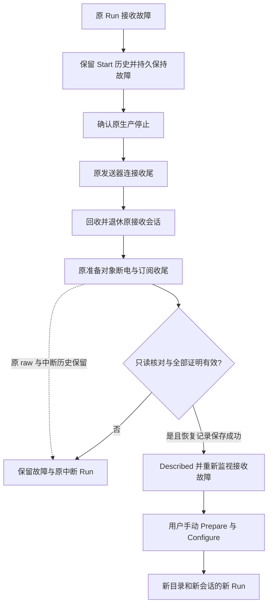

# 原采集故障清理后的只读核对恢复

更新：2026-10-14。本流程的后端、生产客户端与完整运行窗口恢复/手动新Prepare已通过本机测试；整套重构及现场验收尚未完成。Qt 仅发送控制请求、显示状态和保存 Run 元数据；raw 数据仍由独立原生接收进程处理。

## 为什么清理完还不能直接开始采集

Start 成功只说明当时启动完成。后续某个接收进程失败时，这个 Run 已经不完整。原成功 Start 记录必须保留，同时增加绑定原操作 ID 的持久故障保持记录。不能把 Start 的历史结果改成失败，也不能因断电完成就宣称整个系统已恢复。

`reconcile-acquisition` 用于同一个仍在运行的 ECC 服务，核对它保留的原对象和全部清理证据。完成后目标为 **Described**。用户还须明确重新 Prepare、Configure 和新 Run；原 Run 保持 Interrupted，原 raw 保留，不能补写成正常完成或自动推进编号。

## 操作顺序与各步作用

1. 接收故障发生后查看原操作 ID、节点、会话、PID 和错误。启用的接收故障策略只对原对象停止生产；确认该停止有完成证据。
2. 执行原失败采集连接收尾 `breakup-after-failure`，确认原发送器已停止并断开。
3. 执行 `abort-failed-receivers`，回收原接收进程。它不代表正常排空或封存。
4. 执行 `retire-failed-receivers`，确认原数据会话退休。原会话和退出状态仍作为证据保留。
5. 执行 `unprepare-acquisition-after-failure`，对原准备对象完成断电与自有订阅收尾。独立板卡的收尾结果必须分别确认。
6. 在操作台选择 **Verify original failed acquisition after cleanup...**，核对提示并确认。这一步发出新的只读核对请求，`failed_operation_id` 必须指向原失败采集操作。
7. 观察到该请求完成、目标为 Described 且无待核对标记后，手动重新 Prepare。为新 Run 使用新的未占用目录；保留旧 Run 的中断记录。

每次操作只提交一次。超时或应答丢失时按原操作 ID 查询结果；不要换 ID 重试可能已执行的硬件动作。取消确认框不应提交请求。服务重开后不能按本流程接管旧硬件或旧进程。

## 后端如何核对

界面只负责提交这些控制请求和显示结果。数据从发送器进入原生接收进程并写盘；此图中的恢复核对不经过 Qt 搬运或重新扫描 raw。新 Run 的数据仍使用原生链路。测试清理合成 raw 是测试工具的职责，与生产恢复流程中保留原始数据是两件不同的事。

协调器持有命令互斥锁，要求同一原操作、准备对象、采集对象、固定配置摘要和服务实例。原数据停止、连接收尾、Abort、退休、断电记录及各子审计必须完整且内容、身份与权限未变。新描述对象采用 UseExisting，仅观察现有硬件描述；同时重新观察生产停止、未就绪、供电关闭及原自有订阅关闭状态。

观察证据由实际写入者确认的审计链产生。清单最多 1 MiB；父 ECC 恢复证据最多 4096 字节。最后一次数据停止 RPC 前后均重新检查证明，防止核对过程中证据被替换。只有核对成功且恢复日志持久化成功，才提交 Described 并解除对应接收故障门槛。

网络层将接收故障策略复位信息放进同一条完成记录，再重新启用监视。独立告警、固定输入故障、内部存储故障及无关发送源故障不随本次恢复清除。Qt 持久存储只清除同一原操作、同一所有者及实例下的已确认清理门槛；额外未确认的清理失败保持禁止新操作，重开后也不放行。

## 如何判断成功与失败

成功应同时满足：恢复请求为 complete；控制状态为 Described；恢复操作 ID 匹配；无控制或数据待核对标记；接收故障监视恢复 watching。若操作台正在记录原 Run，还应保存恢复操作结果、hardware_recovery_complete=true 和 duration_incomplete=true，Run 仍标为 Interrupted，不生成正常完成 CSV。

缺少原证明、原操作不匹配、审计变化、数据尚未停止、独立故障未解决或持久化失败，都不能直接开始新采集。保留现有证据并查看失败操作结果。单纯把文件或数值恢复原样不能自动解除已锁存的故障。

## 同时存在其他故障时，为什么仍会拒绝

恢复命令只解除它实际核对的原采集故障，不能代替所有故障的处理。下表区分已验证路径：

| 当前情况 | 已验证的动作与结果 | 仍未完成的工作 |
| --- | --- | --- |
| 原接收故障，原清理证明齐全，无独立故障 | 只读核对成功后回Described，手动新Prepare；原Run仍中断 | 冷服务接管、现场与目标平台验收 |
| 接收故障之外又有硬件告警 | 两个策略各保存自己的停止操作；连接/数据退休/断电完成后，两次新ID的恢复请求仍明确失败 | 符合下节绑定条件时使用明确告警确认入口；普通已知Ready告警使用正常收尾入口；Prepare告警使用独立准备确认入口 |
| 原清理完成后还有独立输入故障 | 普通和插桩原生两编码均拒绝恢复，不重放硬件 | 输入故障修复后的专门持久核对流程 |
| ICE发送源已经UNKNOWN | 原源线程已停并确认，但未知发送器不允许连接收尾；恢复请求拒绝，无End/封存声明，保留原接收会话 | 原源的专门人工核对；尚未达到完整连接关闭/退休/断电阶段 |

硬件告警联调使用实际ECC服务、两个数据服务和原生TCP接收进程；告警发生在原接收故障已停生产之后。它不是把一个软件错误字符串当硬件告警，而是通过原告警订阅进入独立策略，保存另一份自动停止记录。最终数据状态可为Retired、供电已关闭，但父ECC仍UNKNOWN。操作结果中的failed及独立告警提示是这条路径的预期结果；不会生成恢复完成记录或重新启用接收监视。

ICE源联调使用实际受控源、源读出工作线程和ICE接收进程。异步源故障先由只读观察发现，再由明确停生产路径停止源线程，源状态仍UNKNOWN。随后测试显式保存父端接收故障门槛，验证它不能掩盖源故障；这不是另行注入了一次真实接收进程故障。测量时原接收进程仍保留，未回收/未封存/未确认End，因此该证据不能推广为“源故障在完整退休后的恢复已通过”。测试退出时回收自己的子进程和删除合成raw，只属于测试清理，不是产品已经完成Abort或正常封存。

独立核对工具 tests/check_independent_recovery_holds.py 检查原Start仍complete并另有held、没有reconciled，检查两次拒绝请求的实际字节/摘要/持久失败结果，以及告警组两份独立停止记录或源组UNKNOWN/无End证据。恢复菜单出现并不意味着上述任一独立门槛已经解除。

## 明确确认原告警后，核对同一次失败采集

`reconcile-acquisition-with-alarm` 是独立的确认入口。本轮已通过普通/插桩/包内及完整窗口的本机验证；它只处理**原接收故障已保持UNKNOWN，其后原告警策略也对同一原操作完成停生产**的情况。普通 `reconcile-acquisition` 仍拒绝独立告警，Describe/Prepare恢复也不能绕过它。

此入口不适用于仅有正常Stop后的已知告警、Prepare告警、未知ICE源、其他实例或冷重开的旧对象。它不证明告警的物理原因已修复；确认的是已断电、原连接/数据/订阅均已收尾的这一轮旧采集。新Prepare仍须重新监测硬件。

开始采集前，在操作台配置的getdaq段启用 `native_alarm_status: true`，以观察原告警记录；已有模板默认false，需要显式设置。GUI查看开关不会启用服务器自动策略。服务器固定配置须分别启用 `alarm_stop_policy` 和 `receiver_stop_policy`，两者都有enabled/poll_interval_ms；详细部署见[告警策略](ALARM_STOP_POLICY.md)。不要在正在运行的服务上直接改固定配置。

实际操作如下：

1. 在日志查看原接收故障操作ID与原告警停止ID，等待两个自动停止操作分别完成。新入口要求告警记录的原控制操作ID与当前UNKNOWN采集一致。
2. 按前文完成连接收尾、接收回收、会话退休和断电；每项都要有原对象的完整证明。
3. 选择 **Acknowledge original alarm and verify acquisition...**。默认取消；确认框要求先查看日志中的原告警停止ID，并说明旧Run保持中断、需要新Prepare。
4. 选择Yes后，worker从当前新鲜的同实例告警缓存取原停止ID，只提交一次新请求；缺少缓存、过期、错实例、错原操作、未完成停止都不提交。
5. 等待恢复完成到Described；原Run journal保存native_alarm_acknowledgement_operation及通用恢复结果，仍为Interrupted/duration_incomplete，不补CSV、编号或raw封存。
6. 状态与告警缓存刷新后，手动新Prepare。后续选择新的未占用Run目录继续Configure/Start；新的告警仍由重新启用的策略监视。

协议新增的两个字段必须一起绑定：

| 字段 | 必须指向 |
| --- | --- |
| failed_operation_id | 同一仍运行ECC保留的原UNKNOWN采集操作 |
| alarm_operation_id | 该采集已确认完成的原告警停生产操作；与原失败ID及本次新ID都不同 |

其余身份/配置/所有者字段沿用普通请求；只有本命令允许alarm_operation_id。旧命令的规范字段与末尾换行不变，不能给普通恢复额外塞一个告警ID来改变行为。

服务先核对原告警观察、原告警停止和原接收停止，再调用原协调器的只读描述/断电/清理证明核对。成功完成行一次保存receiver_policy_reset、alarm_policy_reset、两次原停止ID和alarm_observation_sha256；该摘要使用原持久观察的准确字节。只有这条记录保存成功，才解除对应的两种策略保持并重新监视。输入、存储、发送源及无关失败不随它解除。回复丢失时按原新请求ID观察，不能换ID重发确认。

客户端为成功恢复增加本地观察代数：恢复前已发出的状态、告警或接收故障GET，若回复在本次完成后才到达，就撤回并重新查询。这样既不会用旧UNKNOWN重新锁住刚恢复的状态，也不会让旧健康缓存代替新的状态核对。历史恢复结果查询不解除后来的新故障。

冷重开仅验证历史记录可解析，仍保持启动待核对，不重新启用旧对象。无原绑定操作时策略显示startup-reconciliation；保留原操作时显示reopened-held，不能把已锁存状态标成watching。本轮普通服务测试已包含原确认完成记录重放、拒绝冷确认和拒绝直接Start，最终缓存解码和拒绝接管已在普通/插桩/包内两编码复核。

## 完整窗口恢复后应看到什么

本机完整窗口验证从实际 MainWindow 和 RunControl 的 Running 状态开始。测试仅终止自己创建的接收进程以模拟故障，随后由生产故障策略停止原生产；窗口依次确认连接收尾、接收回收、会话退休、断电和只读恢复。每个确认框先取消，确认未提交请求，再选择 Yes，核对只提交一次。

恢复后原 Run 的 journal.json 应同时包含：

| 字段 | 含义与预期 |
| --- | --- |
| phase | 仍为 Interrupted，原 Run 没有正常完成 |
| native_acquisition_recovery_operation | 实际恢复请求及完成结果，failed_operation_id 指向原采集操作，结果为 Described |
| hardware_recovery_complete | true，仅表示这次绑定的硬件与清理证明核对完成 |
| duration_incomplete | true，中断前后的完整有效采集时间不能补造 |
| native_acquisition_unprepare_operation | 原断电完成的历史记录，其 UNKNOWN 结果仍保留，不因后续恢复而改写 |

不会生成原 Run 的正常完成 CSV，也不会自动增加 RunNumber。窗口重新允许手动 Prepare；该 Prepare 完成后控制状态为 Prepared，原已退休的接收会话、PID 和未封存标记仍保留，接收进程不会因此启动。接收启动属于之后的新 Configure/Run 流程。

**继续采集时，手动选择新 Run 编号或新的未占用目录。** 旧中断 Run 的目录保留作故障追溯；不能将恢复后的新数据接着写入旧目录来冒充同一次完整采集。只读恢复不自动选择新编号，不把原文件删除或补封存。

独立验证工具 tests/check_acquisition_recovery_window_evidence.py 会对比十份实际 GUI 请求文件、本地持久意图与终态，以及后端十一项操作；多出的一项是原接收故障策略自动停生产。它重新计算规范请求摘要，检查原 Start 的 intent/complete/held 历史、reconciled 和同一完成记录中的监视复位，并要求原 Run 仍中断。菜单信号次数或一个 passed 字段不能单独替代这些核对。

## 验证范围

本阶段使用合成板端和本机回环测试。原生协调器测试中的数据生命周期是明确的测试替身；跨服务测试才运行实际 ECC、两个数据管理服务和原生接收进程。编译通过不代表菜单交互通过；监视状态回到 watching 本身不等于第二轮新故障的自动停止已经验收。本阶段另有两编码测试，重新 Prepare/Configure/Start 后核对新会话/PID，再注入第二次接收故障，确认仅执行一次新的停生产；独立脚本核对了实际请求文件、摘要和持久历史。

后端阶段详细结果位于工作区 build-acquisition-recovery；完整窗口接续位于 build-acquisition-recovery-window，阶段检查点均明确保留goal_complete=false。普通/新代码插桩原生各四项、跨服务恢复及第二次故障两编码、包内Release两编码、客户端37项和界面89项通过。Windows六程序实际编译及匹配DLL、无SDK PATH、初始窗口检查通过；未进行新菜单人工操作验收。旧 70.42 运行包及检查点保留为该阶段历史证据；当前源码已有新变化，不能将旧来源摘要说成与当前全部源码匹配。完整窗口普通/新代码插桩/包内Release各两编码与独立持久核对已通过；独立输入故障普通/插桩两编码均拒绝恢复。Windows 新菜单交互、Ubuntu 24、macOS、现场板端与持续跨主机吞吐仍须独立验收。合成测试遵守所有流总量不超过 20 GiB，结束删除测试自有 raw；不删除生产数据。

本轮独立故障门槛的普通、新代码插桩及包内Release各两编码已通过，结果与清理记录位于 build-independent-recovery-holds，checkpoint.json保留goal_complete=false。告警组和源组的证明范围按上表区分；原receiver UNKNOWN后同一告警的明确确认由70.46接续，该阶段普通已知/Prepare告警及源故障的专用正向解除尚未完成；Prepare告警现由70.47的独立准备确认入口接续。

本轮明确告警确认的当前证据位于build-alarm-acquisition-recovery，详细分组及历史版本区别见[验证记录70.46](VALIDATION.md#7046-明确绑定原告警的失败采集只读恢复2026-10-14)。Linux23程序和Windows Qt5.14.2 MinGW六程序已实际构建打包，Windows初始窗口通过，人工新菜单/独立目标机与真机仍未验；阶段检查点不把整套目标标为完成。

相关步骤见 [断电收尾](FAILED_ACQUISITION_UNPREPARE.md)、[失败会话退休](ECC_FAILED_SESSION_RETIREMENT.md)、[网络服务](ECC_NETWORK_SERVICE.md) 和 [总体进度](REFACTOR_STATUS.md)。

Prepare阶段的原告警明确确认使用独立命令，见[准备告警恢复](PREPARATION_RECONCILIATION.md#9-prepare-告警策略已保持时的明确确认)；不使用本页的采集恢复命令。

父状态已知Ready时的普通告警使用[正常收尾入口](ALARM_STOP_POLICY.md#10-普通告警已经成功-stop-后怎样明确收尾)，不套用本页的UNKNOWN故障退休流程。
