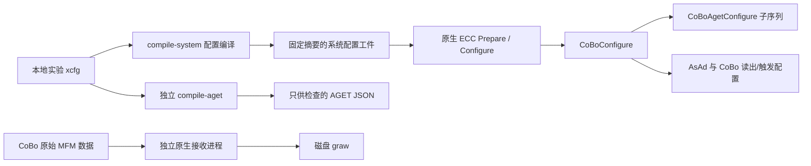

# AGET 实验参数编译：操作、寄存器原理与当前边界

## 1. 这一步解决什么问题

旧实验配置通常是 `.xcfg`。人看到的是“增益 1pC”“峰值时间 1014ns”“通道命中后才读”等参数；硬件真正接收的是寄存器中的一串位。新的计算核心负责把这些参数转换成可检查的寄存器值，避免在实际写硬件时才发现参数有问题。

目前实现了**单片及一个 CoBo 上全部活动 AGET/ASTRE 的寄存器计算**：每片 13 个配置寄存器、6 个 CoBo 读出掩码、来源与型号检查，以及全板共用偏移、深度和 2p 模式的检查。独立`compile-aget`/`compile-cobo-aget`输出的是供检查的参数工件，不是可执行硬件计划；`getdaq-hardware`不会直接读取这个独立JSON。

生产配置走完整系统工件路径：`getdaq-config compile-system`把 AGET、CoBo读出、AsAd、时钟、监控、校准和 MuTaNT 参数组合成系统JSON；原生 ECC 将其按固定实例和摘要绑定，再由 `SystemPreparationClient::Configure` 调用 `CoBoConfigure`。`CoBoConfigure`会执行本页第12节的 AGET 写入/读回子序列，并继续完成 AsAd、CoBo触发/读出等配置。`tests/system_experiment_integration.py`与`tests/hardware_system_preparation_test.cpp`覆盖系统工件编译、绑定和模拟硬件Prepare/Configure；具体回归证据见[验证记录第21、22节](VALIDATION.md)。 当前源码与Linux host候选内确切`getdaq-config`又于71.102完成系统工件到模拟原生Prepare/Configure的端到端复验，分别覆盖Ice 1.0/1.1；绑定程序SHA、审计回执和边界见[验证记录71.102](VALIDATION.md#71102-当前候选-aget-系统工件到原生-prepareconfigure-模拟联调2026-10-21)。这证明模拟硬件上的软件配置路径，不证明实际板卡加载、电气效果、同步和现场持续运行；这些仍需实机验收。

## 2. 控制与高速数据仍分开



`common/experiment/agetconfiguration.h/.cpp` 和 `coboagetconfiguration.h/.cpp` 只使用 C++11 标准库，没有 Qt、Ice、XML、YAML、socket 或文件访问。离线编译器和原生 `CoBoConfigure` 共用这层计算，避免审阅工件与实际配置计划使用不同的寄存器算法。

`common/config/agetcompiler.h/.cpp` 用 Qt Core 读取现有配置文档、定位继承来源、计算 SHA-256，并生成 JSON。这里的 Qt 用于离线配置处理，不承担原始事件接收。数据接收器没有增加依赖，数据也不经过编译器或 GUI。

## 3. 构建

在项目根目录运行：

```bash
# 构建 Qt 控制软件和离线编译器。
bash tools/build-linux.sh control

# 单独构建不依赖 Qt 的寄存器计算核心和测试。
bash tools/build-linux.sh experiment
(cd build-experiment && ctest --output-on-failure)
```

`all` 也会构建该核心，Ice 仍是单独选择的可选组件。新的计算核心不需要安装任何专用第三方库；离线工具复用当前 Qt Core。

Windows 可在 Qt Creator 中打开 `GetDAQ.pro`，使用 Qt 5.14.2 MinGW Kit 构建 `getdaq-config`。命令行参数与 Linux 相同，程序名变为 `getdaq-config.exe`，带空格的路径需加双引号。C++11 核心也可以独立通过 CMake 构建。目前实际验证仍是 Ubuntu 20.04.6/GCC 9.4/Qt 5.12.8；Windows、Ubuntu 24 和 macOS 尚未完成平台验收。

## 4. 编译一片 AGET

命令格式：

```text
getdaq-config compile-aget INPUT.xcfg COBO_INSTANCE ASAD_ID AGET_ID CHIP_VERSION OUTPUT.json
```

| 参数 | 含义与要求 |
| --- | --- |
| `INPUT.xcfg` | 本地实验参数文件；不是 `hardwareDescription_*.xcfg` |
| `COBO_INSTANCE` | `Node[CoBo]/Instance[...]` 的实例 ID；不一定是帧头中的数字 CoBo ID，也不是 Ice proxy |
| `ASAD_ID` | 0、1、2、3 中的一个，拒绝 `04` 等写法 |
| `AGET_ID` | 所选 AsAd 上的芯片编号 0、1、2、3；不是全板 0..15 编号 |
| `CHIP_VERSION` | 必须写成 `0x201`、`0x202` 或 `0x203`；0x203 表示 ASTRE |
| `OUTPUT.json` | 必须是从未存在的新文件；不覆盖已有文件 |

使用随项目提供的旧 pedestal 示例：

```bash
./build-suite/bin/getdaq-config compile-aget \
  source/get/GetBench-software-release-20210208/data/config/configure-pedestals.xcfg \
  0 0 0 0x202 /tmp/pedestal-aget0-new.json
```

使用另一份旧配置：

```bash
./build-suite/bin/getdaq-config compile-aget \
  source/get/GetBench-software-release-20210208/data/config/configure-ExternalTrigger-2CoBo_1Mutant.xcfg \
  Crate00_Slot00 0 0 0x202 /tmp/external-aget0-new.json
```

这两个命令是离线示例，`0x202` 是示例中选择的编译条件，**不是本软件读到的实机版本**。实际部署前，完整后端必须在正确选择芯片、满足慢控制前提后核对真实 reg5，不能用编译成功替代这个核对。当前工具没有进行该步骤。

可以直接打开 JSON，也可以用 Python 查看：

```bash
python3 -m json.tool /tmp/pedestal-aget0-new.json
```

退出码：0 表示离线编译及文件写出成功；1 表示配置/输出错误；2 表示命令行格式、编号或版本参数不合法。错误输出会指出相关配置路径或参数名。

## 5. 先看哪些输出

`kind` 固定为 `getdaq.aget-register-image`，`schema_version` 当前为 1。

| 字段 | 读法 |
| --- | --- |
| `scope` | 当前只覆盖单片芯片寄存器及读出掩码 |
| `hardware_deployment_supported` | 当前固定 false，表示没有部署入口 |
| `cobo_instance`、`asad_id`、`aget_id` | 确认自己选对了实例/板/芯片 |
| `chip_version_source` | 明确表示版本由调用者指定，尚未硬件核对 |
| `registers` | 13 个寄存器的名称、有效位数、十进制字符串及十六进制字符串 |
| `readout_masks` | 后缀 1_4、5_36、37_68 对应的 always/only_if_hit 掩码 |
| `register_stage_depth` | 旧 AGET 寄存器子步骤临时写给 readDepth 的值 |
| `module_readout_depth` | 旧 Configure 随后按 Module 写入的最终深度 |
| `parameters` | 每个参与计算的参数值、查询路径、实际声明文件/路径/行号，及代码缺省标记 |
| `sources` | 根文档和所有 include 文档的完整路径与原始字节 SHA-256 |
| `warnings` | 离线边界，以及两个深度不同时的覆盖提示 |

64 位寄存器值必须以字符串读取。JSON 数字经常被当成 double，超过 2^53 时不能表示每一个整数。例如 `18446744073709551615` 若被转换为 double，会失去精度。生成器为它输出十进制字符串，并另提供十六进制字符串方便人工核对。

pedestal 示例中，未修改默认参数时的部分检查值为：

| 寄存器/掩码 | 值 |
| --- | --- |
| reg1 | `0x283ac079` |
| reg2 | `0x28a187` |
| reg6、reg7 | `0xaaaaaaaaaaaaaaaa`，64 个普通通道增益为 1pC |
| reg8、reg8msb、reg9、reg9msb | `0xffffffffffffffff`，各通道个体阈值为 15 |
| reg3、reg4、reg10、reg11、reg12 | 0 |
| readIfHit 三段 | 15、4294967295、4294967295 |

这些数值是特定示例的参考，不能当成所有实验通用的寄存器配置。

## 6. 默认值、实例与 include

例如查询 `Setup[Conditions]/Node[CoBo]/Instance[0]/AsAd[0]/Aget[0]/Global/Reg1/peackingTime`，值可能来自 `Instance[*]/AsAd[*]/Aget[*]`。输出同时记录查询路径与实际声明路径，因而可以看出自己是否改中了正确来源。

`*` 是默认声明，不是一块真实板或一个真实通道。所选实例、AsAd、AGET 必须有可查到的具体声明并处于活动状态。0..67 的所有通道也必须具体声明，可以是 `<channel id="0"/>` 这种继承默认值的空对象。只有 `<channel id="*">` 不会被当成 68 个已声明通道。

include 导入被包含文档根对象的子内容。例如一个 `<Aget id="0" include="aget-defaults.xcfg"/>` 可导入包含 Control、Global、channel 的 Aget 根文档。根文件和被包含文件都会进入来源清单。

**当前 include 不支持将导入对象与本地同名对象任意合并。** 两处同时声明 `Global` 等同名同 ID 的兄弟对象会报冲突，不能用这种方式表达覆盖。普通的 `Instance[*]` 默认值与 `Instance[0]` 具体声明则按现有路径回溯规则处理。共享泛型路径的 `unit`/`range` 已按旧 CompoundConfig 语义投影、校验和展示；scalar 的具体值与 `type` 仍属于来源声明。硬件编译器拒绝旧 XML 解析器不接受的未知属性，编辑器仍保留其原文。复杂数据库/网络来源及未实现的旧扩展仍不属于完整 CompoundConfig 兼容范围。

只有旧解析器明确存在的四类缺省会使用代码默认值：`Module/readoutDepth` 缺失时为 512/256，`inputDynamicRange_5pct` 为 false，`triggerLvdsThreshold` 与 `multiplicityLevel` 为 1。输出逐项标记 `default_from_code=true`。其他参与计算的活动参数缺失即报错。

通道 `isActive=false` 时不参与测试选择、增益、阈值、抑制和读出掩码；其余通道参数不求值。其寄存器位按旧行为保留零值。零值并不自动等于“完全禁止硬件模拟通道工作”，例如抑制位零表示 none；这项语义沿用旧解析器，需由完整采集模式解释。

## 7. 寄存器和通道位序

旧 Configure 顺序为 reg1、reg2、reg3、reg4、reg6、reg7、reg8、reg8msb、reg9、reg9msb、reg10、reg11、reg12。reg5 是芯片版本，不在配置写入值中。顺序保存在工件中，但目前没有执行器消费该工件。

| 寄存器 | 有效位数 | 含义 |
| --- | --- | --- |
| reg1、reg2 | 32 | 芯片全局模拟/时序/触发参数 |
| reg3、reg4 | 34 | 各半边 34 个通道的测试选择，包含 FPN |
| reg6、reg7 | 64 | 各半边 32 个普通通道的 2 位增益 |
| reg8msb、reg8 | 64 + 64 | 前半普通通道的 4 位个体阈值 |
| reg9、reg9msb | 64 + 64 | 后半普通通道的 4 位个体阈值 |
| reg10、reg11 | 64 | 每个普通通道的 2 位触发抑制 |
| reg12 | 9 | SCA 读出指针偏移 |

软件通道编号是 0..67，FPN 编号为 11、22、45、56。去掉这四个编号后，普通通道按原顺序对应物理编号 0..63。FPN 有测试选择位和读出掩码位，没有普通通道的增益/个体阈值/触发抑制位。

reg3 中通道 0 对应 bit33、通道 33 对应 bit0；reg4 中通道 34 对应 bit0、通道 67 对应 bit33。

reg6 中物理通道 0 位于最高 2 位，物理通道 31 位于最低 2 位；reg7 中物理通道 32 位于最低 2 位，物理通道 63 位于最高 2 位。个体阈值也遵循这种两半相反的方向：前半的四位组从高位往低位排，后半从低位往高位排。不能直接对 0..67 的软件编号统一乘 2 或乘 4，否则会错位或对 FPN 写出不存在的字段。

| 参数 | 编码 |
| --- | --- |
| Gain | 120fC→0，240fC→1，1pC→2，10pC→3 |
| LSBThresholdValue | 必须 0..15，不再用 `& 0xF` 截断错误输入 |
| TriggerInhibition | none→0，inhibit_channel→1，inhibit_trigger→2；保留旧别名 inhibit_trigger_function/data |
| Reading | never 不置位；always 置 readAlways；only_if_hit 置 readIfHit |

读出掩码分为软件通道 0..3、4..35、36..67 三组，每组最末通道对应 bit0；FPN 也包括在内。always/only_if_hit 掩码是否实际影响读出，还取决于完整 Configure 中的全通道读出和 hit 寄存器模式；独立 AGET 工件编译器不单独推断这些最终模式，系统工件编译器会连同 CoBo Module 参数一起校验和组合。

## 7.1 旧 ECC AGET 即时命令如何迁移

旧命令不是直接硬件写入的 GUI 等价物。下表说明如何在 `.xcfg` 表达相同的目标设置，再通过完整系统工件和 Configure 应用。这样保留同一套审阅、来源摘要、型号校验及状态门槛。

| 旧命令 | 旧寄存器行为（源自 GetBench 2021） | 在配置中的表达 | 等价范围与限制 |
| --- | --- | --- | --- |
| `aget-readout-channel-select n` | 对每片活动 AGET 清空三段 `readIfHitMask`，并令通道 n 成为唯一 `readAlways`；n≥68 时 always 掩码也清零 | 对所选 CoBo 的每片活动 AGET，将通道 n 的 `Reading` 设为 `always`，其余 67 个通道设为 `never`；清空所有 `only_if_hit` | n=0..67 时，只有所选通道 `isActive=true` 才能由当前编译器生成该位；通道 68 对应全部 `never`。旧即时命令本身不检查单个通道的 `isActive`。完整 Configure 还会应用 Module 级读出模式，因此这是目标掩码映射，不是立即生效时序的一对一替换。 |
| `aget-test-channel-select n` | 写 reg3/reg4 为通道 n 的 one-hot 测试位；n≥68 时二者清零 | 所选 CoBo 的每片活动 AGET 中，仅将通道 n 的 `isSelectedforTestMode` 设为 true，其余通道设为 false | n=0..67 时要求该通道 `isActive=true`；当前配置编译器对非活动通道强制不输出测试位，旧即时命令没有该通道级过滤。n=68 表示清除所有测试选择。 |
| `aget-channel-lsb-treshold-set n T` | n<68 时读出相应阈值寄存器、改一个 4-bit 字段并写回；FPN 不对应普通阈值字段；n≥68 时将 reg8、reg8msb、reg9、reg9msb 的全部字段设为 T | 单通道：设置每片活动 AGET 中通道 n 的 `LSBThresholdValue=T`；全通道：将所有普通物理通道阈值设为 T | T 的有效范围为 0..15。FPN 11、22、45、56 没有阈值字段，单通道操作无实际字段可改；全通道映射覆盖所有普通通道。旧解析器对缺失/非法文本有不可靠默认行为，新配置应显式写合法值。 |

迁移操作步骤：在 Qt 配置编辑器打开实验 `.xcfg` 工作区，编辑对应 CoBo/AsAd/AGET 通道值并检查变更；使用已审阅的硬件兼容 profile 执行 `getdaq-config compile-system`，再按[系统实验配置流程](SYSTEM_EXPERIMENT_CONFIGURATION.md)检查、绑定并由原生 ECC 执行 Prepare/Configure。配置窗口只编辑本地参数，不直接发 Ice/RPC 或寄存器写入。若只想快速切换即时调试通道，这套配置化流程目前不提供等价的无持久化快捷命令；不要把独立 `compile-aget` 的检查 JSON 当成可部署计划。

语义依据为旧 `GetEccCmd.cpp` 的命令参数、`GetEccImpl.cpp` 的通道/阈值说明、`BackEnd.cpp` 的当前 CoBo 路由，以及 `CoBoNode.cpp` 的慢控制写入和掩码实现。它们证明的是旧软件映射，不证明目标板固件、电气效果或现场使用方式；相关板端效果仍需实机验收。

## 8. reg1/reg2 的全局字段

这里的 bit 编号从 0 开始，位宽大于 1 时低位在左。

| reg1 位 | 参数 | 编码/限制 |
| --- | --- | --- |
| 0 | isIcsax2 | true→1 |
| 1..2 | TestModeRange | 120fF/240fF/1pF/10pF→0/1/2/3；接受文档化的旧 fC/pC 别名和一个空格，不接受任意后缀 |
| 3..6 | peackingTime | 按对应芯片的 16 档表查索引 |
| 7..8 | TestModeSelection | nothing/calibration/test/functionality→0/1/2/3 |
| 9 | IntegrationMode | variable→0，fixed_500ns→1 |
| 10..11 | SCA_Pointer | column_0/col_0or256/col_0or128or256or384/anySCAPointer→0/1/2/3 |
| 12..16 | SCA_Splitting、is32channels、isAllChannelRead、isFPNRead、isPositivePolarity | 各一位 |
| 17..18 | Vicm | 1.25V/1.35V/1.55V/1.65V→0/1/2/3 |
| 19..21 | GlobalThresholdValue | 0..7 |
| 22 | isThresholdSignedPositive | true→1 |
| 23..24 | TriggerVetoOption | none/4us/HitRegisterWidth/undefined→0/1/2/3 |
| 25..27 | isckwriteSynchro、isTOTActive、isTriggerWidth200ns | 各一位 |
| 28..29 | TriggerWidthRange | width0..width3→0..3 |
| 30..31 | ExternalLink | none/SKFilterInput/Gain-2Input/CSAStandby→0/1/2/3 |

| reg2 位 | 参数 | 编码/限制 |
| --- | --- | --- |
| 0..2 | DebugSelection | standby/CSA/CR/Gain-2/PositiveInputDiscri/NegativeInputDiscri/trigger/none→0..7 |
| 3..11 | isReadFromColumn0 至 isSCoutputBufferInTriState | 按源码声明顺序，各一位 |
| 12..13 | currentBias | current0..current3→0..3 |
| 14..15 | bufferCurrent | 1.503mA/1.914mA/2.7mA/4.870mA→0..3 |
| 16..22 | isPWDonWrite 至 islvdsTriggerOutput | 按源码声明顺序，各一位 |
| 24 | inputDynamicRange_5pct | true→1；0x201 不允许设置为 true |
| 25..26 | triggerLvdsThreshold | 1/2/4/8→0/1/2/3；非缺省值只允许 ASTRE |
| 27..28 | multiplicityLevel | 1/2/4/8→0/1/2/3；非缺省值只允许 ASTRE |

保留拼写 `peackingTime`、`isckwriteSynchro` 等，是为了兼容已有文件。旧模板列出大写 `Undefined`，旧解析器却只识别小写 `undefined`，其他输入会默默写 0。新核心拒绝大写值，要求修正配置和其显式 range 后再编译，避免自动改变实验含义。

## 9. 型号、峰值时间及读出深度

AGET（0x201/0x202）峰值时间，单位 ns：

```text
70, 117, 232, 280, 334, 383, 502, 541, 568, 632, 721, 760, 831, 870, 976, 1014
```

ASTRE（0x203）峰值时间，单位 ns：

```text
68, 116, 180, 225, 343, 442, 541, 641, 739, 836, 943, 1039, 2034, 3985, 5770, 7700
```

即使某个值属于另一个型号的合法表，也不能用于当前型号。旧软件遇到非法值会退回某一档，新编译器明确拒绝。`peackingTime` 的显式 unit 必须为 ns，不能把 1us 当成 1ns；当前不自动做单位换算。

普通模式 SCA 容量为 512，2p 模式每半块容量为 256。Module.enableMem2pMode 必须与 reg1.SCA_Splitting 相同；偏移必须小于容量；最终读出深度必须为正且满足：

```text
ReadoutPointerOffset + Module.readoutDepth <= 当前 SCA 容量
```

例如普通模式 offset=12、depth=500 可编译；offset=12、depth=512 被拒绝。2p 模式 offset=255、depth=1 可编译，offset=256 无法编译。

旧 AGET 子步骤先按 `容量-offset` 写 readDepth，随后整个 CoBo Configure 又按 Module.readoutDepth 写一次。新工具分别输出这两个值，不把临时值误当最终值；不同时增加提示。整板编译器现在要求全部活动芯片的偏移、最终深度及 2p 模式相同；原生子序列最后写入并核对共用 readOffset 和最终 readDepth，避免只取第一片芯片的偏移而忽略其他芯片。

## 10. 输出与来源保护

所有配置文件保持原字节不变。输出使用 NewOnly，只创建新文件，成功后 flush；失败不会覆盖已有工件。它不是一次具备 fsync 和掉电保证的部署事务，也没有绑定 ECC 操作 ID。异常退出可能留下不完整的新输出，不能将“文件存在”作为成功证明。

来源 SHA-256 是加载时读到的字节摘要，不是对真实硬件配置的签名。JSON 不内嵌原始文件内容；需要保留或归档原文件及 include 文件。当前也未实现全套配置的不可变发布、实际写入版本绑定或完整后端自动消费。

## 11. 测试及后续接入

纯 C++11 测试覆盖 68 通道逐个映射、FPN、两半位序、最高 64 位值、13 寄存器顺序、AGET/ASTRE 的全部 16 档表、全局字段及非法值。Qt 测试使用两份提供的原始实验配置，验证默认值来源、include 和新文件输出。CLI 跨进程测试另验证显式覆盖、版本错误、非活动选择、阈值越界、单位/type/range/class 拒绝及失败时不生成工件。

```bash
python3 tests/aget_compiler_integration.py build-suite/bin/getdaq-config
```

实际记录见 [VALIDATION.md](VALIDATION.md)。第 12 节的写入/读回子序列另使用真实本机 Ice TCP 模拟对象验证，但没有连接真板，不能代替实机串行校准、寄存器验收或高速采集测试。下一步需要接到完整 ECC 后端，并在第一个硬件写入之前完成完整实验配置、元数据、状态及控制权预检查。

映射依据保存在 `source/get/GetBench-software-release-20210208/src/get/rc/CoBoConfigParser.cpp` 和 `CoBoNode.cpp`，不是按 GUI 显示名猜测。迁移计算代码保留 CEA GET 的来源声明，原始 CeCILL 许可另保存在 `third_party/licenses/getbench/COPYING`；不将它重新标为 attpc_envoy 的 MIT 许可。

## 12. 整板 AGET 编译和原生写入子序列

### 12.1 编译一个 CoBo 的全部活动芯片

命令格式：

```text
getdaq-config compile-cobo-aget INPUT.xcfg COBO_INSTANCE VERSIONS OUTPUT.json
```

例如原始 pedestal 配置启用了 AsAd 0 上的四片 AGET：

```bash
./build-suite/bin/getdaq-config compile-cobo-aget \
  source/get/GetBench-software-release-20210208/data/config/configure-pedestals.xcfg \
  0 '0=0x202,1=0x202,2=0x202,3=0x202' /tmp/cobo0-aget-new.json
```

Windows 命令行请将版本列表放在双引号中，并将 `/tmp/...` 换成自己的输出路径。

全板芯片编号为 `4 * AsAd编号 + AsAd上的AGET编号`，范围 0..15。例如 AsAd 1 的 AGET 3 是编号 7，AsAd 3 的 AGET 3 是编号 15。版本列表必须恰好覆盖配置中的全部活动芯片：少一片、多一片、重复编号、`00` 等非规范编号、未来型号或超范围编号均拒绝。混用 0x201/0x202/0x203 可以，但每片参数必须满足其型号；这些版本仍是调用者指定的编译条件，不能当作实机 reg5 结果。

Qt 文档层要求所选 CoBo 有四个具体 AsAd 声明，每个活动 AsAd 有四个具体 AGET 声明；不活动的参数树不求值。活动 AsAd 即使没有活动芯片也保留在 AsAd mask 中，版本表不应给它增加不活动芯片。整板完全没有活动芯片时拒绝编译。纯 C++11 API 则由调用者提供全部活动芯片列表；它没有文档或网络访问能力，不能自动发现调用者遗漏的实机。

编译先逐片生成 13 个寄存器和通道掩码，再检查全板约束。所有活动芯片必须共用 `Module.enableMem2pMode`、`ReadoutPointerOffset` 和最终 `Module.readoutDepth`。冲突时说明对应路径或共享约束，返回非零退出码，不写出 JSON。例如 depth=500 时，某片 offset=12、其他片 offset=0 各自都合法，但全板共用 readOffset 无法同时表示它们，因此整板拒绝。

### 12.2 如何看整板输出

工件 `kind` 为 `getdaq.cobo-aget-register-image`，`schema_version=1`，`hardware_deployment_supported=false`。`asad_mask` 是活动 AsAd 的四位掩码；`aget_mask` 是活动芯片的十六位掩码；`chips` 按全板编号升序排列，各项包含单片的寄存器、掩码和参数来源。根级 `sources` 汇总加载时的文件摘要，不重复内嵌原文。

`two_pulse_mode`、`readout_offset` 和 `readout_depth` 是已经完成一致性检查的共用结果。`fpn_read` 是所有活动芯片 reg1.isFPNRead 的逻辑或，沿用旧 CoBo 行为：任一活动芯片要求读 FPN，就打开共用 pipeCtrl.isFPNRead。`selection_parameters` 记录决定活动范围的参数及来源。

输出仍采用新文件保护及第 10 节的 flush 边界。它没有部署签名、ECC 操作 ID 或自动执行能力；不能把 JSON 当成硬件描述传给 `getdaq-hardware create`。

### 12.3 原生库实际执行什么

`CoBoAgetConfigure(const CoBoAgetSettings&)` 位于 `apps/hardware/coboagetconfigure.cpp`。它调用同一个纯 C++11 整板编译器，返回供 `HardwareClient::Execute` 执行的有序计划，不依赖 Qt。独立 AGET JSON 没有直接部署入口；生产路径由系统JSON解码后的类型化设置调用`CoBoConfigure`，再组合这个子序列和AsAd/CoBo其他配置。可执行调用链见`apps/hardware/coboconfigure.cpp`、`apps/hardware/systempreparation.cpp`及`apps/ecc/native/nativeecccoordinator.cpp`。

生产链要求绑定硬件描述、同一成功Prepare对象及其配置摘要，并检查停采、配置兼容和互锁；配置器仍不能从软件中证明物理控制器独占、板卡固件状态或电气效果。若单独调用`CoBoAgetConfigure`计划执行，它本身不提供完整系统生命周期或独占控制权保障；不能绕开原生ECC流程直接部署独立JSON。子序列开头读取`pipeCtrl.firmwareEnable=0`、`intEnable=0`也不能单独证明完整硬件前提成立。

执行顺序如下：

1. 在本机计算全部芯片，并由 Execute 校验整份计划的目标、位宽和本地访问权限。任何晚位置的目标缺失也会在首个硬件操作前拒绝。
2. 明确读取并检查上述两个停止位，然后按旧慢控制切换顺序设置 AGET 控制器、活动掩码和脉冲模式，等待 1000 ms，再恢复 SC_En、清除 pulseEnable。
3. 逐片选择读取芯片，检查全部活动芯片 reg5 低 16 位。所有型号检查均发生在第一次 AGET 配置寄存器写入之前；此时第 2 步的控制位写入可能已经发生。
4. 按编号升序配置每片芯片。每次只开启该片 SC_En，写一个 AGET 寄存器，再明确选择该片并读回核对，覆盖全部 13 个配置寄存器。reg12 后保留旧流程的临时 readDepth 写入。
5. 为该片分别选择读出掩码银行，写入并核对三段 readIfHit 和三段 readAlways 掩码。
6. 恢复全板 AsAd select 和 AGET SC_En，并核对两者及 pulseEnable=0。
7. 写入并读回共用 FPN、2p、最终 readDepth 和 readOffset。

本节逐项说明的是 CoBo Configure 中的 AGET/读出掩码子序列；它本身不包含后续 AsAd TCM、inspection、触发、零抑制及其他 CoBo 配置步骤，也不能单独代表完整 Configure。完整系统调用者`CoBoConfigure`会把这些后续步骤与本子序列组合成一个预先校验的有序计划；实际硬件效果仍未实机验收。

### 12.4 reg2 的历史读回差异

默认所有寄存器严格读回匹配。历史实现曾容忍 reg2 的 bank reset 位 bit21 读回差异；新库只在调用者显式设置 `allowReg2BankResetDifference=true` 时容忍这一位，掩码为 `0x200000`。其他位仍严格比较，bit21 加其他位同时不符也会停止。

审计 intent 明确记录 `allowed_difference`。仅发生被允许差异时，该步记为 `matched_with_warning`，同时保存实际值与 XOR 差异，不能伪装成完全一致的 `matched`。硬件执行器还要求允许差异只能用于 Expect 步骤，且在比较掩码和实际目标位宽内；不合法策略在任何操作前拒绝。这个选项应由有依据的固件兼容策略决定，不能用来忽略未知写入错误。

### 12.5 失败后的处理与验证范围

元数据预检查失败不会执行寄存器操作；版本不符不会写 AGET 配置寄存器，但慢控制切换可能已发生。寄存器/掩码读回不符、版本读取异常或远端写入异常会立即停止后续步骤。若远端已经应用写入后断线，结果是 unknown；不自动重发、不回滚，也不在错误后自动恢复选择范围。恢复本身也是硬件动作，必须由完整后端核对实际状态后处理。

本机真实 Ice TCP 测试覆盖编码 1.0/1.1、稀疏的芯片 0/7/15、AGET/ASTRE 混用、64 位高位、完整选择/掩码恢复、全部版本先检查、默认严格/显式 bit21 警告、其他位不符、写入生效后响应丢失且只写一次，以及计划预检查失败时零操作。另有 16 片全启用的纯计算测试。这些是协议和软件行为验证，尚无实机电气、校准效果或持续跑数结论；成功完成这个子序列也不应直接把 ECC 标成 Ready。

后续已增加 [CoBo 读出配置](COBO_READOUT_CONFIGURATION.md)：对本文的 AGET 部分再组合 full/partial、位置 multiplicity、触发、零抑制及循环缓冲区，提供 `compile-cobo-readout` 和原生库子序列。AGET 专用命令仍只负责本文范围，不会自动变成完整 Configure。
