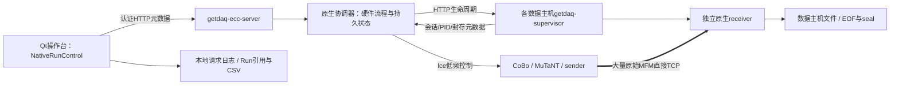
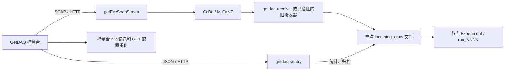
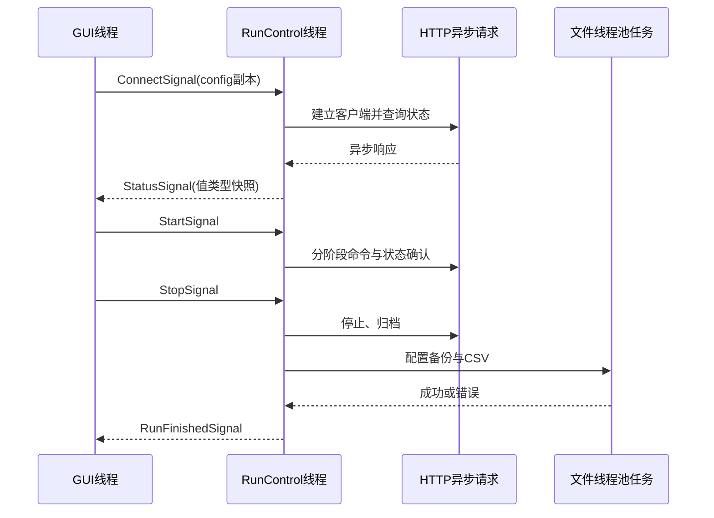

# 软件架构与开发说明

配置来源的[共享读、独占写协议](CONFIGURATION_SOURCE_TRANSACTIONS.md)位于已有Qt Core配置层：多个后台读取可以并行，Save All与明确恢复独占同用户/同环境/同缓存域；普通Load还核对来源旁未完成记录。它解决合作工具读到中间组合的问题，不进入receiver热路径，也不提供跨主机或外部编辑器强制互斥。

主机端 Configure 可捕获 [寄存器读回证据](CONFIGURE_READBACK_EVIDENCE.md)：审计器在成功持久化后更新摘要链，HardwareClient保留成功执行摘要，系统协调器据此核对完成记录并缓存覆盖计数。认证GET仅取缓存与父状态，原生离线检查只读历史控制日志；原始MFM不进入该层，不将历史匹配提升为当前全量加载或物理证明。

ECC 可启用 [同机板卡占用保护](HOST_CONTROL_OWNERSHIP.md)：在创建审计根与硬件调用前取得共用目录下的按 IPv4 地址锁，生命周期覆盖所有硬件客户端，命令前核对身份与内容；HTTP 只返回缓存。该层仅协调同机新 ECC，板端全局/跨主机控制权和实际加载版本仍不能由文件锁证明，原始数据通路不参与此机制。

[选定CoBo维护](COBO_MAINTENANCE.md)沿用这条控制路径：窗口读取固定活动目标和实例身份，工作线程保存原请求后经HTTP提交，ECC串行调度NativeEccCoordinator，SystemPreparationClient只重新准备目标板。旧普通命令1—9和恢复记录10保留，维护使用11。该操作需要健康Prepared和数据停止，成功仍Prepared；它不创建诊断raw接收器、不经Qt转发事件，也不自动Configure或Start。HTTP/Qt入口已完成本机普通及新控制代码插桩的两编码组合验证；维护功能从70.59的`cobo-maintenance-candidate`起提供，后续包继续包含，旧70.57包不含此功能。

旧/新状态机范围以及native GUI的单板快捷入口见[ECC状态归属说明](ECC_STATE_OWNERSHIP.md)。native逐行数据显示系统状态，不代表每板独立状态。

[部分交接显式补齐](PARTIAL_HANDOFF_COMPLETION.md)是另一类元数据动作：保留原失败父请求及原节点请求，RemoteReceiverManager对已受理节点只GET，对明确未受理且原实例/周期仍匹配的节点才允许本次明确补交；成功生成完整回执，但旧控制者继续保持禁用。NativeEccCoordinator单独核对原生控制日志和不可变输入，避免把数据交接本身的保持误当成硬件UNKNOWN，也不会忽略独立硬件/输入/存储故障。入口包括ECC HTTP、主机原生CLI与Qt计划切换窗口。Qt在原退休POST前将正常封存状态、SHA-256与原请求键持久关联；补齐使用独立ID且只引用原失败父请求，断线后只GET保存的补齐ID。回执的周期按原前状态核对，同时保留当前实时已知停止/冻结边界，不用旧证据覆盖新的硬件UNKNOWN；不从部分退休后的节点状态补造正常周期；缺原状态的旧记录不支持该GUI补齐。冷数据实例已有独立[恢复服务和窗口](COLD_DATA_HANDOFF_WINDOW.md)，任意硬件冷恢复和已受理后失败子操作的恢复仍待。

## 1. 范围和交付状态

用户要求最终重构整套 DAQ 软件。当前已有 C++ 控制台、C++ sentry、独立 HTTP 联调模拟器、无 Qt 原生接收/导出服务和离线帧检查工具。Paused/Transition 区分、无 MuTaNT 模式、独立数据/代理主机已实现；原生ECC后端和CompoundConfig主要编辑功能已接入本机组合流程。[配置文件路径迁移](CONFIGURATION_PATH_MIGRATION.md)复用已有配置层，增加新旧路径存在状态和独立明确恢复；普通加载不能启用迁移器的私有内存候选模式。任意外部读者可见的跨文件持久原子事务、完整冷恢复和现场验收仍未完成。来源审阅见 [SOURCE_REVIEW_AND_PLAN.md](SOURCE_REVIEW_AND_PLAN.md)，实际验收见 [VALIDATION.md](VALIDATION.md)。

| 组件 | 当前职责 | 状态 |
| --- | --- | --- |
| GetDAQ | 实验参数、运行控制、监控、配置备份 | 已实现 |
| getdaq-sentry | 监控节点进程/磁盘/.graw 文件；按 Run 归档 | 已实现 |
| getdaq-simulator | 提供 ECC SOAP 服务和新 sentry，生成测试文件 | 已实现；仅联调 |
| getEccServer / getEccSoapServer | 历史Ice / SOAP接口 | 源码保留；新原生协调器与固定HTTP入口已有本机联调，GUI可明确选择原生模式，完整现场替换尚未验收 |
| getdaq-receiver | 原始 MFM TCP 接收、分源存储/可选导出 | 已实现第一版并通过合成帧测试；不等于全部旧模式兼容 |
| getdaq-inspect | 流式核对 `.graw` 帧结构/来源，或只读汇总指定CoBo/AsAd/AGET的type-1头hit位 | 纯C++11离线程序；hit位计数不等于阈值物理分析，不参与接收 |
| getdaq-merge | 已封存CoBo/RIBF MFM按事件号生成0xFF01分层帧 | 原生离线工具；不经过Qt，不承担实时传输 |
| getdaq-fits / getdaq-root / getdaq-root-viewer | 已封存 `.graw` 离线转换为旧分析链FITS表/ROOT对象树，并可浏览ROOT事件 | 分别需显式CFITSIO/ROOT 6及可选Qt Widgets；默认不构建，不进入DAQ接收和控制路径；ROOT树保留有限旧类/分支结构 |
| getdaq-matrix | 完整CoBo type 1波形帧转旧CoBoFrameViewer `.gmat` binary64矩阵 | 原生离线工具；严格校验四个AGET的512个bucket；不经过Qt，不承担实时传输 |
| getdaq-waveform-viewer | 离线查看 `.graw` / `.gmat` 单通道波形 | Qt Widgets只负责本地浏览；raw帧索引/解码不连接网络，也不进入接收路径 |
| getdaq-config | 离线编译硬件描述、AGET/CoBo读出、AsAd Configure、时钟、上电监控、校准及MuTaNT参数/来源；PeakingTime扫描计划展开 | Qt Core，无网络连接；`compile-system`组合整系统工件；扫描命令生成带摘要的完整离线配置点。Envoy已有单点Native ECC身份/生命周期、事件数Stop、receiver封存/catalog和Run归档闭环；该CLI仍不向运行中的ECC热加载点工件，多点部署切换/自动继续需现场安全流程支持 |
| getdaq-experiment-core | AGET/CoBo读出、AsAd配置、Prepare基础/输入、PLL/LCM时钟、监控/校准和MuTaNT参数计算 | 纯C++11；原生硬件库复用，无Qt/Ice/YAML，含整系统参数检查、严格JSON编码/读取及配置摘要；控制命令在隔离原生硬件库执行 |
| getdaq-hardware | 无Qt的设备发现、寄存器/管理器访问、顺序日志及自有主机告警观察 | 硬件层已由原生ECC调用，GUI提供绑定的只读硬件/读回证据；完整现场互通待验，观察不发硬件Stop |
| getdaq-align | 原生CoBo/MuTaNT拓扑、槽位定位、机箱内及机箱间对齐协调 | 无Qt；全节点预检查/独占停止声明、保存掩码和故障日志，本机TCP/独立旧函数对照通过；物理相位、完整Prepare和GUI接入待验 |
| getdaq-system-config | 完整实验工件检查、按ID/活动/角色与拓扑绑定 | 无Qt；不连接硬件/建立回调，不提交ECC状态；详见[配置手册](SYSTEM_EXPERIMENT_CONFIGURATION.md) |
| getdaq-system-describe / SystemDescriptionClient | 全系统描述核对、创建/明确替换及CoBo未就绪状态 | 无Qt；全节点预检查、旧/新完整策略、一次动作日志和未知不重发；只有CLI/库，不提交生产ECC，详见[描述手册](SYSTEM_DESCRIPTION.md) |
| getdaq-ecc-core | C++11 状态转换、并发拒绝、unknown 约束、可选持久化接口 | 已接原生组合后端并提供限定原对象恢复；任意冷硬件恢复与真机效果仍待验收 |
| getdaq-ecc-journal | 持久化操作 ID、历史查询与启动核对约束；同名命令行只读查看 | POSIX、复用本地 yaml-cpp；不连接硬件，没有网络服务 |
| getdaq-supervisor-protocol | 固定数据计划、控制请求、状态及观察结果的严格编解码 | 纯C++11 target，与文件/进程/网络I/O分离；作为数据receiver服务和查询客户端共用的协议层 |
| getdaq-data-supervisor-core | 同主机独立receiver的启动、身份/就绪、EOF/退出/封存，持久控制操作 | 原生C++11/POSIX，不链接Qt/Ice/yaml；链接共享协议target，重开保持核对要求，完整恢复待接 |
| getdaq-supervisor / getdaq-supervisor-query | 数据主机固定计划的远程低频管理 / 原生客户端 | 服务使用Qt Core/Network/Concurrent，客户端无Qt；不接原始帧，详见[远程手册](REMOTE_RECEIVER_CONTROL.md) |
| getdaq-ecc-server / EccControlJobs | 固定部署的整系统ECC网络入口 / 原生后台命令 | Qt只提供低频HTTP；长期原生对象执行九命令与数据节点协调，身份/操作ID/审计绑定，重启不重放；GUI原生模式已接，硬件UNKNOWN恢复尚未完成，见[网络手册](ECC_NETWORK_SERVICE.md) |
| getdaq-control-mcp | 本机 stdio MCP 适配器，让支持 MCP 的 AI host 发现 ECC 状态工具并可选提交有限生命周期命令 | Qt Core/Network 只承载低频 JSON；默认只读，显式配置才显示控制工具；复用 ECC 的 Bearer HTTP、服务端状态机、实例/快照绑定和操作 ID，不接 receiver/raw 数据。配置和确认边界见[MCP手册](ECC_CONTROL_MCP.md) |
| getdaq-control-protocol / EccSystemClient | 可复用纯协议 / Qt整系统客户端 | 协议无Qt/Ice/POSIX，Qt客户端无硬件SDK；固定范围/属主/新鲜状态、发送前意图、原ID观察和未知门槛。主窗口native_ecc分支已接，见[GUI手册](ECC_GUI_CLIENT.md) |
| NativeRunControl / EccClientStore | 全系统GUI流程、本地Run关系与持久请求 | Qt只处理元数据；一次全局命令、Stop→Breakup→全部receiver退出/封存后完成Run，重启只观察/核对相同实例会话，不解除硬件UNKNOWN；原始文件留在数据主机 |
| ReceiverCatalog / getdaq-catalog | 数据主机按实验/Run建立硬链接归档，保存请求/清单/完成凭据；独立CLI支持同机和跨主机归档复制 | 原生C++11/POSIX无Qt/Ice/yaml/curl，保留原会话目录；远程数据服务和ECC/GUI只传元数据。同机复制与跨主机SSH兼容路径、普通TCP路径均支持明确续传/完整校验/不覆盖发布；TCP不做身份认证或加密，SHA-256用于内容校验，必须由可信网络与防火墙限制访问，实机双主机、防火墙、目标卷及断电验收仍待。见[本机归档](DATA_RUN_CATALOG.md)及[跨主机归档手册](CATALOG_TRANSFER.md#13-普通-tcpip-发送已完成归档) |
| RemoteReceiverManager | 原生ECC的多节点数据生命周期 | 无Qt/curl；全部计划/发送目标、父范围/持有期/意图、节点PID/会话和UNKNOWN已组合，已接固定HTTP和GUI；硬件UNKNOWN/服务重启核对仍待接，见[远程ECC手册](REMOTE_ECC_DATA_LIFECYCLE.md) |
| ReceiverProcessManager / getdaq-ecc-native | 原生ECC九命令及真实接收流程组合、持久操作与接收计划绑定 | 低频控制，不接原始帧；网络/GUI入口已接，真实控制权/加载版本和硬件UNKNOWN恢复待接；见[详细手册](RECEIVER_PROCESS_MANAGEMENT.md) |
| getdaq-ice-check | 独立的 Ice ping / GET 状态读取 | 本地兼容构建和 TCP 测试通过；无硬件写入功能 |

数据服务`/v1/receivers`通过原生try-lock/waitid WNOHANG|WNOWAIT观察当前自有子进程，原生CLI严格核对身份/计划/实例和退出信息。不回收、不发信号、不改变持久状态或读取载荷；ECC的同名端点通过有界原生HTTP在Qt后台聚合，GUI可选定时显示并检查本地时效/会话，缓存计数保持原语义。见[进程观察](RECEIVER_PROCESS_OBSERVATION.md)和[GUI观察](RECEIVER_GUI_OBSERVATION.md)。

## 2. 部署关系

原生全系统模式：



采集实时原始数据的路径只有sender→receiver→磁盘；Qt操作台、ECC网络前端及数据节点控制HTTP都不接收热路径数据。数据主机同文件系统硬链接Run归档已接入；已完成归档可由独立getdaq-catalog经SSH兼容路径或普通TCP/IP复制到另一主机，supervisor只接受固定策略元数据并观察子进程。TCP不做认证或加密，但归档流使用SHA-256校验；实现及本机回环已验证，真实双机网络/目标卷验收尚未完成。GUI恢复只重建原Run记录关系；复制任务冷启动恢复、硬件UNKNOWN核对与物理多主机硬件操作仍未完成。Prepare失败的明确生产停止由同一准备对象执行，保持未知与告警，不替代恢复，见[故障停止手册](PREPARATION_FAILURE_STOP.md)。

后台告警策略在原生EccControlJobs线程中读取自有回调缓存，先保存告警依据和门槛，再通过与用户命令相同的入口安排一次停止。回调线程只记录/保持，不直接执行硬件命令；状态和`/v1/alarms`读取发布的缓存。Qt可独立启用native_alarm_status，用纯C++11类型协议核对实例/摘要和精确计数，把原缓存保存到未完成Run；不会启用后台策略或把自动停止当EOF/封存。它不处理原始帧、没有新增库，也不承诺硬件实时保护；详见[告警策略](ALARM_STOP_POLICY.md)。

源观察通过认证`GET /v1/sources`独立执行：ECC短暂捕获已绑定源的共享句柄，释放命令锁后用有界只读Ice连接查询。GUI的`native_source_status`按固定身份、操作和接收会话显示源状态，失联或过期撤下旧正常显示，不发送采集命令或解除UNKNOWN。大量数据仍走原数据连接，详见[源端观察原理](SOURCE_GUI_OBSERVATION.md)。

保留的旧SOAP/sentry模式：



GUI 不转发原始事件。节点上的原始数据目录和控制台记录目录独立，不能用控制台目录的空闲空间代表节点磁盘空间。

## 3. 目录结构

```text
GetDAQ/
├── GetDAQ.pro                 # Qt Creator 统一入口，构建九个控制程序（含独立stdio MCP）
├── apps/
│   ├── envoy/                 # 控制台 .h/.cpp/.ui，保持 MUSIC 风格
│   ├── sentry/                # 无 GUI 的节点服务
│   ├── simulator/             # 无硬件联调服务
│   ├── configtool/            # Qt Core 离线硬件描述/AGET 参数编译
│   ├── hardware/              # 独立硬件访问层、维护子序列、操作日志
│   ├── ecc/                   # 状态/日志核心，native/协调后端，service/固定HTTP；现场验收未完成
│   ├── icecheck/              # 只读 Ice/ECC 检查
│   ├── datasupervisor/        # 原生核心/客户端；service/为可选Qt低频入口
│   └── datareceiver/          # 独立 CMake、C++11/POSIX，无 Qt
├── common/http/               # 控制服务共用的最小 HTTP 实现
├── common/storage/            # 原生接收/归档共用本机目录锁
├── common/config/             # 原文保留的配置文档、include 与值来源查询
├── common/experiment/         # 纯 C++11 参数计算、整系统工件/严格读取/摘要
├── common/cmake/              # 保留历史/可选本地yaml构建入口；当前原生JSON无此依赖
├── common/text/               # 有界 UTF-8 错误文本，不依赖 Qt
├── config/
│   ├── simulation.yml         # 控制台内部模拟模式配置
│   └── sentry/                # 节点服务配置示例
├── tests/                     # Qt、原生核心和真实 TCP 联调测试
├── tools/                     # 分离控制/数据构建入口
├── docs/                      # 操作、原理、协议、架构和验收
├── third_party/               # yaml-cpp 源码、Ice 历史归档、许可与依赖清单
├── source/                    # 收到的历史 GET 源码，保留作对照
├── MUSIC/                     # 用户原始参考工程，未修改
└── REWRITE_PROPOSAL.md         # 设计演变与已确定约束
```

构建输出建议在源码之外的 `build-suite/`；统一工程的程序输出位于其 `bin/`。MUSIC 的 `.pro.user` 不应作为新工程的 Kit 设置。不同平台、Qt Kit、Debug/Release 各用独立构建目录。

## 4. 控制台模块

配置窗口的XcfgEditHistory统一包住scalar、实例覆盖和十种结构保存入口，保存一个文件的前后字节、两端快照摘要及所有来源守卫，包含被物化移出的include。Undo/Redo先重算候选和完整差异，单文件保存后核对实际来源/快照；历史按条数/字节有界，Open重置，只读模式禁用。没有跨文件事务或硬件回滚，也不进入原始数据路径，见[操作手册](CONFIGURATION_UNDO_REDO.md)。

`common/hardware`提供共享标准C++11描述数据、严格JSON读取/校验和规范权限字节；原生硬件控制与Qt只读窗口共用，模块本身不含Qt/Ice/yaml。HardwareDescriptionWindow只读取本地编译工件，设备/寄存器/位域按展开创建界面项，地址走完整uint64，不读实际寄存器。现场元数据和加载版本仍须另行观察，见[查看手册](HARDWARE_DESCRIPTION_VIEW.md)。

配置结构操作由`XcfgStructureEditor`在独立审阅窗口提供，沿用现有QtCore XML解析与标准C++11范围/快照核心，不增加第三方解析库。原始来源保持原字节，候选只替换选中声明或同父顺序；普通公开快照仍核对磁盘，内部候选在来源已核对后复用同一快照算法。Apply重算完整请求/字节/差异，单文件QSaveFile提交后重载核对；当前有效子树物化要求有效参数与对象摘要不变。连接模式禁用，不能解释为硬件部署或跨文件事务，见[详细手册](CONFIGURATION_STRUCTURE_EDITOR.md)。

| 文件/类 | 输入 | 输出 | 不负责的事情 |
| --- | --- | --- | --- |
| MainWindow | 用户操作、状态快照 | 控制请求信号、界面、应用日志 | 不直接操作网络对象 |
| IPWindow | 配置副本 | 通过校验的节点和路径设置 | 不连接硬件 |
| ConfigWindow / XcfgDocument / EffectiveConfigurationSnapshot | 本地 .xcfg 与 include | 声明树、有效值/约束来源、声明修改和实例覆盖、后台有效快照/变更审阅 | Qt仅配置/元数据；不执行硬件命令，快照不是实际加载凭据，详见[有效快照](EFFECTIVE_CONFIGURATION_SNAPSHOTS.md) |
| SystemConfigurationPublisher / ConfigurationPublication | 已加载实验、审阅profile | 新目录发布包、完整工件与来源字节绑定；无Qt校验，FixedEccConfiguration持续核对 | 不上传原始数据，不证明硬件实际加载；见[发布流程](CONFIGURATION_PUBLICATION.md) |
| EffectiveConfigurationRecord / getdaq-config-check | 快照JSON/发布包/完整工件 | 标准C++11语义/摘要核心；Qt和原生ECC复用，独立检查器无Qt/Ice | 只校验支持的快照语义/来源和内容，原XML重编译与硬件实际加载另行验证 |
| ConfigurationRepository / getdaq-config-service / Qt仓库客户端 | 完整配置发布包、已核对仓库身份 | 标准C++11/POSIX块存储与只读登记，Qt只处理低频HTTP；失联观察原版本，同计划中断恢复 | 不接原始MFM、不自动选择ECC固定输入或加载板卡；版本列表只是索引，完整查询另验；见[仓库手册](CONFIGURATION_REPOSITORY.md) |
| ConfigurationSelection / getdaq-ecc-select | 审阅后的仓库收据、ECC固定模板 | Qt导出选择；纯协议复用，原生离线生成新部署输入并持续绑定收据/包；ECC可查启动缓存 | 保留模板审计根、不切换运行中的配置、不清历史门槛、不证明板端加载；见[选择手册](ECC_CONFIGURATION_SELECTION.md) |
| EccControlConfiguration / 配置查看与Run绑定 | 已核对实例的启动输入缓存 | 共享严格协议、Qt只读表格、显式Start前记录与同记录恢复；最终保存ecc-configuration.json | 缓存不是文件实时健康或硬件加载证明，不发送硬件命令/原始数据；见[查看手册](ECC_CONFIGURATION_VIEW.md) |
| SupervisorNextPlan / ReceiverCycleEvidence / SupervisorPlanPredecessor | 原正常封存周期、审阅的新接收计划、原退休证明 | 原生C++11核对、一次性激活、旧部署租约及新控制归属；Qt仅低频命令/元数据 | 不读取raw、不搬运归档数据；激活后仅保持审计依赖；父ECC不同配置编排和GUI待接入，见[计划切换](DATA_PLAN_TRANSITION.md) |
| 原ECC retire-data-plans / RemoteReceiverManager前驱核对 | 原正常周期、保存的新ECC身份、每节点审阅计划 | 全节点意图先持久化、单次退休、旧实例保持；新数据服务启动后新ECC核对前驱并从Fresh开始新周期 | 控制端点/节点集合/超时策略保持；不传raw、不自动新Prepare，不提供连续占用/部分或冷切换恢复/GUI，见[ECC计划切换](ECC_PLAN_TRANSITION.md) |
| EccSuccessorPlan / getdaq-ecc-handoff / 原ECC交接入口 | 冻结新旧配置、接班计划、原客户端与正常封存证明 | 原受理永久门槛、各节点单次交接、原回执、新独立进程一次性核对启动；CLI无Qt | 保持同一实验/接收计划；不转发载荷、不自动新Prepare，连续主机占用和任意硬件冷接管仍待；原实例部分补齐、计划退休GUI及冷数据CLI/独立恢复服务入口已分别接续；见[服务交接](ECC_SERVICE_HANDOFF.md)及[冷数据窗口](COLD_DATA_HANDOFF_WINDOW.md) |
| RunControl | 操作请求、客户端回包 | 阶段推进、记录、状态信号 | 不绘制界面 |
| EccClient | 节点配置、ECC 操作名 | 操作应答或状态结果 | 不决定全局启停顺序 |
| SentryClient | 状态/归档请求 | 节点文件和磁盘信息 | 不读取远端目录本身 |
| HttpClient | URL、请求体、超时 | HTTP 内容或错误 | 不自动重试有副作用的请求 |
| Protocol | XML/JSON 字节 | 校验后的值 | 不持有 socket |
| RunConfig | 旧/新 YAML、界面设置 | 值类型配置 | 不含窗口或线程指针 |
| RunRecorder | Run 参数、运行时间、本地配置镜像 | journal、CSV、按配置 ID/include 收集的原文件及哈希清单 | 不搬运远端 .graw；收尾镜像不等于远端硬件读回 |
| WidgetPlot2D | 低频 NodeStatus 快照 | 最近 300 秒曲线 | 不解码硬件波形 |

## 5. 线程与对象生命周期

主窗口创建 RunControl，然后 `moveToThread` 到一个工作线程。RunControl 在收到 Connect 后才创建 QTimer、网络客户端和 QNetworkAccessManager，因此这些对象属于工作线程。



- QObject 子对象由所属对象管理；跨线程数据使用注册过的值类型。
- 网络请求结束后使用 deleteLater 清理；取消请求解除本地回调。
- 所有运行阶段状态只在控制线程修改，不依赖 GUI 线程读写共享变量。
- 文件任务持有配置副本；退出时等任务完成，再退出控制线程。
- GUI 析构不删除仍在运行的 QThread，也不从后台线程更新 QWidget。
- 数据目录扫描、进程查询、归档在 sentry 的线程池执行，HTTP 接收主循环保持响应。
- sentry 等待排空使用 QTimer；等待 30 秒不占用一个睡眠线程。

## 6. 运行控制设计

RunControl 用 `Step {ids, operation, target}` 表达阶段。一个阶段的不同 CoBo 可以并发，但相同设备的请求串行。操作成功应答后再执行 GetState，匹配目标状态且 Transition=0 后才允许进入下一阶段。

三类等待分开配置：

1. `timeout_ms`：普通 HTTP 请求。
2. `step_timeout_ms`：ECC 阶段的总等待时间，包括命令和后续状态确认。
3. `catalog_timeout_ms`：归档请求。原 sentry 固定先等 30 秒，不能使用很短的普通请求超时。

请求超时只能说明本地没有及时得到结果，不能证明远端没有执行。控制器不自动重发 Start/Catalog，而是保存现场并继续查询状态。

## 7. 运行记录与恢复

启动前原子地占用一个新的 Run 目录。目录已经存在则拒绝覆盖。`run.yml` 记录启动时的配置，journal 逐阶段使用 QSaveFile 更新。

每个节点的归档结果为：

- 无条目：尚未计划发送。
- `sent`：已在本地记录将发送请求，服务器结果尚未确定。
- `complete`：收到有效成功响应并确认 incoming 文件数为零。
- `unknown`：请求或结果异常，必须核对远端。

本地备份失败可以重试，不会再次归档已经 complete 的节点。进程中断后从快照恢复，恢复期间不重新解释实验参数。

这不是分布式数据库事务。某节点归档成功、另一节点失败时，已经移动的文件不会自动回滚。journal 和 sentry 的 catalog.json 共同用于定位和恢复。

## 8. sentry 文件操作

`/status` 扫描根目录直接包含的 `.graw` 普通文件，不递归扫描已归档目录，不跟随文件符号链接。磁盘统计使用 QStorageInfo，进程查询使用系统 `ps` 或 Windows `tasklist`。

`/catalog` 等待 settle_ms 后，在数据目录取得 QLockFile，创建从未存在的 `experiment/run_NNNN`，写 catalog.json，然后逐个重命名文件。重命名避免将大文件全部读入内存；每次移动后更新清单。任何失败保留原地和目标目录的实际状态，不覆盖同名文件。

原生接收器目录另外使用 shared DirectoryLease 所代表的相同 flock 锁，以及正常退出后生成的封存文件清单。进程活跃、异常退出、文件清单不符或未 fsync 时拒绝归档。传统外部 dataRouter 不参与这套锁，所以不能对旧后端声称同样保证。原生全系统模式现经ECC和数据节点服务管理接收器，GUI只发低频控制；旧SOAP模式仍需独立启动或现场旧管理方式，见 [操作说明](DATA_SERVICE.md)。

## 9. 模拟器的边界

内部模拟：EccClient/SentryClient 使用 QTimer 返回模拟结果，不创建网络客户端、不写测试原始数据。

独立模拟器：真实监听 loopback HTTP 端口；ECC 模拟状态、返回 SOAP；使用正式 sentry 实现扫描和归档文件。会生成带明显标记的 `.graw` 测试字节，但它们**不是合法 GET/MFM 帧**，不能用于验证原始帧解码或丢事件率。为避免忘记停止模拟Run而占满磁盘，整个模拟根目录默认累计预算为1 GiB，最大可配置值为20 GiB；预算按所有模拟节点incoming目录及归档子目录中的已有`.graw`计算。达到预算只会停止生成模拟字节，不会自动改变模拟ECC状态或删除文件；由操作者完成Run Stop并清理专用模拟目录。

## 10. 依赖控制

原生硬件描述、拓扑和持久ECC日志现共享标准C++11 StrictJson，可选原生兼容构建及新源码插桩脚本不再编译/链接yaml-cpp。日志序号仍为字符串，状态/命令是真正JSON整数，原写入和恢复门槛保持；Qt操作台处理envoy YAML时继续使用本地库。JSON原生移除yaml不代表已替换板端IceEirfu，见[依赖迁移手册](NATIVE_JSON_DEPENDENCIES.md)。

控制组件依赖 Qt 5 基础模块；控制台额外静态编译本地 yaml-cpp。sentry/模拟器配置采用 Qt 内建 JSON。默认原生TCP/ZBUF/FDT接收与离线检查仅依赖系统C/C++/线程库，不链接Qt、Boost、ROOT、Ice；可选ICE入口单独使用本地旧Ice/GET/bzip。Python 仅用于开发集成测试。原生ECC主机控制已接本地Ice兼容组件；旧SOAP模式仍调用外部旧ECC，板端getHwServer等现场组件尚未由这些本机验证替换。

不把 Qt SDK 和编译器复制到仓库；它们由目标平台 Kit 提供。Windows 发布时使用同一 Kit 的 windeployqt 收集必要动态库。

## 11. 新组件接入规则

硬件源码现已到位，下一步先建立旧版与新版的帧样例、状态转换、命令和文件输出对照测试，再改实现。禁止仅实现一个能接收 TCP 字节的程序就宣称兼容原 dataRouter；TCP 的流分段并不等于 GET 帧边界。硬件服务的选型和合并依据见 SOURCE_REVIEW_AND_PLAN.md 与 ROUTER_COMPARISON.md。

## 12. 原生数据程序内部

`Receiver` 管理生命周期、接收/写盘线程和独立的只读状态端口。`BlockQueue` 传递固定内存池块的所有权；`MfmStream` 重组并校验帧；`FrameStore` 保持分源文件打开并批量写入；`Exporter` 持有独立、容量受限的共享帧副本，发送线程不拿着原始接收块等待分析客户端。

FrameStore命名可选native/get；get固定写盘会话本地毫秒时间、每来源至少四位递增编号，跨连接保留且限制来源总数，创建仍O_EXCL。ReceiverSourcePlan的非默认file_naming进入规范计划/摘要，启动参数及真实状态核对匹配；默认native保持旧规范字节。POSIX归档允许日期冒号，单组件/禁止符号链接/设备inode大小核对保持，见[命名手册](RECEIVER_FILE_NAMING.md)。

输入明确选择TCP/ZBUF/FDT，默认TCP，完整ECC管理已支持TCP/ZBUF/FDT。ZBUF在线上仍是原始TCP；FDT由写盘线程的同一分帧器在帧边界识别4字节控制字，载荷内相同字节保持。GOODBYE后还须自然EOF，EOF才允许重置下一连接；控制字不写盘、不导出。没有增加第三方依赖或把数据送进Qt，详见[输入协议与计数](RECEIVER_TRANSPORTS.md)。

数据主机管理FDT时，DataSupervisor通过匿名AF_UNIX socketpair保留每源私有控制端，receiver继承另一端为stdin；所有原始数据仍走原TCP端口及有界写盘队列。每段真实EOF之后保留PID/session/文件编号和累计计数，私有F请求关闭整个接收会话，仍等待活动发送器真实EOF。未连接的空会话拒绝成功封存，父控制器在F前消失则继续录盘且不正常seal；私有A只确认未接入数据的失败启动中止。完整ECC的FDT启停/重连与同Run接法已接续；从未发出Start且确认Disconnect的来源经父意图和receiver零连接/数据复核，以E结束，保留EOF=false及显式未使用凭据。详见[FDT接收周期](FDT_RECEIVER_CYCLES.md)和[受管理FDT](MANAGED_FDT.md)。

`MfmStream`当前块含完整帧且无上一帧残留时同步读取原块，省去重组复制；跨块帧仍进入有界缓存。回调返回前必须消费或复制数据，不能保存指针、跨线程使用或重入Feed。小帧写盘批量缓存与可选导出副本仍存在，不是整链零复制。测试预算、内存基准解释和普通/插桩验证见[接收器性能说明](RECEIVER_PERFORMANCE.md)；本工作区传输测试每轮所有流合计最多20GiB，生成载荷结束删除。

接收线程只有一条输入连接，写盘线程按接收顺序处理。多 CoBo 首先通过多进程、独立端口/目录扩展，避免一个不明确的全局锁覆盖整个实验。状态接口只读取统计量；原始字节不进入 Qt 代理或 GUI。

导出线程在接纳新客户端前，以非阻塞socket检查并回收结束的单向读取订阅，空闲时也不保留无效名额。客户端写方向EOF/额外输入结束订阅；八连接/字节/消息上限仍保持，重连不重放历史，不改变输入EOF或文件seal。详见[下游连接规则](EXPORTER_RECONNECTION.md)。

可选`apps/iceingress`单独链接本地Ice/GET兼容库；DataIngress继承原DataProcessor，同步复制借用RPC字节到固定池，单写盘线程复用MfmStream/FrameStore及可选Exporter。一个同步dispatch线程、连接序列化、单来源绑定；显式同连接finishStream核对session和累计字节。旧无结束/peer关闭不冒充完成，发布独立ICE类型凭据、EOF=false；数据主机固定混合计划/专属归档和完整ECC源控制/会话已接；真实板端部署仍待完成，详见[ICE入口原理](ICE_DATA_INGRESS.md)。源侧另有公共头只用C++11的IceSourceClient，Connect在核对接口/session后将代理固定到实际连接；单向计数仅本地handoff，未知时拒绝重连/补End。文件/管道工具只在自然输入EOF显式结束，读取/中断错误不产生源标记，详见[ICE源架构](ICE_DATA_SOURCE.md)。默认接收器及GUI依赖边界保持。

`getdaq-inspect` 复用分帧核心但不启动网络、不修改原文件。结构检查和`--hit-pattern`都顺序读取已有文件；后者只累计匹配type-1 CoBo帧头、72位容器内前68个物理通道的hit位，不解码payload或推断阈值响应。最大帧32MiB，内存不随输入文件总大小增长。详细输入范围、输出与物理解释限制见[DATA_SERVICE.md](DATA_SERVICE.md#9-离线检查与异常恢复)。

保留 MUSIC 的类/文件命名与 `f` 成员前缀，但数据模块使用标准 C++ RAII 和显式所有权，不为了形式统一引入 QObject。数据与控制的构建分开，才能在没有 Qt SDK 的接收机器上独立编译和部署。

## 13. 硬件访问层

`HardwareClient` 的公共头文件使用 C++11 数据结构，Ice 类型封装在实现中。Node 入口和 Device 返回代理都固定编码、超时并禁止自动重试。`Execute` 在执行前校验所有步骤，再依次记录 intent/begin/结果；没有跨板事务或自动回滚。`CoBoPipelineInit` 对照旧源码迁移流水线初始化，不能拿它代替完整 Prepare 或单板重新对齐。见 [硬件后端说明](HARDWARE_BACKEND.md)。

新增 Configure 组合库进一步包含 AsAd 和 2p 初始化。板端脉冲管理器通过明确的类型化 RPC 步骤接入同一日志/权限检查，保留板端计时职责，GUI 不产生精确脉冲，也不传输原始事件。这个库流程不自动把 ECC 置为 Ready，完整 Prepare、生产后端和恢复核对仍需接入。详见 [AsAd 配置](ASAD_CONFIGURATION.md)。

Prepare 的确定性基础值和输入槽位编译同样属于纯 C++11 实验核心；原生库负责基础配置及 ADC/DAC 命令时序。只写 ADC 不强加读回，复位的效果与命令确认在文档中明确区分。它们需要完整后端按上电、监控、时钟、AGET 校准的次序组合，不能单独把 ECC 提交为 Prepared。见 [Prepare 原理](COBO_PREPARE.md)。

单板CoBoPrepareClient现已组合上述子流程，并在最后ADC复位后重应用通道设置。订阅前后两段合并作整体元数据预检查；自有订阅先于板端检查器，执行器逐步骤/轮询/读改写和分段等待检查本地故障保持。Preflight与Prepare分开，供全系统首次写入前检查所有板和后续Configure；监听器在同一对象中保留。停止后段不等于硬件Stop，见 [单板组合架构与操作](COBO_PREPARE_CLIENT.md)。

SystemPreparationClient长期持有单板客户端、MuTaNT硬件客户端和系统对齐结果。它先全局检查，再MuTaNT Prepare→对齐→CoBo Prepare；Configure保留全部CoBo→Level2→mutantMode→WSCA低→保存掩码/同步高→全部同步低→WSCA高→initDone→MuTaNT的旧次序。跨板checkpoint同时检查已完成板的保持告警；状态只表示原生库命令阶段，不提交ECC。实际加载版本、控制权、数据连接/排空和恢复仍待生产接入，见[全系统协调架构](SYSTEM_PREPARATION.md)。

DataSenderClient将DaqCtrlNode低频控制单独封装，DataLinkSetClient先检查全部实体接口再开始第一条连接；发送器和接收器保持一对一。暂停Stop刷新后连接仍打开，Resume使用同一对象，结束时显式Disconnect才产生普通TCP EOF。发送器的本地已确认状态、接收器文件完整封存和生产ECC状态分属不同证据；控制组件没有原始帧API，也不进入数据热路径，见[数据连接与封存架构](DATA_SENDER_CONTROL.md)。

SystemAcquisitionClient保留同一SystemPreparationClient引用及私有sender集合，以不可变配置组合CoBo流水线、快控制、MuTaNT主从及读出。告警只在控制队列中阻止后段，显式停止不受保持告警阻断；生产停止与sender刷新分阶段，失败后显式生产停止不清UNKNOWN。后台告警调度、原生ECC和接收器生命周期已组合；现场实际控制权、加载版本及电气效果仍待验收；架构、完整顺序和接口见[全系统采集](SYSTEM_ACQUISITION.md)。

`HardwareCompiler` 从 XML/default/include 枚举实际硬件对象，输出精确整数的 JSON 工件；`HardwareClient::Create` 只对空节点提交，随后核对完整元数据。旧板端不能完整表达的权限由 `UseDescription` / `--description` 在主机绑定，并核对结构后执行。流程详见 [硬件描述](HARDWARE_DESCRIPTIONS.md)。


时钟配置也沿用这条边界：Qt ClockCompiler 通过共用 ExperimentReader 检查单位/类型/范围并保留来源，pure CompileCoBoClock 负责寄存器和上下游名义模型；原生 CoBoClockInit 生成类型化计划，HardwareClient 整份核对布局/权限后才操作 FIFO 和 LCM。单项计算与原码对照保持独立验证。硬件描述绑定、调试确认及子流程边界写入审计；结果不能提交 Prepared，也没有将 JSON 直接当脚本执行。详见 [时钟原理与操作](COBO_CLOCK_CONFIGURATION.md)。

上电监控继续使用相同边界：MonitoringCompiler 编译有来源的离线工件，纯核心编码阈值/转换策略，原生计划操作供电和监控。HardwareClient 新增只引用已观察结果的条件步骤及有界轮询，全部目标预检查、逐次审计、不重发写入；组合片段重新编号条件引用。一次监控读取仍属于有状态的停止维护流程，已由系统Prepare和原生ECC组合；现场供电及保护效果仍需实机验收。Qt没有进入数据接收路径，详见 [上电监控手册](ASAD_MONITORING.md)。

校准继续复用上述三层：CalibrationCompiler 只生成有来源的策略工件；纯核心检查校准片和活动覆盖、共同/逐板字段策略；原生 CoBoAgetInit/Calibrate 与自动延迟计划执行旧时序并记录。AGET阈值仅用3位DACthreshold保留极性，自动延迟临时使能固件及覆盖reg1/reg2必须位于最终Configure之前。完成不提交Prepared，故障不自动清理或重放。详见 [AGET 校准](AGET_CALIBRATION.md)。

LED与板端检查器RPC复用同一计划执行器和HardwareAudit；失败指示与ExpectObservedValue共用一次观察，AppendHardwareSteps同时平移两类引用。主机CoBoAlarmClient使用独立兼容通信实例、随机自有订阅ID、逐事件持久化和有界队列；callback只保持停机请求，不从回调线程执行硬件停止。配置输出只记录Alarms策略，实际订阅端点/独占所有权和生产ECC仍需后端组合。getdaq-hardware提供有限时长的观察入口，不改变板端检查器策略或原始数据路径。没有新增Qt/Boost/log4cxx依赖，详见 [服务架构与操作](COBO_SERVICES.md)。

MuTaNT继续沿用配置读取、纯计算与原生执行三层。MutantCompiler验证明确声明的实例、单位/范围和来源；CompileMutant计算v1.5位图、量化时间及对齐快照/ATO；原生MutantPrepare/Configure保留旧命令次序，MaskedWriteValue只用于普通配置字段并保存其他位。计数/同步命令不强求回显，故障不重发。系统对齐主机协调由SystemAlignmentClient/getdaq-align执行，纯核心核对槽位/两路报告及保存掩码；原生系统Prepare/Configure由SystemPreparationClient组合，原生ECC、Start/Stop和发送器已组合，现场加载与电气效果仍待验收，详见 [MuTaNT](MUTANT_CONFIGURATION.md)、[系统对齐](SYSTEM_ALIGNMENT.md)和[全系统协调](SYSTEM_PREPARATION.md)。

Breakup/Unprepare复用同一采集/准备对象、私有sender与原告警服务。按本地阶段避免重复Stop/Disconnect，先确认自有断开再清全体CoBo状态；撤销准备读取实际供电/保护，独立断电后只释放自己的订阅。它们没有数据帧API、Qt或新增依赖；正常生产ECC/receiver生命周期及限定原对象恢复已接；任意故障和完整冷恢复仍待，见[结束与撤销准备架构](SYSTEM_RELEASE.md)。

NativeEccCoordinator作为新的原生组合层长期持有这些对象：不可变工件/部署快照→只读检查→ECC意图fsync→原生硬件及必需数据生命周期→父后端完成→ECC完成fsync。操作ID绑定到唯一审计目录；状态查询不等待慢RPC，命令入口立即拒绝并发。数据接口没有原始帧或默认成功实现；早期纯控制夹具仅模拟生命周期，后续已接真实receiver进程管理、本地/远程数据适配器及认证HTTP入口。具体普通/插桩组合与真实硬件的验证区别见验证记录。重开日志保持核对门槛，未知不重放；详细目录和接口见[原生ECC协调器](NATIVE_ECC_COORDINATOR.md)。

ICE来源在同一计划绑定可选ice_executable及SHA，实际接收PID/session/源/工件和目录持有关系持续核对。管理Finish不代发源End，正常退出后按ICE凭据验证false EOF/true源结束，控制协议/GUI保留source_end_confirmed。混合Run归档按每源协议选凭据并保留原字节，默认计划字段省略规则保持。操作与异常处理见[管理ICE](MANAGED_ICE.md)。

源端ControlledIceSource用独立控制/数据锁连接生产线程与IceSourceClient，停止回调join及drain期间不占数据锁，Pause/Stop保持连接；最终源端静止/排空后Finish，未知结果不补End。纯数据兼容构建可用GETDAQ_ICE_DATA_ONLY跳过Qt/ECC目标，当前生成DataProcessor、DaqControl和CmdException三份必要GET接口以及新的数据/控制扩展协议；原完整构建默认保持。源端回调职责及真实板端尚未验收的边界见[源端生命周期架构](CONTROLLED_ICE_SOURCE.md)。

GetDAQ::DataSourceControl低频扩展不包含波形参数。SourceControlServant在源进程组合生产/策略回调，按SourceID/实例/固定目标/实际接收会话核对；控制与数据分别固定真实连接，来源控制peer不能被另一连接冒充。EccDataLifecycle从实际Ready接收周期提供ICE会话，完整集合预检查后绑定DataLinkSet，Pause/Stop保持流，最终源端closeIceStream才在原数据连接结束；接收文件凭据仍独立核对。详见[ICE源控制架构](ICE_SOURCE_CONTROL.md)。

源端可移植 `apps/sourcereader` 不依赖Qt/Ice。SourceRingReader借用设备内存、按累计计数读出并在同步发送返回后发布设备读指针；故障禁止重放并向源生命周期锁存UNKNOWN。设备DMA一致性/背压/停止和中断仍属驱动，详见[读出架构与接法](SOURCE_RING_READOUT.md)。

SourceRingReadout组合设备回调、消费线程与SourceRingReader，不链接Qt/Ice。多缓冲观察写位置必须落在完整消息边界，消费预算结束于半帧时保留原缓冲到下一调用，完整消息批次完成才切换；设备stop先于本地join，UNKNOWN不重复设备动作/补End。具体生命周期见[读出线程架构](SOURCE_READOUT_LIFECYCLE.md)。

源端SourceMfmRing与接收MfmStream共用mfmheader.h。源端仅复制至多28头字节，借用载荷，区分raw/complete/published位置；SourceRing的verifyDrained将原始半帧门槛接Start/Drain/掩码变更，避免eligible为空却错误End。没有新增Qt/外部依赖，见[源MFM边界架构](SOURCE_MFM_BOUNDARIES.md)。

### 操作台接收计划切换与服务端审阅锁

`PlanTransitionWindow`沿用MUSIC的h/cpp/ui布局，仅读取两份有界元数据；经RunControl转发至NativeRunControl工作线程。EccClientStore先保存原请求，EccSystemClient再单次POST，退休意图持久阻止原客户端的新控制。纯C++11身份编码、目标审阅和回执校验由Qt与原生ECC共享。原ECC在自己的Linux主机锁定实际接班身份文件，避免Windows界面依赖POSIX锁或访问Linux路径。父完成记录持久化后释放共享锁，随后由明确的新服务启动取得独占锁并重新核对前驱证明。原控制和数据保持不解除；冷重开只观察原操作，不重发。原始DAQ继续由独立receiver处理。步骤与异常处理见[操作台说明](ECC_PLAN_TRANSITION_GUI.md)。


## 冷交接证据与控制授权分开

`RemoteReceiverManager`在首个交接子请求之前保存有界的正常封存上下文，并用日志承诺准确摘要；明确HTTP409/412另行持久记录。`RemoteHandoffEvidence`只读核对这些文件及后续接续尝试。早先拒绝后出现任何不明/已受理尝试，都保持不可据此重发；目录和文件变化会撤回当前审阅。它不是控制器重建或远端接管实现。

`FixedEccConfiguration`默认仍校验控制凭据；命名的`OfflineEvidenceOnly`构造只用于相同输入的离线审阅，不加载认证文件。接收绑定使用纯函数计算，避免为哈希建立HTTP客户端。`EccControlJobs`在创建数据客户端、原生控制器之前拒绝离线配置，不能借只读解析跳过正常启动校验。CLI报告与真正交接回执的kind、字段和用途不同，不可互相替代。详情见[离线审阅](COLD_HANDOFF_REVIEW.md)。

### 原生冷数据交接补齐的边界

`RemoteReceiverManager::CompleteColdHandoff` 是低频控制核心，处理原管理对象销毁后的原数据请求。它先独占只读原ECC日志，核对历史释放状态及不可变快照/实验工件，再从持久上下文恢复原数据范围、持有期和正常封存周期。每次明确尝试使用独立审计目录；当前节点身份和原操作历史重新查询，投递不明时不重发。函数只返回准确原交接回执，内部临时管理器随后销毁，原硬件状态机、旧日志及raw均不修改。调用方须保持固定配置及接班身份检查；70.64的原生CLI已核对原网络父记录、持有准确接班文件的共享租约，并用新目录记录明确尝试。只读inspect从持久完成审计重建原回执，不POST或联网。原网络父failed保留，Qt和远程恢复任务仍待连接，不能据此推导任意硬件冷恢复已经可用。实现见[冷补齐CLI](COLD_DATA_HANDOFF_COMPLETION.md)，验证边界见 `VALIDATION.md` 第70.63、70.64节。


### 冷数据恢复服务和窗口

`getdaq-handoff-service`与原ECC分开运行，原ECC退出后仍可用。固定配置绑定原/新配置、准确接班计划、原意图目录、CLI路径/摘要及独立任务根；HTTP只接受task/attempt标识、实例/policy及submit或inspect。它不会构造旧NativeEccCoordinator。

Qt窗口先保存本地意图再单次POST；服务先持久保存请求及accepted/running，再用QProcess直接启动原生CLI。正常结果必须有准确CLI回执和摘要，窗口只GET原任务并导出已核对字节。一次只执行一个子任务，诊断限64KiB、回执限1MiB、历史最多256任务。关窗不取消子任务，服务正常退出等待当前子任务。

服务重开将未完成记录派生为unknown，不收养PID、不杀旧任务、不自动重放；原submit未知期间阻止新submit。明确inspect可以对原生已完成审计产生独立证据，原unknown事实保持。恢复HTTP的认证和连接不属于CLI“只读inspect零网络”的范围：窗口与服务之间仍有元数据HTTP；inspect子进程不POST或查询节点。原始数据不经过这两层，详见[操作和原理](COLD_DATA_HANDOFF_WINDOW.md)。
