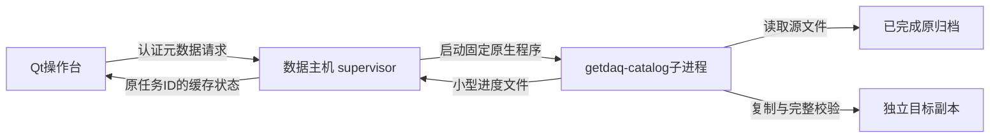

# 已完成 Run 归档的跨文件系统复制

本功能由数据电脑上的独立原生 C++11 程序 `getdaq-catalog` 执行。它不使用 Qt、Ice、OpenSSL 或 curl，不把原始数据经过操作台或 ECC。Qt 配置工作区及硬件控制流程没有变成数据传输通道。

## 1. 哪些工作已经实现

首先按[原归档流程](DATA_RUN_CATALOG.md)在接收目录所在文件系统生成硬链接归档。硬链接只增加文件名，不多占一份原始数据空间。然后运行本工具，将这个**已经完整核对的归档**复制到另一块磁盘的一个新目录。

复制得到独立文件，源文件与目标文件不共享 inode。操作成功、失败或中断都不删除生产源文件；也不自动修改 GUI 的 Run 记录、原 catalog 路径、ECC 状态或接收器会话。软件不根据副本成功自动解除 UNKNOWN。

本机文件系统复制与跨主机普通TCP/IP归档发送是两种不同任务：本机复制可直接运行CLI，也可以通过第9节的操作台窗口提交元数据任务；跨主机TCP发送/监听由第13节的独立原生CLI启动，不经过操作台或ECC，也不要求传输凭据。TCP不加密，部署必须限制在可信网络并配置防火墙。网络挂载目标是否适用仍取决于挂载文件系统的权限、锁及fsync行为。两种传输都只支持用户明确发起的续传，不会自动重试；本机复制仍按第11节处理，跨主机TCP续传见第13节。

## 2. 先理解两个完成文件

| 文件 | 含义 |
| --- | --- |
| 原归档的 `catalog-complete.json` | 接收会话及原同文件系统硬链接归档已经完成 |
| 新副本的 `transfer-complete.json` | 本次复制及目标内容 SHA-256 校验已经完成 |

两个文件不是同一种凭据。副本中保留原完成证据为 `source-catalog-complete.json`，不会把它伪装成新位置的 `catalog-complete.json`。原证据里的输出路径、PID、会话都是历史来源信息，不是新磁盘上的接收器状态。

没有 `transfer-complete.json` 的目标目录只能看作部分结果，即使所有 `.graw` 看起来都已出现。出现完成文件后仍可用 `--verify-transfer` 独立核对全部字节。

## 3. 操作机器、目录和前提

以下命令在**能访问原归档和目标磁盘的数据电脑**执行。路径示例需要替换为本机实际路径，不在 Windows 操作台上发送原始文件。

前提：

1. 所有来源已经确认 EOF 或受支持的显式源端结束、排空、正常退出和 seal。原归档核对必须通过，不接受“手写 complete=true”。
2. 原接收会话目录及原归档暂时都保留，并由执行用户访问；任务会保留源目录锁，拒绝仍被其他进程占用的来源。
3. 目标父目录已经存在，由执行用户管理；新目标目录尚不存在。软件不覆盖已有目录，也不把新目标放入原归档或原接收会话内部。
4. 目标空间足够放下全部独立副本。源归档是硬链接，本次复制会真实增加一份数据空间；稀疏文件的孔洞按普通字节复制，不承诺保持稀疏布局。
5. 文件系统支持 POSIX 权限、锁、文件/目录同步及在目标文件系统内部发布完成文件。磁盘断电或网络挂载的真实持久性仍需现场确认。

## 4. 完整命令和预期结果

先查看原归档：

```bash
build-delivery/full/native/getdaq-catalog --inspect-catalog \
  /srv/getdaq/catalog/Experiment/run_0000/node-A
```

这一步检查原有元数据、请求、seal、文件名称/大小/inode集合，不读取 `.graw` 内容。失败时先处理原归档问题，不继续复制。

在目标磁盘创建父目录，保留一个尚不存在的最终目录：

```bash
mkdir -p /srv/backup/getdaq
chmod 700 /srv/backup/getdaq

build-delivery/full/native/getdaq-catalog --copy-catalog \
  /srv/getdaq/catalog/Experiment/run_0000/node-A \
  /srv/backup/getdaq/Experiment-run0000-nodeA
```

不要提前创建最后的 `Experiment-run0000-nodeA` 目录。复制成功时命令返回 0，输出小型 JSON 完成凭据，主要字段包括：

```json
{
  "kind": "getdaq.catalog-transfer-complete",
  "complete": true,
  "copied_files": "4",
  "copied_bytes": "2105344",
  "content_verified": true,
  "source_preserved": true
}
```

数字只是格式示例，实际值应等于原归档所有文件的总数与字节数。正常复制命令只在完成时输出凭据，长任务没有每块载荷输出；不要因暂时没有输出而换一个目标自动重发。

独立校验副本：

```bash
build-delivery/full/native/getdaq-catalog --verify-transfer \
  /srv/backup/getdaq/Experiment-run0000-nodeA
```

这一步重新读取目标的全部原始文件并核对 SHA-256，需要与数据量相应的读取时间。成功返回 0 和同一完成凭据；原接收磁盘此时可以暂时不可访问，因为校验所需的原请求、seal和清单副本已保存在目标中。

## 5. 目标目录内容

```text
Experiment-run0000-nodeA/
  .getdaq-transfer.lock          本任务/校验的互斥锁
  transfer-intent.json           源、目标、原请求摘要；不自动重试/删源
  source-request.json           原归档规范请求副本
  source-manifest.json          原硬链接归档清单副本
  source-catalog-complete.json   原完成凭据副本
  transfer-manifest.json         新文件相对路径、字节数和内容 SHA-256
  transfer-complete.json         全部复制/读回核对后最后发布
  source_0/
    receiver-seal.json           原 seal 副本
    ...graw                     独立文件，不是源 inode 的链接
  source_1/
    receiver-seal.json
    ...graw
```

原归档可能增加一个 `.getdaq-transfer.lock` 运行锁；原始文件及 seal 内容不改。各来源名称仍须按清单核对，不仅凭 `source_0` 猜测板号。

## 6. 原理、内存和大文件行为

原生任务先核对整个已完成来源集合及锁，再独占创建新目标，写入意图和历史元数据。每个文件使用 64 KiB 固定分块缓冲读取、复制及增量 SHA-256，不把整份大文件放入内存；控制 JSON 只用于有界的清单和凭据。

所有目标文件同步后，再从目标重新读取并核对每个文件的 SHA-256。内容校验通过还不够：原目录、源文件、源完成证据、复制程序产生的清单和目标文件身份/时间等元数据也必须保持绑定，防止中途变化被提升为完成。最后发布完成凭据并同步目标目录。

原文件总计读取一遍用于复制/源摘要，目标总计读取一遍用于完成前核对。之后手动 `--verify-transfer` 会额外完整读取目标。摘要实现嵌入本地标准 C++11，不引入额外加密库；既有小型配置摘要算法及编码保持不变。

64 KiB 是分块 I/O 大小，不是整个进程 RSS 上限。清单最多 65536 个文件；原清单最多16 MiB、复制清单最多32 MiB，元数据及解析树也占内存。历史归档读取已修正默认4096项JSON数组限制与65536项文件预算不一致的问题；控制协议默认小型 JSON 限制不放宽。

SHA-256 校验说明复制目标与本次读取的源字节相符，不能证明原始采集以来源文件从未被改写、每个物理事件正确、元数据有签名或全局控制权有效。分析和备份程序仍应按只读流程使用已完成数据。

## 7. 失败和中断的处理

| 现象 | 处理 |
| --- | --- |
| 目标目录已存在 | 拒绝，不覆盖；检查是否属于原任务，不自动换名重试 |
| 原接收锁或传输锁被占用 | 等待实际任务结束并查清所属进程；不 kill 生产进程来抢锁 |
| 文件/目录/清单被修改或替换 | 保留部分目标，拒绝完成，先核对来源和当前任务 |
| 空间不足、文件大小限制、短写或同步失败 | 命令失败，保留意图与已写文件，不发布完成凭据 |
| Ctrl+C、SIGTERM 或机器断电 | 可能留下部分目录；先检查完成凭据并独立校验，不能只看退出消息 |
| 校验发现同大小内容损坏 | 不把副本作为可靠完成数据；保留现场用于检查，原始数据未删除 |

程序没有自动恢复、覆盖、删除部分目录或重新提交行为。人工检查确认为本任务的失败副本后，再决定保留现场还是清理并开启新任务；不要删除真实源归档来“释放”软件故障状态。

## 8. 验证边界

实际测试范围及源码/程序摘要见[验收记录](VALIDATION.md)。包括本机两个不同 `st_dev` 文件系统的独立原生 CLI 复制、源暂时不可用时目标仍可校验、同大小损坏、中断、写入失败、锁冲突、清单变化，以及两个真实本机 receiver 产生的已封存数据。

测试只使用合成数据，所有输入/输出及硬链接名称保守合计每轮不超过4 GiB，并在成功/失败/可捕获中断后清理自有 `.graw`，低于用户20 GiB上限。生产程序始终保留源数据。第13节普通TCP入口已做本机loopback的发送、监听、断线续传、读回及复续传测试；尚无两台实际主机、现场防火墙/网卡、生产磁盘/NFS、持续吞吐或断电验证。第12节SSH兼容入口另有本机模拟与localhost sshd历史回归，仍不能替代实际两机验收。Ubuntu24独立主机/macOS及完整硬件 UNKNOWN 恢复仍待继续。

## 9. 通过 Qt 操作台提交原生复制任务

### 9.1 三个进程分别做什么

操作台只发送实验名、Run编号、任务ID和摘要，接收小型JSON状态。数据主机的 `getdaq-supervisor` 验证凭据、固定目录、来源完成证据，先保存任务意图，再启动独立的 `getdaq-catalog` 子进程。子进程直接读取数据主机上的源文件、写目标磁盘，并核对完整目标内容。窗口、HTTP连接和ECC均不搬运这些原始字节。



一次仅运行一个复制任务，不排队。复制需要磁盘带宽；虽然不经过Qt，仍可能与正在采集的数据竞争同一块磁盘。优先在采集结束后复制，或者使用独立目标磁盘并实际验证接收性能。这里没有宣称持续采集下无丢失，也没有设置已验证的现场吞吐指标。

### 9.2 在数据主机启用服务

已有服务配置保留 `receiver_plan`。该计划的 `catalog_root` 是复制来源根；来源节点名取同一个计划的 `deployment_id`，操作台不能指定任意源文件或目标路径。给服务JSON增加如下顶层字段：

```json
"transfers": {
  "backup_root": "/srv/getdaq/backup",
  "audit_root": "/srv/getdaq/transfer-jobs",
  "executable": "/opt/getdaq/bin/getdaq-catalog",
  "executable_sha256": "替换为上述原生程序的64位小写SHA256"
}
```

这是需要合并的JSON字段片段，不是可单独启动的完整配置。不要把示例中文摘要直接复制为有效值。没有 `transfers` 字段时，原服务功能保留，新传输接口返回404。

先创建来源根、备份根和任务审计根。三者必须是彼此不包含的独立目录，归服务用户所有、权限0700；源根就是已有 `catalog_root`，不要另建空目录替换真实来源。原生程序必须是该用户拥有的普通可执行文件，不能让组或其他用户写入。以实际路径执行：

```bash
mkdir -m 700 /srv/getdaq/backup /srv/getdaq/transfer-jobs
sha256sum /opt/getdaq/bin/getdaq-catalog
/opt/getdaq/bin/getdaq-supervisor --config /srv/getdaq/service.json --check-config
/opt/getdaq/bin/getdaq-supervisor --config /srv/getdaq/service.json
```

检查配置不创建任务或复制目标。凭据继续使用原 `credential_file`，由原 `--generate-token` 流程生成，权限0600。HTTP是现有Bearer认证方式，不提供TLS；远程部署要采用受控网络或已配置的加密隧道，不能将凭据直接暴露在不可信网络。

审计根固定保存策略摘要和服务互斥锁。新服务不能改变该根已经绑定的来源、备份、部署名、可执行路径或摘要。升级程序需安排一个新的审计根，并保留旧根用于历史检查；不得删除旧意图来让未知任务重放。当前每个根最多256个任务，无自动历史清理。

### 9.3 在操作台操作

1. 打开菜单 **Native data-host copy tasks...**。
2. 输入数据主机地址、supervisor端口、预期agent ID和操作台本地的凭据文件路径。这里填写的是本地凭据路径；不要把令牌直接粘贴到输入框。
3. 输入已经完成归档的实验名和Run编号，点击 **Check identity and completed source**。界面先核对agent身份，再读取来源元数据；未完成或无法验证的来源不能提交。
4. 检查显示的来源完成凭据和服务固定备份根。检查结果只在十秒内允许提交；超时重新检查。
5. 点击 **Confirm new native copy**。确认框默认取消，点击取消不会生成任务。点击Yes后先将任务ID及请求保存到操作台本地，再发送一次POST。
6. 记下 **Original operation ID**。窗口按该ID查询结果，在进行中每两秒查询一次。完成后停掉自动查询；不会自动提交第二份副本。

目的目录由服务生成：

```text
backup_root/实验名/run_0000/deployment_id-copy-任务ID/
```

任务ID不能复用为另一个实验或来源。同ID且完全相同的请求只观察原任务，不重新启动子进程；同ID改参数会拒绝。任务进行中提交另一ID会拒绝，不形成后台队列。

### 9.4 如何看状态

| 状态 | 含义及后续动作 |
| --- | --- |
| accepted | 原请求及接受状态已保存，等待原生子进程执行 |
| running | 子进程正在复制；copied_bytes只是已经观察到的计数，不是完成凭据 |
| verifying | 正在完成前检查，不能当作复制已完成 |
| complete | 子进程成功退出、独立副本完成证据已核对；可再运行CLI完整核对 |
| failed | 已观察到子进程/存储错误；保留意图与部分目标，人工检查 |
| unknown | 例如服务重启遇到未完成任务或结果无法持久保存；禁止自动重放，人工核对原任务 |

进度写入最多约每秒一次常规更新，阶段切换另行报告；状态是缓存，并不是实时带宽测量。完成要求匹配原请求、固定目标、来源摘要和复制字节数。窗口显示complete不会修改ECC状态、Run编号、原Run路径或CSV，也不能把UNKNOWN硬件恢复为Ready。

重新打开服务后，已经完成的任务作为旧实例历史显示；未完成的任务标为unknown，服务不认领旧PID、不杀旧子进程、不重新复制，也阻止该审计根下启动新的任务。现在可以明确请求独立原生完整校验；只有目标完成凭据与全部文件字节通过后才核对原任务为complete，操作步骤见第10节。仍无自动恢复、进程接管或断点续传。

### 9.5 失联、关窗口和停止服务

POST超时或失联时，任务可能已被接受。界面保留原任务ID，提示结果未知；使用 **Observe original task** 查询同一个ID。不要换一个ID尝试“恢复”。调整地址、端口、实验名或凭据会撤回旧身份/来源检查并停止轮询，不会改变服务器上已经接受的任务。

操作台在 `QStandardPaths::AppLocalDataLocation/transfer-intents/任务ID.json` 保存小型请求记录，包含目标服务、agent与原请求，不包含令牌。权限设为当前用户读写；该文件帮助找回ID，但当前界面不自动导入旧文件，不提供跨文件或跨进程事务。平台实际位置由Qt决定。

关窗口只停止状态查询，不停止复制。服务收到普通SIGTERM/SIGINT会关闭HTTP并等待自己启动的复制子进程结束，因此大文件复制时正常退出可能需要较久。强制杀服务、杀子进程、断电的行为不能等同于正常退出，也不保证任务记录最后状态同步；重启会保守显示unknown。部分目标保留，不自动删源、删目标或续传。

### 9.6 接口与小型文件

所有接口都需要同一数据节点Bearer凭据：

| 方法与路径 | 用途 |
| --- | --- |
| GET `/v1/transfers/identity` | 当前服务实例、策略摘要、固定源根和备份根 |
| GET `/v1/transfers/source/实验名/Run整数` | 原归档元数据核对，不读取raw载荷 |
| POST `/v1/transfers/operations` | 一次提交带实例/策略/来源摘要的固定请求 |
| GET `/v1/transfers/operations/任务ID` | 查询缓存状态，不启动、重试或恢复任务 |
| POST `/v1/transfers/reconciliations` | 明确请求原任务目标的独立原生完整校验，不重新复制 |

每个 `audit_root/job-任务ID` 保存 `request.json`、`operation.json`、`child.json`、`progress.json`及子进程标准输出/错误日志。请求与操作各自有大小限制；子进程进度只有阶段和字节计数。原请求及固定源、目标路径在接受、执行、结果保存和历史加载时核对；检测到持久化错误会保留未知结果。审计不是抵抗同用户恶意篡改的签名系统。

原生CLI可附加 `--progress-file /绝对路径/新进度文件`；带该参数时还可附加 `--expected-source-key 原来源request_key`，在创建目标前检查已选择来源。进度文件是服务观察接口，无需普通人工CLI使用。原CLI不带新参数的调用方式保持。

## 10. 服务重启后的原复制任务人工核对

### 10.1 这个功能解决什么问题

原生复制进程可能已经完成，而管理服务还没来得及保存最后的任务状态，就因系统重启或强制退出中断。服务再次启动时看到旧记录的accepted/running/verifying，必须保守显示unknown。unknown的意思是“管理端不能确认结果”，不等于副本一定损坏，也不等于可以重新复制。

新增人工核对会启动一个独立的 `getdaq-catalog --verify-transfer 原目标目录` 进程。这个进程只校验现有目标：检查原来源请求/归档凭据、文件集合、大小、独立文件身份及每个文件完整SHA-256，取得目标占用锁后读取全部载荷。它不会执行copy命令、续写目标、删除原始数据或向ECC发送命令。Qt和管理服务只处理小型意图、退出结果和完成凭据；巨量文件读取仍由无Qt原生进程完成。

本功能用于“目标已经完整”的情况。若目标只有部分文件、没有transfer-complete.json、文件损坏或仍由旧进程占用，校验失败，原任务继续unknown。它本身不执行断点续传；部分副本的明确续传另见第11节，失败目标删除仍未提供。

### 10.2 在操作台如何操作

1. 打开原数据复制窗口，填原数据主机地址、端口、本地凭据文件和Expected agent ID。凭据仍是文件路径，不是令牌明文。
2. 在Original task ID中填写原复制任务ID。可以从原操作台 `transfer-intents` 小型记录，或数据主机 `audit_root/job-任务ID/request.json` 找回。不要用一个新复制ID代替。
3. 点击 **Verify unresolved original copy...**。窗口先查询当前agent身份，再查询原任务。不需要点击Check source；核对使用原任务的固定目标。
4. 只有同策略的unknown任务才进入确认。先检查弹窗中的agent、目标完整路径、原任务ID和原请求SHA256，确认这确实是要检查的旧副本。**Cancel**不创建远端核对意图、不读载荷、不改变任务状态。
5. 选择 **Yes**后，本地先保存一个新的verification ID与准确请求，再发一次认证POST。服务持久保存对应核对意图，启动独立原生校验，窗口按原复制ID观察verifying。大文件校验可能很久；不要以窗口等待时间推断失败。
6. complete表示本次独立完整校验通过，且结果已经写回原任务。原复制请求仍归属旧服务实例；界面保留历史提示，不把它改成新实例创建的副本。只有该根下所有unknown任务都核对完成，才能接受新的复制任务。
7. 校验失败仍显示unknown。检查对应verify目录的stderr.log及目标，保留原任务/部分目标。目标仍被占用时等待实际复制进程自然结束后，再明确发起新的核对尝试；本功能不认领旧PID、不发kill，不自动换verification ID重试。

窗口收到的complete不改变Run编号、原始Run目录、CSV、receiver生命周期或硬件UNKNOWN。关闭窗口只停止观察，不杀校验子进程；服务普通退出会等待自己启动的子进程。强制退出后仍需核对原ID，不自动重新校验。

### 10.3 来源目录、磁盘与运行时间

完整副本自带原来源元数据，可以在原归档目录暂时不在原位置时校验。这个服务仍绑定source_root、backup_root、audit_root和校验程序的身份；三个固定根须存在、身份及权限不变。整块来源盘卸载导致source_root不存在时，这个服务不能按原配置启动；不能把“归档目录不在原位置”推广成任意磁盘卸载后的服务接管。单独CLI的离线核对说明见前文。

校验会从头读取目标全部原始文件一次，因此耗时主要取决于目标总量和磁盘读取带宽。它通常不生成新的raw副本，但会占用磁盘读带宽；由操作者选择适合核对的时机。服务HTTP事件线程不进行这些读取，状态GET仍读缓存。verifying中的copied_bytes保留原复制计数，不是本次校验的实时进度或测速。

### 10.4 原任务ID与核对ID为什么不同

原任务ID决定原请求、来源摘要和固定目标。verification ID表示一次明确授权的完整校验，两者不能互换。请求必须包含当前服务实例/策略及原复制request_key；服务重启后，旧校验请求不能冒充当前实例提交。

同一个verification ID及准确请求再次提交只返回原复制任务当前观察，绝不再启动第二个子进程；该返回不是独立的每次核对结果列表。换ID发起新校验必须由用户重新明确确认，且原任务仍unknown、没有活动复制/校验。每个原任务最多保留64个verify记录；不会自动删除旧记录。整个服务仍单活动、不排队。

API为认证 `POST /v1/transfers/reconciliations`，Content-Type为application/json，字段为：

```json
{
  "schema": 1,
  "kind": "getdaq.transfer-reconciliation-request",
  "verification_id": "verify-本次唯一ID",
  "operation_id": "原复制任务ID",
  "instance_id": "当前服务instance_id",
  "policy_sha256": "当前服务policy_sha256",
  "original_request_key": "原复制任务request_key"
}
```

上述中文占位符只是解释，不是可直接提交的值；ID必须使用ASCII字母/数字/下划线/连字符，摘要是64位小写十六进制。通常直接使用窗口，由它生成准确请求。POST接受后继续GET `/v1/transfers/operations/原复制任务ID`；没有读取原始载荷的Qt接口。

### 10.5 保存了什么、失败时保留什么

原 `job-任务ID/request.json` 和原 `child.json`不改。每次核对另建 `job-任务ID/verify-核对ID/`，保存新的request.json、该校验子进程child.json、stdout.json及stderr.log。准确意图在启动前保存；完成前再次核对原任务及校验意图，原生成功退出的stdout必须与目标完成凭据字节一致，并符合原请求/目标/来源摘要和字节数。

成功后仅将原operation.json更新为complete，保留原请求归属。失败继续unknown，保留记录与数据；写入/固定输入/核对意图损坏会保留故障门槛，不能恢复原字节就认定已核对。强制退出可能留下verifying记录；重开仍unknown，不按旧PID自动接管。

第11节已补充符合原来源绑定的部分副本续传；失败目标清理/废弃确认、旧校验进程接管、跨主机核对或真实断电保证仍未提供。不能通过手改operation.json为complete来替代完整校验。测试边界和实际结果见[验证记录](VALIDATION.md)第70.30节。

## 11. 中断副本的明确续传

### 11.1 完整核对与续传如何选择

副本已经完整、管理状态未知时，使用第10节 **Verify unresolved original copy...**，它只读取并校验目标。副本确实不完整、原来源仍在线时，使用 **Resume original partial copy...**；它需要读取原来源、核对已有目标前缀，然后追加缺失字节。两种操作都保留原复制任务ID，不能用“再建一个复制ID”冒充原任务恢复。

Qt和管理服务只保存与传递意图及小型进度。真正读取巨量文件、比对前缀、追加字节与最终SHA核对，均由独立无Qt `getdaq-catalog` 进程完成。没有把大数据写入QByteArray、GUI线程或HTTP响应。

### 11.2 哪些副本能够续传

新版复制在写第一份raw之前，额外保存 `resume-source.json`。它绑定原来源与目标根的device/inode、来源元数据摘要，以及每个原文件的device/inode、大小、权限、owner、硬链接计数、mtime和ctime。续传重新读取同一归档并重算这份准确记录，必须与保存的字节完全相同。

原来源目录必须在线，封存/归档凭据完整，原文件集合与身份未改变。改变来源字节、大小、权限、硬链接或时间属性，即使随后改回内容，也可能因ctime变化拒绝旧续传。不能换另一个路径、另一次采集、同名目录或新source key去接着写旧副本。

旧完整副本仍能使用独立 `--verify-transfer`。旧不完整副本若没有resume-source.json，或这份记录损坏/不匹配，会明确拒绝续传，不在事后生成一份“当前来源身份”来替代原始证据。来源身份是合作软件的文件核对记录，不是签名、原始事件物理正确性或所有文件系统的断电证明。

### 11.3 窗口操作步骤

1. 打开原复制窗口，填写原数据主机、端口、本地凭据文件与Expected agent ID。
2. 填写原复制任务ID，确认原来源归档仍在线。任务需为unknown或failed；正在运行的任务不能同时续传。当前服务/原请求/策略变化时拒绝，不排队。
3. 点击 **Resume original partial copy...**。窗口先重新查询身份和原任务，再显示固定目标路径、原任务ID和原请求SHA256。
4. 仔细核对目标，确认要追加缺失字节，而不是只读完整校验。默认 **Cancel**，取消不创建远端续传意图、不改数据。
5. **Yes**先保存新的本地恢复ID和准确请求，再发一次认证POST。后台先持久化恢复意图，再启动独立原生续传。目标和来源仍被旧复制进程占用时会失败，不kill或接管旧PID。
6. 窗口按原复制ID观察verifying/running；原任务归属旧实例时仍显示历史提示。数值包含已有前缀与追加后形成的数据集合，不是本次新增写入量或网络速率。大文件的前缀核对和最终完整校验可能花很长时间。
7. complete只有在全部内容核对及结果保存后出现。原Run/ECC、原请求、原复制PID记录保持不变。中途再次失败会保留目标和恢复记录，原任务保持unknown；再次继续必须人工明确确认，不自动重发。

更改地址、凭据、实验/Run选择会撤回旧身份。关闭窗口不停止后台续传，普通服务退出等待自有子进程；强制退出后按原ID核对。原来是否已收到POST应答，不决定服务器是否已经执行，失联时不要自动换一个恢复ID。

### 11.4 为什么已有数据不会被截断或悄悄重写

1. 取得原归档、原接收会话及目标的固定锁，核对原请求、目录身份、来源记录和元数据。
2. 在追加任何raw之前，检查全部已有目标文件：名称须属于原集合，必须是当前用户的正常独立文件，不能是软链接/硬链接别名，大小不能超过原文件。目标中出现未登记文件或目录时保留现场并拒绝。
3. 用64KiB缓冲区逐块读取来源与目标已有前缀，要求每个字节一致。任一前缀不一致时，不给其他文件追加raw，也不“修复”不一致的数据。
4. 前缀全部通过后，按原inode打开目标，不使用O_TRUNC；从已核对长度开始追加缺失字节。完全写好的文件不会重复写raw，缺失文件使用独占新建。写入前还要核对预检时的文件身份，变化拒绝。
5. 对来源完整流计算SHA，完成后再完整读取目标，与新清单核对；元数据已有且相同时保留，内容不同时不覆盖。成功凭据最后发布，来源和已有失败记录不删除。

前缀核对会重新读取已有数据；它减少重复写入，并不免除完整读取或保证固定耗时。来源、目标、文件在检查期间变动会拒绝；普通合作锁不是对恶意同用户修改的防护。Linux文件/目录同步已有实现，真实断电及所有文件系统恢复仍须现场验证。

### 11.5 原生CLI和认证接口

在数据主机上可明确运行：

```bash
./getdaq-catalog --resume-catalog \
  /原来源根/实验名/run_0000/数据部署名 \
  /原备份根/实验名/run_0000/数据部署名-copy-原任务ID
```

这两个参数必须是原意图中记录的原始路径。不要给一个新目标目录，或把新的copy命令用于已存在的目标。普通CLI不影响管理服务的缓存状态；通过窗口/认证服务提交，才会在原任务中保存结果。

服务新增认证 `POST /v1/transfers/resumptions`，Content-Type为application/json。请求字段沿用第10节的verification_id/operation_id/current instance/policy/original_request_key，kind改为 `getdaq.transfer-resume-request`。verification_id在此表示一次明确恢复意图，不是原复制ID。服务严格区分只读核对与续传请求，不接受把另一种kind送到本入口。

续传意图保存在 `job-原任务ID/resume-恢复ID/`，原job/request.json与原child.json不改。同恢复ID和准确请求只观察当前原任务，不再启动第二个子进程。核对与续传合计每个原任务最多64个恢复记录；全服务单活动、不排队、不自动清理。

### 11.6 常见失败与当前边界

| 观察结果 | 含义及处理 |
| --- | --- |
| 缺少或改变原来源记录 | 不能证明当前来源就是开始复制时的来源；不自动补造记录或接续 |
| 原目录/文件身份变化 | 原文件替换、权限/链接/时间变化或磁盘重新映射；保留现场，不能换路径绕过 |
| 目标前缀不一致 | 数据损坏或写错来源；不会截断或覆盖，先独立检查 |
| 未登记目标内容 | 目录存在额外内容；不自动删文件来“修好”清单 |
| 来源/目标锁仍被占用 | 另一个合作进程仍在使用；本程序不kill，等待或独立核对实际进程 |
| 再次写失败、空间不足 | 保留当前实际长度与意图，没有成功凭据；解决存储问题后重新明确确认 |
| 完整校验失败 | 不发布complete；保留来源、目标和诊断，不把进度计数当结果 |

当前支持保持原文件/路径身份的本机续传，包括跨文件系统目标；第13节普通TCP跨主机传输也支持显式续传，但不自动重试或清理远端失败目录。旧SSH兼容入口见第12节。以上均不支持改变来源身份后接管、失败任务自动废弃/删除或旧PID接管；也不解除硬件UNKNOWN或证明配置已加载。本机续传测试包括真实短写子进程、16KiB不对齐前缀、来源/前缀变动及实际窗口确认，见[验证记录](VALIDATION.md)第70.31节。

## 12. 跨主机发送已完成归档

> 本节记录的 SSH 方案是早期实现。当前推荐的跨主机方式已改为第13节的普通 TCP/IP；SSH CLI 暂时保留以兼容已有流程。

### 12.1 适用范围

这条旧路径把已经封存并通过 `--inspect-catalog` 的归档从数据主机发送到另一台归档主机。发送程序、SSH加密连接和接收端 `getdaq-catalog` 直接传递原始文件；Qt窗口、ECC服务和HTTP接口不接触原始字节。新部署建议采用第13节的普通 TCP/IP 方案，并在可信网络内使用。

此功能不自动寻找主机、不配置SSH账户、不自动重试或清理目标端失败目录。传输中断后，用户可使用`--resume-catalog-ssh`显式续传同一来源到同一远端根目录。一次源归档只能发布到由原请求键确定的唯一目录；普通发送遇到已有最终目录或`.partial`时拒绝覆盖，须先核实目标意图再选择显式续传或管理员处置。

### 12.2 两台主机准备

源和目标机都安装同一兼容版本的独立原生 `getdaq-catalog`。构建阶段不增加OpenSSL、curl或Qt网络依赖；运行时发送端调用系统OpenSSH客户端 `ssh`，接收端需要可执行程序和POSIX文件系统。macOS使用系统SSH；Ubuntu使用发行版OpenSSH客户端/服务端。

在目标机为接收归档建立一个由专用账号所有的私有根目录：

```bash
sudo install -d -o daq-archive -g daq-archive -m 700 /srv/getdaq/remote-archive
```

建议使用专门的SSH密钥和归档账号。先从发送账号用普通SSH人工确认主机指纹已通过可信渠道核实并写入 `known_hosts`，再确保非交互登录可用。发送命令固定使用 `BatchMode=yes`，不会提示输入密码或接受未知主机密钥。不要关闭主机密钥验证。

接收端是固定程序加固定根目录，例如`/opt/getdaq/bin/getdaq-catalog --receive-catalog-stream /srv/getdaq/remote-archive`和`/opt/getdaq/bin/getdaq-catalog --resume-catalog-stream /srv/getdaq/remote-archive`。如果用`authorized_keys`强制命令，应使用管理员审阅的固定包装器，只允许这两个精确子命令和固定根目录；不要开放任意shell参数。建议同时限制转发权限，例如`no-pty,no-port-forwarding,no-agent-forwarding,no-X11-forwarding`。专用密钥不得用于交互式登录或其他用途。

远端登录shell及其启动脚本不得向标准输出打印欢迎语、状态文字或调试日志，因为标准输出承载二进制协议帧。诊断信息只能输出到标准错误。部署程序和父目录应由管理员控制写权限，普通归档账号不能替换可执行文件。

### 12.3 发送命令

先在源主机确认归档完成：

```bash
/opt/getdaq/bin/getdaq-catalog --inspect-catalog \
  /srv/getdaq/catalog/Experiment/run_0000/node-A
```

检查成功后，从源主机发送：

```bash
/opt/getdaq/bin/getdaq-catalog --send-catalog-ssh \
  /srv/getdaq/catalog/Experiment/run_0000/node-A \
  daq-archive@archive.example.org \
  /opt/getdaq/bin/getdaq-catalog \
  /srv/getdaq/remote-archive
```

如果发送中断并留下`.partial`，先确认SSH/接收进程已经退出、原来源仍在线且没有被修改，再向**同一SSH目标、同一接收程序和同一远端根目录**显式续传：

```bash
/opt/getdaq/bin/getdaq-catalog --resume-catalog-ssh \
  /srv/getdaq/catalog/Experiment/run_0000/node-A \
  daq-archive@archive.example.org \
  /opt/getdaq/bin/getdaq-catalog \
  /srv/getdaq/remote-archive
```

将 `archive.example.org`、实验路径、账号和程序路径换成实际值。命令使用本机OpenSSH配置的身份文件、端口和 `known_hosts`，SSH目标需是普通 `user@host` 或在SSH配置文件中定义的别名；本程序不接受以 `-` 开头的目标，也不把身份私钥放进程序参数。非交互认证失败、网络中断或接收端校验失败时，命令以非零状态结束并保留两端已有数据。

发送中，标准错误最多约每秒输出一行小型JSON进度，例如 `{"phase":"sending","sent_bytes":"..."}`；发送完载荷后，目标端同步并回读校验期间会显示 `remote-verifying` 心跳。标准输出只在成功后输出最终完成凭据。`sent_bytes` 是源端已写入SSH管道的字节数，不是网络接口测得的带宽，也不代表目标已落盘。只有最终成功凭据和目标端再次校验都通过，才可视为目标副本已完成。

### 12.4 目标命名和完整性

目标端在私有根目录下自动建立：

```text
getdaq-transfer-<原请求键前32个十六进制字符>/
```

传输期间先写入相邻的 `.partial` 目录。协议先验证原请求、原catalog清单、完成凭据和每个receiver seal，再按清单顺序发送文件；目标逐文件计算SHA-256、同步文件和目录，随后重新读取目标全部载荷核对。成功时先在临时目录内发布完成回执，再用平台支持的“不覆盖重命名”原子发布最终目录。Linux使用 `renameat2(RENAME_NOREPLACE)`，macOS使用 `renamex_np(RENAME_EXCL)`。如果内核或目标文件系统不支持对应的独占重命名，发布会失败并保留 `.partial`，不会退化为可能覆盖已有目录的普通重命名；Apple也说明该能力依文件系统而异，需以实际目标卷验收。

当前仅为 Linux 和 macOS 提供原子不覆盖发布实现。其他 POSIX 平台会明确拒绝最终发布并保留 `.partial`；代码不使用“先检查目标不存在、再普通重命名”的有竞态替代方式。

目标目录中包含原请求/清单/完成凭据副本、传输意图、传输清单、receiver seal、独立 `.graw` 文件和 `transfer-complete.json`。使用回执的 `destination` 字段取得确切路径，再在接收主机运行：

```bash
/opt/getdaq/bin/getdaq-catalog --verify-transfer \
  /srv/getdaq/remote-archive/getdaq-transfer-<请求键前32位>
```

该检查会完整读取目标所有 `.graw` 并复算SHA-256，耗时与数据量相关。发送源和目标最终副本都有各自字节，不是硬链接；程序不会删除源归档。

### 12.5 失败边界和当前验收状态

SSH断开、进程退出或目标写盘失败可能留下`.partial`目录。它不会被当作完整归档，也不会自动续传或自动删除；确认原发送与接收进程均已退出后，可由操作者再次明确执行`--resume-catalog-ssh`。首次发送会保存来源请求/manifest/完成收据摘要、来源目录及每个raw文件的设备/inode/大小/权限/owner/链接数/mtime/ctime身份。续传必须在远端比对完全相同的来源checkpoint，并逐文件报告目标已有前缀长度和SHA-256；发送端用原来源逐字节范围计算对应前缀SHA，全部一致后才开始传输。目标再次核对前缀文件描述符，再追加缺失后缀，复算整文件SHA、同步并回读校验全部目标内容，最后独占发布。

若来源目录、请求、manifest、封存收据、raw文件身份或任一远端前缀变化，续传拒绝且不追加；不会换路径/新请求键接管旧partial。若原目标已发布但源端未收到最终回执，显式续传会先对已有最终目录和来源身份做完整校验，成功后返回已有回执且不重传载荷。普通`--send-catalog-ssh`仍会拒绝已有partial/最终目录。管理员应先检查`transfer-intent.json`、`resume-source.json`、文件和磁盘空间；程序不会删除失败目录。

此前候选曾验证认证TCP；该协议现已按用户要求替换为普通TCP/IP。当前候选`build-packages/getdaq-ubuntu24-20261021-71-95-current-source-full-candidate`含27个当前源码程序及173项SHA-256清单。包内确切`getdaq-catalog` SHA-256=`e5ab61dae6aaeaa23dd8a3039280f32e4712fdb5e9f11105e29314f90db88646`，在Ubuntu24.04.5用户空间中通过无认证TCP独立CLI收发、显式续传、目标读回及完成后零载荷核对；合成raw共15,245,312字节且已删除。详细回执及局限见[验证记录71.95](VALIDATION.md#7195-最新ubuntu24候选包普通tcp传输复验2026-10-21)。该回归仍是同一WSL2宿主内核上的loopback，不是双机验收。普通TCP协议与安全边界见下节。

当前测试覆盖协议帧、参数引号、空格路径、原子不覆盖发布、16,896字节非对齐partial、损坏前缀拒绝、原来源变化拒绝、续传只发送缺失后缀、传输清单及完成回执已落盘后的发布中断恢复、最终回执丢失后的无载荷核对，以及目标完整读回。本机假SSH测试验证了进程/文件系统契约；真实系统OpenSSH客户端连接临时localhost sshd的回归另由runner显式开启，验证密钥认证、known_hosts、远端shell命令和Ubuntu24候选接收程序互通。真实SSH runner分别传输40,960和134,225,920字节；较大回归同时核对来源fixture目录被删除及远端4个目标raw被显式清理，测试数据没有残留。同一测试二进制在不设置真实SSH开关时由注册`catalog-transfer-filesystem` CTest通过1/1，执行原生场景和假SSH回归。详细预算、回执及限制见[70.88验证记录](VALIDATION.md#7088-真实openssh有界128mib归档流回归2026-10-20)。该单机回环仍不能证明两台独立主机、现场账号/权限/防火墙/磁盘、macOS SSH或DAQ持续吞吐；现场部署前仍需小样本两机互通及持续性能验收。任何合成DAQ传输测试产生的数据总量不得超过20 GiB，测试结束删除自己生成的`.graw`。

## 13. 普通 TCP/IP 发送已完成归档

### 13.1 用途与协议

该入口只传输已经封存并通过 `--inspect-catalog` 检查的归档。它用于采集结束后的归档复制，不负责实时 DAQ 接收、分帧或写盘。实时原始数据仍由独立原生接收程序处理；Qt 操作台、ECC 服务和 HTTP 管理接口不承载归档字节。

跨主机传输使用普通 TCP/IP，不做 TLS 加密，也不做用户名、密码、令牌或共享密钥认证。发送端连接后直接开始归档流。TCP 提供可靠、有序的字节流；传输协议另外使用 SHA-256 校验归档内容、检查已有续传前缀、同步文件并读回验证，最后以不覆盖方式发布完成目录。SHA-256用于检测内容损坏，不是身份认证或防篡改签名。

因此，监听服务只应绑定采集/归档专用的可信网络地址，并由操作系统防火墙限制允许连接的主机。没有网络访问控制时，任何能连接该端口的主机都可以尝试提交归档；网络上的请求、文件和回执均可被观察或篡改。此程序不会替现场设置防火墙。若需要跨不可信网络传输，应先使用经批准的 VPN/SSH 隧道，或另行设计加密与身份认证方案。

### 13.2 在接收主机启动服务

两台主机安装兼容版本的原生 `getdaq-catalog`，创建一个由归档服务账号独占的目标目录：

```bash
sudo install -d -m 700 -o daq-archive -g daq-archive \
  /srv/getdaq/remote-archive
```

在接收主机启动监听：

```bash
sudo -u daq-archive /opt/getdaq/bin/getdaq-catalog \
  --listen-catalog-tcp 192.168.20.12 49152 \
  /srv/getdaq/remote-archive
```

将 `192.168.20.12` 替换为归档网卡地址。不要在不受控的公共接口上监听。防火墙只允许指定发送主机访问 TCP/49152。程序不会自动发现主机或配置防火墙。启动输出的 `listening` JSON 报告实际端口；端口0可用于临时测试端口。服务串行接受连接并持续运行；增加 `--once` 后，在一次完整归档接收完成后退出。

### 13.3 发送和显式续传

发送前在源主机检查归档：

```bash
/opt/getdaq/bin/getdaq-catalog --inspect-catalog \
  /srv/getdaq/catalog/Experiment/run_0000/node-A
```

然后发送：

```bash
/opt/getdaq/bin/getdaq-catalog --send-catalog-tcp \
  /srv/getdaq/catalog/Experiment/run_0000/node-A \
  192.168.20.12 49152
```

如果传输中断，确认两端旧进程已结束且源归档未改变，再显式续传：

```bash
/opt/getdaq/bin/getdaq-catalog --resume-catalog-tcp \
  /srv/getdaq/catalog/Experiment/run_0000/node-A \
  192.168.20.12 49152
```

续传会逐文件核对接收端已有前缀与原归档，只追加缺失部分；已完整接收的归档再次续传时只核对并返回原回执，不重发载荷。程序不自动重试、不覆盖已有目标，也不会自动删除失败的 `.partial` 目录。发送端若未收到最终回执，可重复同一显式续传命令，让接收端核对已发布目录。

名称解析由系统 resolver 执行；解析完成后的 TCP 地址连接共用15秒总时限。成功连接后，数据I/O的空闲超时为60秒。15秒不包含系统名称解析耗时；关闭或拒绝的端口会快速报告连接错误。详细边界见[71.05验证记录](VALIDATION.md#7105-归档-tcp-客户端连接阶段设置总时限2026-10-20)。

完成回执包含由来源请求键确定的目标目录。在接收机独立核验：

```bash
/opt/getdaq/bin/getdaq-catalog --verify-transfer \
  /srv/getdaq/remote-archive/getdaq-transfer-<请求键前32位>
```

### 13.4 验收范围和限制

当前回归使用本机 loopback 上的独立发送/监听进程，覆盖普通TCP直连、连接拒绝、首个文件后中断、同一 `.partial` 显式续传、接收端完整读回，以及完整归档零载荷复续传。归档流在当前线程屏蔽写入关闭管道/套接字时产生的`SIGPIPE`，并在退出时消费本次产生的待处理信号，不临时修改进程级信号处理器；并发回归确认一次流会话不会改变进程级`SIGPIPE`处理状态。测试只生成有上限的小型合成归档；不接触真实硬件。Ubuntu24 用户空间和 Windows/MacOS 数据路径的状态以[验证记录](VALIDATION.md)为准。单机 loopback 不等同于两台独立主机的DNS、防火墙、网卡、MTU、磁盘和长时间吞吐验收；现场部署前仍需完成小样本双机互通检查和受控吞吐测试。测试生成的 `.graw` 总量不得超过用户设定的20 GiB上限，并必须在测试后删除。

另有一个不默认加入常规CTest的有界大文件runner：Linux host和Ubuntu24候选的真实发送/监听CLI各处理两个source，每个source含一个512 MiB合成文件；源和目标全部`.graw`合计约2 GiB。Ubuntu24程序由其目标loader和运行库启动；两次测试均共享WSL2内核。runner硬限制源+目标raw合计16 GiB，启动前要求该额度外再有256 MiB可用空间，并核对发送端/接收端峰值RSS、完整目标读回和测试目录清理。超时会终止runner自己的整个进程组再清理测试根；超预算输入在创建载荷前拒绝。该loopback证据见[71.125验证记录](VALIDATION.md#71125-512-mib-单文件普通-tcp-归档回归2026-10-21)；它不是测速结果，也不能替代真实双机或持续采集下的目标磁盘测试。

### 13.5 两台独立主机的现场验收步骤

本节是待执行的现场验收流程，不表示已取得双机测试结果。验收必须使用两台独立主机、两块实际网卡和真实网络路径；同一台电脑上的loopback、虚拟机、WSL或Windows与WSL互通都不能作为双机证据。两端使用同一版本的Linux `getdaq-catalog`，并先按各自候选包的SHA-256清单验证程序文件。记录两端操作系统版本、内核、程序版本/SHA-256、网卡地址和网络路径。

为遵守磁盘预算，选择已完成封存且可删除的测试归档；测试源目录和接收端测试目录都必须是专用测试数据。测试开始前，在源端统计归档中所有`.graw`文件大小之和，必须不超过8 GiB；这使源和目标两份raw的合计不超过16 GiB，为用户设定的20 GiB硬上限留出余量。接收端须至少有源raw总量再加256 MiB的可用空间。空间不够、来源是否可删不明确或源raw总量超限时，不开始传输。不要为了测试生成超限文件。

接收端创建私有测试根目录，并只在归档专用、可信且有网络访问控制的接口启动一次性监听。下面示例只开放专用测试端口；防火墙规则由现场管理员按源主机IP精确添加并在验收后撤销，本程序不会改动系统防火墙：

```bash
install -d -m 700 "$HOME/getdaq-tcp-acceptance/target"
umask 077
/opt/getdaq/bin/getdaq-catalog --listen-catalog-tcp \
  192.168.20.12 49152 \
  "$HOME/getdaq-tcp-acceptance/target" --once \
  >"$HOME/getdaq-tcp-acceptance/listener.stdout.log" \
  2>"$HOME/getdaq-tcp-acceptance/listener.stderr.log"
```

将地址换成接收端归档网卡地址，确认标准输出中的`listening` JSON报告预期端口后，再从源端连接。不要将监听绑定到公共或不受控网络接口。此协议无认证、无加密；必须由可信网络隔离和主机防火墙限制来源，不能把它直接暴露到互联网或不可信网络。

源端先检查归档及大小预算，再发送：

```bash
/opt/getdaq/bin/getdaq-catalog --inspect-catalog \
  /srv/getdaq/catalog/Experiment/run_0000/node-A

/opt/getdaq/bin/getdaq-catalog --send-catalog-tcp \
  /srv/getdaq/catalog/Experiment/run_0000/node-A \
  192.168.20.12 49152 \
  >"$HOME/getdaq-tcp-sender-receipt.json"
```

完成后，接收端`listener.stderr.log`应包含`TCP archive complete:`及完成凭据。用凭据中的`destination`路径在接收端执行完整目标校验：

```bash
/opt/getdaq/bin/getdaq-catalog --verify-transfer \
  "$HOME/getdaq-tcp-acceptance/target/getdaq-transfer-<请求键前32位>"
```

只有发送端成功退出、发送回执与接收端完成凭据对应同一个`source_request_key`、回执报告`content_verified=true`和`source_preserved=true`，且接收端`--verify-transfer`再次完整读回成功，才记录为通过。核对两端报告的文件数、复制字节数和目标路径。若连接或传输中断，先确认旧进程已经退出、源归档没有变化、接收端partial仍在且磁盘空间充足；保持同一接收根目录和端口，由原源端显式运行`--resume-catalog-tcp`。不要删除partial后重试，也不要另建目标来掩盖失败。

记录开始/结束时间、耗时、源raw总字节、回执复制字节、文件数、网卡/网络、端口、两端程序SHA、完整读回结果、是否发生续传及错误日志。此结果用于现场链路验收，不应把单次耗时直接等同持续DAQ吞吐能力。通过后停止监听，并确认回执、日志及测试目录均已保存到指定验收位置；由负责人确认后，只删除本次明确标记的接收端测试归档和临时日志。源端测试归档按其原有生命周期处理，绝不删除生产源目录。
