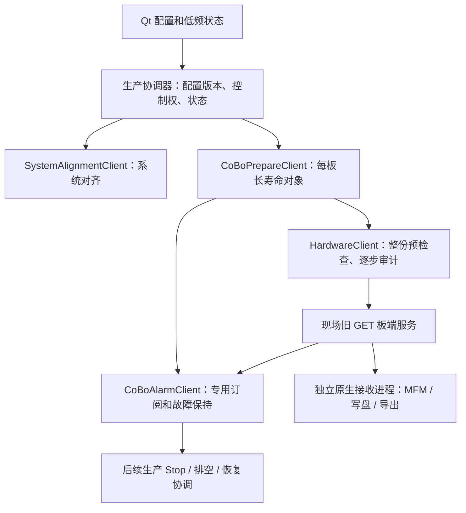

# 单板 CoBo Prepare：组合流程、告警生命周期和停止联锁

## 1. 当前可用到哪一步

`CoBoPrepareClient` 已把基础初始化、AsAd 上电监控、PLL/LCM、输入槽位、AGET 串行校准、ADC/DAC、硬件保护、自有主机告警、监控读取、阈值和自动延迟串成一个原生 C++11 流程。它还会在最后一次 ADC 复位后重应用通道关闭位，解决旧顺序中通道配置被复位清除的问题。

这是供生产后端接入的**长寿命单板库对象**。目前没有新增 GUI 按钮、`prepare-cobo` CLI 或 JSON 直接部署入口；普通实验可经native模式操作台连接新ECC，由其调用系统准备流程；也保留旧SOAP兼容客户端。不要把下面的库示例当成现场运行命令。

`Complete` 表示本板定义的命令、等待和检查完成，**不提交整个系统 ECC Prepared**。原生[SystemPreparationClient](SYSTEM_PREPARATION.md)已组合跨板对齐、MuTaNT、Configure和系统同步；生产ECC及发送器/接收器启停、正常排空与同原对象特定故障收尾现已接续；真实全局控制权、实际加载配置版本与冷恢复仍须完成。真实电源、PLL 锁定、ADC 波形和串行/读取延迟尚未验收。

## 2. 架构和数据路径



图中的生产协调器和部分Stop/恢复已接续，具体前提见[重构进度](REFACTOR_STATUS.md)，图示不代表任意故障自动恢复。`CoBoPrepareClient`、硬件客户端和告警回调不链接 Qt；原始 DAQ 字节直接进入独立接收进程。每步 `fsync` 只用于低频控制审计，不进入原始事件写盘路径。这次没有增加第三方依赖，继续使用已本地保存的 Ice/GET 接口及标准C++11 JSON描述读取。

代码分层：

| 文件 | 用途 |
| --- | --- |
| `common/experiment/coboprepareconfiguration.*` | 所有片段参数的一致性检查，只有标准 C++11 |
| `apps/hardware/coboprepareplan.cpp` | 按旧顺序生成订阅前/后的两段计划；不连接设备 |
| `apps/hardware/coboprepareclient.*` | 所有前提检查、实际单板执行、自有订阅及失败生命周期 |
| `apps/hardware/hardwareclient.*` | 权限/元数据/范围检查、命令确认、可中断等待和日志 |
| `apps/hardware/coboalarmclient.*` | 独立原生 Ice 回调、事件审计、有界队列和故障保持 |

## 3. 输入必须彼此一致

`CoBoPrepareSettings` 汇总已有的 foundation、inputs、clock、monitoring、calibration，并加入 `manualReadDataDelay`（0..255，缺省14）和 `adcDoubleDataRate`（缺省true）。构造客户端时就编译全部片段；以下问题在网络连接前拒绝：

- 输入、时钟、监控、校准的活动 AsAd 集合不同；每份参数仍须完整列出各自活动板。
- 输入位置的 logical active 与校准期望型号表的芯片集合不同；型号表键为 `4*AsAd+AGET`。
- foundation/clock 的板型或 `verifyHardwareVersion` 策略不同。
- 要求 LED 服务时，其板型与本板不同；收到的 LED 实现只支持2或5。
- 手动延迟越界、芯片/板重复或缺失、任一子编译失败、组合计划超过4096步。

`enabled=false` 不会把 logical active 改成 false。这是旧配置中物理槽位开关与逻辑范围的区别；实际校准和电气结果仍需现场核对。缺寄存器的旧布局必须在调用前明确选择，不能在写入失败后换布局或跳过。

客户端复制本次settings、硬件描述和连接选项，外部随后修改原对象不会改变已编译计划。跨板接续由[全系统协调器](SYSTEM_PREPARATION.md)组合，并经NativeEccCoordinator提交生产ECC阶段状态；但本地工件摘要仍不能证明板端实际加载了该版本，现场加载读回和全局控制权仍待验收。

## 4. 执行前会检查什么

1. 对象必须是 `Fresh`。`Prepare()` 一经进入就不能重用，即使后来是文件路径或前提错误；创建新对象不能代替部分生效后的恢复核对。
2. 调用者必须提供 `ownsStoppedHardware=true` 和 `dataProcessesStopped=true`。它们是生产协调器提供的前提声明，**不实现远端锁，不停止发送器或接收器，也不证明接收器已经排空**。
3. 独占创建全新0700日志目录和0600 `prepare.jsonl`，同步父目录。路径存在、含控制字节或末尾为斜杠则拒绝；失败记录不自动删除。
4. 连接本板并绑定调用者传入的完整描述；实际 node name 必须等于 `expectedNodeName`。
5. 把两段计划合并作整体 `HardwareClient::Validate`：目标、字段、布局、权限、板端检查器间接权限、宽度、步数、等待/轮询范围全部检查。该调用不读寄存器值、不写硬件。
6. 要求订阅时先准备监听器，并核对实际节点名称、非空 AlarmService 和远端 `ice_isA`。这一步不订阅、不 reset。
7. 通过单独 `premises.jsonl` 只读检查 `firmwareEnable=0`、`intEnable=0` 和所选实际板型。**版本不符不会先写 initDone、复位或上电。** 执行阶段仍重新检查；没有把预检查当作跨客户端原子保证。

全系统使用时先对每个活动板调用`Preflight(新目录, 后续Configure步骤)`，进入`Preflighted`，不写硬件、不订阅；该步骤还检查后续Configure元数据。全部板通过后，用同一对象的`Prepare(checkpoint)`接续，不销毁/重建监听器。执行前新增`execution-premises.jsonl`再次只读核对停止/板型。原有`Prepare(新目录)`仍自动完成这两个阶段。

`CheckInterlock()`无硬件访问，检查当前订阅应为Fresh还是Active及保持故障；失败对象也拒绝继续。全系统checkpoint逐一调用全部活动板，阻止先完成的板告警后另一块继续写入。不能从检查器重入同一持锁HardwareClient。`Alarms()`也允许在`Preflighted`取得Fresh监听器，但它尚未订阅，不能把存在的回调代理当作持续告警保护。

旧 Ice 的 `checkedCast` 可以根据本地代理类型直接返回；Slice getter 返回一个 AlarmService 类型的代理，并不证明远端实际提供这个服务。将它先赋给 `ObjectPrx` 也可能保留原代理动态类型。这里显式发送 `ice_isA(AlarmService::ice_staticId())`，测试中把普通 Device 包装成 AlarmService 后会在任何硬件写入前被拒绝。类型检查成功仍不证明方法语义、订阅回调可达或实际保护生效。

## 5. 完整单板调用顺序

| 阶段 | 工作 | 保留或修正的行为 |
| --- | --- | --- |
| foundation | initDone=0、版本观察、pipeline、LEMO、触发和缓冲区初值 | 保留500ms等待及四块各32MiB初值；不是最终实验配置 |
| asadInit | 上电、AsAd慢控制校准、监控/VDD等待、初始输入保护 | 连接/供电/LED策略事前明确，保留原等待和有界轮询 |
| clockInit | CoBo PLL、AsAd LCM1/2、CKW/CKR | 默认拒绝已知名义范围错误；偏差/未知须显式确认 |
| setReadDataDelay | 四个手动延迟字段 | 旧源码对所有板型写入；字段只有R-CoBo实际使用 |
| inputs | 每板 ADC0、IM0、IM1 | 物理四槽位，恢复活动 AsAd 掩码，不读只写 ADC |
| agetInit | ADC测试、AGET串行校准、逐片型号、SCA读出初始化 | 保留200ms、1000ms和64位hit图样 |
| adcInit | 最终 ADC 格式、deskew、bit-slip | 再次复位 ADC，两个1000ms等待 |
| adcChannelsFinal | 逐活动板重新写 ADC0 通道关闭位 | **新增修正**：只写 ADC0，不复位，不覆盖ADC2/5或IM策略 |
| dacInit / protection | DAC初值、最终电源/温度保护 | 不写只读DAC2，板端保护与主机订阅分开 |
| 自有订阅边界 | 专用随机ID Subscribe，然后开启/关闭板端检查器 | **明确改动**：不reset其他客户端，先订阅再开启检查器，减少无本订阅的空隙 |
| monitoring / threshold | 一次原始监控读取，活动芯片阈值=2 | 一次监控不是持续健康证明；阈值保留reg1极性位 |
| automatic / select | 可选自动延迟计算，然后独立选择自动/手动 | 计算覆盖reg1/reg2、临时开启固件，必须在正式Configure前 |
| 最终观察 | 停止位、活动掩码、可用initDone及计算后的清理位 | initDone仍为0；不发SyncPulse，不启动采集，不置系统Prepared |

如果 `computeAutomaticReadDelay=false`，不发送自动计算或相应清理写入，也不要求那些仅由计算产生的最终清理结果；最终选择策略仍会执行。`subscribeAlarms=false` 则不建立主机监听/订阅，检查器仍按 `checkAsAdAlarms` 明确策略处理；没有主机持续告警保证。SDR/不计算/不订阅的明确组合已通过模拟测试，不等于所有旧固件已经验证。

## 6. 后端如何使用

构建和测试仍使用现有入口：

```bash
bash tools/build-linux.sh experiment
(cd build-experiment && ctest --output-on-failure)
bash tools/build-linux.sh ice
(cd build-ice-compat && ctest --output-on-failure -R hardware-prepare-tcp)
python3 tests/cobo_prepare_original_reference.py
```

最后一个命令需要先有 `build-experiment/libgetdaq-experiment-core.a`，它提取收到的真实旧 `impl_prepare` 函数体，与新计划阶段对照；只检查主机顺序，不操作硬件，不代表完整旧后端验收。

生产后端中的调用形式如下；`verifiedOptions` 必须来自已加载、审核、绑定版本的配置和实际控制权/停止观察，不能直接使用默认值填齐：

```cpp
#include "coboprepareclient.h"

// 此对象归生产运行协调器所有，必须活到后续Configure/运行/注销完成。
std::unique_ptr<GetDAQ::CoBoPrepareClient> owner(
    new GetDAQ::CoBoPrepareClient(verifiedOptions));
owner->Prepare(newOperationDirectory);

// Complete只确认单板步骤；上层仍须核对系统其他板、对齐、配置版本和告警。
GetDAQ::CoBoAlarmClient *alarms = owner->Alarms();
if (alarms) {
    const GetDAQ::CoBoAlarmSnapshot snapshot = alarms->Snapshot();
    // snapshot.stopRequested必须交给生产Stop/排空/封存/恢复流程消费。
    // Configure/运行期间也必须继续检查；不能只在Prepare返回时检查一次。
}
```

`Alarms()` 只能在本次调用已经 `Complete` 或 `Failed` 后取得；禁止在调用仍 Running 时从外部操作该订阅。对象所有者随后可持续读取快照、按有界数量 Drain，并在已经核对订阅Active且运行生命周期允许时显式注销自己的ID。Drain不清除故障保持。Unknown订阅不允许再次Subscribe/Unsubscribe；不能用reset移除全部客户端来恢复。

## 7. 告警如何中止后段

`HardwareClient::Execute(plan, audit, checkpoint)` 是新增的原生接口，原无检查器接口仍保留。检查器只读取本地故障保持；不能重入同一HardwareClient，因为执行期间持有其互斥锁。

检查发生在步骤和RPC发出前、每次轮询样本前、读改写观察后且写入前，以及最后完成标记前。有检查器的等待按最多25ms一段检查，使用单调时钟期限，**不缩短旧500/1000/200ms时序**。没有检查器时仍按原等待方式执行。

告警、无效通知、事件审计失败、队列/日志预算问题或订阅状态不符合预期，都会保持故障并拒绝后段。日志写 `interlock_stopped`，不把这件事伪装成上一条已确认RPC的UNKNOWN。

这不是实时硬件急停：它不能打断已经发出的RPC，也不能排除检查与实际发出之间的竞争；回调可达性、网络/磁盘延迟和线程调度没有硬实时保证。比如在临时 `firmwareEnable=1` 应答期间收到告警，后续SCW/清理不再发送，板可能仍开启。生产协调器必须接入明确的硬件Stop和恢复，不能把停止执行后段理解成停机完成。

## 8. 出错时看哪些记录

| 文件 | 含义 |
| --- | --- |
| prepare.jsonl | 实际名称/连接/编码/超时、完整绑定权限描述、阶段和最终单板结果 |
| premises.jsonl | 首次写入前的停止位/板型实际观察 |
| before-subscription.jsonl | 前段完整计划和逐步命令/观察/等待 |
| alarms.jsonl | 回调地址/专用ID、收到的事件、持久化和故障状态 |
| subscribe.jsonl | 恰好一次自有订阅请求及应答或UNKNOWN |
| after-subscription.jsonl | 后段完整计划、间接服务命令、观察及联锁拒绝 |

前置元数据或服务错误可能只有根日志/监听器准备记录，不会出现硬件动作。执行后异常可能已有部分上电、复位或寄存器覆盖；保留全部目录，不删除后再重跑。远端写入/订阅已生效但应答丢失是UNKNOWN；不重发、回滚、自动恢复选择、补发清理或自动注销。

客户端析构仅关闭本地资源。成功后立即销毁对象会使保留在板端的订阅回调失去本地监听器，故必须由运行协调器长期持有；失败后也不在析构中冒险发送注销或Stop。根日志 `stopped` 描述流程中断，**不表示硬件Stop已发送**。原生ECC协调器已提供有限条件下的Prepare失败显式停机入口，且有后台告警/接收故障策略可选；这些操作保留UNKNOWN门槛与未完成数据，不等于通用恢复或自动重试。条件、GUI/HTTP步骤和审计格式见[准备故障停止手册](PREPARATION_FAILURE_STOP.md)与[后台告警手册](ALARM_STOP_POLICY.md)。真实硬件恢复和其他故障场景仍待验收。

详细基础参数见 [Prepare原理](COBO_PREPARE.md)，告警队列/审计/订阅状态见 [服务手册](COBO_SERVICES.md)，系统顺序见 [对齐手册](SYSTEM_ALIGNMENT.md)，实际本机测试和平台限制见 [验证记录](VALIDATION.md)。
