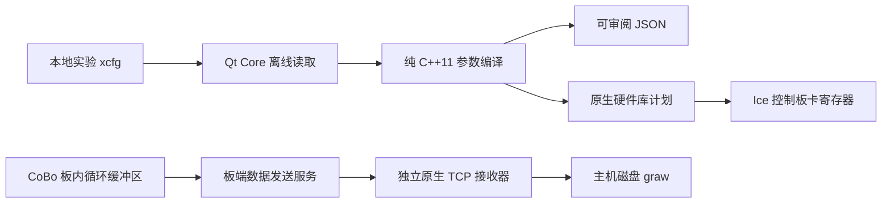

# CoBo 读出配置：参数、原理、离线操作与原生执行

## 1. 目前实现了什么

这一步把旧 CoBo Configure 中影响数据读出的主要参数移入新工程：AGET 配置寄存器/通道掩码、每通道零抑制阈值、主次触发、多重性触发、帧头编号、full/partial 模式及 CoBo 板内循环缓冲区。所有活动芯片和缓冲区先在本机编译、检查，再生成原生硬件计划。

`common/experiment/coboreadoutconfiguration.h/.cpp` 只用 C++11 标准库，不依赖 Qt、Ice、XML、YAML、socket 或文件系统。Qt Core 仅在外围读取 `.xcfg`、追踪参数来源和生成 JSON。原生硬件库复用同一计算结果，Ice 仍只在控制兼容边界内。

**本文不是完整ECC Configure的全部内容。** AsAd TCM、inspection、pulser和2p初始化已进入`CoBoConfigure`组合流程，见[AsAd配置](ASAD_CONFIGURATION.md)；完整Prepare、Configure及采集生命周期已由SystemPreparationClient/SystemAcquisitionClient组合，并经NativeEccCoordinator和native_ecc固定HTTP入口调用。现场配置加载版本、控制权和真实板卡效果仍待验收。

## 2. 配置与数据传输的关系



`CircularBuffer/startOfMemory` 等地址是 **CoBo 板内 RAM 地址**，不是 Ubuntu 主机的内存地址或文件路径。配置软件可以设置这块 RAM 的分配和阈值，但不读取或转发原始事件。板端数据发送服务将数据交给独立接收进程，Qt GUI 只查看状态和低频统计。

这次没有改变接收器的缓冲池、线程队列、MFM 分帧、写盘或导出实现，也没有向它增加任何库依赖。接收器的操作仍见 [高速数据服务](DATA_SERVICE.md)。

## 3. 构建与命令

在项目根目录构建：

```bash
bash tools/build-linux.sh control

# 单独构建纯计算和测试，不需要 Qt。
bash tools/build-linux.sh experiment
(cd build-experiment && ctest --output-on-failure)
```

独立实验核心现在有 AGET 和 CoBo readout 两项 CTest。示例从构建目录运行，兼容不支持 `ctest --test-dir` 的旧版 CTest；必须确认报告发现并运行两项测试，在源码根目录看到“No tests were found”不代表通过。

命令格式：

```text
getdaq-config compile-cobo-readout INPUT.xcfg COBO_INSTANCE VERSIONS OUTPUT.json
```

使用收到的 pedestal 示例：

```bash
./build-suite/bin/getdaq-config compile-cobo-readout \
  source/get/GetBench-software-release-20210208/data/config/configure-pedestals.xcfg \
  0 '0=0x202,1=0x202,2=0x202,3=0x202' /tmp/cobo0-readout-new.json

python3 -m json.tool /tmp/cobo0-readout-new.json
```

Windows 使用 `getdaq-config.exe`，将版本列表放入双引号，并使用自己的输出路径。Qt Creator 根工程仍是 `GetDAQ.pro`；用户的 Qt 5.14.2 MinGW Kit 尚待实际平台验收。

实例是配置中的 `Node[CoBo]/Instance[...]` ID，不能用帧头数字 CoBo ID 代替。版本表的全板编号为 `4*AsAd+AGET`，必须恰好覆盖全部活动芯片；0x201/0x202 是 AGET，0x203 是 ASTRE。指定版本只是编译条件，没有读取实机 reg5。活动范围、型号和 AGET 参数的详细规则见 [AGET 配置](AGET_CONFIGURATION.md)。

输出路径必须是新文件。退出码 0 表示编译和写出成功，1 表示配置/文件错误，2 表示命令格式或版本表格式错误。编译失败不生成工件，也不会替换调用者已有的编译结果；输出仍是 NewOnly 加 flush，不能作为掉电安全的部署事务。

## 4. 工件如何阅读

`kind=getdaq.cobo-readout-image`、`schema_version=1`、`hardware_deployment_supported=false`。

| 字段 | 含义 |
| --- | --- |
| `aget` | 整板 AGET 子工件，包含每片 13 个寄存器、通道掩码和参数来源 |
| `full_readout` | 已核对所有活动芯片一致的 full/partial 模式 |
| `suppress_multiplicity` | 四位位置掩码，不是十六位芯片掩码 |
| `trigger_mask` | 主触发、第二触发及辅助输出触发的最终位值；十进制字符串 |
| `buffer_layout` | CLI 当前固定 `per-asad`；原生类型化 API 另支持显式 shared 布局 |
| `buffers` | 四个 AsAd 的 start/end、编号和活动标记 |
| `writes` | 零抑制、Module、缓冲区的有序目标和值；AGET 寄存器在 `aget` 中 |
| `use_external_time_reset` | 供未来 Start 流程使用的策略；本子序列不执行计数器复位 |
| `parameters` | 本层查询路径、声明来源、行号、局部属性及代码缺省 |
| `sources` | 加载时的根文件/include 摘要；不重复内嵌文件原文 |

所有寄存器值以字符串消费，避免 JSON double 丢失 64 位精度。`writes` 中同一字段可能先清零再启用，必须保留顺序，不能用字典去重后执行。它不是通用脚本，也不是硬件描述；不要把它传给 `getdaq-hardware create-description`。

数值接受非负十进制及带 `0x` 的十六进制，不接受负号、浮点、尾随单位或超范围截断。显式 `type="hex"` 的文本按十六进制解释，例如 `10` 表示 16；来源中保留原 `value=10`，同时记录送入计算的 `compiled_value=0x10`。不能先用范围检查按十六进制理解，再在计算时悄悄按十进制理解。

所选 scalar 的 `type` 与值仍来自该声明；相同泛型路径共享的 `unit`/`range` 会由文档层解析并参与检查，冲突范围不会静默覆盖。硬件编译还按旧 CompoundConfig 规则拒绝全部未知 XML 属性；通用编辑器则原样保留未知内容。该支持不等于完整 CompoundConfig 的数据库/网络和所有旧扩展语义。include 与 `*` 默认声明规则见 AGET 手册。

## 5. 全板读出和 multiplicity 的一致性

### 5.1 full 与 partial

AGET reg1 bit14 来自 `Global/Reg1/isAllChannelRead`。CoBo 另有 `pipeCtrl.partialReadOut`：full 时写 0，partial 时写 1。所有活动芯片必须使用同一种模式；一片 full、另一片 partial 会在本机拒绝。

`Module/enableWriteHittedregister` 控制 `writeHitRegisterMaskEnable`，保留旧参数拼写。它与 readAlways/readIfHit 掩码、full/partial 模式共同决定实际读出，不能仅凭某个通道的 `Reading=only_if_hit` 就断言硬件只读命中通道。例如原始 pedestal 配置的全部活动 AGET 都是 full，即使通道掩码是 only_if_hit，工件仍正确显示 `full_readout=true`。

### 5.2 suppressMultiplicity 为何只有四位

M-CoBo 的 `pipeCtrl.suppressMultiplicity` 对 AGET **位置** 0..3 生效，同一位置的设置跨所有 AsAd 共用。例如 AsAd0/AGET2 与 AsAd1/AGET2 都使用 bit2；它们不能一片屏蔽、一片保留。

编译器要求同位置的所有活动芯片 `Global/suppressMultiplicity` 一致。不活动芯片不参与判断；完全没有活动芯片的位置设置屏蔽位。缺失参数沿用旧 false 缺省，但该来源明确记录。`asad_mask`、十六位 `aget_mask` 和这四位位置掩码各有不同用途，不能互换。

`multiplicityThreshold`、`multiplicityThreshold_2p` 和 `multWindowSize` 分别写 multThreshold、multThreshold_2p、multWindSize。`multSubtractAverage` 缺省 false，`multSubtractDevs` 缺省 0，后者只能 0..7。新代码对两项分别求值，不保留旧 try/catch 中一项缺失导致另一项被忽略的偶然行为，也不在硬件写失败后仅警告并继续。

## 6. 触发、时间单位和帧头编号

| 主触发名字 | 第一次触发字段 |
| --- | --- |
| `external` | external |
| `onRequest` | manual |
| `periodically` | timing |
| `onMultiplicity` | multiplicity |
| `onSlowControl` | slowControl |
| `noTrigger` | 全部关闭 |

五种模式都有 `_2p` 主触发形式：同时启用普通字段及其 `_2p` 字段，而且要求 `enableMem2pMode=true` 与全部芯片 SCA_Splitting 一致。未知或大小写错误的模式拒绝，不沿用旧代码“先清零、然后未知模式静默不启用”的行为。

`secondaryTriggerMode` 是 J6 pin4 的辅助触发输出，本身不触发事件读出。它接受五种普通模式和 noTrigger，没有 `_2p` 输出字段。读取优先级是 secondaryTriggerMode → 旧别名 externalTriggerMode → 主 triggerMode。最后一种缺省若继承了主模式的 `_2p` 字符串，沿用旧行为保持辅助输出关闭；显式填写不支持的 `_2p` 辅助模式则拒绝。

写入计划先清除普通/2p/辅助输出的 15 个字段，再启用所选字段，避免残留前一次配置。触发 mask 位分布为普通 0..4、2p 8..12、辅助输出 16..20，组内依次 external/manual/timing/multiplicity/slowControl。

| 配置 | 单位及新规则 |
| --- | --- |
| triggerPeriod_10ns | 优先，非负 32 位值；一个计数单位为 10ns |
| triggerPeriod | 前项缺失时使用，单位 ms；乘 100000，乘法溢出拒绝 |
| triggerDelay / triggerDelay_2p | 10ns；写对应延迟寄存器 |
| triggerDeadTime_2p | 10ns；写 triggerWindowStart_2p |
| triggerTime_2p | 10ns；写 triggerTime_10ns_2p |
| triggerTimeOut_2p | 10ns；写 triggerWindowEnd_2p |
| scwMultDelay | CKR 时钟周期，不是 10ns；缺省 200 |
| scwScrDelay | 10ns，优先于旧 writeReadDelay；两项都缺失时为 0 |
| dataSource / coboId | 帧头字段，各 0..255，缺省 0 |

有新名字时旧别名不求值，例如定义了 triggerPeriod_10ns 就忽略 triggerPeriod。没有通用自动单位换算；显式错误单位拒绝。整数还要满足实际硬件目标位宽和权限预检查。dataSource/coboId 编译合法不代表多块 CoBo 的编号已全系统去重；该跨节点协调仍由完整后端负责。

## 7. 零抑制阈值

`Module/enableZeroSuppression` 和 `zeroSuppressionInverted` 缺省 false，写 pipeCtrl 对应字段。正向通常抑制阈值以下的采样；inverted 设置改变抑制方向，必须与实验信号极性一起判断，不能当作通道是否活动的开关。

每片活动芯片的全部 68 个 `channel[id]/zeroSuppressionThreshold` 必须可查到，范围 0..4095。这里包括 FPN 11/22/45/56 和 `isActive=false` 的通道：旧 CoBo 零抑制方法独立于普通 AGET 通道位计算，不跳过它们。因此不活动通道的增益等参数可以不求值，但零抑制阈值仍需要明确值。

硬件目标为 `zeroSuppress`（AsAd0）或 `zeroSuppress_AsAd1/2/3`；寄存器名是 `aget<该板上的芯片编号>ch<0..67>`，字段 threshold。这里使用软件通道编号，不去掉 FPN，也不套用普通增益的相反位序。

即使 enableZeroSuppression=false 也写入阈值，沿用完整配置先设置阈值的行为。旧后端遇到阈值缺失可能警告并保留历史值；新编译器拒绝，避免本次配置依赖上次运行残留内容。它们是 CoBo FPGA 的 12 位零抑制阈值，不是 AGET 的 4 位 LSBThresholdValue。

## 8. 板内循环缓冲区

### 8.1 全局范围与四块范围

`CircularBuffer/startOfMemory`、endOfMemory 是非负 32 位地址，要求 start < end。按旧大小计算采用半开区间 `[start,end)`，容量是 end-start。

四个 AsAd 的 CircularBuffer/startOfMemory/endOfMemory 若都可查到，使用显式范围。它们必须全部在全局范围内；活动板的区间必须非空且互不重叠。不活动板可保留非零区间，但不能越界。只有一部分范围可查到时拒绝，不沿用旧代码某一项缺失后忽略其他全部显式设置的回退。

如果四块均未指定，按活动 AsAd 数量分配：1 块分全容量，2 块各一半，3 块各四分之一，4 块各四分之一。三板使用四分之一而非三分之一是旧实现的规则，保留空余一份。按 AsAd 编号升序累加，仅活动板占用容量，不活动板的 start=end。整数除法未分配的余数保留，不伪装成新增容量。

原始 pedestal 示例明确给出了四块范围：0x08000000..0x0A000000、0x0A000000..0x0C000000、0x0C000000..0x0E000000、0x0E000000..0x10000000。即使仅 AsAd0 活动，也使用这组显式分配；不能误读为 AsAd0 自动占用整个全局 128 MiB。

### 8.2 指针、阈值和布局

默认每块写 memStart_asadN、memEnd_asadN、readPtr_asadN，readPtr 设为该块 start。随后写 interruptRate、aFullLevel、aEmptyLevel。这个操作会重置读取位置，必须在采集和相关数据读取停止、旧数据按现有规则处理完后使用，不能作为运行中参数热更新。

`levelAlmostFullMemory` 表示空闲空间低于多少字节时停止继续写入；`levelAlmostEmptyMemory` 表示恢复写入的空闲空间门槛。两者不是“已使用空间”计数。检查 full < 最小活动缓冲区容量，full <= empty <= 容量；interruptRate 缺省 1，必须为正。门槛还应覆盖实际最大帧及现场固件要求，当前没有真实帧样本来证明这个条件。

原生类型化设置可显式选 SharedBuffer，改写全局 memStart/memEnd/readPtr，适用于已核实的旧共享布局。CLI 当前仅编译 per-asad。新执行器不会在 per-asad 写失败后改用共享布局，也不会默默跳过未知 interruptRate 等目标；全部目标/权限先检查，缺失即拒绝。共享布局同样先核对输入范围的一致性，不能靠选择布局掩盖错误配置。

## 9. 原生库的执行和失败语义

`CoBoReadoutConfigure(const CoBoReadoutSettings&)` 返回组合计划，位于 `apps/hardware/coboreadoutconfigure.cpp`。先完成所有纯计算检查，再组合已经验证的 AGET 子序列及本文的有序写入/显式读回。硬件客户端先校验整个组合计划的元数据、位宽、权限及策略；即使最后的 aEmptyLevel 不存在，也不会先写 AGET。

执行开头保留 firmwareEnable=0、intEnable=0 两个位检查及慢控制切换，然后核对全部活动芯片 reg5，再写 AGET 寄存器和通道掩码。随后配置全部零抑制阈值、Module/缓冲区/触发及最终共用读出参数，每项都显式读回。组合计划复用 AGET 子序列，所以它的共用 FPN/2p/readDepth/readOffset 会先写一次，再在 Module 阶段设置最终值；这不是完整旧 Configure 的逐条流程，因为 AsAd 等部分尚未插入。

调用者仍需正确绑定硬件描述、完成 Prepare/串行校准、停止采集及相关读取，并独占目标控制权。两个停止位不能证明这些完整前提。`useExternalTimeReset` 只是返回策略，不在这里复位时间戳或事件计数，也不会启动采集或设置接收器状态。

读回不符立即停止；写入生效后断线记 unknown，不自动重发、回滚、恢复选择或改换内存布局。失败前完成的 AGET 或零抑制设置不会自动撤销；审计日志中的 complete 仅说明这个子序列完成，不能把 ECC 状态直接改成 Ready。AGET reg2 的显式 bit21 警告策略仍见 [原有说明](AGET_CONFIGURATION.md#124-reg2-的历史读回差异)。

16 片全活动的组合计划仍在执行器 4096 步上限内；日志继续采用新文件、intent/逐步结果、fsync 和失败不重用规则。这些机制用于控制操作可靠性，不承担原始数据传输。

## 10. 验证和下一步

纯计算测试覆盖所有 15 个活动 AsAd 掩码、显式/自动/共享缓冲区、25 种主次触发组合及其 2p 形式、跨芯片读出/屏蔽冲突、68 通道阈值、数值边界和旧别名优先级。Qt/CLI 使用两份收到的实际 GET 配置，检查来源、固定寄存器值、新文件保护及失败不生成工件。

硬件 TCP 模拟测试使用 Ice 1.0/1.1，检查稀疏三板的 AGET/零抑制目标、FPN/不活动通道阈值、32 位最高触发周期、触发和帧头字段、两种缓冲区布局，以及版本错误、读回不符、阈值写入后响应丢失只写一次和晚位置元数据错误时零寄存器操作。实际结果和插桩范围见 [验证记录](VALIDATION.md)。

AsAd设置与2p初始化已由CoBoConfigure接入整系统Configure；生产ECC控制和数据生命周期已接入native ECC。真实板卡、电气读出效果、独立Ubuntu24/Windows/macOS部署及持续高速吞吐仍待验收。

依据为收到的 `CoBoNode.cpp::impl_configure`、setCoBoZeroSuppressionThresholds、setCircularBuffers、setTriggerModes、setReadoutMode，以及 fullCoBoStandAlone 硬件描述。保留原 CEA GET 的来源及 CeCILL 许可，不把迁移代码改标为 attpc_envoy 的 MIT。
