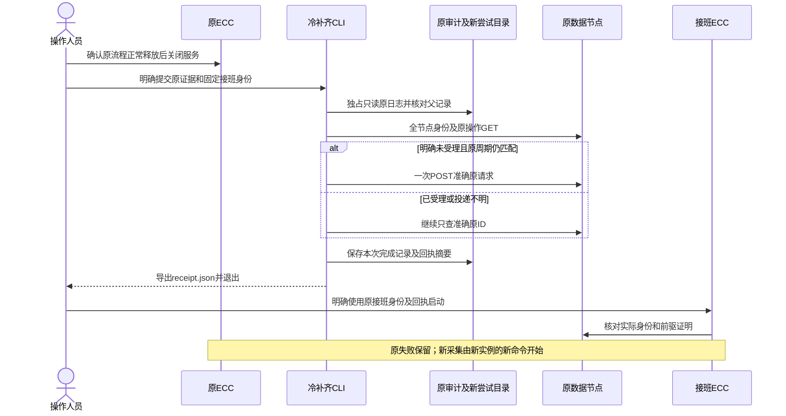

# 原ECC已关闭后，怎样补齐原数据交接

本页的命令处理一种具体情况：原ECC在正常结束、封存并释放采集控制后，向已经冻结的接班目标交接数据节点；部分节点已经受理，另一些节点明确拒绝或尚未发送，随后原ECC退出；也包括节点已受理、原ECC未收到回复的情况。

`getdaq-ecc-handoff cold-complete-submit`可以从保存的原证据补齐这些数据请求，保存完整交接回执。它不会把原硬件控制器恢复成可用状态，不清除硬件UNKNOWN，也不续跑中断的采集。新的采集仍通过原先确定的新服务、新ECC及明确的新命令开始。

这是原ECC主机上的原生C++11工具。Qt操作台和ECC的HTTP前端不传原始事件；本工具也不打开或转发raw载荷。Windows操作电脑需要在原ECC主机执行这些命令；它不是Windows Qt操作台中的新按钮。实际平台和测试范围见[验证记录](VALIDATION.md)。

恢复服务及Windows操作窗口的部署与操作，见[冷数据交接窗口手册](COLD_DATA_HANDOFF_WINDOW.md)。以下独立CLI仍保留，用于原ECC主机直接操作。

## 1. 应选择哪个入口

| 当前情况 | 使用入口 | 结果 |
| --- | --- | --- |
| 原ECC仍在运行，原实例、原请求及独立控制状态健康 | [原实例显式补齐](PARTIAL_HANDOFF_COMPLETION.md)的`complete-submit`，或已有Qt计划退休补齐窗口 | 新接续操作引用原失败操作，旧控制保持禁用 |
| 服务已经关闭，只想查看历史，认证文件已经清理 | [只读历史审阅](COLD_HANDOFF_REVIEW.md)的`review-cold` | 输出历史报告，不生成恢复控制权的凭据 |
| 原ECC已关闭，需要补齐原数据交接；原固定输入、认证文件及接班身份仍完整 | 本页`cold-complete-submit` | 查询原节点操作，有条件补交准确原请求，保存交接回执 |
| 本次冷补齐可能已完成，回执没有保存在操作证据目录中 | 本页`cold-complete-inspect` | 只读已保存的完成审计并重新导出同一回执；不POST、不访问网络 |
| 原Run未正常结束、节点已换实例、原硬件仍UNKNOWN或已受理子操作执行失败 | 本页不适用 | 保留原证据，按相应故障流程核对；不能用新ID绕过 |

`review-cold`和`cold-complete-inspect`不同。前者不要求保留认证文件，产生历史审阅报告；后者导出本次已经完成的交接回执，当前仍按正常固定配置校验其引用的认证文件。不能把审阅报告改名成`receipt.json`交给新ECC。

## 2. 准备哪些文件

| 内容 | 所在主机或目录 | 必须保持的内容 |
| --- | --- | --- |
| 原ECC固定配置 | 原ECC主机 | 原JSON及引用的描述、实验工件、节点、端点和认证路径声明 |
| 原控制器审计根 | 原ECC主机 | `snapshot.json`、`experiment.json`、`ecc.jsonl`及network目录；原路径参与范围绑定 |
| 原交接的后端证据 | 原控制器`operations/原父操作ID/data-handoff` | 原`intent.json`、`handoff-context.json`、`remote.jsonl`及全部后续尝试 |
| 原操作侧证据目录 | 执行命令的主机 | `request.json`和交接前的`original-status.json` |
| 接班ECC配置与接班身份文件 | 原先审阅的ECC主机路径 | 原新配置和0400的`successor.json`，文件摘要、范围、持有期和下一代目标不能改变 |
| 数据节点认证文件 | 配置声明的本机路径 | 本工具需要访问原节点的认证HTTP；不会打印或把令牌写进操作证据 |
| 新证据目录的父目录 | 原ECC主机 | 已存在的规范绝对路径、当前用户所有、0700；新证据目录自身必须尚不存在 |

原`retire-submit`或`submit`生成的证据目录包含这里要求的`request.json`和`original-status.json`。从操作电脑转移证据时，应确认确实包含这两项；不要拿失败后的Status补造交接前状态，也不要用原交接的后端`intent.json`代替操作侧`request.json`。

原有认证文件目前都应保留并符合正常校验，包括原ECC配置和接班配置引用的文件。这里不会为了检查历史而改写固定配置；如果认证文件已经不可用，仍可使用独立的`review-cold`查看历史，但本命令不会据此放宽控制校验。

文件所有者检查以运行CLI的当前UID为准，应使用原ECC的部署账户。示例中的`/home/daq`只是占位路径；先替换为实际部署路径，再在该账户下准备证据父目录，例如：

```bash
mkdir -p /home/daq/operator
chmod 700 /home/daq/operator
```

这只准备新证据的父目录，不创建`cold-001`本身，也不修改原控制器、原节点审计或生产数据的权限。

旧版本没有保存`handoff-context.json`时，本入口保持拒绝。它不会根据当前状态、猜测PID或某个旧回执补造上下文。也不能把原控制器目录复制到另一条路径后当成同一范围继续使用。

## 3. 先正常关闭原ECC

关闭操作台窗口只代表前端退出，不代表`getdaq-ecc-server`已经退出。应通过实际部署使用的服务管理方式正常关闭原ECC，确认它不再持有原生控制日志锁。

本工具不会自动结束原ECC、停止硬件、断开发送器或kill接收器。如果原ECC仍持锁，会报`ECC journal is already locked by another controller/inspection`，不会开始本次数据节点尝试。不要为消除这个错误而删除锁定文件或原日志。

原交接之前必须已经有正常封存周期和已释放的Idle/Described控制历史。若原日志仍有未完成命令、UNKNOWN或错误，关闭进程本身不能使这些条件成立。

## 4. 六个参数怎样填写

命令名之后必须有六个参数，顺序如下：

```text
cold-complete-submit OLD_CONFIG NEW_CONFIG SUCCESSOR_PLAN ORIGINAL_EVIDENCE NEW_OPERATION_ID NEW_EVIDENCE
```

| 参数 | 含义 | 示例 |
| --- | --- | --- |
| `OLD_CONFIG` | 原ECC启动使用的固定JSON配置 | `/home/daq/old/ecc-service.json` |
| `NEW_CONFIG` | 原先冻结并审阅过的接班ECC配置 | `/home/daq/next/ecc-service.json` |
| `SUCCESSOR_PLAN` | 原请求绑定的接班身份文件 | `/home/daq/next/successor.json` |
| `ORIGINAL_EVIDENCE` | 原操作侧证据目录，不是本次新证据目录 | `/home/daq/operator/retirement-001` |
| `NEW_OPERATION_ID` | 本次明确冷补齐的全新操作ID | `cold-001` |
| `NEW_EVIDENCE` | 本次全新证据目录，不能覆盖已有目录 | `/home/daq/operator/cold-001` |

`NEW_OPERATION_ID`只标识这一次明确尝试。节点侧仍使用原交接的操作ID、请求键、实例和目标，不能借新父ID重启已受理的子操作。不要更换下一代计划或重做另一个接班身份来处理同一个部分交接。

新证据目录必须在原控制器及接班控制器审计根之外。父目录需提前存在，例如下面示例中的`/home/daq/operator`；命令不会递归创建任意目录树。

## 5. 提交一次冷补齐

在原ECC主机执行，替换为你的实际路径：

```bash
bin/getdaq-ecc-handoff cold-complete-submit \
  /home/daq/old/ecc-service.json \
  /home/daq/next/ecc-service.json \
  /home/daq/next/successor.json \
  /home/daq/operator/retirement-001 \
  cold-001 \
  /home/daq/operator/cold-001
```

工具先核对原ECC网络策略、原父请求、配置绑定、原正常状态及准确接班身份；再取得原生ECC日志的独占只读锁。它不会追加一次新的ECC打开记录，也不会启动旧硬件控制器。

全部原节点先完成身份、原操作和正常周期核对。已经受理或结果不明的节点只查询原ID；明确未发送或明确409/412拒绝的节点，只有当前仍是准确原实例、原计划、原正常封存周期时才允许补交原请求。任何一个已受理节点的当前周期变化，都会在补交其他节点之前使检查失败。

接班身份文件在本次动作期间持共享租约，新ECC不能同时取得其启动所需的独占租约。成功保存父回执后工具退出，才由下一步明确启动新实例。

## 6. 成功后会看到什么

正常退出并输出回执路径后，新证据目录包含：

| 文件 | 含义 |
| --- | --- |
| `cold-request.json` | 本次冷补齐ID、原请求摘要、原证据路径、原后端意图摘要和接班身份摘要 |
| `original-request.json` | 准确原父请求副本 |
| `original-status.json` | 原交接前的正常状态副本 |
| `receipt.json` | 全部原节点的完整交接回执；类型为控制交接或计划退休，沿用原目标 |
| `completion-held.json` | 仅在提交调用失败时出现；表示本次调用已尝试、禁止自动重试，不表示每个节点都收到POST |

后端另在原控制器`operations/NEW_OPERATION_ID/data-handoff`保存本次请求集合和审计。原交接目录、原网络父失败记录、原生ECC日志与raw不被覆盖。原失败仍显示failed是预期行为：新证据证明补齐结果，不改写旧事实。

不能仅凭`receipt.json`文件名或目录存在判断完成。应核对命令正常退出，保留完整新证据目录，随后按接班流程使用该回执。

## 7. 已完成但回执丢失：只读检查并重新导出

使用同样六个参数，只更换命令名：

```bash
bin/getdaq-ecc-handoff cold-complete-inspect \
  /home/daq/old/ecc-service.json \
  /home/daq/next/ecc-service.json \
  /home/daq/next/successor.json \
  /home/daq/operator/retirement-001 \
  cold-001 \
  /home/daq/operator/cold-001
```

`cold-complete-inspect`不POST、不查询节点或板卡。它只读本次已保存的后端完成审计，重新构造准确同一份回执，核对最后的回执SHA-256；外部`receipt.json`缺失时重新导出，已存在时只接受完全相同的字节，不覆盖不同内容。

这个检查仍核对原配置、认证文件、原父记录及接班身份，且要求接班身份尚未消费。新服务已经启动、接班计划已经激活后，不应再用它申请新权利；保存的原回执及新控制器前驱记录用于后续历史查阅。

如果本次审计没有持久完成记录，检查保持失败，不会自行补发请求。此时保留全部目录，先判断原节点投递状态和失败原因，再决定是否需要另一次明确尝试。

## 8. 明确拒绝后，何时可以另建一次尝试

例如原节点因本机缺少已审阅的0400计划文件而明确拒绝：应在该数据主机恢复原路径、准确字节和规定权限，确认其SHA-256仍是原请求中的值。原新ECC配置和`successor.json`不变。

保留`cold-001`及其失败审计，另选新操作ID和新证据目录，例如`cold-002`，再执行一次`cold-complete-submit`。工具会重新合并全部已保存尝试、查询原ID并核对当前原周期，不因新ID自动获得重发许可。

如果某次请求投递结果不明，随后GET返回404，404不能证明从未受理，本工具仍拒绝重发。不能通过删除失败目录、换下一代目标、改原JSON或反复启动同一提交命令绕过。重复使用同一新证据目录的submit直接拒绝；需要查看时用inspect。

## 9. 用回执启动原先确定的新服务

计划退休时，先按[接收计划更替手册](ECC_PLAN_TRANSITION.md#6-逐节点更换数据服务)在每个数据主机明确更换服务。节点自己的前驱证明是原数据主机上的`plan-retirement.json`；本机路径、节点操作ID及摘要来自原回执，不能拿ECC聚合回执代替节点证明。

例如某个数据节点：

```bash
bin/getdaq-supervisor --config /home/daq/next/data-service.json \
  --predecessor-proof /home/daq/audit/old/control/operations/NODE_OPERATION_ID/plan-retirement.json
```

同计划交接沿用原数据服务实例和原接收计划，不需要为了执行本步骤而重启节点或更换计划。新ECC会核对原节点操作及同一正常封存周期。

所有节点按原目标就绪后，在接班ECC主机明确启动：

```bash
bin/getdaq-ecc-server --config /home/daq/next/ecc-service.json \
  --successor-plan /home/daq/next/successor.json \
  --handoff-receipt /home/daq/operator/cold-002/receipt.json
```

这里应使用实际成功尝试的回执路径；若第一次已经成功，就用`cold-001`。接班计划仍只允许激活一次，失败或消费后的标记保留，不自动重新启动。

新ECC重新核对实际数据节点与前驱证明，随后从明确的新Describe/Prepare/Configure等操作开始。旧ECC及旧操作台记录的禁用状态保留；不要清旧记录来让旧控制台继续操作。新配置、实例、Run和状态记录的使用见[计划更替](ECC_PLAN_TRANSITION.md)及[操作台手册](OPERATIONS.md)。

## 10. 常见错误怎样理解

| 错误或现象 | 含义与处理 |
| --- | --- |
| 原生日志已经锁定 | 原ECC或观察者仍在占用；确认原服务已正常关闭，不删除日志 |
| 原父请求、配置或接班身份不一致 | 参数或文件不再是原请求绑定内容；核对准确原证据，不修改摘要来匹配 |
| 原实验工件或上下文变化 | 不可变输入/证据检查失败；保留现场，不凭旧正常状态继续 |
| 当前节点实例、计划或会话不同 | 节点已更替或进入另一周期，不能把当前状态套到原请求上 |
| 投递不明后404 | 没有足够证据授权补发；保持不明，不盲目POST |
| 本次没有durably complete记录 | 已保存尝试尚未持久完成；inspect不执行补齐 |
| 新证据目录已存在 | submit不会覆盖；用原ID和原目录inspect |
| 接班根或激活标记已存在 | 接班身份已经使用或发生变化；不能重复消费该计划 |
| 凭据不可读 | 本入口仍要求正常配置的认证文件；仅查看历史可用review-cold |

## 11. 实现与验证边界

原生核心在`apps/ecc/native/remotereceivermanager.cpp`，CLI绑定和只读回执重建在`apps/ecc/handoff/coldhandoff.cpp`，历史证据校验在`RemoteHandoffEvidence`。核心不恢复旧硬件对象；CLI把原网络父请求、原配置、接班文件租约和新的独立证据连接起来。

本机测试使用真实独立ECC/节点/receiver进程和模拟板端，验证原ECC退出、缺计划失败、一次明确补齐、同ID拒绝重提、只读回执重导出，以及接班实例的新周期和封存。只读检查额外注入禁止网络的库；插桩范围以构建回执为准，旧库和所有进程未整体插桩。具体通过数量、目录和交付包见验证记录70.64，不能据本页推导真实硬件、Ubuntu24/macOS/独立Windows或持续大流量已经验收。

## 12. 按时间顺序理解各组件的职责

下图只描述控制与元数据。原始数据仍由sender直接进入receiver及磁盘，不经过这些回执和控制请求。



如果外部回执未保存而本次审计已经完整，`cold-complete-inspect`只读图中的审计目录，重新导出同一回执；它不重新执行节点箭头，也不启动接班ECC。
