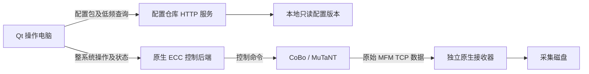

# 配置仓库：上传、登记与查看版本

## 1. 先理解它在系统中的位置

配置仓库保存已经生成的配置发布包。操作电脑把包上传到配置主机，服务器核对完整内容后登记一个版本。你可以列出版本、检查某个版本，并取得服务器上的发布清单路径。

这个过程不执行 Describe、Prepare、Configure 或 Start。登记成功表示服务器保存并校验了配置，不表示板卡已经采用它。当前所有登记收据都保留 `hardware_loaded_verified:false`。审阅后导出选择记录及原生离线生成ECC启动输入现已接入，见[ECC配置选择](ECC_CONFIGURATION_SELECTION.md)；运行中受控切换及板端实际加载核对仍须后续实现。

三条链路分别是：



Qt 网络用于配置和操作。数据量最大的 MFM 流始终由板端直接送到独立原生接收器。仓库既没有原始帧接口，也不会将 `.graw` 上传到操作电脑。仓库的配置块配额不属于 DAQ 数据磁盘配额。

## 2. 程序和目录

| 组件 | 作用 | 依赖与构建 |
| --- | --- | --- |
| `getdaq-config-repository` | 初始化仓库；停服务后本机检查对象/版本 | 标准 C++11、POSIX；CMake |
| `getdaq-config-service` | 认证 HTTP，后台核对/登记配置 | 上述核心、Qt Core/Network/Concurrent；CMake，可选 |
| `getdaq-config-upload` | 上传、查看仓库身份、列版本 | Qt Core/Network、标准配置核心；独立 qmake 工程 |
| `ConfigurationRepositoryWindow` | 操作台中的仓库窗口 | Qt Widgets，随 GetDAQ 构建 |
| `getdaq-config-check` | 离线检查原发布包 | 标准 C++11；已有独立工具 |

对应源码是 `apps/configrepository/`、`apps/configtransfer/`、`apps/envoy/configurationrepositoryclient.*` 和 `configurationrepositorywindow.*`。配置格式与校验复用 `common/experiment/`，没有再次引入 JSON、数据库、curl、Boost 或硬件 SDK。仓库核心不链接 Qt/Ice/yaml。配置仓库的 POSIX 文件身份/权限核验、受限读取、独占发布和目录同步集中在私有 `configurationrepository_files_p.cpp`；仓库层负责对象/版本校验与提交次序。

运行目录例如：

```text
/srv/getdaq/config-store/       0700，仓库运行用户拥有
  identity                    0400，仓库稳定身份
  lock                        0600，单写者锁
  objects/                    0700
    <块的SHA-256>              0400，最多32768字节
  versions/                   0700
    <publication.json的SHA-256>/
      intent.json             0400，绑定本次上传计划
      experiment.json         0400，完整实验工件
      profile.json            0400，明确编译策略
      effective.json          0400，有效快照
      source-000.xcfg          0400，原文/include来源
      ...
      publication.json        0400，原发布清单
      registration.json       0400，最后写入的登记收据
```

凭据文件另放在受限目录，例如 `/srv/getdaq/private/repository.token`，权限要求 **0600**。上图中的 `<...>` 是解释占位符，不是需要创建的字面目录名。

## 3. Ubuntu 构建

从项目根目录执行。这里的构建命令不下载专用依赖；编译器、CMake、Qt 开发包仍须在电脑上安装。

```bash
cmake -S apps/configrepository -B build-config-repository -DCMAKE_BUILD_TYPE=Release
cmake --build build-config-repository --parallel 2
mkdir -p build-config-transfer
cd build-config-transfer
qmake ../apps/configtransfer/configtransfer.pro
make -j2
cd ..
```

产物为 `build-config-repository/getdaq-config-repository`、`getdaq-config-service`，以及 `build-config-transfer/getdaq-config-upload`。服务器配置时如果找不到 Qt Core/Network/Concurrent，CMake 只构建无 Qt 的核心、CLI 和测试程序；没有生成 HTTP 服务时，应先检查 Qt 是否可被 CMake 找到。

原来的根 `GetDAQ.pro` 构建操作台及既有五个子工程，仓库窗口已包含在操作台。上传 CLI 可单独打开 `apps/configtransfer/configtransfer.pro`；服务器使用独立 POSIX CMake 工程。

**目标**是 Ubuntu 24.04；本轮实际测试环境仍是 Ubuntu 20.04.6、GCC 9.4、Qt 5.12.8，不能据此宣布 Ubuntu 24 验收完成。macOS 的目录同步和锁仍需实际验证。

## 4. 第一次建立仓库

使用将来运行服务的普通用户操作，父目录应事先存在。下面以当前用户的家目录做本机试用，避免要求管理员创建 `/srv`。

```bash
mkdir -p "$HOME/getdaq-private"
chmod 700 "$HOME/getdaq-private"
build-config-repository/getdaq-config-repository initialize "$HOME/getdaq-private/config-store"
build-config-repository/getdaq-config-service --generate-token "$HOME/getdaq-private/repository.token"
```

`initialize` 要求最终仓库目录不存在；`--generate-token` 要求最终凭据文件不存在。已有名称会被拒绝，不覆盖历史内容。凭据生成时不打印令牌值。不要把令牌写到命令行参数、工程配置、截图、文档、测试归档或 Git。

启动服务：

```bash
build-config-repository/getdaq-config-service \
  --root "$HOME/getdaq-private/config-store" \
  --credential "$HOME/getdaq-private/repository.token" \
  --bind 127.0.0.1 --port 24002
```

终端应显示监听端口及不执行原始 DAQ/硬件动作的说明。终端保持运行，另开一个终端进行客户端操作。Ctrl+C 或 SIGTERM 请求正常结束；服务析构等待已经接受的后台工作完成。因此客户端关闭窗口、取消或服务收到退出信号，均不能解释为已经撤销服务器上的登记。

同一仓库只有一个进程持有写者锁。HTTP 服务运行时，另一个 `getdaq-config-repository identity/list/version` 进程也会被拒绝，这是为了保证它不会绕过现有对象的故障保持。服务运行期间请用 HTTP/Qt 客户端查看；停服务后再使用本机 CLI。

## 5. 查询并核对仓库身份

```bash
build-config-transfer/getdaq-config-upload \
  --host 127.0.0.1 --port 24002 \
  --credential "$HOME/getdaq-private/repository.token" identity
```

返回 `repository_id`，是该仓库的稳定 64 位十六进制身份。它不是密码，也不是服务进程 ID；同一个完整仓库正常重开保留这个值。重新初始化另一个仓库会产生不同身份。

首次连接请将身份与服务器管理员从本机可信终端核对的值比较，再用于 `--repository-id`。程序不会仅因某个网络端点返回身份就自动信任它。上传和列表查询必须显式指定已核对身份；服务器所有修改请求另核对 `X-Repository-ID`，不匹配返回 412。

当前协议是 HTTP，不提供内建 TLS。远程使用应放在已受控的配置网络，或经现场已有的安全隧道转发。局域网 IP 和 `repository_id` 本身不提供传输加密；不要将服务直接作为公开互联网入口。服务默认只绑定 `127.0.0.1`。

## 6. 准备发布包并上传

先按[发布包手册](CONFIGURATION_PUBLICATION.md)生成整个包，例如 GUI 的 Build configuration publication，或 `getdaq-config publish-system`。普通 `.xcfg` 文件不能直接代替 `publication.json`；必须包含工件、profile、有效快照和全部来源文件。

上传前可独立检查：

```bash
bin/getdaq-config-check publication /absolute/path/to/package/publication.json
```

将下面的 `REVIEWED_REPOSITORY_ID` 替换成第5步核对的值：

```bash
build-config-transfer/getdaq-config-upload \
  --host 127.0.0.1 --port 24002 \
  --credential "$HOME/getdaq-private/repository.token" \
  --repository-id REVIEWED_REPOSITORY_ID \
  upload /absolute/path/to/package/publication.json
```

退出码0且得到有效登记收据，才表示本次观察成功。收据含：仓库身份、发布清单/配置参数/工件/有效树/快照的摘要，以及服务器上的 `manifest_file`。`manifest_file` 是服务器路径，Windows 操作电脑不能把它当本地路径直接打开。`hardware_loaded_verified` 为 false 是正确结果，不是上传失败。

上传期间不修改本地发布包。客户端先完整检查包，再为每个文件计算块摘要；实际发送时重新读对应块并核对原摘要。来源变化会拒绝继续原计划，不能一边编辑一边把新旧内容混入同一次发布。

再次上传同一字节完全相同的包，会先查询已有版本并取得原收据，不重复登记。若只是注释、来源路径或profile发生变化，发布清单摘要可能变化，即使有效参数摘要未变化；这是来源记录变化，不应强行覆盖旧版本。

## 7. 在 Qt 窗口操作

1. 打开 GetDAQ，进入 **GET configuration files...**。
2. 点击 **Remote configuration repository...**，出现独立仓库窗口。当前配置连接期间也可打开；窗口没有硬件 Configure/Start 按钮。
3. 输入服务器规范 IPv4、端口，选择凭据文件。填写的是路径，不是令牌文本。
4. 点击 **Query identity**；核对返回值后将 `repository_id` 填入 **Reviewed repository ID**。
5. 点击 **Upload publication...**，选择本地发布包的 `publication.json`。进度区显示块查询和登记过程。
6. **List registered versions** 只获取元数据索引。选择摘要，点击 **Verify selected version** 才触发服务器完整包检查。
7. 上传失联时保留窗口和原输入，使用 **Observe and resume**。它先查原版本；只有明确未登记时，才查询块并补发缺失内容。

地址、端口、凭据路径或仓库身份修改后，旧客户端计划失效，应重新核对。传输时这些输入被禁用。关闭窗口只取消本地等待，服务端可能仍在保存配置；重新打开后选同一个原包会按同一发布摘要观察。

Windows 用 Qt Creator 打开 `GetDAQ.pro`，选择用户已有 **Qt 5.14.2 MinGW** Kit 构建 GUI；也可打开独立上传 CLI 工程。本实现使用 C++11 和 Qt 5.12 已有 API，没有把 POSIX 仓库后端加进 Windows GUI 工程。Windows Kit、运行和部署仍需在实际电脑验证；Windows 客户端凭据需用文件 ACL 限制读取，不能将 Unix 0600 检查当成 Windows ACL 验收。

## 8. 失联和失败怎么处理

| 情形 | 已知事实 | 下一步 |
| --- | --- | --- |
| 上传某块时超时/连接断开 | 该块可能已经保存 | 保留原计划；查询同一块，缺失才补发 |
| 登记时回复丢失 | 登记可能已完成 | 查询原 `publication_sha256`；取得有效原收据即可，不再 POST commit |
| 版本查询明确 HTTP 404 | 当前未登记此版本 | 原计划重新观察块并提交；不能把其他网络错误当404 |
| HTTP 409 busy | 服务正在执行其他配置工作，未排队 | 待该工作结束，显式观察/继续原计划 |
| HTTP 401 | 凭据不匹配 | 核对凭据来源；不要把令牌输出到日志 |
| HTTP 412 | 仓库身份不匹配 | 停止上传，核对端点和已登记身份 |
| 内容/权限/目录身份变化 | 仓库对象观察到完整性故障 | 保留现场，人工检查；同一对象恢复原值不解除门槛 |
| 本地包改变 | 新字节不再属于原上传绑定 | 核对原包或明确生成另一个完整包；不覆盖旧版本 |

共享 `HttpClient` 使用禁止缓冲的单遍顺序上传设备，拒绝倒回请求体。原因是 Qt 默认可缓冲/重发 POST；即使应用层没有 retry 循环，也可能重复向服务发送请求。当前本机故障测试实际在服务器提交成功后切断连接，并检查两次客户端运行合计只有一次 commit。仍需服务端去重，因为显式重启/恢复客户端、其他客户端或进程崩溃也可能产生重复意图。

同一进程的仓库/凭据故障会保持。故障保持目前不等于跨进程永久锁死：重启后的新对象重新校验当前内容，当前有效内容可能通过。因此重启不能解释为问题已经查明，更不能自动据此加载板卡。

登记中断后目录可能只有 `intent.json` 和部分文件。只有原字节相同的上传计划能够继续；已有文件逐个检查，不覆盖。若计划不同、已有文件内容错误或出现意外文件，拒绝并保留。没有 `registration.json` 的目录不列为已登记版本；有文件或清单本身也不足以证明登记完成。

## 9. 块传输和登记原理

每块最多 **32768字节（32KiB）**，以实际字节的 SHA-256 命名。上传计划记录每个固定角色文件的块列表和发布清单的块列表。计划本身也分块上传，最后 commit 只发送计划块摘要数组。这使配置 HTTP 请求始终有界，而不要求将64MiB的配置文件塞进一个请求。

服务器按计划组装清单并核对其SHA，再按清单固定文件名和长度组装各文件。非末尾块必须恰为32KiB，角色必须完整且唯一。随后复用已有发布校验：文件长度/摘要、profile和工件绑定、来源集合，以及有效快照的语义和双摘要。客户端自检不能代替服务器自检。

全部检查成功后，服务器在新版本目录写入计划意图与角色文件。每个文件先写独占临时名称，完整写入、设0400并 `fsync` 后，通过不覆盖的硬链接发布最终名称并同步目录；再去除自己的完成临时名称。原清单在角色文件之后写入，登记收据最后发布。失败的部分文件保留；原版本从不覆盖。

上述顺序和同步有普通/插桩文件系统测试，**尚未经过真实断电验收**。文件读写和摘要也不是抵抗拥有同一运行用户权限的恶意进程的完整安全隔离。仓库目录应专用于服务，其他程序不要手动创建/替换对象。

## 10. 边界、资源和清理

| 项目 | 当前上限/策略 |
| --- | --- |
| 单个HTTP请求体 | 64KiB；超过返回413 |
| 单个内容块 | 32KiB，非空，SHA-256核对 |
| 计划/发布清单 | 各最多1MiB，最多32块 |
| 单角色块引用 | 最多2048块 |
| 原文来源 | 1..256份，总计最多64MiB |
| 完整工件/有效快照 | 各最多64MiB |
| profile | 最多1MiB |
| 完整内容对象数 | 最多32768个，按最大块计约1GiB |
| 版本目录数 | 最多1024，包含未完成目录 |
| 服务并发 | 一份后台工作；其他请求明确busy，不自动排队 |
| 客户端响应 | 最多1MiB |

“约1GiB”只约束完整块对象，不是整个仓库磁盘硬限额。版本目录保存组装后的文件，失败临时文件也占空间；没有自动垃圾回收/历史删除或整个仓库总字节配额。登记核对还会在内存组装支持的配置文件，不是零拷贝流式DAQ。部署时应留出配置版本磁盘/内存，别与原始数据磁盘混为同一吞吐预算。

当前不提供自动删除。不要只删除某个版本文件来“释放空间”，这会破坏收据与校验。需要清理或迁移时先停止服务、保留原仓库和故障证据，核对完整备份与身份；受控版本清理/迁移接口仍待实现。仓库路径含在收据内，直接搬目录不能假定原收据路径仍有效。

## 11. HTTP 接口和检查范围

所有接口要求凭据；修改接口另要求已核对仓库ID。

| 方法/路径 | 含义 |
| --- | --- |
| GET `/v1/identity` | 仓库稳定身份与块尺寸 |
| GET `/v1/objects/<sha>` | 检查某配置块是否存在并有效 |
| POST `/v1/objects/<sha>` | octet-stream保存该块，同字节重复安全 |
| POST `/v1/commit` | JSON `schema_version:1` 和 `plan_objects`，验证/登记原包 |
| GET `/v1/versions` | 索引；每项 `content_verified:false` |
| GET `/v1/versions/<sha>` | 完整重验该版本后返回原登记收据 |

当前证明为同一物理主机上真正独立服务进程、Qt客户端和文件系统测试，覆盖重复上传、登记回复丢失后观察、认证/身份/请求边界、锁与损坏拒绝；核心另覆盖同计划中断恢复和同对象故障保持。普通及新源码ASan/UBSan/LeakSanitizer结果分别保存，系统Qt未插桩。不是实机、物理多主机、Windows/Ubuntu24/macOS、真实断电或持续DAQ吞吐证明。最终记录见[验证文档](VALIDATION.md)。

验证构建和执行入口：

```bash
python3 tests/build_configuration_repository_validation.py build-config-repository
python3 tests/build_qt_control_validation.py apps/configtransfer/configtransfer.pro build-config-transfer
python3 tests/configuration_repository_core_runner.py \
  build-config-repository/configuration-repository-tests \
  --evidence build-config-repository/my-core-evidence
python3 tests/configuration_repository_network_test.py \
  build-config-repository/getdaq-config-repository \
  build-config-repository/getdaq-config-service \
  build-config-transfer/getdaq-config-upload \
  --evidence build-config-repository/my-network-evidence
```

这些测试只用本机回环地址、临时仓库和发布包；默认读取此前冻结阶段的测试包。干净checkout没有该构建目录时，给两个运行器加 `--manifest /absolute/path/to/test-package/publication.json`，使用按发布手册生成的完整测试包。结果目录不能当生产仓库。归档创建需要本阶段的普通/插桩、GUI/ECC/Run及构建凭据完整，并拒绝覆盖已有包；已归档后可独立检查历史字节：

```bash
python3 tests/archive_configuration_repository_validation.py --historical-only
```

不加 `--historical-only` 还会检查当前工作树输入，后来继续改代码时可能合理失败；历史字节正确不证明后来程序仍是原版本。

Qt关于顺序上传必须设Content-Length及禁止上传缓冲的定义，见[官方QNetworkRequest文档](https://doc.qt.io/archives/qt-5.15/qnetworkrequest.html#Attribute-enum)。本工程的实际不重发证明以本机故障请求记录为准，Qt5.14.2的现场Kit仍需复测。
