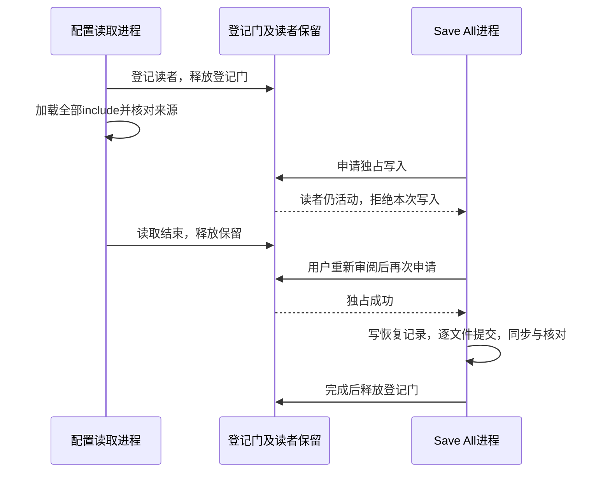

# 配置文件并发读取、保存与中断恢复

本页说明新版配置工具怎样避免读到一次Save All的中间结果。这里的文件是小型XML配置来源，不是采集数据；原生receiver、存储队列和在线导出不使用本机制，也不因此增加Qt依赖。

## 1. 为什么已有恢复记录还需要并发保护

假设根配置同时include两个文件：A保存阈值，B保存合法范围。一次修改需要把A从1改为2，同时更新B。操作系统只能逐个替换文件，不能把两个独立路径在同一瞬间一起替换。

已有Save All会先保存原始/候选副本和摘要，再逐个提交来源。进程中断后，可以按准确记录明确完成候选或恢复原始版本。这个记录解决的是“中断以后如何核对和恢复”，本身不阻止另一个正在运行的读取者在A已更新、B尚未更新时加载来源。

现在增加两层配合：

1. **进程还活着时**，合作的新工具通过共享读、独占写协议互斥，保存者存在时不允许新的来源加载。
2. **保存者异常退出后**，活动锁可以释放，但来源旁的未完成Save All标记仍在。普通加载拒绝这些来源，必须使用原恢复记录明确核对。

锁不能替代恢复记录，恢复记录也不能替代锁。对不参与这个协议的旧软件、文本编辑器或其他主机，不承诺跨文件原子可见性。运行中的ECC继续使用已经发布、绑定的不可变配置工件，不实时追踪正在编辑的XML树。

## 2. 使用者会看到什么

| 操作与当前情况 | 结果 | 接下来怎么做 |
| --- | --- | --- |
| 两个窗口只读加载或生成快照 | 可以并行读取 | 正常审阅即可 |
| 有后台来源读取，另一窗口准备保存 | 保存拒绝并报告`transaction busy` | 等待读取完成，重新审阅再保存 |
| Save All正在提交，另一进程打开来源 | 加载拒绝并报告`transaction busy` | 等待保存结束后重新打开 |
| 保存进程在第一份文件提交后退出 | 普通加载报告`unfinished Save All`及记录路径 | 保留记录，按第3节处理 |
| 来源被其他编辑器改成第三种内容 | 原审阅或恢复拒绝覆盖 | 核对外部修改，不能通过删除标记强行继续 |
| 事务缓存目录权限或类型不符 | 拒绝来源操作 | 关闭配置工具后检查准确目录，不直接清理恢复记录 |

失败不会自动排队重试保存，也不会自动回滚或覆盖来源。窗口已有的未保存文本仍须按窗口提示保留；成功保存后，其他窗口的旧审阅也不会自动变成新版本，应重新加载或重新审阅。

并发保护使用一个用户级登记域，因此另一个不相关配置目录的长读取也可能暂时挡住保存。它优先保持来源组合一致；当前没有按配置目录细分锁域。后台只读任务之间仍可并行，切换到另一份配置也不必等待前一个只读快照结束。

## 3. 中断后怎样继续

1. 确认原保存进程已经退出。保留来源文件、`.getdaq-workspace-recovery/save-UUID/`及来源旁的`.getdaq-workspace-save-摘要.json`。
2. 打开多文档配置工作区，点击 **Inspect interrupted save...**，选择报错指向的准确恢复记录。
3. 选择 **Finish the reviewed candidate** 或 **Restore the recorded original sources**，预览每份文件的当前字节、目标字节及摘要。
4. 核对全部来源和根配置的组合。确认框默认取消；只有明确确认后才执行恢复。
5. 成功后关闭旧工作区，重新打开来源。旧Undo历史不自动绑定恢复后的文件。

活动锁释放只说明进程不再占用登记域，不能证明Save All完成。不要删除缓存锁、来源标记或恢复目录来消除`unfinished Save All`。更详细的磁盘步骤、容量和再次中断处理见[多文档工作区第11节](CONFIGURATION_MULTI_DOCUMENT.md#11-save-all中断后的持久恢复记录)。

## 4. 锁在哪里，哪些程序能互相协调

程序使用Qt的`QStandardPaths::GenericCacheLocation`，在其下固定使用：

```text
getdaq-configuration-transactions-v1/
  source-access.lock        读者登记门；写者在整个来源写入期间持有
  read-UUID.lock            每个活动读取作用域的保留文件
```

这个位置不使用可执行文件名或应用名，所以GetDAQ、配置CLI及独立配置测试程序可以共用同一登记域。常见路径：

- Linux：`$XDG_CACHE_HOME/getdaq-configuration-transactions-v1/`；未设置XDG变量时通常在`~/.cache/`下。
- 当前实际Windows Qt5.14.2环境：`%LOCALAPPDATA%/cache/getdaq-configuration-transactions-v1/`。不同Qt/系统部署应以`GenericCacheLocation`实际结果为准。

协作要求是：采用同一版协议、同一用户、同一操作系统环境、相同的规范缓存位置，并能正确识别对方进程是否存活。修改`XDG_CACHE_HOME`会建立另一个域。**Windows原生程序与WSL程序不共享这个互斥协议**，即使它们可以看到同一份配置文件。也不支持用网络共享目录把不同主机的本地进程锁变成分布式锁。

旧版程序没有这个协议，不能与新版同时编辑同一批来源。外部文本编辑器也不参加；保存前的来源字节复核仍保留，但不是对外部程序任意时刻写入的强制保护。

POSIX事务目录以0700原子创建，后续检查属主、权限、规范路径及非符号链接。不会把不合规目录自动改为合规后继续。Windows创建目录并设置Qt权限，但本轮测试不证明NTFS ACL隔离或与POSIX相同的目录断电持久性。活动期间不要手工删除或搬移缓存目录。

## 5. 内部读写顺序

`common/config/xcfgtransaction.h`提供作用域对象`XcfgIoTransaction`，只使用已有Qt Core和C++11设施，不引入外部锁服务或新依赖。

读者先短暂取得登记门，创建唯一的`read-UUID.lock`保留，再释放登记门。随后整个加载、来源检查或候选计算期间持有自己的保留；退出作用域时释放。多个读者不需要互相等待整个解析过程。

写者先取得登记门，检查全部读者保留。存在活动读者就拒绝本次写入；没有活动读者时，继续持有登记门，直到整个来源写入作用域结束。因此不会在两个Save All提交之间让一个新读者进入。



登记门每次`tryLock`最多等待250ms；这不是整个来源操作的执行时限，也不是等待所有读者完成的超时队列。读者保留最多256个；达到上限时先核对失活保留，仍无空间就拒绝。使用`QLockFile`的零年龄失活规则，不能仅因操作耗时长就删除活进程的锁；退出进程遗留的读者保留由后续登记/写者核对清理。保留文件刚好在枚举后消失，按已经完成的读者处理。

同一线程内嵌套读取、写者内部的读取或再次写入复用已有作用域。**不允许把已经活动的读者升级成写者**，避免读写升级死锁；调用方应结束读取并重新取得写作用域。不同线程各自登记，通过相同文件协议协调。

## 6. 哪些入口接入了保护

| 入口 | 作用域 |
| --- | --- |
| `XcfgDocument::Load`、来源核对、快照/覆盖预览 | 共享读；物理来源读取检查未完成Save All |
| 工作区打开、候选重建、结构/声明移动预览和暂存 | 共享读；暂存只改变内存 |
| 单值保存、覆盖、结构Apply、单文件历史执行 | 独占写，内部重算预览仍可嵌套读取 |
| `XcfgWorkspace::SaveAll` | 独占写覆盖重新审阅、记录、全部提交与完成核对 |
| 保存记录创建/完成、明确ApplyRecovery | 独占写；恢复预览共享读 |
| 隔离副本、文本/二进制导出的来源访问 | 预览共享读，实际保存独占写 |

工作区使用的私有内存候选、原恢复记录中的候选字节仍能在受控检查后解析。否则恢复器会被自己要恢复的标记永久挡住。这个内部入口不作为普通调用方绕过磁盘校验的公开开关；新增外部include仍要接受物理来源检查。

## 7. 验证了什么，还没有验证什么

最终独立进程场景使用实际`XcfgDocument`、`XcfgWorkspace::SaveAll`和`XcfgSaveJournal`，不是用测试锁替代产品入口：

- 第一份来源同步后暂停保存进程，独立观察确实为A=2、B=1；另一个普通加载被拒绝。释放后只接受完整的2、2。
- 一个已加载文档的写者与另一个读者交错；写入拒绝，来源保持不变，同时第三个读者可以并行成功。
- 写者在第一份来源同步后立即退出；普通读取因原待核对记录拒绝，另一个进程明确完成原候选后才能读取。
- 读者立即退出遗留保留；后续真实Save All可核对失活保留并完成。
- Linux目录权限错误和符号链接被拒绝；Windows使用真实NTFS临时来源进行前四类测试，结束删除自有临时来源，仅保留小型证据副本。

普通、插桩、实际Qt5.14.2 MinGW核心以及完整界面测试的具体结果见[验证记录70.67](VALIDATION.md#7067-配置来源共享读取独占保存与中断加载保护2026-10-18)。立即退出的子进程不具备正常LeakSanitizer退出检查，不能据此声称这些子进程无泄漏；系统Qt也没有整体插桩。

本协议本身不实现文件路径迁移；后续[路径迁移功能](CONFIGURATION_PATH_MIGRATION.md)复用它并增加新路径/旧路径消失的独立恢复记录。它仍不强制外部读者只见全旧或全新、不提供跨主机锁或任意硬件冷恢复，也不证明真实断电、目标磁盘损坏、Ubuntu24/macOS或独立Windows部署已经验收。生产环境仍应发布不可变配置工件后再明确选择并部署。
