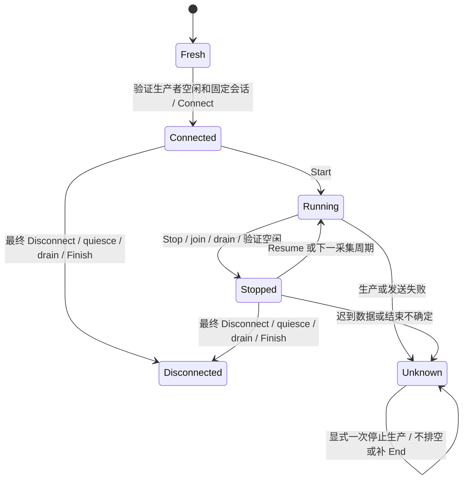

# ICE 源端生命周期：生产线程、暂停、尾缓冲与最终结束

本页对应 `apps/icecontrol/controlledicesource.h/.cpp`。它在数据源进程内部组合生产线程和已经实现的 `IceSourceClient`。它不让 ECC、Qt 操作台或数据主机代发原始波形，也不把旧板端的 Stop 应答当作流结束。

这是源端接入模块，完整 ECC 新控制接口及固定会话已有本机联调；尚未直接替换旧 VxWorks 板端程序。已经提供实际实现、线程/网络测试和无需 Qt 的构建入口，原来的 `source/` 保留不变；板端工具链和现场互通仍须继续。

## 1. 为什么在源进程里处理结束

旧 `IceDataSender` 用长期 communicator 发送单向 `processData`。它的析构没有结束方法；暂停/Stop 可以刷新已有缓冲，同时还需要在同一 Run 内恢复或重新 Start。若在每次 Stop 后发布 finishStream，后续恢复会向已封存会话追加数据，破坏边界。

正确关系是：



Pause/Stop 表示生产线程和尾缓冲完成本次停止。Disconnect 表示此源不再为该接收会话提交数据。两者不能混为同一个操作。

## 2. 构建：数据进程可以不安装 Qt

源码和旧专用依赖都在本地。纯数据构建生成原 `DataProcessor`、`DaqControl`、`CmdException` 三份必要 GET 接口，跳过 ECC、Qt 控制服务和无关硬件接口。配置阶段禁用 Qt 查找，目标也不链接 Qt/yaml/Boost/curl。

在仓库根运行：

```bash
cmake -S third_party/ice-compat -B build-ice-data \
  -DGETDAQ_ICE_DATA_ONLY=ON \
  -DGETDAQ_BUILD_ICE_RECEIVER=ON \
  -DCMAKE_DISABLE_FIND_PACKAGE_Qt5=TRUE \
  -DCMAKE_BUILD_TYPE=Release

cmake --build build-ice-data --target \
  getdaq-ice-receiver getdaq-ice-send getdaq-controlled-ice-source -j4
```

`GETDAQ_ICE_DATA_ONLY` 默认为 OFF，原完整兼容构建保持原有入口；纯数据模式必须显式启用可选 ICE 组件。它仍需要标准 C/C++ 编译器、CMake、线程/POSIX 和本地嵌入的 Ice/bzip/mcpp 源码，不需要另外寻找二十年前的主机 Ice 安装包。

数据模式不是完整控制主机安装。需要旧 ECC/硬件工具时，使用 [兼容构建说明](ICE_COMPATIBILITY.md)；Qt 操作台独立构建。源端低频扩展/固定会话已接，详见 [源控制接口](ICE_SOURCE_CONTROL.md)。此入口现针对 Linux/macOS POSIX，尚无 macOS 实际验收，也不等于 Windows 原生 DAQ 进程已支持。

静态库目标 `getdaq-controlled-ice-source` 供源端程序链接，不是一个假装硬件采集的命令行守护程序。源程序要提供真实读出线程、停止检查和尾缓冲排空回调。

## 3. 四个回调分别做什么

| 回调 | 源端应用必须完成的动作 | 返回所表示的范围 |
| --- | --- | --- |
| `verifyIdle` | 确认生产线程已结束/已 join，必要的设备停止观察和队列前提满足 | 应用的空闲检查成功；不自动取得硬件独占权 |
| `start` | 启动读出/生产线程，把真实字节交给 Feed | 源端启动回调返回；不证明 receiver 持久写盘 |
| `stop` | 停止生产并等待全部生产线程退出；不能只设置一个退出标志就立即返回 | 回调已确认停止；实现责任仍在源应用 |
| `drain` | 将剩余有效字节按原顺序通过 Feed 发出，排空自有尾缓冲 | 应用排空回调返回；单向发送仍只是本地 handoff |

缺少任何回调，构造就拒绝，不会连接数据端口。接收会话必须是显式的 64 位小写十六进制 `expectedSession`，不能在此受控模块中任意发现别的会话后继续发送。

回调必须有可解释的有界失败策略。Ice 请求超时只限制网络调用，不会强行终止任意应用线程或设备等待。`stop` 等待生产线程时不能持有该线程 Feed 所需的应用锁；超时/无法确认停止应抛异常，保留 UNKNOWN。

回调可以调用本模块的 Feed 和 Status，不能递归调用 Connect/Start/Stop/Disconnect/StopProductionAfterFailure：控制操作相互串行，递归控制会造成等待。实际硬件命令和应用审计属于源应用/ECC 的对应控制层。

## 4. C++11 接入示意

公共头只使用 C++11/标准库类型。Ice 实现在已有源库中隔离，Qt 不进入此模块。

```cpp
#include "controlledicesource.h"

GetDAQ::IceSourceOptions options;
options.address = receiverAddress;
options.port = receiverPort;
options.expectedSession = reviewedReceiverSession;
options.chunkBytes = 256 * 1024;

GetDAQ::IceProducerCallbacks callbacks;
callbacks.verifyIdle = [&readout] { readout.VerifyIdle(); };
callbacks.start = [&readout] { readout.Start(); };
callbacks.stop = [&readout] { readout.StopAndJoin(); };
callbacks.drain = [&readout] { readout.DrainRemaining(); };

GetDAQ::ControlledIceSource source(options, callbacks);
// 将真实读出和 DrainRemaining 的发送目标接到 source.Feed(data, bytes)。
source.Connect();
source.Start();
// 生产线程提交原始字节；UI/ECC 不搬运字节。
source.Stop();       // 暂停/停止本周期：保留连接，不发 End。
source.Start();      // 恢复或下一周期，仍是同一个会话。
source.Stop();
source.Disconnect(); // 最终排空后，源自身在原连接发送结束。
```

这里的 readout 是真实源应用已有的读出对象，并非仓库中声称已经实现的板端驱动。不能把这些示意方法改成空回调就当成真机停止/排空验收。

Feed 借用输入字节，并在返回前交给原生源库；调用者之后可以复用缓冲。支持任意字节块，不把块当 MFM 帧。缓冲区读指针只能在本次调用明确返回后推进；发送失败时保留待核对位置和原始记录，不猜测远端是否收到了部分块。

## 5. Stop 怎样避免线程死锁

模块分别使用控制操作锁、数据锁和短状态锁。Stop 先进入 Stopping，然后执行 stop/join 和 drain；执行回调时不占数据锁，所以正在退出的生产线程或排空回调仍能调用 Feed。

待回调完成并再次确认空闲，Stop 才获取数据锁，等正在发送的调用退出，再提交 Stopped。测试使用真实 std::thread，从生产线程 Feed，并从 drain 内追加一帧，证明不会因 join 持有数据锁造成死锁。

Feed 只允许在 Running/Stopping。在 Connected、Stopped 或结束后提交非空数据属于生产者违反边界，模块拒绝并保持 UNKNOWN，不能再通过 Disconnect 装作完整完成。模块不能补救应用在生产线程已经真实退出后又创建一个未经管理的线程；应用必须遵守 join 和生命周期前提。

## 6. 最终 Disconnect 的严格条件

Disconnect 只接受 Connected 或 Stopped。Running 状态不能借 Disconnect 隐式停止生产；调用方必须先完成正常 Stop，确保硬件/线程停止路径有独立记录。

最终 Disconnect 会再次 stop/join、检查空闲、排空尾缓冲、再查空闲，随后在数据锁下调用 IceSourceClient.Finish。Finish 使用此前固定的同一连接、接收会话和累计本地发送字节。零数据源也需要这条合法源结束，不能靠空目录或析构完成。

只有收到源结束应答，源端状态才成为 Disconnected。它仍不是接收器封存或 Run 完成证明。数据主机还必须等待实际 receiver 正常退出，核对独立 ICE 凭据和真实文件，操作见 [管理 ICE](MANAGED_ICE.md)。

## 7. UNKNOWN 和一次显式停止

以下情况保持 UNKNOWN：生产/停止/空闲/排空回调出错，非标准 C++ 异常，发送不确定，迟到数据，或最终结束应答丢失。状态保留先前计数及是否已经尝试结束，普通 Connect/Start/Stop/Disconnect 不允许重放。

同一 UNKNOWN 对象可以显式执行一次 `StopProductionAfterFailure()`。它只调用 stop/join 和 verifyIdle，不调用 drain、不重发原字节、不补 finishStream，不把 UNKNOWN 改成成功。尝试标记在回调之前设置；即使停止回调失败，也不能再次执行同一失败停止。

```cpp
try {
    source.Stop();
} catch (...) {
    // 先在应用控制/审计层记录原失败。
    source.StopProductionAfterFailure(); // 仅尚未执行过此专门停止时调用。
    // source.Status().state 仍然是 Unknown，继续人工/外部核对。
}
```

failureStopAcknowledged 表示专门停止与空闲检查回调都返回，不表示整体数据恢复。不要新建对象、换端口或清目录来解除历史门槛。真实 ECC 接法必须记录同一源实例、会话和操作意图，才能讨论硬件恢复。

模块析构只释放本地资源，不发送 Stop 或 End。应用必须在销毁模块之前显式停止/join 所有可能引用它的线程，并保证回调对象还活着。已有失败只能在保留 UNKNOWN 的前提下处理，不能在析构中自动补成功结束。

## 8. 本机验证怎样解释

普通和新代码 ASan/UBSan/LeakSanitizer 各 12 实际场景：两种编码的三采集周期同连接、空源、错预期会话、连接前非空闲、普通/非标准排空异常、停止后空闲检查失败、迟到 Feed、析构无 End、源结束丢连接及同端口不同会话替换、缺少回调。失败后的显式一次停止保持 UNKNOWN，不再次排空或结束。

测试对照真实原始 MFM 字节和接收计数。普通停止期间完整小帧可以仍在接收器的有界写盘缓冲中；accepted_file_bytes 不等于此刻已同步的文件大小。失败用例先证明没有 End/凭据，再由夹具清理信号关闭并保留完整帧；这不是生产控制路径，也不会生成成功凭据。

每组总预算 8 MiB，输入/输出所有流合计远低于用户的 20 GiB 上限。正常、失败、捕获中断都清理本轮合成 raw，仅保留小型结果/计数/SHA；SIGKILL/断电/文件系统错误不保证 finally。生产数据不使用测试清理。

纯数据独立构建还运行同一套 12 项场景，证明没有依赖 Qt 配置或链接。详细构建/实际程序及归档见 [验证记录](VALIDATION.md)。旧 Ice/GET/bzip 和系统库没有整体插桩；本机测试不证明真实 VxWorks、板端 FIFO/中断、目标平台、持续吞吐或断电完整性。

## 9. 下一步接什么

源端低频控制扩展及原生ECC固定来源/会话现已接续，详见 [ICE源控制](ICE_SOURCE_CONTROL.md)。DataSenderClient仅在实际核对新增能力和固定实例/会话后接受ICE；原板端旧接口仍被拒绝，不能仅改协议字符串。真实驱动/控制权/加载及硬件恢复仍需继续。

可移植环形读出、分块预算、掩码/刷新策略和失败读指针门槛已实现，接法见[源端环形缓冲手册](SOURCE_RING_READOUT.md)。真实 DMA/MMIO、设备停止/中断和控制权仍需接到回调，并在板端工具链验证。原始发送库已实现，不能把示意回调或模拟源当成现场驱动。原代码来源和接口保留，参见 [ICE 源库](ICE_DATA_SOURCE.md)及[接收原理](ICE_DATA_INGRESS.md)。

生产/停止/join/排空回调已有可复用SourceRingReadout模块，完整ECC夹具已改用实际读出线程和双缓冲完整帧边界；接法与真实driver前提见[读出线程手册](SOURCE_READOUT_LIFECYCLE.md)。
