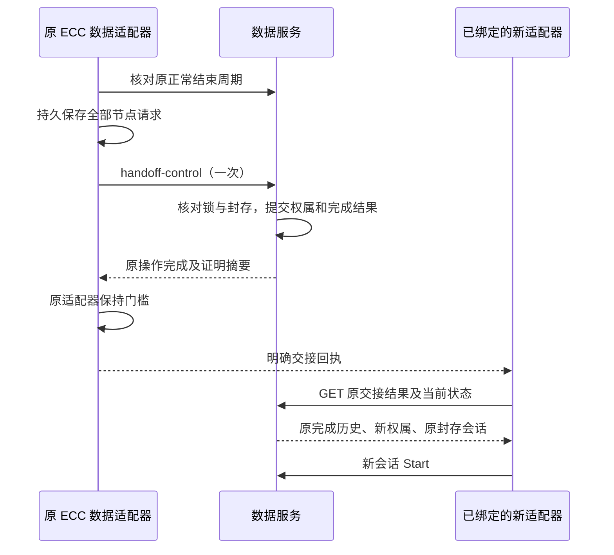

# 数据服务控制权交接：原控制者明确交给新控制者

后续面向原ECC服务的受控入口、原生操作工具与独立接班启动见[服务交接手册](ECC_SERVICE_HANDOFF.md)。本页保留数据节点和多节点适配器的底层规则及70.50阶段证据；不同接收计划的数据层入口见[计划切换说明](DATA_PLAN_TRANSITION.md)。同计划节点交接中“服务已接受、写证明失败”的有限补齐流程见[失败节点交接补齐手册](FAILED_CONTROL_HANDOFF_COMPLETION.md)。

## 1. 解决什么问题

每个数据主机上的 `getdaq-supervisor` 会绑定一个 ECC 控制者。绑定内容包括控制者标识、控制范围摘要和持有期。这样，另一个 ECC 进程即使知道数据主机地址和相同接收计划，也不能直接启动或收尾原接收会话。

配置版本切换需要建立新的 ECC 实例，因此必须先解决原控制者怎样把数据服务交给新实例。`handoff-control` 提供这一底层能力：**原控制者明确指定接班者，数据主机重新核对正常结束的原会话，再持久提交权属变化。** 它不采用超时抢占，不修改板端接口，不传输原始数据。

目前已经实现数据服务、原生 CLI 和 ECC 多节点数据适配器的交接；服务仍失败但原周期正常封存时，也有操作员显式补齐入口。完整 ECC 配置版本切换命令、板卡主机占用的交接和覆盖所有交接场景的 GUI 操作向导仍在接续中。本章不把底层交接写成已可直接使用的完整配置切换。

## 2. 先分清三个标识

| 标识 | 含义 | 从哪里取得 |
| --- | --- | --- |
| `controller_id` | 固定计划允许的 ECC 控制者名称 | 数据服务 identity / 固定配置 |
| `controller_snapshot_sha256` | 数据控制范围摘要，绑定父 ECC 快照和其审计根 | 原适配器 `Status().controllerScopeSha256`；服务 status 返回当前值 |
| `controller_epoch` | 这一个适配器对象的随机持有期 | 原适配器 `Status().controllerEpoch`；服务 status 返回当前值 |

数据控制范围摘要不是父 ECC 的 `snapshot_sha256` 本身。不要把二者互换，也不要手填一个看起来合法的摘要。接班者的范围和持有期必须来自已经绑定自己父审计根的新适配器对象。

交接保持 `controller_id`、接收计划及其配置/工件摘要不变，只改变明确指定的控制范围和持有期。**参数改变后重新加载接收计划是另一项工作。** 本命令不会把旧计划改成新计划。

## 3. 哪些状态可以交接

必须同时满足：

1. 数据服务仍是原来运行的同一实例，原控制者与持有期匹配。
2. 原接收会话已正常 Finish，状态为 Stopped；接收器全部正常退出并已回收，退出码为 0，封存已确认。
3. 没有服务、存储或独立控制故障，没有其他正在执行的操作。
4. 原输出目录、锁文件、最终状态和封存记录仍可核对；文件集合及大小与原来相符。
5. 明确的新范围和持有期通过格式与身份检查，且新旧组合不同。

Fresh 尚未产生控制归属、Ready 正在接收、Failed、Aborted、Retired 或冷服务重开均不能用本命令交接。失败会话退休不等于正常封存；必须先完成对应故障恢复，并有新的正常结束周期，才能满足本路径。

交接重新核对的是进程结果、输出锁、封存元数据、文件集合与大小，不重新读取巨量事件载荷，也不提供整个数据集的内容校验和证明。

## 4. 单节点服务与 CLI

命令仍通过带认证的 `POST /v1/operations` 提交，使用新的操作 ID。请求除原有固定字段外，增加：

```json
{
  "command": "handoff-control",
  "successor_controller_snapshot_sha256": "由已规划的新适配器取得的64位小写十六进制摘要",
  "successor_controller_epoch": "由该新适配器取得的64位小写十六进制持有期"
}
```

这是完整请求中的附加字段示意，不能单独提交。完整请求还需要 `schema`、`operation_id`、当前服务实例/计划/控制者身份、原控制范围与持有期、配置/工件摘要及父审计引用。其他命令不能携带这两个新字段；已有请求的规范字节保持不变。

原生 CLI 可以提交由控制软件生成、已审阅的完整请求文件：

```bash
bin/getdaq-supervisor-query submit \
  --host 192.0.2.20 --port 24001 \
  --credential-file /home/daq/private/data-node.credential \
  --expected-agent data-node-0 --controller experiment-ecc \
  --expected-plan YOUR_ACTUAL_PLAN_SHA256 \
  --request-file /home/daq/reviewed/handoff-request.json
```

示例地址和路径需要替换。认证值仅从私有文件读取，不放入命令行。`202` 表示请求被接受，必须继续通过原 ID 查询终态：

```bash
bin/getdaq-supervisor-query operation \
  --host 192.0.2.20 --port 24001 \
  --credential-file /home/daq/private/data-node.credential \
  --expected-agent data-node-0 --controller experiment-ecc \
  --expected-plan YOUR_ACTUAL_PLAN_SHA256 \
  --operation-id YOUR_ORIGINAL_HANDOFF_OPERATION_ID
```

成功结果的 `handoff` 字段包含明确的新范围、新持有期和原交接证明文件摘要。status 中的当前归属随后变为新控制者。旧 ID 仍可查询；同 ID、同请求只返回原结果，不重复交接。用同 ID 改接班者会被拒绝，旧控制者用新 ID 发起 Start 也会被拒绝。

这些是开发/受控集成接口。完整 ECC 切换入口接通前，不应绕过仍在使用数据服务的 ECC 对象，单独执行节点交接。

## 5. ECC 多节点适配器怎样使用

交接分为规划、原控制者交接、新控制者核对三个阶段。

1. 建立新适配器并绑定它自己的父快照和审计根。此时仅规划身份，不连接旧数据流、不采集。
2. 读取新适配器的 `Status()`，取得目标范围和随机持有期。
3. 原适配器在自己保留的正常完成周期内调用 `HandoffControl(newAuditDirectory, successorScope, successorEpoch)`。
4. 原适配器先核对全部节点，把全部规范请求写入原父审计目录，再逐节点各发一次 POST。全部确认且新权属的即时 status 核对通过，才生成 `CompletedControlHandoffJson()`。
5. 新适配器在尚未查询/使用节点之前调用 `AdoptControlHandoff(receipt)`。它只接受指向自身范围、持有期和完整节点集合的回执，独占创建并绑定自己的回执文件。
6. 后续 Validate/VerifyStopped 会向每个原数据服务查询原交接 ID，核对真实完成结果、证明摘要、原实例与计划、新归属和原封存会话。全部通过以后才可启动一个新会话。

旧适配器在尝试交接后不能再继续正常工作；成功后也永久保持自己的门槛。新对象不会因为看到 Stopped 就自动认领旧会话，未绑定回执仍会拒绝把该旧周期当作自己的周期。



## 6. 应答丢失、部分完成或文件变化

POST 应答丢失不表示服务没有执行。客户端不自动重发。原适配器保存每个节点的原请求、操作 ID 和观察结果；某节点不确定时，不能生成完整交接成功回执，不能回滚已完成节点或换新 ID 重做。

一部分节点可能已经交给接班者，另一部分仍归原控制者。这时两个对象都不能把整个系统当作可继续采集，也不存在跨节点原子事务。若未完成节点的原 `handoff-control` 操作明确处于 `failed`，且它仍是同一运行服务、当前归属和周期仍符合条件，可按[失败节点交接补齐手册](FAILED_CONTROL_HANDOFF_COMPLETION.md)由操作员明确补齐该节点，再让原父ECC只读观察完成结果。应答不确定、原实例/周期改变、节点冷重启、不同接班目标或独立故障均不属于此恢复路径。

服务重启可以重放查看原交接完成历史和新权属，但不会因此接管原进程或自动启动新会话。当前冷服务仍保持核对门槛。

原交接证明、规范请求文件、操作目录身份或新适配器的回执被改变，会保持存储/核对故障。把文件内容恢复原样不会自动解除门槛。不要删除旧审计目录、锁文件或原数据来“修复”它。

## 7. 依赖与性能边界

交接核心使用原生 C++11/POSIX 和现有有界 JSON 协议，原生 CLI 不依赖 Qt/Ice/curl。服务的 Qt 前端只接收低频控制请求；原始事件仍直接进入独立原生 receiver。

每份请求不超过 8 KiB，交接证明/回执不超过 1 MiB。交接不搬运或重写数据文件，不增加板端服务接口，也不代表取得板端/跨主机的全局排他锁。

## 8. 验证和接续范围

数据服务九场景分别经过普通构建与 ASan/UBSan 检查：正常交接与新周期、真实应答丢失、冷服务、证明/请求/目录身份篡改、封存文件大小变化、输出锁重新占用和独立故障保持。ECC 两节点适配器已覆盖两编码的新对象核对/新周期，以及应答丢失和回执变更门槛；上述适配器四场景也通过ASan/UBSan，数据服务同时使用插桩构建。独立检查器逐项核对实际请求/请求摘要、完成行、原封存会话及交接证明摘要；不只依赖测试自报。

全部使用本机合成帧和测试自有进程，不是物理多主机或现场板卡验收。每组测试载荷预算 2 MiB，结束后删除自有 `.graw`；用户所有测试流合计 20 GiB 的限制保持。

本次完成的是配置切换所需的数据控制权交接组件。节点的有限“accepted 后 failed”证明补齐已有原生查询工具和父端只读观察，但面向所有用户场景的同计划交接 GUI、不同配置的完整操作向导、板卡主机占用连续交接和任意冷/不确定交接恢复仍待实现，整套重构未完成。

相关说明：[远程接收控制](REMOTE_RECEIVER_CONTROL.md)、[ECC 配置选择](ECC_CONFIGURATION_SELECTION.md)、[主机板卡占用](HOST_CONTROL_OWNERSHIP.md)、[重构状态](REFACTOR_STATUS.md)。

本阶段结果入口如下：

- 普通服务九项：`build-controller-handoff/ordinary-final-evidence/controller-handoff-5q1_neoe`。
- 插桩服务九项：`build-controller-handoff/sanitized-evidence/controller-handoff-f9pz5qn9`。
- 普通适配器四项：`build-controller-handoff/remote-final-evidence/remote-controller-handoff-1w81jm2a`。
- 插桩适配器四项：`build-controller-handoff/remote-sanitized-evidence/remote-controller-handoff-tp_ce73q`。

在源码根目录可执行：

```bash
python3 tests/check_controller_handoff_evidence.py build-controller-handoff/ordinary-final-evidence/controller-handoff-5q1_neoe
python3 tests/check_controller_handoff_evidence.py build-controller-handoff/remote-final-evidence/remote-controller-handoff-1w81jm2a
python3 tests/check_controller_handoff_sanitizer_build.py build-source-retirement/sanitized-final build-controller-handoff/remote-sanitized
```

前两条只核对保存的证据，不操作硬件；第三条检查适配器夹具168项依赖与编译前已有摘要的一致性。若后续源码改变，旧记录可能报告不匹配，应查阅新阶段结果，不应改旧摘要来伪装匹配。

数据服务普通与插桩各60条严格C++11编译配方/121输入，系统Qt未插桩；适配器插桩重编译16个对象，按实际仓库头依赖核对复用62个对象，旧GET/Ice库未整体插桩。Linux完整23程序、Windows实际Qt5.14.2 MinGW六程序已重建。Windows程序字节与上一阶段相同，新文档包明确沿用相同程序/DLL的既有初始窗口检查，不冒充新交互人工验收。

当前候选目录为 `build-packages/getdaq-host-20261015-controller-handoff-candidate` 和 `build-packages/getdaq-windows-qt5142-20261015-controller-handoff-candidate`，证据索引为 `build-controller-handoff/checkpoint.json`。旧阶段的包和证据保留；本机仍是Ubuntu20.04.6/WSL、GCC9.4、Qt5.12.8，并非Ubuntu24/macOS或现场验收。

候选包自身的三项补充联网联调（success / ack-loss / cold）因自动审批额度限制未能启动，命令没有执行，因此不计入以上26个已通过场景。候选包文件清单已核对；实际运行证明来自上列普通/插桩构建。阶段索引可用 `python3 tests/check_controller_handoff_checkpoint.py` 重新核对。
