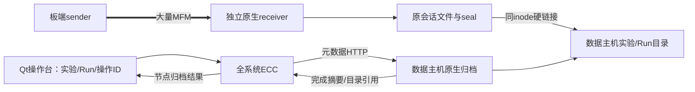

# 数据主机Run归档：配置、原理、操作与失败处理

Run编号、手动回退及覆盖约束见[Run编号与覆盖规则](RUN_NUMBER_AND_OVERWRITE.md)。legacy Sentry支持在Start确认后以同名raw新文件胜出、不同名旧raw保留的方式替换Run；Native catalog仍拒绝已有Run，本手册下文描述Native归档的当前“不覆盖”行为。

## 1. 这项功能做什么

原生 `ReceiverCatalog` 在接收器确认自然EOF、排空、正常退出及seal之后，将这一接收会话与实验名和Run号关联。它在数据主机建立Run目录和原始文件的硬链接，保存原始请求、文件清单、seal副本及完成凭据。原会话目录、文件和seal保留，后续生命周期核对仍使用这些原路径。

GUI只提交低频元数据；ECC协调各数据节点，节点上的原生C++11代码进行归档。Qt不读取、缓存、复制或发送.graw内容。硬链接操作增加文件名，数据块仍是原来的数据块；容量不会因为这次归档再增加一份数据。两处文件名指向同一inode，编辑任意一处都会改变同一数据，分析程序应以只读方式打开。独立备份仍须由专门的数据任务完成。

当前ECC/数据服务归档仍要求原始数据目录和catalog_root在**同一文件系统**。已完成归档可由独立无Qt的 `getdaq-catalog --copy-catalog` 复制到另一文件系统；跨主机默认使用普通TCP/IP的 `--send-catalog-tcp`，接收端运行 `--listen-catalog-tcp`。该归档链路不做身份认证或加密，SHA-256只用于内容校验；部署时必须绑定可信网络地址并用防火墙限制来源。操作、续传方法和风险边界见[归档复制与传输](CATALOG_TRANSFER.md#13-普通-tcpip-发送已完成归档)。复制与跨主机传输都是独立原生任务，不经过Qt/ECC数据通道，也不自动迁移原Run路径。



## 2. 构建与程序职责

在项目根目录运行：

```bash
cmake -S apps/datasupervisor -B build-data-supervisor \
  -DGETDAQ_BUILD_SUPERVISOR_SERVICE=ON -DCMAKE_BUILD_TYPE=Release
cmake --build build-data-supervisor -j2
```

输出：

| 程序/类 | 职责 |
| --- | --- |
| getdaq-supervisor | 原有接收器控制HTTP和新的catalog持久命令；Qt仅做网络通知 |
| ReceiverCatalog | 原生同文件系统归档核心；读取有界元数据、检查文件身份、建立硬链接 |
| getdaq-catalog | 原生离线请求检查、明确执行或归档检查CLI，无Qt/Ice/yaml/curl |
| RemoteReceiverManager | ECC的多节点意图、只提交一次、原ID观察与结果核对 |
| NativeRunControl | GUI的Stop→Breakup→可选Catalog→本地Run完成记录 |

只编译原生核心和CLI，可设置 `-DGETDAQ_BUILD_SUPERVISOR_SERVICE=OFF`。`bash tools/build-linux.sh data`也构建这些原生目标，receiver热路径继续独立。

实际Qt/ECC组合仍按 [ECC网络手册](ECC_NETWORK_SERVICE.md) 构建。WindowsQt5.14.2 MinGW用于GUI；归档核心使用POSIX，实际验证是当前Linux环境，macOS及目标Ubuntu24仍需验证。

## 3. 数据节点配置

在每个数据服务的固定receiver_plan中增加 `catalog_root`，其余字段沿用 [远程接收管理](REMOTE_RECEIVER_CONTROL.md)。例如：

```json
"deployment_id": "experiment-node-A",
"catalog_root": "/srv/getdaq/catalog"
```

这两行属于receiver_plan对象，不是顶层字段。完整模板见 [supervisor-service.catalog.example.json](../config/receiver/supervisor-service.catalog.example.json)。模板地址、路径、三个摘要和全部source ID必须按实际部署修改。

| 约束 | 为什么 |
| --- | --- |
| catalog_root为规范绝对路径、现有普通目录、当前服务用户所有、0700 | 限制归档位置并绑定目录身份 |
| 与这一节点所有来源的会话目录在同一文件系统 | 硬链接无法跨文件系统；预检查会在创建目标前拒绝 |
| 不在某个receiver会话目录内部 | 保留原会话边界，避免把归档目标递归混入会话 |
| deployment_id为字母/数字开头的字母、数字、下划线或短横线，最多128字符 | 它将作为数据节点的Run子目录名 |
| 实验名最多80字符，字符规则与GUI实验名相同 | 请求不能指定任意目录或越过归档根 |
| Run号为0～INT_MAX-1 | 与GUI运行号保持一致 |

例如在数据主机上先建立目录：

```bash
mkdir -p /srv/getdaq/catalog
chmod 700 /srv/getdaq/catalog
```

目录须由实际服务用户建立/拥有；不要在此处填GUI的output_dir。GUI的本地Run记录根与数据主机catalog_root是不同目录。

不填catalog_root时归档功能关闭，原14字段计划的规范字节和摘要保持原有格式。启用后计划包含第15个字段，其plan_sha256随之改变；ECC端预期数据计划摘要也必须重新核对。正在运行的固定计划不能直接改文件来启用：按部署流程重新准备新固定输入和审计根，保留旧证据，不通过换目录清UNKNOWN。

## 4. GUI操作

先配置全部数据节点的catalog_root，再更新ECC固定输入中的各节点plan_sha256，核对新的ECC输入/快照摘要。GUI配置增加：

```yaml
getdaq:
  simulation: false
  native_catalog: true
  native_ecc:
    # 原有11个固定客户端字段仍需完整填写。
```

native_catalog位于getdaq内、native_ecc外；默认false，以便保留前一阶段仅保存封存引用的模式。“Nodes and paths”也提供“Require data-host Run catalog before Complete”选项。必须使用原生全系统模式；旧SOAP/模拟模式不能设置此标志。

正常流程：

1. Connect核对固定身份、属主和当前状态。
2. Progress依次完成Describe、Prepare、Configure，Start Run开始生产。
3. Pause/Resume保留同一receiver会话。
4. Stop先停生产，GUI随后提交Breakup并等待所有receiver的EOF、正常退出和seal。
5. 开启native_catalog时，GUI保存完整归档请求意图，向ECC只提交一次catalog，绑定当前实验名与Run号。
6. ECC先检查全部节点是当前已封存会话且计划启用了归档根，然后持久保存全部节点请求，逐节点最多一次POST；后续只观察原ID。
7. 各节点成功后，GUI等待新的全系统状态，核对每节点归档文件数与封存集合，再保存data-catalogs.json、receiver-status.json和Run完成记录，推进Run号。

状态表的Dataset显示原会话目录；Run archive显示节点归档目录。GUI不会打开这些路径读取原始数据。任何节点失败时Run保持未完成；已成功节点的归档结果保留，不自动回滚或再次提交。

## 5. 归档目录与完成证据

```text
catalog_root/
  .getdaq-catalog.lock
  Experiment/
    run_0000/
      experiment-node-A/
        request.json               原始规范请求/计划/Stopped集合
        manifest.json              来源、原路径、seal摘要、帧数与文件身份
        catalog-complete.json      完整完成凭据，最后发布
        source_0/
          receiver-seal.json       原seal副本，内容摘要写入manifest
          CoBo...graw              与原文件相同inode的硬链接
        source_1/
          receiver-seal.json
          CoBo...graw
```

source_0/source_1按照本次已核对的Stopped集合排序；具体source ID在manifest中保存，不能只靠目录序号判断物理板卡。

源会话另增加 `.getdaq-catalog-intent.json`，绑定操作ID、请求摘要和最终目标。它用于阻断将同一会话换一个新ID再次归档。原seal的output_directory继续指向原会话目录，因此本版本保留原路径；受控删除/释放原会话目录尚未提供。

目录出现或.graw链接出现，只说明操作已经开始。**catalog-complete.json必须存在且可完整核对，才表示节点归档完成。** 目标目录独占创建，不覆盖旧Run；中途失败可能留下不完整目录和源意图，供检查。CLI检查会核对完成凭据→manifest摘要→原请求摘要→来源/文件inode、大小与名称集合；不会读取事件内容。

完成凭据包含operation_id、request_key、manifest_sha256、directory、linked_files及payload_method: hardlink、raw_payload_bytes_read: "0"。这证明本次归档关系，不代替每个物理事件的完整性或持续DAQ性能验收。

## 6. 归档前检查与持久过程

归档前检查整个来源集合：当前会话、PID/reaped/exit=0、seal_verified、配置/工件摘要、自然EOF、durable、准确文件集合/大小，以及目录、文件、锁的身份/权限。仍被receiver占用的目录锁会立即拒绝；不会kill进程来获得锁。

全部预检查完成后才创建目标和意图。先提交所有源意图，再建立硬链接；过程保留源锁和归档根写者锁，检测源文件/目录/seal和锁被替换。链接后核对实际inode和文件元数据，提交目录及元数据，完成凭据通过独占临时文件和链接发布。源文件内容已由receiver关闭并同步；归档代码只读取请求、seal和清单，不读取.graw载荷。

单请求最多1MiB，seal单份最多16MiB、累计最多64MiB，整个节点最多65536个文件，manifest最多16MiB。日志按阶段及每1000个链接检查点记录，避免对每个文件反复读取整份可执行文件和部署日志。预算不足时保留失败，不无记录继续。

文件/目录fsync、原子完成文件发布和只重查原操作ID已有本机测试；断电/真实存储设备/目标平台的持久性仍需独立验收。原硬链接步骤不复制载荷或进行内容哈希；独立复制任务及副本内容验证见[复制手册](CATALOG_TRANSFER.md)。

## 7. 离线CLI

CLI以归档请求JSON作为输入；请求包含schema/kind、操作ID、实验/Run、完整固定plan与完整Stopped集合。不要用手写“reaped=true”代替实际监督器证据。正常生产应优先使用ECC/数据服务，CLI用于已经核对的离线资料/受控手工操作。

```bash
build-data-supervisor/getdaq-catalog --check-request /home/daq/catalog-request.json
build-data-supervisor/getdaq-catalog --execute-request /home/daq/catalog-request.json
build-data-supervisor/getdaq-catalog --inspect-catalog \
  /srv/getdaq/catalog/Experiment/run_0000/experiment-node-A
```

check-request保留源锁并核对所有来源，不创建目标或意图；进程结束释放锁。execute-request明确执行一次，没有自动重试或修复；已有目标/源意图时拒绝。inspect-catalog只检查已有完成记录和文件身份，可在服务之外运行，不解除任何服务UNKNOWN门槛。

源请求的plan含目录/端口/可执行程序路径与摘要，不含认证值。它的接收器Stop结果必须来自真实服务记录；离线CLI不负责验证远程控制权或重新接管旧进程。

## 8. 数据服务协议与故障处理

仍使用认证 `POST /v1/operations` 和 `GET /v1/operations/原ID`。catalog沿用原11个请求字段，再增加catalog_experiment、catalog_run_number、catalog_session_id；只有catalog命令允许这些字段，它们进入规范请求摘要。非catalog请求/结果的字节格式保持原样。catalog完成操作额外返回catalog对象，绑定本次固定根、会话和文件清单。

| 现象 | 处理边界 |
| --- | --- |
| 提交时receiver仍Ready/正在收数 | 接受前拒绝，不能生成归档意图 |
| expected session错误/计划未启用固定根 | 接受前拒绝，不能指向别的旧Run |
| 目标Run已存在 | 保留旧目标和当前数据，不覆盖 |
| 某源文件/seal/目录锁改变 | 停止、保留门槛和证据；恢复原文件不自动清除当前对象故障 |
| 第一个节点已完成、第二个失败 | 保留第一个节点结果，GUI Run不Complete；不自动回滚或换ID重放 |
| POST应答丢失 | 保存原ID，后续只读观察；失联不证明未执行 |
| 服务重启 | 保留原操作结果，新的实例保持核对要求，不自动重放/接管 |
| 不完整目录且没有完成凭据 | 视为未确认；保留原会话和原操作意图，不能手工删日志后自动重试 |
| 跨文件系统目标 | 全源预检查拒绝；通过独立原生数据迁移任务处理 |

关闭窗口或服务不会取消已经接受的归档，也不会发送信号杀receiver。旧Run目录的分析工具应检查完成凭据，不能把目录出现当成完整交付。

## 9. 已验证范围与剩余工作

当前普通版：原生归档27组文件系统检查、真实receiver生命周期15场景、数据服务15场景及8组原生HTTP故障、GUI运行控制10项、完整GUI53项、客户端14项及实际Qt/ECC/两数据服务归档的Ice1.0/1.1两组通过。文件系统测试包含512MiB稀疏文件，核对相同device/inode/blocks；系统调用跟踪未发现读取或复制.graw载荷。它验证归档方法，不能作为512MiB流式吞吐测试。

数据主机原生核心/服务的插桩生命周期与15场景通过；最终全系统ECC/GUI普通和插桩各两编码成功/部分失败共六场景通过，独立请求/源码/真实文件inode及凭据复核通过。具体根与归档范围见[验证记录](VALIDATION.md)第34节。跨文件系统复制及元数据任务窗口已由后续70.24/70.25接续；后续70.87/70.88验证了localhost真实OpenSSH回环，70.96/70.97新增普通TCP归档CLI、部分续传及Ubuntu24候选刷新。以上都不是两台独立主机/现场防火墙/目标磁盘或持续吞吐验收。真实断电、物理多主机/MuTaNT、受控原会话清理的更广场景、完整硬件UNKNOWN核对与目标平台验收仍未完成。
