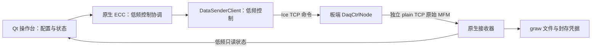

# 数据发送器控制、暂停和接收器封存

## 1. 本阶段做到哪里

新增无 Qt 的 `DataSenderClient` 和 `DataLinkSetClient`，控制现场板端旧 `mdaq::DaqCtrlNode` 接口。实现连接、缓冲区选择、刷新策略、启动、停止和断开，每一步都有持久化日志；整组连接先检查全部服务，再连接第一块板。

CoBo/MuTaNT原生运行顺序由接续同一准备对象的[SystemAcquisitionClient](SYSTEM_ACQUISITION.md)组合，并已接[原生ECC](NATIVE_ECC_COORDINATOR.md)、接收进程管理及[整系统GUI](ECC_GUI_CLIENT.md)；本页说明sender组件，完整硬件恢复和现场验收仍未完成。不要把本组件的Running/Stopped当整套DAQ状态，也不通过逐板CLI绕过系统配置。

默认TCP保持原控制序列；ZBUF使用相同连接生命周期，已接固定计划/发送端协议匹配及实际运行核对，配置与边界见[受管理ZBUF](MANAGED_ZBUF.md)。FDT的Stop关闭连接，采用另一套[接收周期机制](MANAGED_FDT.md)，保留同一sender对象/receiver会话并允许重连。

本机测试使用模拟板端、真实 Ice TCP 控制连接和独立原生接收进程。没有连接真实 GET 板，没有验证真实中断线程、DDR 读指针、帧完整事件数或持续吞吐。

代码入口：

- [单发送器接口](../apps/hardware/datasenderclient.h)、[基础生命周期实现](../apps/hardware/datasenderclient.cpp)、[ICE失败恢复与只读观察](../apps/hardware/datasenderclient_ice.cpp)。
- [整组连接接口](../apps/hardware/datalinksetclient.h)、[实现](../apps/hardware/datalinksetclient.cpp)。
- [原生回环测试](../tests/hardware_data_sender_test.cpp)、[独立接收进程测试](../tests/data_sender_receiver_integration.py)。
- 接收器现有操作见 [原生接收器手册](DATA_SERVICE.md)；系统配置见 [整系统实验参数](SYSTEM_EXPERIMENT_CONFIGURATION.md)。

## 2. 控制连接与数据连接是两条不同的网络路径



`DataSenderClient` 不提供接收帧、复制波形或转发数据的方法。它只告诉板端“向哪个地址发送”“读哪些缓冲区”“启动或停止读出”。真正的字节从板端直接进入 `getdaq-receiver`，不经过 Qt、ECC JSON、Ice 控制客户端或 YAML。

因此 Qt 是否参与界面绘制，不会直接限制本路径的原始传输带宽。实际速度仍取决于板端读出、网卡、内核 TCP、接收器队列和磁盘。需要在超过页缓存规模的数据量下测持续性能；本阶段的几帧联调不能给出 Gb/s 或零丢失保证。

## 3. 最容易混淆的三个动作

| 动作 | 板端普通 TCP 实现的行为 | 接收器此时能否封存 |
| --- | --- | --- |
| `connect("TCP", "IP:port")` | 创建 sender 和中断监视器，并建立数据连接；旧实现会先销毁之前的 sender | 不能，新的连接仍打开 |
| `daqStop()` | 请求中断监视器停止、等待、刷新剩余缓冲区，调用 sender 的 `stop()` | 通常不能，普通 TCP socket 仍保留 |
| `disconnect()` | 销毁 sender，关闭普通 TCP 数据连接 | 接收器可观察 EOF；仍须检查帧尾、排空、fsync、进程退出和封存凭据 |

此结论来自收到的旧实现，而不是 `.ice` 中“daqStop closes data link”的简短注释：

- `source/get/GetBench-software-release-20210208/src/get/daq/DaqCtrlNodeI.cpp` 的 `daqStart/daqStop/disconnect/createDataSender`。
- `source/mordicus/MDaq-release-20210208/src/mdaq/daq/DataSender.h` 的 `start/stop` 只改变标志。
- 同目录 `TcpDataSender.hpp` 持有 TCP 连接，`flushData` 消耗缓冲区内容，析构才释放连接。

暂停应停止触发/采集，再停止并刷新发送器，保持同一个数据连接。继续时重新启动同一个 sender。**暂停不产生 EOF，不能归档这一轮数据。** 本组件的 Start 只恢复发送器；CoBo 流水线、读指针和 MuTaNT 主从运行位必须由系统采集协调器另行处理。

结束一轮必须分别确认：系统停止触发/采集 → 发送器停止并刷新 → 断开数据连接 → 接收器收到 EOF → 队列排空与文件同步 → 正常退出 → 检查封存凭据与目录锁释放 → 归档。系统级原生 ECC 已把生产停止/刷新和 sender Disconnect 接入 `SystemAcquisitionClient`；Breakup 随后调用接收服务的 Finish 并核对停止状态，Unprepare 另外核验停止和撤销准备条件。一次 Stop 应答只确认生产停止阶段，不能跳过 Breakup 的 EOF/排空/封存，也不能把 Breakup 当作 Unprepare 或归档完成。各阶段实现与错误边界见[全系统采集](SYSTEM_ACQUISITION.md)、[结束与撤销准备](SYSTEM_RELEASE.md)和[数据服务](DATA_SERVICE.md)。现场固件、真实多板联动、运行中故障和完整硬件恢复仍需实机验证。

## 4. 参数逐项说明

`DataSenderOptions`是C++参数对象；对应固定ECC输入JSON见[网络部署](ECC_NETWORK_SERVICE.md)，不要把C++字段名直接当JSON键。

| 字段 | 取值与用途 |
| --- | --- |
| `senderId` | 1..128 字节 UTF-8 ID，无控制字符；应与实际配置中的 CoBo/MuTaNT 实例对应 |
| `controlProxy` | 1..4096 字节 Ice 直接 TCP 代理，例如测试地址 `DaqCtrlNode:tcp -h 127.0.0.1 -p 46003`；这是控制端口，不是原始数据端口 |
| `receiverAddress` | 明确的单播 IPv4 和端口，例如 `127.0.0.1:46005`；端口 1..65535，不使用旧接口的隐式默认端口 |
| `protocol` | 默认TCP，受管理接受TCP/ZBUF/FDT；实际connect传此值，非默认进入ECC快照，须与receiver_plan.sources.input_protocol一致，不自动降级 |
| `circularBufferMask` | 1..15，每位对应一个 AsAd 缓冲区；例如 AsAd0/3 是二进制 1001，即 9；应来自同一已核对的配置，不根据数据量猜测 |
| `alwaysFlush` | 默认 false，沿用批量发送策略；true 要求小段尽快刷新，可能增加发送次数。Stop 仍须刷新剩余数据，不能靠 false/true 证明完整性 |
| `exclusiveStoppedOwnerConfirmed` | 默认 false；调用者必须明确提供独占且停止的前提声明。**声明不等于真实锁或远端停止验证** |
| `encodingMinor` | 0 或 1，即 Ice 编码 1.0/1.1；旧现场通常使用 1.0，需要核对实际板端版本 |
| `timeoutMs` | 100..600000 ms，默认 30000 ms；旧 Stop 可能花约 10 秒等待中断线程，再花时间刷新数据，不能机械沿用 3 秒寄存器超时 |

接收地址拒绝主机名、IPv6、空地址、缺端口、端口 0、前导零端口、广播/组播和无效 IPv4。现阶段选择旧板端已经明确实现的普通 IPv4 TCP 路径；ZBUF线上仍是原始TCP，FDT另有控制字与重连语义；ICE尚未接入，不把这些名称当相同生命周期。

控制代理拒绝间接 adapter ID、router、locator、非 TCP endpoint，以及缺明确 host/port 的目标。客户端固定双向调用、编码及超时，并关闭 Ice 自动重试。集合规范身份使用对象ID/facet及目标host/port，忽略超时、压缩和本地绑定选项，端点顺序/重复不改变身份；本地检查不解析 DNS，也不能判断不同 DNS 名或不同地址是否实际上指向同一设备。现场拓扑须使用审阅过的明确地址。

## 5. 单发送器状态如何理解

| 已确认状态 | 允许的后续动作 |
| --- | --- |
| Fresh | Connect |
| Connected | Start 或 Disconnect |
| Running | Stop |
| Stopped | Start 或 Disconnect |
| Disconnected | 本实例结束，不能重新 Connect |
| Unknown | 普通动作全部拒绝，等待完整恢复协调 |

执行中还有 Connecting、Starting、Stopping、Disconnecting。`Snapshot()` 可以在另一线程读取状态；操作本身串行执行。

Connected 只表示 `connect`、`setCircularBuffersEnabled`、`setAlwaysFlushData` 的应答和日志完成，不证明固件已经配置、接收器运行目录正确或 ECC Ready。Running 只表示 `daqStart` 应答完成；Stopped 只表示 `daqStop` 应答完成。Disconnected 也不证明 EOF 已被接收器处理。

快照另有 `lastConfirmedState`、`issuedCalls`、`acknowledgedCalls`、`operation`、`outcomeUnknown`。例如断开已经执行，但应答丢失，状态为 Unknown，`lastConfirmedState` 仍是 Stopped；issued 比 acknowledged 多一。这时接收器可能已经完整封存，也可能没有，必须独立检查。

构造函数只解析代理，不调用远端。`Validate()` 实际调用远端 `ice_isA`，不能将本地 typed proxy 当成真实接口身份。每次动作也会重新核对接口。析构只释放本地 Ice 资源，**不发送 Stop、Disconnect、shutdown 或补偿操作**；对象重建不能代替恢复。

## 6. 日志、部分失败与告警

每次操作要求全新日志路径。已有文件拒绝覆盖，文件权限 0600，目录和逐条记录同步到磁盘。意图必须先持久化，再发远端动作。

典型记录顺序为 `intent → call_begin → call_acknowledged → complete`。Connect 包含三次独立 RPC；第二次失败时，第一次可能已建立连接，不能假装整份 Connect 没有生效。

超时、网络断开、远端异常、方法缺失，或者动作后日志写入失败，都可能留下部分效果。一旦本次已有远端动作尝试，客户端保持 Unknown，不重发，也不自动断开前面已成功的连接。即使 Slice 声明 disconnect 为 idempotent，本客户端也只调用一次；新目录或新操作 ID 不消除未知结果。

如果告警 checkpoint 在第一条 RPC 之前就拒绝，客户端恢复本次原状态，记录 `aborted_before_call`；已经连接一部分再发生告警，则保持 Unknown/部分失败。Connect/Start 可接受 checkpoint，调用方可用同一 `SystemPreparationClient::CheckInterlock()` 消费所有板的保持告警。checkpoint 无法撤销正在执行的远端动作。

Stop/Disconnect 不接受这个告警 checkpoint。停止路径不能被“已经发生告警”这一保持条件再次阻断。它们仍有状态、类型、日志等约束；这不代表完整的告警应急停机已实现。Unknown 对象的恢复和多板停止失败后的继续处理仍须由完整系统恢复协调器决定。

## 7. 多板连接为什么要整组先检查

`DataLinkSetClient` 在构造时检查全部 ID、规范控制代理身份和接收地址的唯一性。两个 sender 不能指向同一个接收地址，因为当前接收器每进程只服务一个 sender。每块板应有独立接收端口和 incoming 目录。

Connect 先对所有客户端执行只读 Validate；第二块或末尾接口错误时，第一块还没有 Connect，也没有创建操作目录。通过后创建全新 0700 根目录，逐 sender 连接；任何部分失败保持 Failed，不自动清理已成功连接。

Disconnect 先检查全部客户端都是本地 Connected/Stopped，再检查全部真实接口类型，随后逐个断开。某个 sender 仍 Running、Unknown 或类型改变时，在第一条 Disconnect 前拒绝。断开过程中应答丢失则集合 Failed，后面的连接保留，交恢复协调处理。

集合不提供 StartAll/StopAll。启动 CoBo、MuTaNT slave、master 的顺序与固件位写入有关，不能用遍历所有 sender 来代替系统 Start。调用方通过 `Sender(id)` 取得同一长寿命客户端，配合系统硬件步骤调用它。

上层须用同一个串行命令队列协调集合动作与取得的sender命令；不能由另一个线程在Disconnect预检查与执行之间发Start。单sender操作自身串行，Snapshot可并发只读；本组件没有跨外部客户端的原子锁。

根目录结构：

```text
new-operation-dir/
  data-links.jsonl       # 整组意图、各sender阶段、成功或部分失败
  connect-0.jsonl        # 第一个sender三条连接/策略RPC
  connect-1.jsonl
  disconnect-0.jsonl     # 断开阶段；不会覆盖连接日志
  disconnect-1.jsonl
```

## 8. 接入原生后端的接口示例

以下展示 API，不是可直接对现场执行的完整 Start 程序。实际后端必须先取得真实控制权、核对已加载配置、硬件停止和接收进程就绪，并保持同一系统准备/告警对象。

```cpp
#include "datalinksetclient.h"

GetDAQ::DataSenderOptions link;
link.senderId = "CoBo0";
link.controlProxy = "DaqCtrlNode:tcp -h 127.0.0.1 -p 46003";
link.receiverAddress = "127.0.0.1:46005";
link.circularBufferMask = 9;
link.exclusiveStoppedOwnerConfirmed = true; // 上层已经核对，不能凭此行建立锁。
GetDAQ::DataLinkSetClient links({link});
links.Connect("new-operation-dir", [&system] { system.CheckInterlock(); });
// 完整系统Start会在正确的流水线/读指针边界调用：
links.Sender("CoBo0").Start("new-start.jsonl",
    [&system] { system.CheckInterlock(); });
// 完整系统Stop须先停止触发和采集，再调用：
links.Sender("CoBo0").Stop("new-stop.jsonl");
links.Disconnect();
// 后续等待每个receiver EOF、排空、正常退出及seal，才允许归档。
```

`system` 表示已经完成原生 Prepare/Configure、仍持有全部监听器的 `SystemPreparationClient`。本组件尚未自动绑定实验工件与sender列表，也不能核对实际硬件加载摘要；上层必须明确保证 ID、活动范围和缓冲区 mask 对应同一配置。

## 9. 离线构建和本机验证

从项目根目录执行，不需要下载新依赖：

```bash
cmake -S apps/datareceiver -B build-receiver -DCMAKE_BUILD_TYPE=Release
cmake --build build-receiver --parallel 4
cmake -S third_party/ice-compat -B build-ice-compat \
  -DCMAKE_BUILD_TYPE=Release \
  -DGETDAQ_RECEIVER_TEST_BINARY="$(pwd)/build-receiver/getdaq-receiver"
cmake --build build-ice-compat --parallel 4
cd build-ice-compat
ctest --output-on-failure -R '^hardware-data-sender-'
```

`GETDAQ_RECEIVER_TEST_BINARY` 只选择跨进程测试所用的既有原生程序，不给接收器增加 Ice 或 Qt 链接。该选项默认为空；显式指定错误路径，或缺测试需要的 Python3，会在 CMake 配置时拒绝。Python 只用于开发测试，不是程序运行依赖。

也可以在项目根目录单独运行：

```bash
build-ice-compat/hardware-data-sender-tests
python3 tests/data_sender_receiver_integration.py \
  build-ice-compat/hardware-data-sender-tests \
  build-receiver/getdaq-receiver
```

单发送器原生测试检查两种编码下的调用次序、缓冲区/刷新策略、所有动作应答丢失后只调用一次、超时/方法缺失/远端异常、实际类型重查、已有日志不覆盖、告警前/中段中止及完成应答后日志失败；另以编码1.1检查多板后段预检查、运行中拒绝断开及部分失败。代理去重另检查超时/压缩变化不改变身份。

跨进程测试每种编码各运行三种场景，共六组：正常暂停恢复、截断尾帧、Disconnect 生效后应答丢失。独立按 MFM 描述生成预期字节，逐字节比较实际 graw，检查封存内容、退出码和目录锁释放。截断场景证明：即使全部控制 RPC 都应答成功，数据仍可能不完整，不能归档。

## 10. 后续工作与现场排查

上述生产顺序已由原生 `SystemAcquisitionClient`、NativeEccCoordinator 与接收服务生命周期组合；它沿用同一准备对象、固定参数/实验工件和 sender 集合，处理 CoBo 流水线/读指针/快控制、MuTaNT 主从、告警互锁和 receiver 启停/Finish。单独的 `DataSenderClient` 仍只承担板端 sender 控制，不独自证明完整 Run 收尾。尚未具备的证据是现场控制权和实际加载版本、多板真实固件行为、真实采集后的事件完整性、独立跨主机排他，以及 UNKNOWN/冷实例等未覆盖故障的硬件恢复。旧板端没有发送器状态查询或所有权接口，单看寄存器 run=0 不足以证明发送器已停；不能把本机合成测试外推成现场验收。

现场如果 Stop 超时，保留控制日志、板端日志和接收目录；不要直接杀接收器来制造“停止成功”，也不要再次 Connect（旧实现会销毁原 sender）。先核对实际采集/中断/发送连接与数据尾部，再按完整恢复流程处理。接收器 EOF/结构/fsync 只证明收到的字节完整，不能证明板端没有漏掉事件。

本机实际验证范围和日志入口见 [验证记录](VALIDATION.md)。Ubuntu24、Windows Qt5.14.2 MinGW GUI、macOS 和真机高速跑数仍须分别验收；此原生控制组件目前随 POSIX Ice 兼容构建，不属于 Windows GUI 的必需链接依赖。

系统级Breakup现将生产停止/刷新、自有Disconnect和全部CoBo清就绪连接到同一长期保留的对象；Closed不重复Disconnect。它仍不证明接收端EOF/完整封存，Unprepare须另外核对数据进程停止；详见[结束与撤销准备](SYSTEM_RELEASE.md)。
