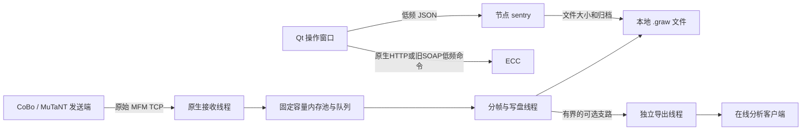

# 原生数据服务：使用、原理与边界

本文对应`apps/datareceiver/`实际代码。它统一dataRouter与DataExporter主机端的MFM接收、分帧、分源写盘和可选在线导出；默认plain TCP，ZBUF原始TCP支持独立及固定计划/ECC管理，FDT控制字过滤支持独立模式及数据主机多连接管理基础，完整ECC FDT启停及明确未使用来源结束已接本机验证。选择、计数及结束语义见[传输手册](RECEIVER_TRANSPORTS.md)、[受管理ZBUF](MANAGED_ZBUF.md)和[FDT接收周期](FDT_RECEIVER_CYCLES.md)。独立ICE入口另见[专用手册](ICE_DATA_INGRESS.md)，固定ECC/ICE归档、实际板端/Narval、getHwServer和所有固件版本尚未兼容验收。

板端低频数据连接/启停已有原生控制组件，详见[发送器控制、暂停与封存](DATA_SENDER_CONTROL.md)。[系统采集协调](SYSTEM_ACQUISITION.md)进一步按CoBo/MuTaNT时序组合生产停止和sender刷新。旧普通TCP sender的daqStop保留连接，disconnect才关闭；[本机进程管理](RECEIVER_PROCESS_MANAGEMENT.md)及[原生ECC远程生命周期](REMOTE_ECC_DATA_LIFECYCLE.md)核对真实启动、EOF/排空/退出/封存。独立数据主机服务/客户端见[远程管理](REMOTE_RECEIVER_CONTROL.md)。这些流程已接固定ECC网络和原生GUI，并有本机合成数据联调；真实控制权、硬件UNKNOWN恢复和现场验收仍待完成，不把Stop应答视为接收器EOF。

受管理的receiver可使用四个配套身份参数：`--session-id`、`--sender-id`、`--configuration-sha256`、`--artifact-sha256`。它们必须一起提供，并要求`--once`及durable默认同步；会话和两个摘要必须是64字符小写十六进制。它们只用于低频状态和seal身份，不进入原始帧。手工旧模式可以全部省略。新增`sender_eof_confirmed`只有实际建立连接并收到自然EOF才为true，从未连接后的TERM退出不能作为完整采集证明；详细语义见上述进程管理手册。

## 1. 为什么与 Qt 控制台分开

大数据量的关键是原始事件走哪条路径。新设计中，窗口只收状态、发配置和启停命令；接收器不链接 Qt，也没有 QWidget、信号槽或 GUI 消息队列。关闭窗口不等于停止接收进程。



Qt 本身并不意味着网络慢；这里选择独立 C++11/POSIX 服务，是为了让数据路径、内存上限、故障处理和性能测量都清楚可控。Qt 只在控制与管理进程使用。若它们共享同一 CPU、网卡或磁盘，仍可能相互争用资源；重要采集建议在独立接收机器上运行数据服务。

## 2. 构建与文件位置

仅构建数据程序，不需要安装 Qt：

```sh
cmake -S apps/datareceiver -B build-receiver -DCMAKE_BUILD_TYPE=Release
cmake --build build-receiver --parallel 4
```

需要 64 位 Linux/macOS、C++11 编译器、CMake 3.12 及以上和系统线程库。实际已测 Linux，macOS 还需要实机编译验证；Windows MinGW 目前用于 Qt 控制台，不构建这个 POSIX 接收器。

生成：

| 程序 | 用途 |
| --- | --- |
| `build-receiver/getdaq-receiver` | 接收、写盘、可选导出 |
| `build-receiver/getdaq-inspect` | 对已保存的 MFM 文件做流式结构检查 |
| `build-receiver/getdaq-merge` | 将已封存 CoBo/RIBF MFM 按事件号合并为 `0xFF01` 分层帧 |
| `build-receiver/getdaq-matrix` | 将完整CoBo type 1波形帧转换为旧CoBoFrameViewer `.gmat`矩阵 |
| `build-receiver/receiver-core-tests` | 开发测试，不参与采集 |

也可从项目根目录执行 `bash tools/build-linux.sh data`。构建脚本不联网下载依赖、不修改系统环境。

## 3. 一条来源一个接收进程

每个进程同一时间只服务一个输入连接。建议每块 CoBo 使用一个进程、一组端口和一个 incoming 目录。一个 CoBo 的多个 AsAd 由帧头区分。不要让互不相关的多块板竞争同一输入端口。

举例：CoBo0 数据发到接收机器的 46005，CoBo1 发到同机 46006；其状态端口可用 46015、46016。两者输出目录分别是 `/data/getdaq/cobo0/incoming` 和 `/data/getdaq/cobo1/incoming`。各自的 sentry 使用不同端口和相应数据目录。

ECC 地址、接收地址、sentry 地址分别配置。控制台 YAML 的 `host` 是 ECC 主机，`router_host` 是输入接收主机，`sentry_host` 是磁盘所在机器上的代理。留空的扩展主机字段沿用 `host`，只是兼容旧配置的默认值。

## 4. 接收器参数

| 参数 | 默认值 | 含义 |
| --- | --- | --- |
| `--output DIR` | 必填 | 已存在、可写、根目录没有遗留 `.graw` 的目录 |
| `--bind IP` | 127.0.0.1 | 输入与可选导出的监听地址 |
| `--port` | 46005 | 原始 MFM 输入端口 |
| `--input-protocol` | TCP | TCP/ZBUF/FDT；FDT过滤帧间4字节心跳/GOODBYE。受管理身份须匹配固定计划；TCP/ZBUF用once，FDT由管理器提供私有周期控制，完整ECC FDT见[管理手册](MANAGED_FDT.md) |
| `--cycle-control-stdin` | 关闭 | 仅管理器启动的FDT接收会话：继承匿名socket控制结束，多次EOF保持PID/session；不可用于普通终端或文件，见[周期手册](FDT_RECEIVER_CYCLES.md) |
| `--file-naming` | native | native保持原名；get采用本地毫秒会话时间+分来源四位递增编号，可纳入固定计划 |
| `--status-bind IP` | 127.0.0.1 | 状态接口地址，可与数据网卡不同 |
| `--status-port` | 46015 | HTTP 状态端口；0 表示关闭 |
| `--export-port` | 0 | 在线导出监听端口；0 表示关闭 |
| `--queue-mib` | 64 | 接收内存池容量，范围 1–4096 MiB |
| `--max-frame-mib` | 32 | 单帧上限，范围 1–1024 MiB；启动时预留 |
| `--rotate-mib` | 1024 | 单个来源的文件轮转阈值，范围 1–1048576 MiB |
| `--min-free-mib` | 0 | 输出卷最低剩余空间保护线，范围 0–1048576 MiB；0关闭，也可放入固定管理计划 |
| `--export-queue-mib` | 16 | 每个导出客户端未释放帧缓冲的上限 |
| `--once` | 关闭 | 一个输入连接结束后退出 |
| `--no-fsync` | 关闭 | 开发测试时跳过原始文件 fsync；此数据不能通过严格封存归档 |

MiB = 1024² 字节，GB = 10⁹ 字节。不要直接把状态界面的 GB 与参数 MiB 当成同一单位。

轮转不会把一个帧切成两个文件：当前文件达到阈值后，下一个完整帧进入新文件。因此文件实际大小可以比阈值大，最多再容纳一个帧。对已知 CoBo/MuTaNT 事件号，出现 `event <= 上一事件号` 时也开始新文件，便于保留重置/回绕边界；不擅自排序、删重或修改原字节。

GET样式按来源编号，事件重置或下一连接继续递增，使用固定写盘会话时间而非旧版重置编号/重新取时间，防止周期内重用文件名。只有文件名确实碰撞时才按旧式语义覆盖同名文件；覆盖前还要核对单链接普通文件身份并取得排他锁，不会截断归档硬链接或活动写入文件。此规则不是Run级覆盖；Native旧Run的catalog目标冲突仍由归档层处理。命名选择进入管理计划摘要和运行核对，说明见[文件命名手册](RECEIVER_FILE_NAMING.md)。

## 5. 内存、背压和磁盘

接收线程从预分配内存池取 256 KiB 块，直接接收进这个块，再把所有权交给写盘线程。队列不是无限增长的。没有空闲块时停止从 socket 读取，TCP 接收窗口最终会让发送端减速，这就是背压。

背压不能让不能暂停的 ADC 无限等待。硬件或板端缓冲仍可能装满，因此“本机没有无界队列”不等于“全系统绝不丢数据”。正式验收要同时检查硬件溢出、发送端计数、接收帧数与磁盘写入。

数据内容内存的粗略上限：接收池 + 一帧缓存 + 每来源 256 KiB 写缓冲 + 8 个导出客户端的预算。另有容器、分配器、线程栈和系统 socket 缓冲；这不是整个进程 RSS 的精确上限。每进程最多 1024 个来源；导出每客户端还限制 4096 个排队消息。调大参数会增加启动内存需求，并不能提高磁盘持续速度。

小帧先累积后批量写盘，大帧直接写。文件保持打开，不再每个帧打开/关闭一次文件。关闭轮转文件和封存时执行 fsync；目录也同步。操作系统/磁盘控制器对持久化的实际保证仍取决于文件系统和存储设备。

设置`--min-free-mib 2048`可要求输出卷至少保留2GiB可用空间。托管监督器会在创建本次启动审计或接收目录前检查每个输出卷是否有满足保护线的空间；接收器进程随后还会在启动前复查一次，以处理两次检查之间的空间变化。写盘线程在累计约1MiB数据或遇到大帧时检查一次，而不是对每个小帧调用系统磁盘查询。接收器检查会把尚在内存中的小帧缓存、当前待写帧、下一个约1MiB检查间隔，以及1MiB文件系统分配余量一并计入预算。触发门槛或无法查询余量时，接收器停止接受数据、丢弃尚未落盘的内存缓存、留下未封存目录并报告失败；不会把Run标为完整。托管接收计划可在每个source增加`min_free_mib`，该值进入固定计划摘要并传入TCP/ZBUF/FDT或ICE接收程序；省略字段兼容旧计划并等同0。状态接口报告实际采用的`minimum_free_bytes`。

这是防止接收器继续写入的保护线，不是文件系统配额或跨进程磁盘锁。其他程序可能并发占用空间，底层文件系统或用户配额也可能导致更早写入失败；仍须监控数据盘并做好容量规划。触发后按[异常恢复](#10-离线检查与异常恢复)核对不完整文件，不能手工补seal或重放未知的硬件命令。

当前分帧对接收块中已完整出现的帧进行同步借用，省去重组缓存中的一次复制；跨块帧仍复制到有界重组缓存。回调返回后该块才能释放，任何使用方不得保留或修改指针。写盘的小帧批处理和在线导出仍可能复制，因此没有宣称全链路零拷贝。两种字节序、任意分段和完整字节校验继续保留。

## 6. 状态接口不是数据接口

```sh
curl http://127.0.0.1:46015/status
```

接口只返回小份 JSON，不包含事件、波形或文件内容。

| 字段 | 解释 |
| --- | --- |
| `connected` | 是否仍有输入 TCP 连接 |
| `minimum_free_bytes` | 固定的磁盘最低剩余空间保护线，0表示关闭；只报告配置值，不是实时余量 |
| `received_bytes` | socket 已接收字节数，包括尚未形成完整帧的尾部 |
| `accepted_file_bytes` | 已交给文件存储层的完整帧字节；可能仍在应用缓冲 |
| `sealed_bytes` | 成功结束文件封存时累计的完整帧字节 |
| `frames` / `files` | 完整帧数量 / 本进程累计创建的文件数 |
| `queued_blocks` | 等待消费的块数，不包括当前正在处理的块 |
| `stream_sealed` | 此刻没有连接，队列排空，计数相等且未出错 |
| `archive_requires_exit` | 当前固定为 true；应先正常结束接收进程再归档 |
| `export_clients` | 在线导出客户端数量 |
| `export_disconnections` | 因关闭、错误、容量限制等断开的累计数 |
| `export_bytes` | 导出到所有客户端的累计线协议字节，包含长度前缀 |
| `export_failed` | 导出线程发生异常 |
| `error` | 首个接收/分帧/写盘/封存错误；非空时不能当成功采集 |

多个字段来自不同线程，查询是监测快照，不是同步事务。不要仅凭一次 `stream_sealed=true` 就移动文件：进程仍持有目录锁，而且随后可能重新接收连接。最终是否能归档由目录锁和封存凭据一起决定。

## 7. 正确的停止与归档

1. 按控制流程先停触发源，再停 CoBo。
2. 由发送端正常关闭输入 TCP；接收器排空队列，确认没有半帧。
3. `--once` 模式自行退出。常驻模式先确认没有输入连接、`stream_sealed=true`，再给该进程 SIGTERM；如果此时又有连接，程序会报失败，而不会假装正常结束。
4. 正常退出码为 0，并生成 `.getdaq-receiver-seal.json`。程序启动/参数错误通常为 2，接收或封存失败为 1。
5. 在同一接收机器上运行 sentry，使用 `config/sentry/native-receiver.example.json` 的模式；把 data_dir 改为实际路径。
6. sentry 取得接收器相同的本机目录锁，核对凭据、持久化标记、所有文件名和大小，然后才允许归档。

原生接收器目录中的三个文件不要手动删除来绕过检查：

| 文件 | 用途 |
| --- | --- |
| `.getdaq-receiver.lock` | 接收/归档共用内核锁的稳定文件；文件存在不等于锁正在持有 |
| `.getdaq-native-receiver` | 标记该目录必须使用原生接收器的严格归档路径 |
| `.getdaq-receiver-seal.json` | 正常退出时产生的文件清单和持久化凭据；异常退出不生成 |

原生 sentry 示例的 `check_process=false` 是有意的：归档前接收进程应已经退出。此时以本机锁和封存凭据作为判断条件，不能又要求同一个接收进程存活。通用 `node.example.json` 当前监控 `getdaq-receiver`；部署旧版 `dataRouter` 或 Windows `DataExporter.exe` 时，应在副本配置中填写目标机上的实际进程名。不要修改共享示例来匹配某一台机器。

归档成功后，凭据移动为 `<实验>/run_NNNN/receiver-seal.json`。凭据检查使用文件元数据，不扫描和哈希整个 TB 级数据文件。它防止协作进程误归档正在写入或大小变化的文件，不证明电子学没有漏事件，也不是防恶意修改的数据认证。

目录锁方案面向同一主机上的本地文件系统。当前不支持把 NFS/SMB 远程挂载盘上的锁行为作为未经验证的归档保证。

## 8. 在线导出

例如增加 `--export-port 46007`，独立分析进程连接该端口。每个消息是：8 字节小端无符号长度 + 该长度的原始 MFM 帧。长度不包含前面 8 字节。

这是对旧 DataExporter 在 x86 上使用 native uint64 长度的兼容形式，也与公开的 [attpc_conduit](https://github.com/ATTPC/attpc_conduit) 当前 Rust 接收器的外层消息封装一致：它用 `read_u64_le()` 读消息长度，再精确读取原始 GRAW 帧。payload并非无条件兼容：Conduit进一步要求MFM主头首字节严格等于`0x08`（其`EXPECTED_META_TYPE=8`），并校验GRAW头字段。旧GET `CoboFormats-Rev-5.xcfg`把`P2BLCK`设为8、头长设为1个块；这对应256字节MFM块、big-endian主头首字节`0x08`。Rev0的块指数是5、Rev1–4是6，little-endian Rev5首字节则是`0x88`，都不能通过Conduit当前的精确首字节检查。接收器仍会把这些它支持的帧原样导出，但Conduit不一定会解析它们。实际CoBo固件版本、帧类型/字段语义及分析效果仍需真实下游联调确认。

Conduit 默认会连接 `192.168.41.60` 到 `.70` 共 11 个地址，端口 `46491`。本接收器的 `--bind`、输入 `--port` 和下游 `--export-port` 是独立配置；接入时必须为每个 CoBo/Conduit 接收任务提供可达的独立端点，并按实际网络规划绑定正确 IP 和端口。若多路 CoBo 汇聚到一台主机，不能只启动一个默认导出端口就假定 Conduit 会自动分辨来源；应配置每路专属监听地址/端口并调整 Conduit 端点，或保留与现有 11 地址布局相符的网络映射。Conduit 端点配置目前是其上游程序的固定常量，本项目没有替用户修改外部仓库。

旧跨大小端组合和真实下游分析客户端仍需单独验收。导出服务最多 8 个客户端；超出预算或消息数上限的客户端被断开。重新连接只获得后续数据，不重放已经错过的帧。

导出线程在没有新帧时也回收已结束的客户端，防止八次空闲断连占满名额。分析连接是单向读取订阅：保持socket写方向打开，不发送命令或心跳；写方向EOF/额外输入均结束订阅。重连从新消息长度头开始，不拼接上一连接的半帧。具体客户端规则、计数及普通/插桩复查见[断连与重连手册](EXPORTER_RECONNECTION.md)。

Linux发送时使用`MSG_NOSIGNAL`，macOS接受客户端后设置`SO_NOSIGPIPE`；状态HTTP应答和在线导出都采用同一socket级保护。接收器不再为此全局忽略进程的`SIGPIPE`，避免一个断开的观察客户端改变整个数据进程及其其他线程的信号语义。

在线导出是可丢弃的分析支路，文件写盘是主输出。客户端必须自己检测断线和重新同步；不能把这条支路当作与落盘同等可靠的数据副本。程序退出时不等待所有客户端清空其队列。如果需要可靠双写，应另外实现有确认机制的持久化输出，不能简单取消队列上限。

注意区分两个 46007：旧 ECC 的第二个 DataLink 是板端主动连接的第二个接收目标；本程序 `--export-port` 是分析程序主动连接的下游出口。操作台新建配置默认将 `exporter_port` 设为 `0`，采用“一次接收，写盘后导出”，只保留 `router_port` 指向本接收器。已有 YAML 显式设置非零 `exporter_port` 时仍保留旧第二目标，只有确认该目标仍在使用时才继续启用；不要把它与本接收器的 `--export-port` 混为一谈。

## 9. 离线检查与异常恢复

实际受限内存文件系统的ENOSPC、零写诊断和seal各阶段错误/重试验证见[写盘可靠性](RECEIVER_IO_RELIABILITY.md)。所有失败保持错误退出和不正常封存；测试不在实际数据盘制造满盘，真实设备/断电仍待验。

需要判断接收器是否已退出时，使用数据服务的`receivers`只读查询，见[进程观察](RECEIVER_PROCESS_OBSERVATION.md)。原`status`仍是生命周期缓存；新查询不读原始数据、不改变状态，也不能把退出0解释为已封存或把running解释为没有卡住。

```sh
./build-receiver/getdaq-inspect /data/getdaq/cobo0/incoming/CoBo0_AsAd0_某文件.graw
```

程序顺序读取 64 KiB 小块，最大帧 32 MiB，显示帧数、完整字节数、来源分布和事件号非递增次数。`VALID_STRUCTURE` 只说明本工具支持的帧结构和边界检查通过，不表示触发、采样内容、CRC 或事件完整性已经验证。当前没有实现完整波形查看、ROOT 转换或嵌套帧递归解析。

只读计数指定 CoBo/AsAd/AGET 的 MFM 头 hit-pattern 时，可用：

```sh
./build-receiver/getdaq-inspect --hit-pattern /data/run/CoBo2.raw 2 1 0
```

该模式仅接受直接的 CoBo type-1 revision 0..5 帧，按帧头的字节序逐位累计所选 AGET 的0..67通道，并向标准输出写CSV（`hit_frames`及占匹配帧的比例）。它按完整MFM帧流式读取，单帧上限32MiB，内存不随文件总大小增长；不展开波形样本、不写回输入，也不处理 `0xFF01` 嵌套合并帧、compact type-2或无匹配帧。旧`CoBoEvent`数据模型说明72位hit-pattern承载68个物理通道，但GetController旧Threshold源码仍把`hitPat_0`物理阈值解释标记为待确认。因此此结果只叫“头字段hit计数”，不能当作阈值响应率、噪声率或自动阈值判定。

该离线模式与接收线程、Qt GUI、网络服务无关。操作员负责把输出计数与已经确认的扫描点/Run对应；它不会读计划目录或推断阈值码，也不表示硬件已加载配置。

若已人工确认多个 raw 文件分别对应哪些 Threshold 扫描码，可把它们合并为一份逐点逐通道 CSV：

```sh
./build-receiver/getdaq-inspect --hit-pattern-scan 2 1 0 \
  0 /data/threshold-000/CoBo2.graw \
  0 /data/threshold-000/CoBo2-0001.graw \
  1 /data/threshold-001/CoBo2.graw \
  > /data/results/threshold-hit-counts.csv
```

参数顺序是 CoBo、AsAd、AGET，随后重复给出“阈值编码、文件路径”。阈值编码须为0..127并按升序提供；同一编码可连续出现多次，命中帧数和匹配帧数会累加。输出列为`threshold_code,channel,hit_frames,matching_frames,frame_fraction`，每点包含68个通道。命令先完整解析全部输入，再向标准输出写CSV；文件存在性、计划工件摘要和Run归档的对应关系仍由操作者确认。CSV头会显式标记文件映射未经程序核验、结果只是MFM头位计数，不是物理阈值结论。不要把未经核实的文件和阈值码配对后用于实验判断。

如果已使用 `getdaq-catalog --bind-scan-point` 为每个阈值点生成归档绑定，也可以让 catalog 工具自行验证完整映射并读取对应封存 `.graw`：

```sh
./build-supervisor/getdaq-catalog --analyze-threshold-scan \
  /data/plans/threshold-plan /data/records/threshold-bindings 0 \
  /data/records/threshold-hit-pattern-analysis.json
```

这里的`0`是MFM帧头数值CoBo ID；计划中的`C0`是接收源ID，程序要求它与归档计划匹配，但不推断二者的数字映射。该模式只接受已经封存且所有点均绑定的threshold计划，流式读取对应来源文件，输出不可覆盖JSON；元数据和源文件身份会在读取前后复验。仍仅是命中位统计，不证明硬件读回配置，也不作物理阈值结论。具体输入、字段和限制见[扫描点与Run归档关联](SCAN_RUN_BINDING.md)。

连接在半帧处结束、长度非法、写盘失败或活动连接被中断时，接收程序返回失败。协议异常时会尽量写出此前完整帧；不把不完整尾帧追加成合法记录，不生成成功凭据。磁盘错误可能仍留下部分文件，应保留日志与原文件后检查。

单文件上限现在通过`EFBIG`进入错误路径，避免`SIGXFSZ`直接终止而缺少最终状态。小帧的已接受计数可能包含尚未刷新到磁盘的批量缓存，不能替代`sealed_bytes`与成功封存；实际内核短写、部分文件及边界验证见[写盘失败说明](RECEIVER_WRITE_FAILURES.md)。此验证没有填满磁盘，也不等于ENOSPC/设备错误/断电验收。

恢复步骤：先确保发送端和接收器停止；复制日志和文件清单；用 inspect 定位结构错误；核对硬件/发送端计数；把不完整采集作为异常 Run 单独保存。不要手工编造成功凭据。自动清理、截断错误文件或重发未知结果的硬件命令均未实现。

## 10. 协议依据和兼容范围

MFM 基本头按照本地 `source/mordicus/MultiFrame-release-20210208/src/mfm/PrimaryHeader.cpp`、`StandardHeader.cpp` 解码；CoBo 字段依据 GetBench 的帧格式描述和旧 FrameStorage。实现不是把历史框架全部链接进来。

支持两种字节序，长度来自头部三字节块数乘以块大小。标准帧检查头长和 item 边界。已知 CoBo type 1 / revision 0–5、compact type 2 / revision 5 可提取事件号及 CoBo/AsAd；MuTaNT type 8 / revision 0 提取已知事件号字段。其他帧只按通用结构保存，不猜硬件字段。结构支持声明仍需要对应版本的真实帧样例验证。

默认TCP/ZBUF输入不接受FDT心跳或其他包装；必须明确选`--input-protocol FDT`才过滤FDT帧间控制字。ICE编码流仍不接受。TCP分段与帧边界无关；一次recv可以只有一个头的部分，也可以含多个完整帧或FDT控制字，这些均由重组器处理。FDT GOODBYE不代替自然EOF，帧内全0/全FF字节保持，详见[协议操作手册](RECEIVER_TRANSPORTS.md)。

## 11. 正式吞吐量验收

完整帧同步读取、跨块重组、回调指针生命周期、本机基准与验证结果见[接收器性能与测试限制](RECEIVER_PERFORMANCE.md)。当前已经省去完整帧的重组复制；不是整条链路零复制，也不是生产吞吐保证。

现有自动测试验证了两种字节序、逐字节 TCP 分段、多帧合并、文件字节/哈希一致、慢导出客户端隔离和异常尾帧。32 MiB 的快速测试可能完全受页缓存影响，不能推算持续 Gb/s 性能。

正式测试应记录：CPU/内存、网卡速率、磁盘与文件系统、挂载选项、固件版本、输入帧大小分布、持续时间、采集总量、RSS 峰值、队列峰值、CPU 占用、磁盘持续写入、fsync 尾部耗时、发送/接收/保存计数，并覆盖轮转、写盘变慢、断链、导出客户端卡住等情况。

**本工作区的传输测试每轮所有接收流合计最多 20 GiB；测试结束必须删除自己生成的数据文件，只保留小型日志、计数和哈希凭据。** 为避免磁盘空间不足，默认只测试 2 × 512 MiB（总计 1 GiB），需要更多样本时顺序执行并先确认上一轮已清理。这个限制是所有流的总预算，不是每个文件或每个接收器各 20 GiB。不得在此机器上直接做填满磁盘的破坏性测试。

开发用脚本 `tests/receiver_sustained_load.py` 在启动接收器前检查总预算和可用空间，额外要求保留 1 GiB 空间。并发锁位于系统临时目录、按checkout隔离，同一工作区禁止并发执行，且不会修改只读源码树。成功后先核对发送/保存 SHA、EOF、计数和封存，再删除合成 `.graw`；失败、Ctrl+C 或 SIGTERM 也会停止测试子进程并删除本轮合成 `.graw`。只处理脚本新建的私有测试目录，不清理真实 Run。`--prune-payload` 保留兼容，但清理已是默认强制行为。`payload-cleanup.json` 记录删除的文件名和字节数；`result.json` 仅在完整校验通过后生成。SIGKILL、突然断电或文件系统错误可能阻止清理，遇到这种情况应先确认测试进程停止，再根据私有目录和清单删除遗留合成文件。

例如，从项目根目录执行下面的命令，合计仅生成 16 MiB，完成后原始测试数据自动删除：

```bash
python3 tests/receiver_sustained_load.py build-receiver/getdaq-receiver \
  --evidence build-receiver/load-small --streams 2 --mib-per-stream 8
```

若主机物理内存大于 20 GiB，这一预算无法提供“数据总量超过内存缓存”的证明。应明确保留这个验证缺口；真正的持续磁盘吞吐验收需在另行安排、空间足够的测试环境进行。小规模本机 TCP 结果不能直接当作真实多 CoBo 采集吞吐。

先验收单 CoBo，再逐步增加并行接收器。只在证据表明 CPU 分帧或复制为瓶颈时再考虑 scatter/gather、专用分帧队列或平台专属 I/O；这些不是本版本已经实现的功能。
