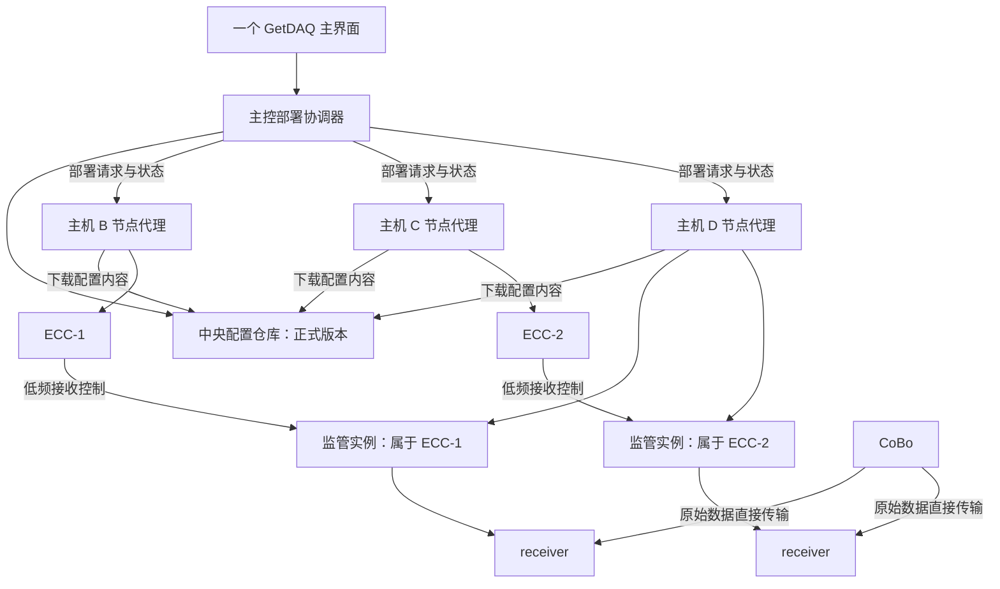

# GetDAQ 多主机配置分发与服务部署方案

日期：2026-11-14。状态：Linux 首版已有实现与本机回环多节点验证；物理多机和实板仍未验收。日常入口已收敛为Nodes / Paths 右侧单个英文角色按钮，操作见[主控 / 从控简明教程](SIMPLE_MASTER_SLAVE.md)。下文保留设计结构；开机服务等超出首版的选项不代表已实现。

## 1. 使用方式与范围

一个主界面统一编辑实验配置，主控机保存正式版本；各执行主机获取自己的部署文件，在本地运行 ECC、数据监管和 receiver。日常操作不要求逐台编辑 JSON、复制摘要或运行远程脚本。

主界面只增加一个主控 / 从控角色按钮，其余布局保持原样。主机登记、实例增删、配置发布和分发结果放进既有 Nodes / Paths 与服务管理窗口。新增 ECC 实例不另开主界面。

首版约定：

- 主控机是本项目配置发布的单一写入入口，也可以兼任执行主机。
- 执行主机首版支持 Linux；每台主机一次安装并登记一个节点代理，由它管理本机多套后台。
- 每套 ECC 管理自己的板卡组，可关联多个数据主机；同一数据主机可以承载不同 ECC 的接收服务。
- 主窗口的采集按钮控制当前选定的 ECC 控制组。跨 ECC 的同步触发、同时开始采集和全局 Run 收尾不属于首版配置分发功能。
- 启动后台不执行 Describe、Prepare、Configure 或 Run Start。配置分发完成也不表示硬件已加载。

## 2. 用户操作流程

### 主控机首次设置

1. 在“主机与服务”窗口选择“本机为主控”，使用默认项目保存目录或选择自己的目录。
2. 选择实验预设或导入原来使用的实验文件。以后修改同一份项目，模板和兼容 profile 保留在项目内。
3. 添加主机、ECC 实例和接收服务，把板卡分配给对应实例。

### 其他主机首次加入

1. 安装 GetDAQ，点击主界面角色按钮选择“从控机”，点“启用 / 检查从控机”。
2. 从控自动生成连接码；复制到主控“加入从控机”一次。
3. 管理 IP、端口、数据保存目录默认自动建议；多网卡时确认地址可访问。缓存目录、安装路径和节点身份由软件管理。

节点代理独立于窗口运行。当前由 GetDAQ 启动，已启用的从控随下次打开 GUI 恢复节点管理；安装为系统登录/开机服务仍属后续项。关闭窗口保留后台，停止实例使用明确的停止按钮。无需为每套 ECC 打开一个主界面。

### 日常修改和运行

1. 在一个配置窗口中修改板卡 IP、接收 IP、端口、数据目录及主机归属。
2. 选择 ECC 配置，点击“启动后台并选用此配置”。软件自动完成保存、同步、缓存校验和后台启动，无需分别发布/应用。
3. 配置变化时，已有运行会话先正常结束，软件不覆盖活动配置。
4. 成功后自动选用于 Run Setup，再按原来的 Connect、Progress、Run Start 操作。

窗口应给出具体结果，例如“接收主机 D 的数据目录不可写”或“ECC-2 仍在采集，尚未切换”，并提供查看日志、重试传输和保留原版本等对应操作。

## 3. 组件与连接关系



组件职责：

| 组件 | 保存什么 | 执行什么 |
| --- | --- | --- |
| 主界面 | 当前项目、选定控制组 | 编辑、发布、查看部署结果、发起明确操作 |
| 中央仓库 | 实验源文件、预设、只读发布版本、文件摘要 | 配置上传、登记、查询和新增的内容下载 |
| 主控部署协调器 | 主机清单、部署计划、各节点回执、选定版本 | 校验拓扑，安排准备与启用顺序，汇总结果 |
| 节点代理（Linux 首版） | 本机身份、配置缓存、本地路径映射、部署操作记录 | 下载、校验、本地配置生成，启动/停止所管理的固定程序 |
| ECC | 本控制组的固定输入、硬件操作状态与审计 | 控制板卡，协调属于本组的接收服务 |
| 数据监管与 receiver | 固定接收计划、本地会话及原始数据 | 启动接收、落盘、收尾和封存 |

配置仓库、节点代理和主界面均不转发原始采集流。

首版把部署协调器作为独立逻辑模块加入主控的 `getdaq-config-service` 后台，保存部署任务并异步执行；GUI 只提交明确操作和查询结果。避免要求用户另外手动启动协调脚本，也避免关闭界面就丢失分发进度。现有仓库写入仍串行保护，长时间等待远程主机不能占住仓库请求处理线程或把整个仓库一直标为 busy。

## 4. 一份总配置与各主机的文件

用户只维护一份总配置，分为四类内容：

| 内容 | 用户常用字段 | 软件维护的内容 |
| --- | --- | --- |
| 主机 | 名称、管理 IP、接收 IP、数据目录 | 节点身份、安装位置、程序摘要、配对信息 |
| ECC 实例 | 名称、所在主机、端口、板卡归属 | 服务配置、回调端口、私有状态目录和身份绑定 |
| 接收实例 | 所在主机、所属 ECC、来源板卡、数据端口、数据目录 | 监管端口、接收计划、程序与配置摘要 |
| 电子学配置 | 常用预设；需要时调整实际板卡/AsAd/AGET 设置 | 源文件、包含文件、profile、硬件描述和编译工件 |

同一份电子学模板可以供不同 ECC 实例复用。模板的板型、芯片版本和槽位假设必须在界面可见，不能通过网络 IP 推断这些硬件参数。

一块板在同一次部署中只能归属一个 ECC；每个数据来源恰好映射到一个接收实例。每个 supervisor 服务实例只能属于一个 ECC 控制组。数据主机 D 可同时运行 supervisor-1 和 supervisor-2，分别使用自己的端口、凭据和状态目录。

示例：

| 主机 | 服务实例 | 分工 |
| --- | --- | --- |
| A | 主界面、仓库、部署协调器 | 保存实验总配置 |
| B | ECC-1 | 控制 CoBo-0、CoBo-1 |
| C | ECC-2 | 控制 CoBo-2 |
| D | 数据监管-1、receiver-0/1 | 接收 ECC-1 所属板卡 |
| D | 数据监管-2、receiver-2 | 接收 ECC-2 所属板卡 |

## 5. 配置版本和本地路径

### 5.1 三层标识

| 标识 | 范围 | 用途 |
| --- | --- | --- |
| 实验发布版本 `release_id` | 一次发布的整个项目 | 证明各参与主机属于同一份总配置 |
| 控制组配置/工件摘要 | 一套 ECC 与它的全部接收节点 | 沿用现有接收生命周期的参数、工件一致性核对 |
| 本地部署绑定摘要 | 某主机上的某个实例 | 绑定本机实际路径、程序、端口和固定服务输入 |

不同 ECC 控制不同板卡时，组内参数和工件摘要可以不同；各主机的本地部署摘要也可能不同。界面比较的是共同的 `release_id` 及明确的组成员关系，不能要求所有 ECC 或主机的文件 SHA 都相同。

同一 ECC 控制组的实验工件应使用相同字节，不为每个接收主机重写工件后又声称工件摘要一致。

### 5.2 文件存放

主控机保留可编辑项目和不可变发布版本；节点保存本地副本，运行不依赖持续挂载主控的目录。

```text
主控项目目录/
  project.json                 软件保存的总配置，界面维护
  content/<sha256>             项目源文件与工件
  repository/                 不可变配置仓库
  jobs/                       各节点操作与回执
  console/                    选定ECC的主界面配置

从控软件工作目录/
  node.json                   自动生成的本机设置
  master.json                 已配对的主控身份
  objects/<sha256>             已校验内容块
  releases/<release_id>/       只读本地副本
  deployments/                每套实例的固定服务输入与审计
  instances/                  当前实例登记
  operations/                 持久操作记录

本机数据目录/                  原始采集文件，与软件缓存分开
```

工作目录和数据目录由本机实际路径映射生成。用户在一台机上选的 `/home/user/data` 不会原样当成另一台机的可用目录。

### 5.3 现有绝对路径需要显式迁移支持

现有配置选择记录含 `manifest_file` 等绝对路径，并绑定原登记收据和发布包。首版远程分发必须增加“已校验副本记录”和受限的文件映射解析，不能编辑旧选择 JSON 的路径后重新计算摘要。

副本记录至少包含：原仓库身份、原发布清单和登记收据的字节摘要、目标节点身份、本地内容根、清单中每个文件到本地路径的准确映射、校验结果。

原发布内容和收据保持原字节。新本地部署的文件引用指向本机位置，形成自己的部署绑定；来源中记录的原路径作为来源信息处理，验证器通过明确映射核对对应内容。映射只允许当前发布清单登记的文件，拒绝越界路径和符号链接替换。

Linux 首版通过单独的 `deployment_origin` 副本证明扩展 `FixedEccConfiguration`，校验完整文件映射和内容；不重写旧选择记录，也不声称旧路径绑定格式可直接跨机复制。

## 6. 分发与启用流程

采用“主控安排任务、节点按固定版本拉取内容”的方式。主控不用保存各台机器的 SSH 密码；配对后的代理只处理被授权项目的固定部署操作。

### A. 保存与编译

主控固定本次总配置，保存全部源文件，编译各 ECC 控制组的电子学工件。检查板卡重复归属、接收来源覆盖、地址与端口冲突，然后生成只读发布版本。

### B. 节点准备本地副本

主控发送部署操作 ID、目标发布版本、实例分配及预期前版本。节点下载缺少的内容块，逐块核对摘要，在独立临时目录组装，完整校验后再发布到本地只读目录。

中断后可以继续下载未完成的配置内容。配置传输重试与硬件动作重试是不同操作；不能因网络恢复而重发 Prepare、Configure 或 Start。

### C. 先生成接收计划，再生成 ECC 输入

现有接收计划摘要包含节点本地路径、接收程序摘要等信息，不能由主控在不了解本机实际环境时随意填入。

1. 数据节点根据本地安装清单、网卡和目录生成固定接收计划，执行离线检查，返回完整计划与摘要。
2. 主控核对这些计划的来源集合、所属 ECC、工件摘要和数据目标；结果必须与总配置一致。
3. ECC 节点取得属于自己控制组的接收计划结果，再生成固定 `remote_receivers`、拓扑及本地服务输入，并执行离线校验。
4. 主控收集所有目标的“已准备”回执。任何节点未就绪，整组保持待处理，不显示部署成功。

这些步骤只准备文件，不占用板卡执行配置。

节点还应报告协议和功能能力以及本机实际程序摘要。按所需能力检查兼容性，不能只比较当前统一的应用版本字符串，也不要求不同平台的可执行文件具有相同 SHA。

### D. 明确启用

启用前检查本次预期前版本和旧实例实际状态：活动采集、未完成接收或原硬件结果未知时，使用现有停采/核对流程处理，不换新审计目录掩盖原状态。

按控制组执行：先启动并认证核对接收监管服务，再启动并核对 ECC 服务身份与实际固定输入。receiver 仍由原来的采集生命周期按需启动。

如果旧服务占用相同端口，先完成旧会话和正常关闭，再启动新服务；不能用“备用进程”绕过同一块板的所有权或旧状态。

每个实例独立持久化启用结果。多主机启用存在部分成功的可能，不能声称网络中存在一次全局原子切换。部分失败时显示每个实例的真实状态；尚未启用的保留旧部署，已启用的不得被标成已自动回滚。

### E. 采集

所有必需节点版本和身份匹配后，主窗口可以连接对应 ECC。硬件准备和开始采集仍走原有控制流程。首版不因“分发完成”自动开始采集，也不提供跨 ECC 同步启动承诺。

## 7. 节点代理与接口边界

Linux 首版已接入 `getdaq-node-agent`，由 GetDAQ 内部入口启动/配置，提供后台运行选项。主机首次安装和配对仍需在本机完成一次；主控不能凭一个 IP 启动尚未安装、尚未配对的机器。

代理接受固定类别的请求，不执行任意 shell 命令：

| 能力 | 请求内容 | 返回结果 |
| --- | --- | --- |
| 主机信息 | 已配对的主机身份 | 网卡、允许目录、安装程序及摘要、已管理实例 |
| 准备部署 | 操作 ID、发布版本、实例配方、预期前部署 | 传输进度、本地校验结果、各实例固定输入摘要 |
| 查询部署 | 原操作 ID | 持久化状态及原结果 |
| 启用已准备部署 | 准备回执、预期前部署、明确操作 ID | 各服务实际启动和身份核对结果 |
| 正常停止实例 | 实例 ID、预期当前部署、操作 ID | 原有正常停采/收尾或拒绝原因 |
| 明确故障终止 | 经界面确认的实例范围和进程身份 | 实际退出结果；不证明板卡已停止或 Run 已完成 |

Linux 首版接口为 HTTPS `/v1/identity`、`/v1/pair`、`/v1/inventory`、`/v1/operations`、`/v1/operations/<id>` 与 `/v1/instances/<id>/status`；消息以源码校验为准。正常停止不会自动代替操作员结束采集，活动或未知会话会被拒绝。

代理只管理当前用户、当前安装、当前实例登记的固定程序。复用现有配置/程序身份核对和进程定位，不能按程序名字杀掉其他实例。

每次部署操作持久记录操作 ID 和请求摘要；相同 ID、相同内容返回原结果，不重复执行。相同 ID、不同内容拒绝。启用采用预期前版本比较，过期主控请求不能覆盖已选的新部署。

配对生成节点身份及受保护凭据；发布包不包含所有节点的通用明文令牌。每个 ECC 只取得控制本组接收服务所需的凭据。远程控制传输采用受保护连接并固定配对身份；现有普通 HTTP 服务不因此被视作已经具备加密或细粒度权限能力。

## 8. 界面设计

既有“主机与服务”管理窗口包含三个页面：

| 页面 | 显示内容 | 常用操作 |
| --- | --- | --- |
| 主机 | 名称、管理地址、接收网卡、数据目录、在线状态 | 添加/配对、修改路径、检查连接 |
| 服务实例 | 名称、所在主机、ECC/接收角色、板卡归属、端口、实际状态 | 新增、启动、正常停止、选用于 Run Setup |
| 配置版本与分发 | 项目版本、各主机缓存/准备/启用版本、失败原因 | 保存并分发、重试传输、应用并启动、查看日志 |

界面自动维护目录、凭据、摘要、硬件描述引用和服务 JSON。端口自动建议并允许修改。高级设置保留自定义电子学模板和兼容配置，不要求日常用户填写。

“缓存完成”“准备完成”“服务已启动”“ECC Idle”“硬件 Ready”“正在采集”分别显示，不将它们合并成一个成功状态。配置信息和运行信息明确区分。

选择另一个实例查看或管理后台，不改变主窗口正在控制的实例；点击“用于 Run Setup”才切换。已有连接或操作时，先按正常流程断开再切换。

## 9. 断线、失败与恢复

| 情况 | 行为 |
| --- | --- |
| 某主机离线 | 保存新版本，显示该机待分发；其他原后台继续运行 |
| 配置内容损坏/缺失 | 不发布本地完整副本，不启用该实例；按原版本重取所需内容 |
| 下载完成但本地路径/程序不匹配 | 显示具体字段和节点，保留旧部署，允许修正本机映射后重新准备 |
| 启用应答丢失 | 查询原操作与进程身份，不换新 ID 重复启动或重放硬件动作 |
| 仅部分节点启用成功 | 显示部分启用，阻止涉及未就绪必需节点的新采集；不伪造全组成功 |
| 主控或界面断开 | 当前 ECC 和接收器独立运行；断线不自动 kill、封存或重置硬件 |
| 节点重启 | 保留配置缓存、原状态和审计，按原记录核对；不自动从 Idle 重放采集流程 |
| 请求回到旧配置版本 | 对已正常释放的实例重新准备并明确启用；不回滚已经发生的硬件写入和采集数据 |

副本传输和配置完整性可独立重试。进程、硬件动作和数据收尾按各自已有结果核对，不能用重试下载的规则重试 Start。

主控的配置分配与代理登记只约束本系统已知实例；板端身份别名、未登记的旧 ECC 和真实硬件独占仍需实际核对，软件登记不等于板卡已提供全局锁。

首版不做自动主控切换。主控离线期间，已有采集继续由原 ECC 和接收服务处理；新发布、跨机启用和接管等待主控恢复及原状态核对。节点缓存保留原版本，不能用一个新项目或新审计根自动认领旧会话。

## 10. 已有实现与新增工作

| 部分 | 当前能力 | 本方案需要新增 |
| --- | --- | --- |
| 配置仓库 | 上传、内容块存储、版本登记、列表与收据查询 | 授权的内容读取/下载、完整副本组装与验证 |
| 仓库对象 GET | 返回 `present`，查询对象是否存在 | 单独新增返回内容字节的接口；保持旧接口兼容 |
| ECC 配置选择 | 固定发布包、选择和输入绑定 | 显式副本证明及跨主机路径解析，兼容现有记录 |
| 本机服务管理 | 多实例、本机进程启动/停止、配置和身份校验 | 节点代理、远程登记、实例路由和部署协调 |
| 原生 ECC | 固定拓扑和单控制组硬件生命周期 | 接入部署来源/版本信息，保持原状态语义 |
| 远程数据服务 | 一个 ECC 协调多个固定远程接收服务 | 自动生成、分发并核对这些节点的固定计划 |
| 简化配置窗口 | 本机网络/路径输入和预设 | 主机归属、中央项目模型和分发结果页面 |

证据入口：

- [当前配置仓库](CONFIGURATION_REPOSITORY.md)：`apps/configrepository/repositoryservice.cpp` 中对象 GET 调用 `HasObject`，没有下载原字节。
- [当前 ECC 配置选择](ECC_CONFIGURATION_SELECTION.md)：选择记录绑定主机绝对路径，尚无受控跨机重定位。
- [远程接收生命周期](REMOTE_ECC_DATA_LIFECYCLE.md)和[数据主机控制](REMOTE_RECEIVER_CONTROL.md)：已有固定计划、控制组绑定和实际 receiver 生命周期。
- [本机后台管理](INTEGRATED_LOCAL_BACKEND.md)：当前已实现的本机边界。

## 11. 分阶段实施与验收

### 第一阶段：中央项目和本地部署模型

增加总配置、主机和控制组模型，将现有本机部署生成为该模型的单主机实例。旧现场配置可导入，主界面布局不改。

验收：本机单 ECC、多 ECC 和原现场配置均可回读；每个来源归属唯一，生成结果能通过现有离线检查，普通用户只编辑网络和目录。

### 第二阶段：配置内容分发与副本校验

扩展仓库下载、节点缓存、部署副本记录和受限路径解析。先不启动远程服务。

验收：两台不同目录的机器能准备同一发布版本；同控制组工件字节一致；断线续传、损坏内容、错误节点、源文件变化和路径越界均有明确结果，原发布记录不被改写。

### 第三阶段：节点代理和远程服务管理

实现配对、只读主机信息、固定实例准备/启用/停止、持久操作结果，接入同一个服务管理窗口。

验收：一个主界面在两台执行主机上分别启动 ECC 和数据监管；同机可再开另一组实例；启动/停止 A 不影响 B。丢应答后可查原结果，过期部署请求拒绝。

### 第四阶段：完整分组部署联调

先以模拟板端和真实 ECC/监管/receiver 验证控制组文件、身份、接收与收尾，再连接现场板卡验证网络、实际描述和电子学参数。

验收：主控机、ECC 主机和数据主机使用不同本地目录；数据直接落到指定接收主机；主控退出期间后台行为符合约定。物理多机、实物采集和持续吞吐分别记录，不以单机回环替代。

第一版完成以上范围后，再单独设计跨多个 ECC 的统一 Run 编号、批量采集编排与同步触发，不把部署版本一致性当作采集同步保证。
