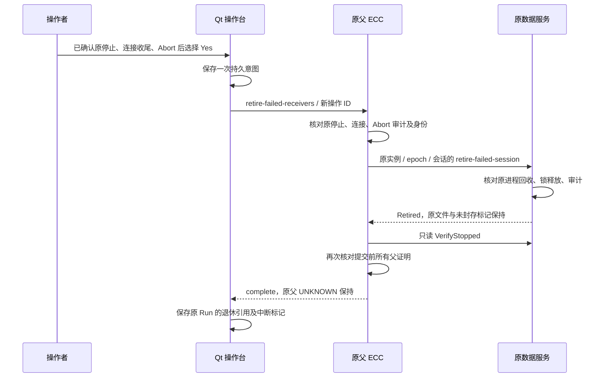

# 从操作台退休原失败数据会话

## 1. 什么时候使用

采集故障后，父 ECC 保留原操作的 UNKNOWN，Run 保留中断记录。已经完成原停生产、发送器连接收尾及失败接收器 Abort 时，可以使用操作台的 **Retire original failed data sessions...**，把原失败数据会话从当前数据管理周期中退休。

这一步通过父 ECC 调用原长期保留的数据适配器，再由各数据主机自己的原生管理核心核对进程回收、锁释放和原会话证据。DAQ 数据不会经过操作台或 ECC；界面只提交小型控制请求、查询状态和保存操作引用。

**退休完成仍不代表 Run 恢复或数据完整。** 原 raw 和失败记录保留，旧会话 ID、PID、目录、退出码和封存标记保持；没有确认封存的来源仍不完整。父 ECC UNKNOWN、网络控制门槛和 Run 的 `duration_incomplete` 保留，编号不推进，不能据此开始新硬件采集。

## 2. 操作顺序

1. 保留原服务、原配置与原 Run 目录。不要通过删除审计根或重启服务来清除门槛。
2. 确认原故障的停生产操作已经真正完成。接收器故障策略可能自动发出原对象的明确停止；必须查看其终态，不能只看通知或请求已接受。
3. 使用 **Close original failed acquisition connections...**。全部已知原发送器停止/断开、原就绪配置撤销确认后，才具有本步骤要求的连接收尾证明；未知或丢应答步骤不能重发来假定成功。
4. 使用原失败接收器的明确清理入口，等待 `abort-failed-receivers` 完成。原接收进程由各数据主机的原父进程回收，原 raw 保留。
5. 在状态刷新、没有其他待核对请求时，点击 **Retire original failed data sessions...**。确认框默认取消；只有选择 Yes 才提交一次退休请求。
6. 等待该操作到 `complete`，并读取新的系统状态。失败来源的数据节点应为 `retired`，原身份及未封存标记保持；正常已封存兄弟仍为 `stopped`。父 UNKNOWN 和 Run 中断标记应保持。
7. 保留原失败文件、操作审计和 Run 日志，继续独立的硬件收尾/核对。当前完整 Run 正向恢复尚需接续，不能把菜单完成提示当作下一轮采集许可。

菜单可操作只表示界面有新鲜的原 UNKNOWN 状态、连接与待提交条件。服务端仍逐项核对原证明；没有完成步骤 2—4 的请求会失败，不对 receiver 或硬件执行退休动作。

## 3. 父 ECC 额外核对哪些证据

父 ECC 必须仍保留原失败采集与准备对象，原失败操作 ID 与原确认停生产记录相符。采集对象必须已有完整的故障连接收尾证明，准备对象为 Prepared，而且有原 receiver Abort 完成证明。通常采集对象为 Broken；若之后只读重新核对停止而保留 Failed，则还必须证明全部原发送器缓存状态仍为已关闭/从未连接、没有 UNKNOWN。仅有这些状态名称，没有相应实际审计记录，不足以执行。

连接收尾证明绑定该次真实硬件/发送器审计文件及原停止记录，接收器 Abort 证明绑定原父操作的意图和完成记录。 即便之后明确重新核对停生产，连接收尾和 Abort 当时依赖的原停止证明也继续保留并检查；不能只检查后来替换的当前停止证明。父 ECC 保存目录与文件身份、权限和完整字节；核对失败锁定存储故障，恢复字节也不能清门槛。

退休意图绑定原失败 ID、原停止 ID、连接收尾 ID、receiver Abort ID、父快照、配置摘要与产物摘要。完成数据退休后，父 ECC先核对这些文件，再调用数据侧的只读 VerifyStopped；该 RPC 返回后再次核对文件，避免等待期间证据被改动而错误提交。

Retired 在此只表示“原数据周期已结束管理，可以用于后续新周期的核对”。VerifyStopped 接受它不意味着获取了正常封存证明。正常封存的兄弟节点保持原 Stopped 状态，远程适配器明确跳过，既不重新 Abort，也不提交退休。

## 4. 意图、丢响应和重复操作

操作台先保存原实例、快照、客户端 epoch 和新操作 ID 的持久意图，服务端再保存规范请求。HTTP 接受响应仅表示请求已登记，必须等待同一 ID 的终态。

响应丢失时查询同一 ID，不生成另一个 ID 重发。一个父退休操作已经尝试后，新的操作 ID 不能重复执行；远程数据适配器和数据主机核心各自也保留尝试/完成记录。独立节点部分成功时保存实际逐节点结果并保持整体门槛，不自动回滚、启动或删除旧数据。

客户端持久保持不能只允许内存客户端发送退休命令；意图存储也必须允许这一明确操作，并在成功后继续保留父 UNKNOWN。关闭再打开窗口不会清除原持久门槛，普通 Configure/Start 仍禁止。

## 5. 到哪里查看记录

- 父 ECC 原退休操作目录中的 `operation.jsonl`：原意图、绑定字段和 `backend_complete`；成功字段明确 `parent_ecc_unknown_preserved=true`、`receiver_sealed=false`、`run_complete=false`、`new_receivers_started=false`。
- 父操作的 `data/` 子目录：本地数据核心或远程适配器的实际意图与结果。各数据主机同时保存自己的控制请求、退休审计和原 Abort 记录。
- 原 Run 的 `journal.json`：`native_receiver_retirement_operation` 保存实际终态操作引用，`duration_incomplete=true`；Run 仍中断，不能写成 Complete。

不要把测试退出时的进程清理当产品完成，不要手工编辑这些证明文件来解除 UNKNOWN。数据主机核心、服务端协议及锁的详细说明见 [失败数据会话退休](FAILED_DATA_SESSION_RETIREMENT.md)；连接收尾见 [故障连接收尾](FAILED_ACQUISITION_BREAKUP.md)。

## 6. 适用边界

本步骤不控制电源、不关闭告警订阅、不重新加载硬件配置、不创建 sender、不启动新 receiver、不归档失败 raw，也不增添数据载荷到 Qt 的路径。

同一仍运行实例和原保留对象是必要条件，冷服务不能凭旧 PID 或日志重建所有权。已知正常告警 Stop 的 Ready 门槛与原采集 UNKNOWN 是不同流程，不能强行改成 UNKNOWN 来使用本入口。完整硬件/Run 正向核对及现场验收需另外完成；实际普通、插桩、完整窗口及运行包验证范围以 [验证记录](VALIDATION.md) 为准。
