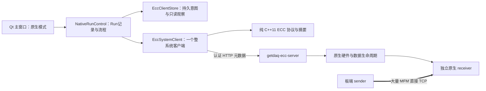

# Qt 整系统操作台：配置、运行、记录与恢复

主窗口已增加启动配置只读查看，另可启用`native_configuration_status`，在Start前把已核对的配置绑定到Run及恢复检查。硬件加载仍未核对，操作和兼容规则见[配置查看与Run记录](ECC_CONFIGURATION_VIEW.md)。

## 1. 当前完成范围

`common/control/eccprotocol.h/.cpp` 提供纯 C++11 的 ECC 请求、服务身份、操作结果和控制器状态协议。Qt 客户端 `apps/envoy/eccsystemclient.h/.cpp` 使用它访问 `getdaq-ecc-server`，不包含 Ice、硬件或 POSIX 进程管理头文件。服务器也复用这份请求编码，保持操作摘要的字节契约。

主窗口已有明确的 `native_ecc` 模式，通过 `NativeRunControl` 调用一个全系统服务。旧 SOAP/模拟模式继续保留。原生模式已经通过本机模拟GUI工作流、两种编码的实际Qt→ECC→数据服务→独立receiver联调及本阶段新控制代码的内存检查；最终范围见 [验证记录](VALIDATION.md)。这不等于 Windows Kit、Ubuntu24、macOS、现场硬件、持续吞吐或断电持久性验收。



原始帧不进入这个客户端。身份/操作回复最多是有界元数据；它不分析、复制或写盘原始事件。

## 2. 为什么不能直接替换旧 EccClient

旧 `RunControl` 为每个节点建立一个 SOAP `EccClient`，分别推进 CoBo/MuTaNT，并在 Stop 后进入旧 sentry Catalog。新服务一次调用就协调全系统，不能在每块 CoBo 上重复发送同一个系统 Start/Configure。

新后端 Stop 还会保留 sender 连接和 receiver 会话。结束数据必须由 Breakup 确认断开、自然 EOF、尾帧检查、排空、同步、退出和封存，再进入 Run 记录/归档。不能把旧“ECC Ready → 等待固定时间 → Catalog”照搬成新模式的完整结束证据。

新模式分别显示全局ECC、数据节点及接收器；同一Run保存操作ID、服务实例、快照、接收会话和封存引用。Recover仅恢复匹配的本地Run关系，不解除硬件UNKNOWN。配置native_catalog后，可在各数据主机按实验/Run建立原生硬链接归档并保存引用；原始数据仍留在数据主机。跨文件系统及跨主机的显式归档复制由独立getdaq-catalog执行，GUI不自动发送载荷。配置和限制见[数据端归档手册](DATA_RUN_CATALOG.md)与[跨主机归档手册](CATALOG_TRANSFER.md)。

## 3. 已实现的纯协议

协议库只依赖现有 C++11 参数/JSON/SHA 核心，无新增第三方运行库。单独构建：

```bash
cmake -S common/control -B build-control-protocol -DCMAKE_BUILD_TYPE=Release
cmake --build build-control-protocol -j2
cd build-control-protocol
ctest --output-on-failure
```

输出 `getdaq-control-protocol` 静态库和 `ecc-protocol-tests`；独立构建还包含既有参数核心测试。协议没有 Qt、Ice、yaml-cpp、curl 或 POSIX 后端依赖，Windows GUI 可通过 `common/control/control.pri` 编译相同源码。

| API/结构 | 用途 |
| --- | --- |
| `EccControlRequest` | 完整七字段请求；显式操作 ID、服务实例、快照、客户端和持有期 |
| `Encode/DecodeEccControlRequest` | 严格字段、UTF-8、类型、命令/ID/摘要与大小检查 |
| `EccControlRequestKey` | 对规范请求字节使用既有域前缀计算 SHA-256 |
| `EccControlIdentity` | 服务/客户端身份、实例、固定输入、配置/工件/数据计划摘要 |
| `EccControlOperation` | 原请求、请求摘要、accepted/running/complete/failed/unknown与结果 |
| `EccControlControllerStatus` | ECC 状态/转换/错误、未知/核对标志、最后操作与消息 |
| `EccControlSystemStatus` | 全系统/属主门槛、各数据节点计划、receiver PID/会话/退出/封存与精确计数 |
| `EccControlAlarmStatus` | 可选告警缓存：保持标志、原自动操作ID、原父状态/失败ID与通知计数 |
| `EccControlSourceObservation` | 可选源观察：固定实例/配置/工件、操作ID、源状态、接收会话及精确64位本地交付计数 |

请求编码保留服务原有字段顺序和末尾换行。解码拒绝重复/未知字段、非法命令、非法 ID、非小写64字符摘要、错误类型和越界状态；操作回复必须与其原请求摘要一致。complete/failed必须带控制结果；重开未完成意图的unknown允许没有结果，不能捏造状态。

## 4. Qt 客户端选项

以下 C++ API 选项对应第8节的YAML和“Nodes and paths”对话框；认证文件只填写路径，不显示值。

| `EccSystemClientOptions` 字段 | 含义 |
| --- | --- |
| `address`、`port` | 规范 IPv4 和控制端口；不是 receiver 数据地址 |
| `credentialFile` | 本机绝对认证文件路径，值不写入请求意图或日志 |
| `serviceId`、`clientId` | 预先核对的服务和客户端身份 |
| `snapshotSha256`、`inputBindingSha256` | 预先核对的固定部署/输入摘要，不能盲信第一次网络返回 |
| `clientEpoch` | 此客户端持有期的64字符值；调用方须跨 Run 保存，不能随意换值接管 |
| `timeoutMs` | 单次 HTTP 100～60000ms；与硬件流程整体截止时间不同 |
| `statusMaxAgeMs` | 已核对状态的最大年龄100～3600000ms；不是硬件健康保证 |
| `alarmStatusEnabled` | 默认false；启用后要求并显示同实例/快照的 `/v1/alarms` 缓存；不会启用服务端停止策略 |
| `sourceStatusEnabled` | 默认false；只读查询 `/v1/sources`，独立显示源状态，不自动发送采集命令或解除UNKNOWN；见[启用与状态解释](SOURCE_GUI_OBSERVATION.md) |

认证文件必须包含64字符小写十六进制，可带一个末尾换行。拒绝符号链接、非普通文件、错误长度/内容；UNIX 下检查私有权限。Windows 的用户/ACL与真实部署仍需目标环境验收。客户端观察到认证值改变后保持故障，恢复旧值不能自动清除。

HTTP 使用现有 `HttpClient`，新增可选请求头参数；旧 SOAP/sentry 调用仍使用默认空头。手动重定向策略和1MiB回复预算保留。当前未增加 TLS，部署网络限制沿用 [ECC网络服务](ECC_NETWORK_SERVICE.md)。

## 5. 发送前保存意图

客户端构造时接收 `IntentWriter` 回调：

```cpp
typedef std::function<bool(const std::string &, QString *)> IntentWriter;
```

回调接收完整规范请求字节。调用方必须把它保存到与当前部署/Run绑定的不可覆盖操作记录，完成必要持久性检查后返回 true。没有回调、写入失败或回调异常时不发送 POST；没有默认成功存储实现。

客户端只有在身份核对完成、状态归属/新鲜度匹配、没有待确认操作或查询且控制门槛允许时接受 `Submit(command, operationId)`。先调用回调，再保留原 ID，最后调用一次网络 API。服务端按同 ID/请求摘要去重；客户端没有自动换 ID 或定时重发 POST 的循环，不能用网络调用次数代替硬件动作次数证明。POST尚未返回时不抢先GET同一操作，避免把尚未被服务接受的请求404误看成最终失败。

GUI的回调现在先写活动Run意图，再写 `EccClientStore`。后者独占创建请求文件、提交追加日志并核对历史记录；UNIX使用文件/目录fsync。Run的JSON/CSV使用既有QSaveFile原子替换，两类记录的持久性级别不同；没有用本机测试推断断电保证。Windows采用文件提交，其目录持久性和ACL仍待实际验收。

## 6. 身份、结果和未知状态

`QueryIdentity()` 是只读操作，核对服务、客户端和两个预期摘要，再保存本次实例。观察到实例变化或回复绑定错误后保持客户端门槛；恢复旧身份不会解除。身份匹配不证明硬件就绪、供电安全或数据已封存。

`OperationSignal` 返回操作 ID、phase、已核对的原始 JSON 和错误文本。accepted/running保留 Pending；HTTP超时/失联保留原意图与 Pending，显示 unknown；只用 `Observe(savedRequest)` 查询原 ID，不自动重新 Submit。回复必须与持久原请求逐字段/规范字节匹配，不能把别的操作成功当作本次成功。

complete/failed表示结果已记录，仍要检查其中 `outcome_unknown` 和 `needs_reconciliation`。它们出现时保持正向控制门槛，重新查询相同身份也不能清除。unknown历史可能没有控制器结果，同样不能假造完成或允许正向重放。

已核对的同一实例保留未知准备/运行对象时，可以明确提交 `stop-production-after-failure`；Prepare 失败且没有采集对象时，后端使用原准备对象。该命令不能作为自动重试、断开 sender、kill receiver、断电、注销告警或清未知的手段。观察到实例变化后不能通过这条路径接管旧对象。操作与完成含义见 [准备故障停止](PREPARATION_FAILURE_STOP.md)和[原生ECC手册](NATIVE_ECC_COORDINATOR.md)。

析构只取消本地网络等待，没有远端撤销/停止。外部意图记录必须保留，服务可能已经接受并继续执行。GUI重开只观察原ID；本地Run恢复另核对同一服务实例及receiver会话，不能通过重新创建客户端或删除记录绕过服务门槛。

## 7. 本机专项检查

```bash
mkdir -p build-ecc-system-client
cd build-ecc-system-client
qmake ../tests/ecc_system_client.pro
make -j2
./ecc-system-client-tests
```

客户端/存储当前共16项（包括QtTest初始化/清理），原14项覆盖意图先保存、同ID观察、应答丢失、错误范围、无写入器、实例变化、UNKNOWN和负向停止、凭据故障、新鲜度/属主/忙状态，以及记录重开、损坏和终态不回退；新增两项检查告警身份与保持不能被健康回复清除。这里使用独立本机HTTP夹具，没有实际硬件或数据进程。

实际 Qt 客户端与实际 ECC 服务的边界另有探针：

```bash
mkdir -p build-ecc-system-client-probe
cd build-ecc-system-client-probe
qmake ../tests/ecc_system_client_probe.pro
make -j2
```

`tests/run_ecc_gui_probe.py` 为实际ECC服务创建新私有证据根，调用这个探针提交非法 Idle→Start，核对认证/实例/快照、持久请求、同ID结果和状态拒绝；根原生日志没有硬件 intent。它不把失败状态测试当作完整Qt采集联调。参数模板由固定配置测试生成，不能用未核对的生产配置运行探针。

客户端基础阶段的52项/262记录结果保留在验证第32节；GUI首次集成的53项/9项/276条既有状态记录，以及完整两编码实际采集证据保留在第33节。归档与告警补充后，当前完整GUI仍53项，专用Run工作流11项，客户端16项；第38节给出最终同版告警及状态时序修复证明。完整Qt采集探针是 `tests/native_gui_probe.pro`，由 `tests/run_ecc_network_service_tests.py --qt-probe ... --scenarios qt-gui-0 qt-gui-1` 驱动；它确实运行两个receiver。历史和当前阶段分开，不把旧结果算作新增代码验证。

## 8. 第一次配置原生模式

### 8.1 先准备服务，再准备GUI

先按 [ECC网络手册](ECC_NETWORK_SERVICE.md) 配置ECC及各数据节点。GUI不会通过SSH安装服务，也不会传输原始数据。以下三个目录承担不同职责：

| 目录 | 保存什么 | 在哪里 |
| --- | --- | --- |
| ECC的audit_root | 固定快照、硬件意图和状态历史 | ECC主机 |
| GUI的record_dir | 该客户端所有操作请求/结果，不随Run切换 | GUI主机 |
| GUI的output_dir | 每个Run的说明、CSV、接收会话及seal引用 | GUI主机 |

receiver的数据目录由数据服务固定计划决定，位于数据主机；它不是GUI的output_dir。Windows GUI可以显示Linux数据路径，不会尝试把该路径当成Windows本机目录读取。

先用服务的 `--check-config` 核对固定输入；输出的 `binding_sha256` 填入GUI的 `input_binding_sha256`。服务首次启动后，从已核对部署的ECC审计根 `snapshot.json` 计算SHA-256，填入 `snapshot_sha256`；服务身份GET也应返回相同值。预期值来自已核对的本地部署/可信交付记录，不能盲信首次网络回复后自动修改GUI配置。

`client_epoch` 是公开的客户端持有期标识，须跨Run和GUI重启保留；它不是认证令牌。可以生成一次：

```bash
python3 -c 'import uuid; print(uuid.uuid4().hex + uuid.uuid4().hex)'
```

保存生成的64字符到配置。服务接受第一个命令后会绑定此epoch；不要每次启动都生成新值。同部署的另一个epoch会被拒绝，换值不构成接管授权。

### 8.2 YAML逐项填写

复制 [envoy.native.example.yml](../config/envoy.native.example.yml)，替换其中所有 `REPLACE_...` 占位值。示例不能直接运行。GUI配置仍支持旧的experiment/run_number/description/fields；`getdaq.native_ecc` 存在时才启用原生全局模式，必须恰好有以下11个字段：

| YAML字段 | 填写方法 |
| --- | --- |
| address、port | ECC控制服务的规范IPv4及端口，不填URL、不填receiver数据端口 |
| credential_file | GUI本机的ECC认证文件路径；Linux保持0600，Windows需核对用户/ACL |
| service_id、client_id | 与ECC固定服务配置一致的公开ID |
| client_epoch | 上面生成并持久保存的64字符小写值 |
| snapshot_sha256 | 已审阅的ECC快照摘要 |
| input_binding_sha256 | 已审阅的固定输入绑定摘要 |
| timeout_ms | 单次元数据HTTP截止时间，推荐先按5000ms联调 |
| status_max_age_ms | 正向动作所用状态最大年龄，示例10000ms |
| record_dir | GUI私有操作记录根，建议与每Run目录分开 |

路径相对于所加载YAML文件的目录解析；界面保存后使用规范绝对路径。Windows可写 `C:/GetDAQ/state/native-control` 等路径；不要复制Linux本机认证路径给Windows使用。

每个CoBo显示行需要 `native_sender_id` 与 `native_agent_id`：前者恰好匹配该CoBo sender/receiver计划来源ID，后者匹配数据服务agent_id。GUI行的整数id仅用于显示定位，不代替这两个来源标识；所有活动来源必须完整且唯一。MuTaNT行使用role: mutant，不填写receiver来源。原生模式支持独立CoBo或最多3个MuTaNT显示行，真实硬件配置仍以ECC固定拓扑为准。

`simulation` 必须为false；原生模式不会把“假数据”标志发给真实ECC。旧SOAP的ecc_port、sentry_port、router/exporter等字段不用于新全局连接，配置对话框切换模式后隐藏这些列。

可选 `getdaq.native_alarm_status: true` 放在 `native_ecc` 外。在Nodes and paths中对应 **Require and display ECC alarm cache (/v1/alarms)**。启用后，正向命令还需一次有效告警缓存；读取失败、身份改变或告警保持不会被下一次健康回复自动清除。两个开关的区别、每种显示含义、原告警JSON的保存和未完成Run处理见[后台告警手册第9节](ALARM_STOP_POLICY.md#9-在gui里启用查看逐步理解结果)。

### 8.3 在Qt Creator / 命令行打开

可选`getdaq.native_receiver_status: true`同样放在native_ecc外，对应设置窗口的`Observe receiver processes`。它经ECC后台查询实际自有进程，显示退出/忙碌/失联/过期提示；不新增硬件命令或自动故障解除，原文件/字节/帧数仍是缓存。完整配置、正常EOF与失败的区别及排障步骤见[接收进程观察手册](RECEIVER_GUI_OBSERVATION.md)。

Qt Creator打开根 [GetDAQ.pro](../GetDAQ.pro)，选择已有Qt Kit构建。Ubuntu控制台可运行：

```bash
./build-suite/bin/GetDAQ --config /home/daq/gui/native.yml
```

实际输出目录以Qt Creator构建配置为准。Windows选择Qt5.14.2 MinGW；源码采用C++11和嵌入yaml-cpp，不要求在Windows编译Ice或POSIX接收后端。Windows实际Kit构建/运行/部署仍需检查，Linux本机通过不证明该Kit通过。

加载配置后，“Nodes and paths”可以编辑全局端点、期望ID/摘要、凭据路径和记录目录；长表单可滚动，OK/Cancel始终在对话框底部。只有未连接且没有活动Run时可以修改部署配置。启用原生模式时Simulation按钮和逐节点推进/回退按钮禁用，状态标题显示NATIVE SYSTEM / METADATA CONTROL。

## 9. 正常采集的一次完整操作

以下流程一次命令作用于整个系统。CoBo有两块或十块都只向ECC提交一次。

| 顺序 | GUI操作 | ECC阶段 | 接收器/记录行为 |
| --- | --- | --- | --- |
| 1 | Connect | 查询固定身份、当前缓存状态和属主 | 不自动准备硬件、不启动receiver |
| 2 | Progress | Idle→Described | 全节点描述/名称检查 |
| 3 | Progress | Described→Prepared | 整系统准备/对齐/告警流程 |
| 4 | Progress | Prepared→Ready | 配置、启动receiver并确认会话、连接sender |
| 5 | Start Run | Ready→Running | 先保留Run目录及原始操作意图，再启动生产 |
| 6 | Pause native Run | Running→Paused | 保留sender连接、PID和接收会话 |
| 7 | Resume native Run | Paused→Running | 恢复生产，不另建receiver |
| 8 | Stop Run | Running/Paused→Ready | 停生产/刷新，连接暂时保留 |
| 9 | GUI自动继续Breakup | Ready→Prepared | 明确断开，等待自然EOF/排空/退出/封存 |
| 10 | 可选数据端Catalog | 保持Prepared | native_catalog启用时一次全系统请求，各节点在固定根归档；只传元数据 |
| 11 | GUI完成记录 | 保持Prepared | 全部退出/封存，以及已要求的归档均确认后保存Run引用与CSV，Run号加1 |
| 12 | 继续下一Run：Progress | Prepared→Ready | 建立新接收周期，再Start Run |

只停止生产不代表已经结束数据。Stop按钮返回后可能还在等待Breakup和封存；看到Complete和Run号推进，才表示当前GUI已保存完成记录。任一节点封存失败时保留当前Run、不写Complete、不推进Run号，成功节点的原始封存证据仍在各数据主机。

操作记录complete和最新状态GET是不同证据。GUI等待完成结果之后发出的状态查询，再启用下一动作；若轮询已在等待返回，则先丢弃这份不能证明完成后状态的回复，重新GET。即使旧回复晚于complete到达，也不据此再提交Breakup/Catalog。查询期间按钮暂时禁用。单次HTTP超时只结束一次等待，整体 `step_timeout_ms` 是硬件阶段观察期限。到期不自动重发、kill receiver或撤销服务已接受的命令。

Regress用于没有活动Run时撤回配置：Ready→Prepared发送Breakup；Prepared→Described、Described→Idle发送Reset。每个动作也只提交一次全系统命令。Finalize用于本地Run已保留且生产已停的结束/补记流程，不是无条件强制结束硬件。

## 10. 状态表能说明什么

Source/System ECC/Transition显示映射来源和全局状态。Data node/cache、Receiver state、PID、Session、Dataset来自ECC最近一次明确生命周期观察；Received bytes、Frames、Files以十进制字符串显示，最大uint64_t和超过2^53的数不会经过double或int截断。它们是缓存计数，不能用来断言此刻实时吞吐或板端事件无丢失。原生模式隐藏旧MB/s曲线，避免将这些缓存误画成实时速率。

Ready表示完整配置阶段已经提交，不代替现场锁定/加载版本/电气验收。seal verified表示该接收器的已记录文件/EOF/退出/封存核对成功，不代替每个物理事件都传到磁盘。阶段说明、操作ID、数据主机文件和现场计数应联合核对。

告警停止的complete不完成GUI Run。启用告警查看时，控制阶段显示Native requires inspection，日志显示原停止ID/阶段及精确通知计数；活动Run的journal保存native_alarm_cache。Start/Progress和Finalize不能绕过保持，GUI不自动Breakup/写CSV/加Run号。Prepare/Start失败后的自动负向停止即使complete，也保留原失败操作UNKNOWN。详细证据见[验证记录第38节](VALIDATION.md#38-unknown与实际qt告警缓存联调2026-10-07)。

普通Run的Duration是GUI自Start结果确认至Stop确认的墙钟时间，含Pause等待；它不是精确束流有效采集时间。GUI重启恢复后无法补齐消失的计时，journal标记duration_incomplete；此时CSV的Duration只保留已记录部分，不能作完整采集时长使用。

## 11. 文件结构与记录核对

```text
native-control-records/
  policy.json                 固定服务/客户端/epoch/摘要/端点绑定，不含认证值
  requests/<operation-id>.json 原始规范请求，独占创建，不覆盖
  observations.jsonl          意图和结果追加日志，带序号/请求摘要
  client.lock                当前GUI写者锁（关闭后移除）

run-records/hardware/NativeExperiment/run_0000/
  run.yml                    本次GUI配置快照
  journal.json               阶段、原生操作、身份、Ready接收会话、时长/错误
  receiver-status.json       所有receiver停止/退出/seal的最终引用
  ecc-identity.json          本次核对的服务身份/工件/快照绑定
  run.csv                    每Run独立表头与说明
```

原生Run不生成旧本机configuration备份来冒充ECC实际加载工件；真正固定输入和工件摘要在ECC身份/审计根中。receiver-status只保存元数据，不复制.graw文件。不能删除ECC/GUI日志再重建目录，来绕过未知结果或自动接管旧进程。

启用getdaq.native_catalog后另保存data-catalogs.json；状态表Run archive列显示实际数据节点目录。数据端归档方法为硬链接，源会话目录和原seal保留；目录出现不代表完成，必须核对catalog-complete.json。完整操作、故障和CLI见[数据端归档手册](DATA_RUN_CATALOG.md)。

记录存储拒绝符号链接、历史请求/策略变动、完整性错误、已有操作ID和并发第二写者；重开检查原意图与结果，不自动补写/重放。观察到文件损坏后恢复原字节仍保留当前对象的门槛。当前Linux目录/文件权限及fsync路径已有测试，真实断电/Windows ACL和目录同步仍待验证。

## 12. 应答丢失、GUI重启与Recover

### 12.1 POST失联

“未收到Start应答”不代表板端没有Start。GUI保留原操作ID，后续只GET原ID；如果服务记录complete且状态一致，可以继续观察原Run。不要重复Start、换操作ID或删除records目录。请求仍在accepted/running时继续观察；unknown或绑定错误时保持门槛并检查ECC/数据节点记录。

### 12.2 GUI退出，ECC和数据服务仍活着

1. 使用原YAML：相同实验/Run号、输出/记录目录、service/client/epoch、预期摘要和来源映射。
2. Connect只核对身份、查询状态并观察records中未完成原ID，不发送采集命令。
3. 核对状态和数据主机实际记录后点击Recover。它加载已有run.yml/journal，要求Run未Complete、相同ECC实例与固定快照，以及全部receiver相同source/session/PID/dataset。
4. 恢复成功只恢复GUI的本地Run关系，标记计时不完整；没有重放Start，也没有解除硬件UNKNOWN。
5. 硬件健康且Running/Paused时可以明确Stop；已Ready时Finalize会执行Breakup；已Prepared时Finalize只在全部receiver正常退出并封存后补记。

模拟重启用例覆盖相同绑定恢复、不同receiver会话/不同ECC实例拒绝；完整真机崩溃/磁盘断电恢复并未验收。ECC重启会产生新instance并保持核对要求，不能通过GUI的Recover把旧采集对象接到新进程。

### 12.3 明确故障生产停止

“Native fault: stop production only (keep UNKNOWN)”是人工明确的负向动作。只有同一已核对实例、有效凭据、没有正在查询/提交或待观察操作时才能提交。它只尝试后端已有的生产停止路径，不自动断开sender、不kill receiver、不使UNKNOWN变成Ready。记录成功后仍需检查原故障及数据状态；未实现的完整硬件核对流程不能用该按钮替代。

| 现象 | 应核对什么 |
| --- | --- |
| 不能Connect | IPv4/端口、凭据本机路径/权限、service/client和两个预期摘要 |
| 显示其他owner | 原client_epoch与ECC持久属主；不要新造epoch接管 |
| 查询完成但动作被阻断 | UNKNOWN、待观察原ID、状态过期/远端忙、历史请求或记录损坏 |
| Stop之后还没Complete | Breakup结果、各数据节点EOF/退出/seal和GUI写盘错误 |
| Recover拒绝 | 旧Run是否Complete；实例、会话/PID/数据路径、Run配置和来源映射是否改变 |
| 计数长时间不变 | ECC给的是缓存；在数据节点查低频状态，不能从缓存推断零速率 |

## 13. 仍需完成的工作

Prepare故障的明确生产停止已接同一保留对象并有本机模拟板端验证。物理多主机/MuTaNT/真实固件、Windows5.14.2 MinGW与Ubuntu24/macOS、硬件独占锁与实际加载版本、后台告警自动协调及硬件UNKNOWN核对、历史FDT/ICE/ZBUF、跨文件系统/主机的载荷迁移、受控原会话清理和持续大流量/断电验收仍未完成。GUI集成或原生socket都不能作为这些项目完成的依据。
