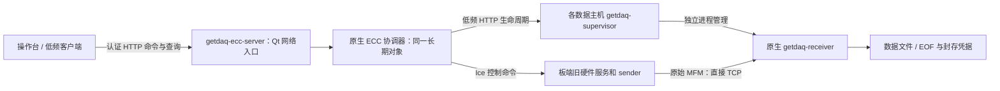

# ECC 网络服务：部署、命令、数据边界与故障处理

认证只读 `/v1/configure-readbacks` 提供 [Configure 读回证据](CONFIGURE_READBACK_EVIDENCE.md)，包含原操作/参数绑定、每板审计摘要和覆盖计数；查询不重新读硬件，须同时检查当前父UNKNOWN/核对状态，不等于已验证实际加载版本。

可选 [主机端板卡占用保护](HOST_CONTROL_OWNERSHIP.md) 防止共用目录的同机新 ECC 实例重复控制同一目标地址。固定配置字段、认证 `/v1/ownership` 查询及释放/UNKNOWN 边界见手册；它不声称板端或跨主机全局控制权。

固定输入现在可选configuration_publication，要求编译工件、profile、有效快照及全部来源属于同一只读发布包，并持续核对目录/文件身份和字节；不含此字段的旧配置保留。操作、权限与实际加载边界见[配置发布包](CONFIGURATION_PUBLICATION.md)。

另可选`configuration_selection:{"path":...,"sha256":...}`，要求同时绑定发布包，并持续核对审阅的仓库身份/登记收据。Qt导出和原生`getdaq-ecc-select`离线部署入口、保留原审计根的规则及GET `/v1/configuration`缓存语义见[ECC配置选择](ECC_CONFIGURATION_SELECTION.md)。不表示运行中切换或实际板端加载。

## 1. 它负责什么

`getdaq-ecc-server` 将一个长期存活的 `NativeEccCoordinator` 暴露为低频 HTTP 控制服务。这个对象组合 Describe、Prepare、Configure、Start、Stop、Pause、Resume、Breakup、Reset，并协调各数据主机上的独立 receiver。一次系统命令只提交给一个 ECC 服务，不按 CoBo 数量重复提交。

Qt Core/Network/Concurrent 用于 HTTP 接口和请求通知。硬件流程、固定输入读取、ECC 状态、远程数据节点适配器使用原生 C++11；高速 MFM 数据由板端 sender 直接发送到 `getdaq-receiver`。接收器没有 Qt、Ice、yaml-cpp 或 curl 链接依赖。

本阶段网络入口已有代码和本机测试；具体已完成的测试以 [验证记录](VALIDATION.md) 为准。GUI的native_ecc模式现接这个整系统入口，旧SOAP模式仍保留；配置/运行/记录和本地Run恢复见 [GUI手册](ECC_GUI_CLIENT.md)。真实硬件控制权、实际加载版本、完整重启核对恢复、Prepare故障后的完整停机、历史FDT/ICE/ZBUF及目标平台验收仍未完成。



三类端口需要区分：ECC HTTP 端口接收系统命令；数据主机 HTTP 端口管理 receiver；receiver 的数据端口接收板端 MFM。控制服务不读取数据端口进行就绪探测。

## 2. 构建

在项目根目录运行：

```bash
cmake -S apps/datareceiver -B build-receiver -DCMAKE_BUILD_TYPE=Release
cmake --build build-receiver -j2

cmake -S third_party/ice-compat -B build-ice-compat \
  -DCMAKE_BUILD_TYPE=Release -DGETDAQ_BUILD_ECC_SERVICE=ON
cmake --build build-ice-compat --target getdaq-ecc-server getdaq-supervisor -j2
```

硬件兼容依赖从仓库本地源码/归档构建，不在这里下载 Ice。网络服务需要 Qt 5.12 及以上的 Core、Network、Concurrent 开发组件；没有相应组件时 CMake 明确省略服务目标，不能把“配置成功”当成服务已生成。输出为 `build-ice-compat/getdaq-ecc-server`。这是 POSIX 控制后端；Windows Qt 5.14.2 MinGW 用于 GUI 检查，当前未提供该后端的 Windows 进程管理移植。

如果只需要原生协调库，可设置 `-DGETDAQ_BUILD_ECC_SERVICE=OFF`，构建 `getdaq-ecc-native`。这个选项只控制 ECC 网络前端；若还需要完全不构建数据主机的 Qt 服务，另外设置 `-DGETDAQ_BUILD_SUPERVISOR_SERVICE=OFF`。原生接收器的独立构建不受这些选项影响。

## 3. 准备文件与目录

示例 [service.example.json](../config/ecc/service.example.json) 的路径、代理、板型对应关系和四个全零摘要是占位值，必须重新核对。示例回调监听 `127.0.0.1` 仅适用于本机联调；远端板端告警需要能反向访问 ECC 主机的真实地址，详见 [告警服务手册](COBO_SERVICES.md)。

建议的目录结构如下，`daq` 表示实际服务用户：

```text
/home/daq/getdaq-input/             已编译工件、拓扑、硬件描述、服务配置
/home/daq/getdaq-credentials/       ECC 及各数据节点认证文件
/home/daq/getdaq-state/             ECC 审计根的父目录
/home/daq/getdaq-state/ecc-main/    ECC 第一次启动独占创建的审计根
```

先创建前三个目录，**不要预先创建 `audit_root` 本身**。输入文件必须为服务用户所有的普通文件，没有组或其他用户写权限；认证文件必须为该用户所有、权限 0600 的普通文件。路径必须为绝对规范路径，不含 `..`、`.`、重复斜线或末尾斜线。服务检查绑定文件身份和字节内容，拒绝符号链接。

生成 ECC 认证文件：

```bash
build-ice-compat/getdaq-ecc-server \
  --generate-token /home/daq/getdaq-credentials/ecc-main.token
```

这个命令独占创建文件，不覆盖已有凭据，不打印认证值。各数据节点的认证文件按 [数据主机管理手册](REMOTE_RECEIVER_CONTROL.md) 生成。控制主机保存数据节点凭据的本地副本；文件路径可以不同，值必须对应实际节点。认证值不能加入 Git、运行日志、截图或共享测试归档。

准备输入时按以下顺序进行：

1. 按 [实验工件手册](SYSTEM_EXPERIMENT_CONFIGURATION.md) 使用 `compile-system`，生成完整且明确选择硬件 profile 的实验工件。
2. 编译硬件描述，填写拓扑的全部 CoBo/MuTaNT ID、代理、预期名称和主从角色。
3. 将拓扑中的 `hardware_description_file` 改成编译后描述文件的**绝对路径**，每个路径都要在 `hardware_descriptions` 注册。旧独立拓扑 CLI 的相对路径兼容仍保留，固定服务使用更严格的绝对引用。
4. 对最终工件、最终拓扑和每份描述运行 `sha256sum 文件路径`，填写对应引用的 `sha256`。
5. 按 [远程数据节点手册](REMOTE_RECEIVER_CONTROL.md) 配置并启动各节点服务，获得其固定 `plan_sha256`，填入 ECC 的 `remote_receivers.endpoints`。
6. 核对 `senders` 与全部节点接收计划：每个活动 sender 恰好对应一个来源，ID、数据目标、工件参数摘要和工件字节摘要一致，不能有缺项、额外来源或重复目标。

工件、拓扑和描述引用都是 `{"path":"绝对路径","sha256":"64字符小写十六进制"}`。不要把参数摘要 `configuration_sha256` 当作文件字节摘要。修改文件后须重新核对部署输入，不能在运行中编辑配置。

## 4. 服务配置逐项解释

顶层必须恰好包含示例中的 19 个字段，未知、缺失和重复键会被拒绝。

| 字段 | 含义 |
| --- | --- |
| `schema`、`kind` | 固定为 1 和 `getdaq.ecc-service` |
| `service_id` | 本部署的公开服务身份，客户端应核对 |
| `client_id` | 允许的操作客户端身份；不代替认证凭据 |
| `bind`、`port` | HTTP 控制监听的规范 IPv4 和 1～65535 端口 |
| `credential_file` | ECC HTTP 认证文件，不是数据节点凭据 |
| `audit_root`、`deployment_id` | 此固定部署的审计根和部署名称 |
| `experiment_artifact` | 完整实验工件文件及其字节 SHA-256 |
| `topology` | 全系统拓扑文件及其字节 SHA-256 |
| `hardware_descriptions` | 拓扑实际引用的全部描述文件；重复和未使用的条目拒绝 |
| `description_policy` | 明确选择 `use-existing`、`create-empty` 或 `replace-existing` |
| `current_topology` | 通常为 null；明确替换时必须提供旧拓扑的文件引用 |
| `exclusive_owner_confirmed` | 必须明确为 true；是操作者前提声明，未实现远端硬件锁 |
| `data_processes_stopped` | 必须明确为 true；不代替执行时的实际停止/就绪检查 |
| `cobo_policies` | 全部 CoBo 的回调和告警预算，含停用 CoBo |
| `senders` | 本系统实际使用的数据 sender，不含原始事件 |
| `remote_receivers` | 固定数据节点列表和命令观察策略 |

描述策略的区别：`use-existing` 只核对已有描述；`create-empty` 仅向空目标创建描述；`replace-existing` 需要明确旧描述并核对目标 ID、角色和代理，才允许替换。不能因读取失败自动换成创建或替换。详细行为见 [全系统描述手册](SYSTEM_DESCRIPTION.md)。

每条 `cobo_policies` 恰好包含 `id`、`callback_endpoints`、`published_endpoints`、`max_pending_alarms`、`max_alarm_audit_bytes`。前两个网络字段用于板端告警回调，后两个字段限制事件队列和审计大小；允许范围和反向网络要求由既有 [Prepare/告警流程](COBO_PREPARE_CLIENT.md) 检查。

每条 `senders` 恰好包含 `id`、`control_proxy`、`receiver_address`、`circular_buffer_mask`、`always_flush`、`exclusive_stopped_owner_confirmed`、`encoding_minor`、`timeout_ms`。`control_proxy` 是板端 DaqCtrlNode；`receiver_address` 是原始数据目标。编码只能为 0（Ice 1.0）或 1（Ice 1.1），RPC 超时由既有 sender 检查约束；缓冲区掩码必须与工件和实际描述一致。详见 [sender 控制](DATA_SENDER_CONTROL.md)。

`remote_receivers` 恰好包含 `controller_id`、`command_timeout_ms`、`poll_interval_ms`、`endpoints`。`controller_id` 必须与各数据节点允许的控制器 ID 相同；单次生命周期总期限为 100～600000ms，查询间隔为 10～1000ms。每个 endpoint 恰好包含 `agent_id`、`plan_sha256`、`address`、`port`、`credential_file`、`timeout_ms`。每次 HTTP 请求的超时为 100～60000ms；它与整个节点动作的总期限是两层不同限制。

固定服务配置和每份拓扑最大 1MiB，描述最大 8MiB，工件最大 64MiB，全部捕获输入合计最多 128MiB。JSON 不需要额外安装第三方解析器；硬件描述/拓扑兼容读取仍复用仓库嵌入的 yaml-cpp。

## 5. 离线检查与启动

先运行：

```bash
build-ice-compat/getdaq-ecc-server \
  --config /home/daq/getdaq-input/ecc-main.json --check-config
```

此命令读取并核对本地固定文件、完整参数、代理格式、回调策略和凭据；不连接硬件或数据节点，不创建 ECC/receiver 审计根，不启动接收器。成功输出 `binding_sha256`，返回 0；失败返回 2。**离线通过不证明远端接口、描述或节点就绪。**

启动服务：

```bash
build-ice-compat/getdaq-ecc-server \
  --config /home/daq/getdaq-input/ecc-main.json
```

服务先绑定控制监听端口，成功后才打开 ECC 审计状态，避免占用端口失败却先创建新部署根。启动不自动发送 Describe/Prepare，不自动启动 receiver。首次部署从 Idle 开始；重新打开已有审计根会保持核对门槛，不会自动恢复或重放命令。服务提供若干**同一活跃实例、绑定原操作和清理/只读观察证据**的专用核对入口（Describe、Prepare、采集，以及部分明确退休源后的采集恢复），不是任意UNKNOWN恢复或冷启动接管；需逐项满足对应章节的原对象和证据前提。

HTTP Bearer 认证覆盖身份、状态、历史操作和命令接口。当前没有内建 TLS：跨主机部署需要在受控私有网络或已配置的安全隧道中使用，不能把认证值通过未保护的公共网络发送。这里只说明当前实现边界，不声称已有现场网络部署验收。

## 6. 三种身份摘要

| 字段 | 证明什么 | 不证明什么 |
| --- | --- | --- |
| `input_binding_sha256` | 固定服务配置、拓扑、描述和工件的路径/实际字节绑定 | 现场硬件已加载这些参数 |
| `snapshot_sha256` | 原生 ECC 的工件、端点、策略、sender、数据计划和固定输入绑定 | 远端独占控制权或真实电气效果 |
| `instance_id` | 当前服务进程实例，重启生成新值 | 原进程命令未执行、可安全重发 |

输入绑定使用 `getdaq.fixed-ecc-inputs:1\n` 域前缀和按路径排序的引用清单。它包含服务配置的原始字节，修改配置缩进也会改变该部署绑定。认证值不进入此摘要；认证文件路径属于配置公开结构。

## 7. HTTP 协议与操作 ID

| 方法/路径 | 行为 |
| --- | --- |
| `GET /v1/identity` | 公开身份、实例、快照、固定输入、工件与数据计划摘要 |
| `GET /v1/status` | ECC/网络操作/数据节点的短缓存快照 |
| `GET /v1/receivers` | 后台有界查询数据节点的实际自有receiver进程；不回收、不发硬件命令 |
| `GET /v1/operations/操作ID` | 已接受操作的缓存状态；不存在返回 404 |
| `POST /v1/operations` | 提交一次完整命令请求，正常接受返回 202 |

POST 必须为 `Content-Type: application/json`，最大 8KiB，恰好包含七个字段：

```json
{
  "schema": 1,
  "operation_id": "run-001-describe",
  "command": "describe",
  "instance_id": "从本次身份查询取得的64字符摘要",
  "snapshot_sha256": "从本次身份查询取得的64字符摘要",
  "client_id": "operator-console",
  "client_epoch": "本客户端会话独立生成并保存的64字符随机值"
}
```

三个 64 字符字段必须是小写十六进制。操作 ID 长度 1～128，只允许字母、数字、下划线和连字符。每个新动作使用新的 ID，客户端必须保存原请求与 ID。服务返回的 `request_key` 是完整请求规范编码的 SHA-256。

命令名为 `describe`、`prepare`、`configure`、`start`、`stop`、`pause`、`resume`、`breakup`、`reset`，另有明确故障处理命令 `stop-production-after-failure`。不能向这个接口上传原始帧、改变接收地址或临时替换工件。

服务先持久化命令请求和接受记录，再交给后台原生执行线程。原请求文件的目录、文件身份、权限与内容在接受时绑定，后续命令继续检查历史请求；观察到损坏后，即使恢复原字节也不能清除门槛。

相同实例、相同操作 ID、相同请求摘要再次提交，返回已有缓存记录，不重做硬件动作；相同 ID 配不同请求返回 412。首个被接受的动作将 `client_epoch` 持久绑定到此部署，其他 epoch 不能自动接管。非法 ECC 状态下的命令也可能已经被网络层接受并绑定该 epoch，然后由原生状态机明确失败；这不表示硬件已执行。

服务不排队。已有动作执行时，新 ID 的请求返回 409；同 ID 的只读重复观察仍可返回缓存。每部署最多保留 8192 个操作，网络日志最大 64MiB。更改预算需要新部署设计，不能删除旧日志使服务继续。

| 返回码 | 解释 |
| --- | --- |
| 200 / 202 | 查询成功 / 请求已接受；不表示采集完成 |
| 400 | 请求 JSON、字段、类型或媒体类型非法 |
| 401 | 未认证；凭据文件损坏时可返回 503 |
| 404 / 405 | 未知资源 / 不支持的方法 |
| 412 | 实例、快照、客户端或相同 ID 的请求摘要不匹配 |
| 409 | 忙、持有期冲突、存储门槛或需要核对；没有接受新动作 |
| 500 / 503 | 服务异常 / 认证或请求处理异常；不得仅凭此推断未执行 |

409 通常发生在接受前；但接受记录或线程启动发生故障时，客户端仍须保留 ID 查询，不能把错误码当作“绝对未执行”的证据。

## 8. 如何判断一个命令完成

操作的 `phase` 为 `accepted`、`running`、`complete`、`failed` 或 `unknown`。其中 `complete` 表示该明确命令已返回并记录成功；`failed` 需要结合结果中的 `outcome_unknown` 判断是否存在已尝试但未确认的动作；`unknown` 表示接受/结果记录或重启边界不确定。错误文本不代替这些结构化字段。

每个正常命令完成后，同时检查 ECC 的 `state`、`transition`、`error`、`outcome_unknown`、`needs_reconciliation` 和网络层的 `control_needs_reconciliation`。状态数值与旧 ECC 相同：Off=0、Idle=1、Described=2、Prepared=3、Ready=4、Running=5、Paused=6。

推荐正常流程：

```text
Idle --Describe--> Described --Prepare--> Prepared --Configure--> Ready
Ready --Start--> Running --Pause--> Paused --Resume--> Running
Running/Paused --Stop--> Ready --Breakup--> Prepared
Prepared --Reset--> Described --Reset--> Idle
```

Stop 停止生产并刷新 sender，但保留连接和接收会话。再次 Start 在同一会话重新 RunInit；Pause/Resume 保留同一接收 PID/连接。Breakup 确认生产停止并断开 sender，等各 receiver 自然 EOF、尾帧检查、排空、同步、正常退出、锁释放和封存验证完成后，才提交 Prepared。截断尾帧、异常退出或未知结果不能被成功的硬件 RPC 掩盖。

`stop-production-after-failure` 是保留 UNKNOWN 准备/运行对象时的明确负向动作。尚无采集对象时由原准备对象执行；已有Configured/Ready采集对象时沿用原对象，即使尚未连接或父ECC没有提交Ready，也不重新构造它。它只尝试独立生产停止，不断开未知 sender、不终止 receiver、不关闭供电或注销告警、不清 UNKNOWN，也不提交 Ready。其网络操作可以 `complete` 而 ECC 仍保持需要核对；不要将两者混淆。父停止意图被替换/改写时拒绝完成并保持存储故障，恢复原文件不清门槛。目标顺序、应答丢失不重发和日志见[故障停止手册](PREPARATION_FAILURE_STOP.md)。

固定输入可选 `alarm_stop_policy` 对象，恰好含enabled布尔值及poll_interval_ms整数25..5000；省略默认关闭，启用要求全部活动CoBo的工件配置自有告警订阅。配置改变属于固定输入变化，不能热加载。后台消费自有缓存，保存alarm-held及原操作，再走同一串行入口停止；门槛保持，不自动恢复或断开数据。`GET /v1/alarms`返回需要认证的缓存，已有状态/请求规范保持。新内部ID前缀internal-alarm-拒绝外部POST，但可只读查询；完整步骤及与旧Ganil日志框架的区别见[后台告警手册](ALARM_STOP_POLICY.md)。

## 9. 状态查询的时效与性能

`/v1/status` 只返回缓存，不等待硬件 RPC，不从数据节点实时拉取计数，不读取原始文件。长时间 Prepare 的执行在线程中，HTTP 状态查询仍能返回。首次未查询数据节点时，数据缓存只提供既有初始化信息；它不是远端健康确认。

`/v1/receivers`是另一个经认证的只读接口：一个后台任务按固定节点先核对identity/规范计划/已绑定实例，再查询实际进程，整体远端网络预算1500ms；忙时409、不排队。失联或预算不足节点保留available=false/null，成功节点保留观察，不改变ECC/数据生命周期缓存、控制权或UNKNOWN。Qt事件线程不等待该网络任务；没有MFM/原始文件读取。其跨平台纯协议和GUI可选显示见[操作台观察手册](RECEIVER_GUI_OBSERVATION.md)。预算不是硬实时承诺，仍有本机文件系统/解析/调度开销。

`data.nodes[].lifecycle` 的 PID、会话、EOF、退出和封存字段来自最近一次明确生命周期观察。字节/帧计数使用十进制字符串保存 64 位精度。运行中的这些计数可能过时，界面应明确显示它们是缓存；要看实时计数应查询对应节点的低频状态接口，不能让控制软件接收全部 MFM。

固定输入及控制审计完整性检查在后台接受/执行路径中进行，工作量受预算限制。Qt 网络线程不执行全套硬件流程，也不承担原始数据拷贝、分帧或写盘。本机小数据联调只验证这个分工，尚无持续大流量性能结论。

## 10. 连接丢失、重启与保存证据

发送 POST 后没有收到回复，无法断定服务未接受。客户端保留原 ID，通过 GET 查询原操作；不能自动换一个 ID 重发 Start/Resume。客户端断开不会取消已接受的后台动作。已接受的 Start 可能继续成功，网络掉线也可能在硬件副作用后留下 UNKNOWN。

重新打开同一审计根时，服务生成新 `instance_id`，保留旧操作查询。旧实例请求返回 412；未完成的 `accepted/running` 记录显示为 unknown，不重放。整个部署保持 `control_needs_reconciliation`；当前没有提供自动接管旧接收器或硬件的恢复命令。

服务退出只停止 HTTP 接受并等待当前后台动作结束，没有隐式 Stop/Disconnect/Unprepare/kill。SIGTERM 不等于系统已停止，服务正常退出也不等于 receiver 已封存。不要删除审计目录或复制一个新目录来绕过控制门槛。

审计根中的重要文件：

```text
snapshot.json / experiment.json            原生固定快照和实验工件
ecc.jsonl                                 原生状态/意图/结果日志
operations/操作ID/                        原生各硬件/数据生命周期子阶段
network/policy.json                       网络身份、输入与快照绑定
network/operations.jsonl                  网络接受、运行及结果记录
network/operations/操作ID/request.json     此明确命令的完整公开请求
```

工件在原生根中保存；拓扑和描述以源文件身份/字节摘要绑定，本阶段还没有完整部署包发布/复制协议。保留原固定输入、审计根和数据节点审计/封存文件，作为下一步明确核对的依据。

## 11. 本机验证入口

开发测试需要允许监听 loopback TCP。下面只连接夹具模拟的板端对象：

```bash
python3 tests/run_ecc_network_service_tests.py \
  build-ice-compat/ecc-network-service-tests \
  build-receiver/getdaq-receiver \
  build-ice-compat/getdaq-supervisor \
  build-ice-compat/getdaq-ecc-server \
  --output-parent build-ice-compat/ecc-network-evidence --jobs 3
```

运行器为每次测试创建新证据目录，保留程序摘要、场景日志、实际服务输入、网络/原生日志、接收器输出、封存证明和 `scope.json`。其中认证文件属于本地私有测试材料，不得整目录公开分享。是否通过以实际退出码和证据为准；本机成功不代表 MuTaNT、现场固件、多物理主机、Ubuntu24/Windows/macOS 或高速持续采集均已验收。

进一步原理分别见 [原生 ECC](NATIVE_ECC_COORDINATOR.md)、[远程接收生命周期](REMOTE_ECC_DATA_LIFECYCLE.md)、[数据服务](DATA_SERVICE.md)。

## 接收进程明确失败的后台处理

固定配置可选 receiver_stop_policy，恰好含 enabled 布尔值及 poll_interval_ms 整数100..5000，省略默认关闭。后台核对绑定实例、计划、会话和 PID 后保存 receiver-held，一次性执行 stop-production-after-failure；保留原状态、UNKNOWN 和网络门槛。认证 GET /v1/receiver-failure 返回缓存及原依据。正常退出、busy 或失联不推断成失败，不自动重启接收器、封存或完成 Run；完整步骤见[接收故障停采手册](RECEIVER_FAILURE_STOP_POLICY.md)。


认证GET `/v1/hardware-state` 由原生后端实际读取固定控制状态位，Qt线程池执行、无任意地址或写入、不解除UNKNOWN；普通旧发送器没有远端状态getter，不能据此认领旧连接或确认加载/全局独占。字段、预算、动作代次与窗口操作见[实际控制位观察](LIVE_HARDWARE_STATE.md)。

## 14. 外部固定输入损坏后，原对象明确停生产

### 14.1 两种故障为什么不能混在一起

服务启动时已经将目标、工件、sender与接收计划绑定到长寿命原生对象。外部部署配置/描述/工件来源后来被改动，并不表示这些原对象突然换了地址；但程序也不能重新读取新配置，继续Start或Configure。

外部输入故障现在单独保持门槛。只有原控制者/实例/快照、网络请求与日志、原生内部工件/快照、目录/操作记录及同机占用保护都仍完整，才允许明确 `stop-production-after-failure` 对原对象停生产；不根据改变后的文件构造新对象。若这些控制审计或所有权本身损坏，仍拒绝操作，不提供绕过审计的“紧急成功”。

### 14.2 普通请求失败后如何继续

1. 发现外部配置来源异常时，普通命令不执行硬件动作。若控制审计仍能可靠保存，服务器持久记录原请求及phase=failed，HTTP 202表示这条请求被接受记录，**不表示硬件动作成功**。结果明确说明未执行请求，并保持父UNKNOWN/需核对。
2. 操作台的原意图按该绑定失败结果闭合，仍禁止普通Start。它不把无应答、任意409、损坏日志或404自动解释为“没有执行”。
3. 重新查看同一实例/快照与原父状态，使用既有 **Stop production after failure** 入口，核对影响范围后明确确认。身份、凭据或原控制者epoch不符时拒绝，不排队。
4. 服务先保存原输入故障依据，沿用同一准备/采集对象，尝试停止生产。未改变的原控制日志和硬件元数据仍要核对；这里只允许故障停生产及其后既有的原失败接收器清理，不允许Reset/重新配置/换部署或输入热加载。
5. 网络负向操作complete仅表示本次生产停止子流程确认；父状态和原操作ID保持，UNKNOWN/需核对不清，Run不能完成、编号不能推进。普通TCP旧sender/receiver连接不在本次停生产中自动断开，也不能将其解释为EOF/封存。
6. 恢复原输入字节不会解除本实例门槛。重启后读到持久输入故障依据继续保持UNKNOWN，不自动重放停止；没有旧准备/采集对象的新进程不能接管或再次停旧对象。

控制日志不能保存、原请求被修改、原生审计/快照或占用锁损坏时，故障停生产也会拒绝。此时界面结果不能当作已停止，应依现场已有硬件停机流程独立核对。本功能未增加配置变动自动停机策略，也未解决板端全局控制权、真实加载或完整硬件恢复。

### 14.3 实际验证的范围

本机实际ECC进程、两数据服务、模拟板端Ice两编码验证准备后/运行中输入故障、原生产位归零、父状态/ID保持、恢复字节仍故障、重启不重放及拒绝旧对象接管；改动网络日志后无硬件操作。另用生产Qt客户端和EccClientStore实际HTTP验证普通停机失败意图闭合后能够提交明确负向动作，正向门槛保持。这不是完整MainWindow按钮链路或现场板端验收；具体最终结果见[验证记录](VALIDATION.md)第70.33节。

## 15. 原 Describe 失败后的明确核对恢复

`reconcile-description` 使用同一认证操作接口，额外绑定 `failed_operation_id`；必须仍有原失败描述对象、有效输入/审计/占用及确认停止的数据侧。只读核对全量描述与停止/未就绪位，完成记录后返回 Described；没有CREATE重发、寄存器修补、Run恢复或冷接管。客户端需要新状态才能再次Prepare。HTTP202仍只表示接受记录，步骤、拒绝处理和新凭据文件见[完整手册](DESCRIPTION_RECONCILIATION.md)。

## 16. 原 Prepare 故障后的断电与订阅收尾

`unprepare-after-failure` 使用标准认证操作字段，不带 `failed_operation_id`；原生后端绑定当前保留的原 Prepare 失败ID及其明确停生产ID。仅同一服务、原 Failed 准备对象、最后确认 Described、没有采集对象且原停止证据完整时允许。全目标先核对，再分别监测实际供电与断电，全部确认后注销本对象拥有的订阅。未确认步骤不能通过新ID重发。

`phase=complete` 表示本次负向收尾确认，父状态仍为 Described/UNKNOWN；不能启动下一次采集、认定 sender 结束或 receiver 封存。其他阶段和冷重启不适用。窗口默认取消，明确确认才记录意图并提交；详细按钮路径、审计、原理和失败处理见[准备故障收尾手册](FAILED_PREPARATION_UNPREPARE.md)。


## 17. 原 Prepare 收尾后的明确核对恢复

`reconcile-preparation` 需要新的 `operation_id` 和原失败 Prepare 的 `failed_operation_id`。沿用同一服务原对象，只有原停止/断电/自有订阅收尾已确认、绑定审计完整、没有采集对象且新只读状态仍满足前提，才提交 Described；原失败历史保留。客户端成功后仍需新状态，不自动发Prepare。操作、凭据、原理及当前验证限制见[准备核对恢复手册](PREPARATION_RECONCILIATION.md)。


## 18. 原失败采集的连接收尾

`breakup-after-failure` 通过原认证操作接口，沿用同一失败采集对象和完整确认的原停生产审计。它只停止/断开本对象中的已知连接，全部确认后撤销就绪配置；未知发送器、未确认或先前已尝试步骤拒绝重放。父状态、原失败ID和UNKNOWN保持，不调用接收服务Finish/Abort，也不完成Run。明确按钮、审计和操作顺序见[故障连接收尾](FAILED_ACQUISITION_BREAKUP.md)。


## 19. 明确绑定原告警的失败采集核对

新增命令`reconcile-acquisition-with-alarm`，请求除普通身份/配置/所有者字段外，还必须有`failed_operation_id`与`alarm_operation_id`。前者是本服务保留的原UNKNOWN采集，后者是同一原采集已完成的告警负向停生产操作；这两个ID与新请求ID必须不同。只有明确告警确认命令允许alarm_operation_id（Prepare专用命令见第20节），普通reconcile-acquisition不会因为追加此字段而变成告警确认。旧请求规范字节不变。

服务先要求原接收和原告警策略停止都complete，告警原观察的controller_outcome_unknown=true、controller_operation_id匹配；拒绝普通已知Stop告警、Prepare告警、错ID、无原对象及冷服务。原操作仍须完成连接收尾、接收Abort/退休与断电，并通过原协调器的新只读描述/供电/订阅及全部审计核对。独立输入、内部存储或发送源故障不随确认清除。Describe/Prepare恢复现同样拒绝独立策略门槛。

成功的同一条网络complete记录保存：

| 字段 | 值或绑定 |
| --- | --- |
| receiver_policy_reset / alarm_policy_reset | 本次均为true |
| receiver_stop_operation_id | 原接收故障策略的已完成负向停止 |
| alarm_stop_operation_id | 本次请求明确确认的原告警停止 |
| alarm_observation_sha256 | `getdaq.ecc-alarm-observation:1`与换行，再拼接原持久观察准确字节的SHA-256 |
| result | 本次恢复ID对应的Described，无UNKNOWN/待核对/转换中标记 |

该完成行持久保存后才重新监视两策略；原告警观察/停止/Start成功及后续held历史仍在日志。若原协调器已提交而网络记录保存失败，网络门槛继续保持，不能以子层Described推断整个服务可用。回复丢失仍观察原新ID，不自动换ID确认。

重放只校验历史，不恢复对象或执行硬件动作；冷服务保持启动门槛。启用策略时，无原绑定操作的缓存报告startup-reconciliation，有原操作的报告reopened-held；不能同时latched=true且phase=watching。GUI在本次完成后撤回恢复前发出的状态/告警/接收故障回复，明确刷新后才使用新状态；历史完成查询不清除后来的故障。

操作台须预先启用native_alarm_status，使用单独的默认取消确认菜单。旧Run保持Interrupted、duration_incomplete并保存native_alarm_acknowledgement_operation，之后手动新Prepare及新目录采集。确认只核对这一轮已断电状态与证据，不证明物理故障原因已修复。完整操作与验证边界见[采集恢复](ACQUISITION_RECONCILIATION.md)。

## 20. 明确绑定原告警的失败 Prepare 核对

`reconcile-preparation-with-alarm` 使用与第19节相同的两个原操作字段，但适用于 **Prepare 失败并保持 UNKNOWN、没有采集对象或接收故障保持** 的原服务。原告警策略必须已对这次 Prepare 完成 `stop-production-after-failure`；错 ID、普通已知 Stop 告警、未确认停止、未完成断电/自有订阅关闭、独立输入/存储/源故障和冷对象接管均拒绝。

后端调用原生 `ReconcilePreparation`，保留其全部原停止、原收尾、当前描述/供电/订阅和数据停止核对。新增命令只是显式确认对应告警，不放宽原生核对。成功的网络完成行保存 `alarm_policy_reset=true`、原 `alarm_stop_operation_id` 和原 `alarm_observation_sha256`；本路径不复位接收故障策略，也不写 receiver_policy_reset 字段。完成行落盘后才重新监视。重开验证该行与旧告警/停止记录的绑定，但仍保留启动核对门槛。

操作台须启用告警查看，并使用 **Acknowledge original alarm and verify Prepare cleanup...**。默认取消；确认后仍需新状态与手动新 Prepare。成功不表示原物理告警原因已修复。详细步骤、请求字段和拒绝条件见[准备恢复第9节](PREPARATION_RECONCILIATION.md#9-prepare-告警策略已保持时的明确确认)。

## 21. 已知停止状态的普通告警收尾

`release-stopped-alarm` 明确确认原已知告警，并在同一保留服务内执行正常 Breakup/接收封存及带最终只读核对的 Unprepare。它沿用普通身份字段，额外要求 `failed_operation_id` 与 `alarm_operation_id`；前一个字段在此命令中表示原已知 Ready 的操作 ID，原成功记录不改写成失败。自动正常 Stop 时两个字段等于原自动 Stop ID；原 Ready 的 held-no-run 情况则后者为空字符串，但字段仍必须存在。新 operation_id 必须不同。

服务要求仅有该告警保持；原停止已确认、父 Ready 且已知、原请求及实际执行审计匹配，并且仍持有原采集/准备对象。拒绝 receiver/源/输入/存储/其他 UNKNOWN 和冷对象接管。正常 Breakup 使用由本请求与快照派生的原生子操作 ID；正常 Reset 使用本请求 ID。因此网络一次请求有两个原生状态操作，不能把内部状态步骤误当两次客户端请求。正常步骤任何失败都保留已发生的效果与告警，不补偿或自动重试。

最终 Reset 在原准备对象释放前验证断电/停止/订阅关闭及描述，保存实际审计文件 SHA 清单，并在最后数据查询后复核原 Stop、Breakup 和观察证明。只有原生已知 Described 且网络完成行持久保存原告警摘要和 `alarm_policy_reset=true`，才重新监视告警。网络保存失败不因原生 Described 而解除控制门槛。

Qt只提交/查看小型元数据，不收发 raw。操作台保存原 Run 为 Interrupted；receiver正常seal不补Run完成或编号。完整步骤与部分失败含义见[普通告警收尾](ALARM_STOP_POLICY.md#10-普通告警已经成功-stop-后怎样明确收尾)。
