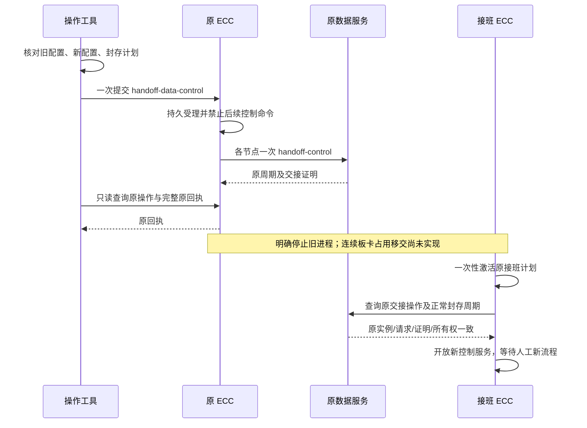

# 旧 ECC 服务交接与独立接班进程

不同实验参数及接收计划的后续入口见[ECC计划切换](ECC_PLAN_TRANSITION.md)。本页的submit/inspect继续保持同计划语义。

## 1. 当前可以做什么

现在可以让两个独立的ECC服务进程交接同一组数据服务的控制权：先保存接班身份，旧服务在正常采集收尾并Reset后明确交接，操作工具核对和导出原回执，随后接班进程使用固定身份启动。

这一流程保留原采集和封存文件，只传小型控制请求与证明，原始MFM不经过Qt、操作工具或ECC控制HTTP。新工具 `getdaq-ecc-handoff` 为原生C++11程序，复用现有本地依赖，没有新增第三方库。

本页的submit/inspect保持同一接收计划，操作工具还要求相同实验配置/工件摘要。更换实验参数和接收计划已有独立的[retire-data-plans流程](ECC_PLAN_TRANSITION.md)及[Qt审阅入口](ECC_PLAN_TRANSITION_GUI.md)；连续板卡占用移交仍待接续。不要把新进程接纳成功解释为已经重新加载了另一套硬件配置。

原请求部分失败后，同一原实例的显式补齐命令见[接续说明](PARTIAL_HANDOFF_COMPLETION.md)。它不解除原ECC禁用，也不覆盖原失败记录。

## 2. 整个过程如何配合



“旧服务禁止后续命令”发生在受理阶段。即使之后超时、只完成部分节点或进程崩溃，也不能自动解除，不能用另一操作ID重新交接或向旧目标继续控制。新的服务只在完整原证明核对后开放。

## 3. 交接前需要满足哪些条件

旧服务必须是原来的实例和原来的操作客户端持有期。完成正常Stop、Breakup和Reset，处于已知的Idle或Described，没有活动命令、UNKNOWN或独立故障保持；每个原接收器均正常退出、被回收、解锁并验证封存，全部数据服务健康。刚启动但没有采集过的Idle不满足条件。

新配置应事先审阅，使用全新的运行审计根，按[接班身份说明](ECC_SUCCESSOR_IDENTITY.md)创建计划。它的数据绑定必须与旧服务完全相同。工具拒绝不同实验配置/工件摘要，服务也拒绝声明不同数据绑定的请求，不会隐式重配置数据节点。

旧客户端的 `client_epoch` 是协调身份，不是认证密码。请使用原操作台/Run记录中的原值；服务状态也可查看已绑定值。不能重新随机生成一个值接管旧服务。认证令牌仍从固定配置引用的0600文件读取，不通过命令行传令牌内容。

操作工具在ECC主机本地运行，需要访问两份配置及它们引用的本地工件。它从旧固定配置读取服务地址/端口/凭据，绑定地址为0.0.0.0时通过127.0.0.1连接，其他情况使用原固定IPv4地址。

## 4. 操作步骤

### 4.1 保存接班计划

```bash
mkdir -m 700 /absolute/private-successor
getdaq-ecc-server --config /absolute/new/service.json \
  --create-successor-plan /absolute/private-successor/successor.json
getdaq-ecc-server --config /absolute/new/service.json \
  --check-successor-plan /absolute/private-successor/successor.json
```

此时新运行审计根尚不存在，没有启动新实例或取得板卡占用。不要先启动普通新服务来取得随机持有期；新服务需要使用计划中的固定持有期。

### 4.2 一次提交

```bash
getdaq-ecc-handoff submit \
  /absolute/old/service.json \
  /absolute/new/service.json \
  /absolute/private-successor/successor.json \
  ORIGINAL_CLIENT_EPOCH \
  handoff_001 \
  /absolute/private-successor/handoff_001
```

将 `ORIGINAL_CLIENT_EPOCH` 替换为原值：64个小写十六进制字符；操作ID使用字母、数字、下划线或连字符，不能与已有动作混用。最后一个参数是新的证据目录，其父目录预先存在。

工具先核对旧服务实例、固定输入、父快照、数据绑定及当前状态，并对计划原文件持共享锁；如果启动者已经取得独占锁，工具在POST之前拒绝。提交期间，共享锁阻止另一个协作进程提前消费身份。随后保存请求、目标计划和原状态，只发送一次POST，再通过GET等待原操作终态。完整完成时核对原回执并保存 `receipt.json`，退出时释放共享锁。不自动停旧服务、启动接班者或重新Prepare。

### 4.3 丢应答或等待超时，只检查原操作

使用**完全相同**的参数和原证据目录，把第一个参数改为 `inspect`：

```bash
getdaq-ecc-handoff inspect \
  /absolute/old/service.json \
  /absolute/new/service.json \
  /absolute/private-successor/successor.json \
  ORIGINAL_CLIENT_EPOCH \
  handoff_001 \
  /absolute/private-successor/handoff_001
```

`inspect`不发送POST、不生成新操作ID。它要求原请求、原目标和原实例仍匹配。重复`submit`同一目录会拒绝，已有文件不会覆盖。若操作未知、失败或部分交接，不回滚、不换ID重试；保留全部证据等待明确恢复机制。

即使操作已经complete，若GET原回执恰好遇到后台锁繁忙，工具也会保留证据退出；再次执行只读`inspect`即可，不能重新提交。

### 4.4 显式停止旧服务，再启动接班服务

只有完整交接证明已导出并核对后，才按部署方式正常停止旧ECC进程，保留旧审计根。当前不会连续移交板卡主机锁，旧进程和新进程之间存在占用释放间隔；不能据此声称具备跨主机或板端全局独占保证。

```bash
getdaq-ecc-server --config /absolute/new/service.json \
  --successor-plan /absolute/private-successor/successor.json \
  --handoff-receipt /absolute/private-successor/handoff_001/receipt.json
```

新进程核对计划，持久标记一次性激活，使用固定持有期，从原数据实例重新查询交接操作和封存周期。全部通过后开放服务。启动本身不Prepare、Configure或Start，也不写硬件。后续采集仍由人工新流程执行；旧Run和原数据不改写。

若接班启动失败，保留激活标记、可能建立的审计根和原回执，不能删除标记重用持有期。若旧ECC冷重开，它会从原受理记录恢复控制门槛，不重新交接、不开放新的负向控制命令，也不把历史回执当作新实例的实时权限。

## 5. 工具证据文件

| 文件 | 内容 |
| --- | --- |
| `request.json` | 精确旧实例、旧客户端、操作ID与新目标绑定的规范请求 |
| `target.json` | 原计划字节的证据副本；仍绑定原计划路径，不能用作另一启动身份 |
| `original-status.json` | 提交前旧实例与原数据周期观察 |
| `submission.json` | 单次POST的HTTP状态和返回体，若收到返回 |
| `submission-held.json` | POST阶段发生错误时的保持标记，不证明服务没执行 |
| `operation.json` | 已核对的原完成操作 |
| `receipt.json` | 已核对的原完整数据交接回执，供接班启动使用 |

目录为0700，文件按现有安全写入机制独占创建并同步。文件是本机控制证据，没有认证令牌内容或原始事件数据。文件恢复、复制或重命名不能解除服务端保持。

## 6. HTTP与架构接口

新增命令仍通过认证 `POST /v1/operations` 进入现有单作业入口：

```json
{
  "schema": 1,
  "operation_id": "handoff_001",
  "command": "handoff-data-control",
  "instance_id": "原ECC实例摘要",
  "snapshot_sha256": "原父快照摘要",
  "client_id": "原配置客户端ID",
  "client_epoch": "原客户端持有期",
  "successor_scope_sha256": "新计划中的数据控制范围",
  "successor_epoch": "新计划中的数据持有期",
  "successor_plan_sha256": "新计划文件原字节摘要",
  "successor_data_binding_sha256": "新计划中的不可变数据绑定"
}
```

上例是字段说明，摘要占位文字不能直接发送。四个新目标字段都进入规范请求键，只适用于这个命令；普通命令携带它们会拒绝，原普通请求字节保持兼容。`successor_plan_sha256`记录操作者审阅的文件身份，服务不会根据摘要自动下载或加载配置，不能把它解释为远程验证了任意计划文件。

查询原操作仍用 `GET /v1/operations/OPERATION_ID`。新增认证 `GET /v1/control-handoff` 仅导出当前原实例已完整提交的回执；未完成、冷重开或后台忙碌时不会返回可用回执。查询在现有受限后台任务执行，状态缓存入口不等待远端或读取原始载荷。

`EccControlJobs`保存受理意图和永久门槛，复用 `RemoteReceiverManager::HandoffControl` 的全部节点意图、单次提交及原证明检查。冷启动从原accepted记录恢复门槛。报警与接收故障后台不会在交接后提交新控制动作。接班过程仍复用上一阶段的计划、激活与原回执核对。

## 7. 验证与未完成事项

本机模拟联调覆盖两种Ice编码的完整正常采集、HTTP交接、两个独立ECC进程、真实原生操作工具、新进程启动核对、计划已消费后重启拒绝及旧实例冷门槛。另用测试专用拦截器消费一次实际POST应答，核对工具保持结果后只读inspect、共享/独占锁互斥及各节点交接没有重放；拦截器不交付。普通及新代码插桩、客户端和统一构建的最终结果见验证第70.53节。

本页的 `submit/inspect` 只支持同实验与同接收计划实例更替。不同实验参数/接收计划已由独立 `retire-data-plans` 流程和 Qt 审阅窗口接续，并有本机合成硬件/数据服务的完整新周期联调；它不提供运行中热切换，也不能证明真实板卡已加载新参数。部分失败已有显式补齐入口，冷数据交接也有独立恢复工具；已受理后节点执行失败及任意硬件冷恢复仍有限制。持续板卡主机占用移交、真实板卡、Ubuntu24/macOS/独立Windows部署和持续跨主机大流量仍待验收。板端 `getHwServer` / `IceEirfu` 保留现有部署。
