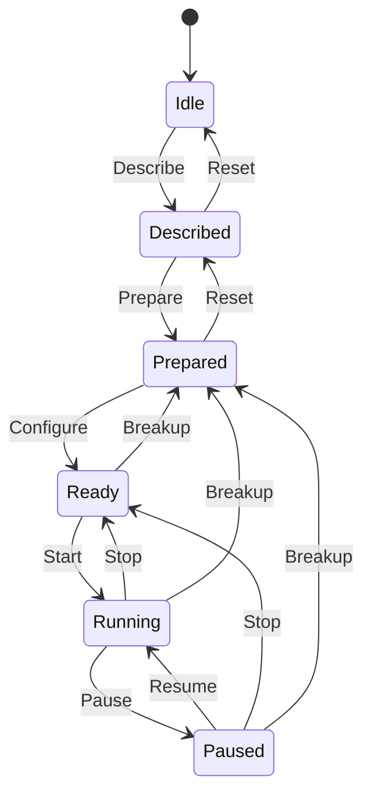

# ECC 状态机：操作顺序、异常和当前实现

## 1. 先区分三个东西

ECC 是电子学控制程序，负责把描述和实验配置变成硬件操作，再管理准备、运行、暂停和停止的顺序。GUI 是向 ECC 发命令的操作台。数据接收器是另一个进程，直接从板卡接收原始事件并写盘。

`apps/ecc/eccstatemachine.h/.cpp` 是新实现的 **C++11 状态约束核心**，不依赖 Qt、Ice 或旧 StateMachine 库。它定义哪些命令可以执行、什么时候报告新状态，以及操作失败后如何阻止重复下发。该状态机本身是静态库，不是网络服务；当前另由 `NativeEccCoordinator`、`getdaq-ecc-server` 和 `EccSystemClient` 组成原生控制通路，Qt 可在 native ECC 模式使用它，同时保留旧 SOAP 兼容模式。两种后端边界见 [ECC 网络服务](ECC_NETWORK_SERVICE.md)。

现在已通过可选 `EccPersistence` 接入 POSIX 持久化日志、操作 ID 和启动核对。详细文件格式、只读查看和故障处理见 [ECC 日志手册](ECC_JOURNAL.md)。不接持久化的构造方式只适用于测试/内存状态约束，不能作为生产服务的重启恢复方案。

新的寄存器访问层在 `apps/hardware`，覆盖硬件描述创建、元数据核对、寄存器操作、流水线初始化和 AsAd 慢控制校准；一部分现已由原生协调器按状态顺序调用。未迁移的旧配置语义、真实控制权和实际加载版本核对仍未完成。不能仅把 Prepare 绑定到流水线初始化就报告 Prepared；也不能把没有实现的流程绑定到空函数。

## 2. 数字的含义

数值根据提供的 GET 20210208 源码 `get/rc/SM.h` 和 `BackEnd::createEngine` 保持一致。

| state | 名称 | 已完整完成的工作 |
| --- | --- | --- |
| 0 | Off | 协议保留值；新核心不把它当作正常运行的初始状态 |
| 1 | Idle | 尚未完成系统描述 |
| 2 | Described | 系统描述流程已经完成 |
| 3 | Prepared | 时钟、板间关系和相应准备/校准流程已经完成 |
| 4 | Ready | 实验参数配置流程已经完成，可以开始运行 |
| 5 | Running | 开始运行流程已经完成 |
| 6 | Paused | 暂停流程已经完成 |

这里的“完成”必须由后端的完整流程证明。状态机自身不读取寄存器来推测板卡状态，也不能证明接收器已经接完数据。

`transition` 是正在执行的命令：0 表示没有命令执行中，1～9 依次为 Describe、Prepare、Configure、Start、Stop、Pause、Resume、Breakup、Reset。`error` 使用相同的 1～9 表示发生错误的操作，0 表示无错误。它们是三个不同字段，不要把 state 和 transition 的数值混用。

## 3. 允许的转换



Reset 的目标取决于当前状态：Prepared 的 Reset 需要撤销准备，Described 的 Reset 需要撤销描述。它不能直接把正在运行的系统设置成 Idle，也不是清除错误的万能按钮。

Breakup 从三个已配置状态回到 Prepared。旧后端会先执行停止相关动作，再使实验参数配置失效；新后端必须迁移这些实际动作。转换到 Prepared 不应自动销毁其他板卡已完成的校准，更不能用全系统 Reset 实现单板重新对齐。

原生SystemAcquisitionClient::Breakup和SystemPreparationClient::Unprepare现已提供这些主机协调接口，保留同一准备/运行对象、对齐快照和自有订阅；具体负向顺序见[结束与撤销准备](SYSTEM_RELEASE.md)。`NativeEccCoordinator`进一步连接九个实际命令、工件/接收计划/操作ID/审计绑定和持久状态提交，并已接本机真实receiver管理库；原生网络服务和固定HTTP入口也已接入。详细EOF/封存边界见[进程管理](RECEIVER_PROCESS_MANAGEMENT.md)，协调器和网络操作边界见[原生ECC协调器](NATIVE_ECC_COORDINATOR.md)。仍未完成的是跨主机/板端全局控制权、全部恢复场景和实机验收；不能把Broken/Unprepared枚举单独当成ECC线上状态。

Idle 下发 Start、Ready 再次 Configure、Running 再次 Start 等均立即拒绝，不调用后端、不排队。Stop 在 Ready 中也不被当作成功的重复操作。网络重发是否属于已执行请求，未来服务层必须通过持久化的操作 ID 判定，不能依赖这些重复命令来猜测。

## 4. 为什么先 Validate，再 Apply

`EccBackend` 有两个必须实现的入口：

1. `Validate(command, from, to)`：检查流程是否已实现、配置是否齐全、目标硬件元数据和操作前提是否匹配。它必须没有硬件写入；对可能有副作用的寄存器也不能随意读取。
2. `Apply(command, from, to)`：执行完整流程，保存硬件操作日志，检查必要的完成条件。只有正常返回，状态机才提交目标状态。

例如当前状态是 Described：Prepare 开始时 state 仍为 Described，transition 为 2。后端成功返回后才变为 Prepared，transition 回到 0。后端执行期间，可以读取状态；查询不会等待慢硬件调用完成。第二个控制命令会立即收到“转换正在进行”的错误。

Validate 报错代表本次没有进入执行阶段。状态不变，error 和 message 保存原因，可以修正输入后重新尝试。这一保证依赖 Validate 遵守不写硬件的约定。

Apply 报错代表可能已经部分执行。即使是“收到板端错误”，也可能在错误前已有写操作，因此状态机保留最后一次完整成功的 state，设置 `outcomeUnknown=true`，并阻止后续所有普通命令，包括 Reset 和原命令重发。

## 5. outcomeUnknown 的正确理解

例如 Describe 先创建了部分设备，然后连接断开：

```text
state: 1 (Idle，最后一次确认状态)
transition: 0
error: 1 (Describe 出错)
outcomeUnknown: true
message: 具体错误
```

这里的 Idle 不能被解释为“板卡现在没有设备”。板端可能已创建部分设备，也可能已创建全部设备但未完成主机端核对。恢复需要检查操作日志、设备清单和必要的硬件状态，而不是重新下发 CREATE。

`outcomeUnknown` 目前是新核心的本地字段，尚未接入旧 SOAP 协议。未来服务层和 GUI 必须明确展示这种状态，不能仅发送最后确认的 state 数字。

现在有带持久化记录的 Reconcile 入口，但后端必须实际实现 VerifyRecovery，默认实现拒绝。它不是通用的“清除 unknown”接口。真实恢复、紧急停止和单板维护需要独立、可审查的硬件流程；不能仅改一个布尔值就恢复普通控制。

## 6. 现在如何构建和验证

状态组件可以独立构建，不需要 Qt、Ice 或板卡；默认的 POSIX 日志组件读取复用项目内 yaml-cpp。只构建无解析依赖的状态核心可传 `-DGETDAQ_ECC_JOURNAL=OFF`：

Linux 可直接使用 `bash tools/build-linux.sh ecc`，或执行下面的标准 CMake 命令。

```sh
cmake -S apps/ecc -B build-ecc -DCMAKE_BUILD_TYPE=Release
cmake --build build-ecc --parallel 4
cd build-ecc
ctest --output-on-failure
```

可选 Ice 工程也会构建同一个状态核心，并在硬件 TCP 测试中把 Describe 接到 `HardwareClient::Create`。测试覆盖成功后提交 Described、部分创建/响应丢失/元数据不符后设置 unknown，以及未实现 Prepare 时在预检查阶段拒绝。

独立测试覆盖完整运行周期、所有状态/命令组合、预检查失败、标准及非标准异常、并发重复命令拒绝和执行中的状态查询。它使用可控的后端验证状态核心；不代表真实 Start/Stop/Prepare 动作已经迁移。

## 7. 剩余工作与验收边界

状态持久化、历史查询、固定HTTP网络入口和启动核对约束已经接入。生产服务在重启后保留历史并要求硬件核对；默认 `VerifyRecovery` 仍拒绝操作，只有具体协调流程提供并核实证据后才能恢复。创建不带持久化的新对象默认 Idle 只适用于库的初始内存状态，**不能因此假定生产现场硬件也是 Idle**。不能清空未知操作、自动恢复采集或重放命令。

系统Describe现由SystemDescriptionClient组合，并提供getdaq-system-describe离线/在线检查与动作入口；全系统TCP测试另验证完整协调接入本状态核心/日志的成功及UNKNOWN边界，见[描述手册](SYSTEM_DESCRIPTION.md)。系统Prepare/Configure、类型化实验工件、MuTaNT对齐、sender及运行/暂停/停止顺序也已有原生组合，原生网络服务会驱动这些主机端协调。剩余风险包括现场全局控制权/实际加载版本、接收进程在异常情况下的恢复、冷启动接管、部分Reset/Breakup边界、单板重新对齐（按当前安全范围未提供）、后台故障停机、受控日志归档和真实硬件验收；跨主机控制权不是已有本机锁的保证。

数据接收器的 EOF、排空、退出和封存属于另外一条链路。ECC Stop 到达 Ready 不证明 `.graw` 已写完；仍应按 [数据服务手册](DATA_SERVICE.md) 等待接收器封存，再交给 sentry 归档。

同一原生ECC实例的 Describe 失败现可通过 `reconcile-description` 只读核对全部最终描述和停机/未就绪位，绑定原失败审计和新观察后提交 Described。它不处理 Prepare/Run 或冷接管；完整恢复仍待接。新控制协议中 transition=10 表示此核对流程。步骤与限制见[Describe核对恢复](DESCRIPTION_RECONCILIATION.md)。
