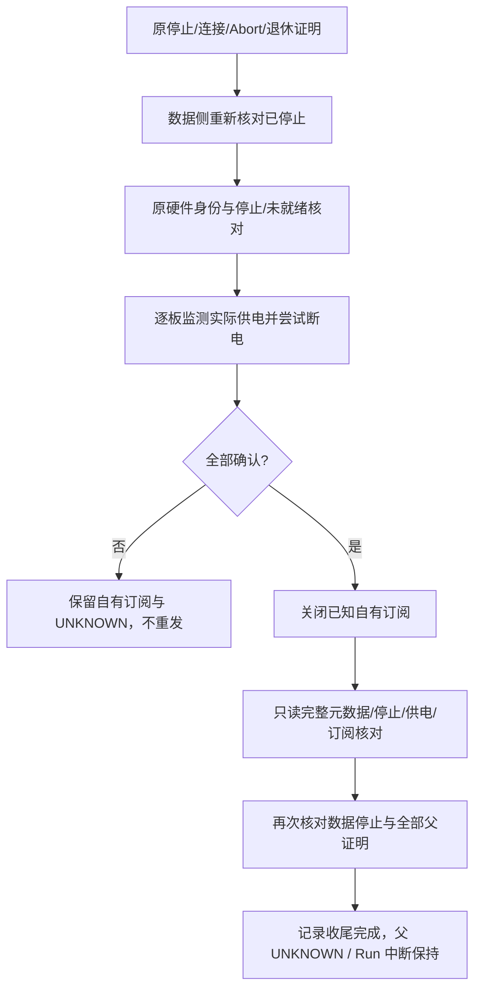

# 原采集故障的数据退休后断电收尾

## 1. 这一步与数据退休有什么区别

失败接收会话退休处理的是原接收进程、目录锁和数据管理周期。硬件上的 AsAd 电源、监测配置和自有告警订阅仍由原准备对象持有。操作台 **Power off original failed acquisition...** 对应父 ECC 的 `unprepare-acquisition-after-failure`，专门接续这些硬件资源。

它要求同一原失败采集已经完成原停止、连接收尾、接收器 Abort 和数据退休，并且原准备对象处于 Prepared。没有完整证据时，阶段名称或“进程似乎不在了”都不足以执行。

成功之后原准备对象为 Unprepared，全部声明 CoBo 的 AsAd 供电读回为零，自有订阅为已关闭。**父 ECC UNKNOWN 和原 Run 的中断记录继续保留**。这一步不重新配置、启动、归档、封存或增加 Run 编号，也不改变 MuTaNT 的物理电源。

## 2. 操作者的顺序

1. 保留原服务、原配置和原 Run 目录。核对原停生产操作的终态已经确认。
2. 完成 **Close original failed acquisition connections...**，确认原已知发送器连接收尾；未知步骤不重发。
3. 完成原失败 receiver 的明确 Abort，再完成 **Retire original failed data sessions...**。数据主机保留旧 raw 和未封存标记。
4. 等待操作台状态刷新，没有其他待核对请求后，打开 **Power off original failed acquisition...**。确认框默认 Cancel；只有 Yes 提交一次。
5. 等待同一操作 ID 的 `complete` 并查看新的系统状态。成功记录确认断电和自有订阅关闭，但父 UNKNOWN、Run Interrupted/duration_incomplete 和原编号保持。
6. 保留所有审计，继续后续独立正向核对。当前完整 Run 正向恢复仍需接续，不能根据断电成功自行删除中断记录或自动开始下一轮。

菜单允许点击表示界面有新鲜的原 UNKNOWN 上下文；真正的原证据、数据退休和硬件身份仍由服务端逐项检查。缺少先前步骤的请求会失败，不能把 Yes 当作绕过条件的手动强制开关。

## 3. 实际执行顺序

父 ECC 在第一条硬件动作之前核对原对象、停止/连接/Abort/退休证明和所有文件身份，再重新调用数据侧 VerifyStopped。Retired 只用于确认原数据周期已经结束管理，不被提升为正常封存。

原准备对象先核对全部硬件元数据、原节点名、生产停止/未就绪状态和自有订阅状态。随后逐板监测当前实际供电情况并断电；一块板失败时仍尝试其他独立板。只有全部监测和断电都已确认，才取消同一原对象确认拥有的订阅。不会注销其他控制者的订阅。

完成断电后还要新建只读观察，重新核对全部元数据、CoBo 生产/就绪/供电位、MuTaNT run=0 以及原订阅已关闭。最后数据核对 RPC 返回后再次检查全部父证明和新增观察，防止等待期间文件变化而错误提交。

## 4. 如何保证审计来自真实执行

准备对象返回每个实际硬件 Execute、订阅关闭和释放日志的最终审计链。父 ECC 读取真实文件并核对该链，绑定文件身份、权限和完整字节，不用完成后随意扫描目录再算摘要替代执行者的确认。

原准备进度日志在合法 Unprepare 中会追加完成记录，而原连接收尾证明已经引用该文件。系统只允许同一长期保留写入者确认的当前完整审计链推进这个引用：原 inode、权限和完整旧字节前缀必须保持，新增文件内容必须与写入者实际确认的链一致。普通文件恢复、任意追加或替换 inode 都不能借此清除故障。其他原证明继续按不可变文件检查。

## 5. 失败、丢响应和重新打开

监测失败、断电丢 ACK 或订阅关闭未确认时，父操作不会提交成功。已发生的独立动作保留实际记录，订阅按上述全确认条件保留，不自动回滚或重复断电。新的操作 ID 不能重发这次已经尝试的收尾。

HTTP 接受只表示意图已保存。响应丢失时查询同一操作 ID；不要生成另一个 ID 再做相同动作。控制台保存意图和终态，成功后仍保持原硬件 UNKNOWN，重新打开窗口不会解除持久门槛。

原操作目录 `operation.jsonl` 绑定原失败 ID、原数据退休 ID、快照/配置/产物摘要；`preparation-cleanup/` 保存实际释放日志，`verification/` 保存最终只读观察。原 Run 的 `journal.json` 保存 `native_acquisition_unprepare_operation`，同时保持 `duration_incomplete=true`；不能写成 Complete 或推进编号。

## 6. 数据量与适用范围

整个入口只传低频控制请求、状态和审计元数据。监测寄存器与原始 DAQ 载荷不同：raw 仍由独立原生接收器处理，本步骤不读取、复制或删除 raw，不把数据转发到 Qt。

只适用于同一仍运行服务的原保留对象。冷服务、未知 sender 接管、重新创建描述/连接及完整 Run 正向恢复都不是本入口的结果。与原 failed Prepare 的断电收尾是两个不同前提，不能混用原操作证明。

前置数据退休见 [父 ECC 数据退休](ECC_FAILED_SESSION_RETIREMENT.md)，原准备失败收尾见 [准备故障断电](FAILED_PREPARATION_UNPREPARE.md)，具体普通/插桩/网络/窗口验证范围见 [验证记录](VALIDATION.md)。本机合成板端测试不代表现场固件、物理电气效果、目标平台或持续吞吐验收。
