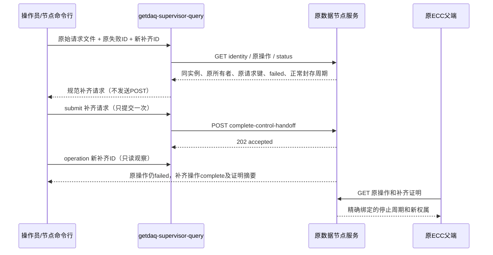

# 已失败节点交接的显式补齐

本手册描述一种很窄的恢复情形：数据节点接受了原 `handoff-control` 请求，随后因为写入交接证明失败而把原操作持久记录为 `failed`。数据服务仍是原来的运行实例，接收周期已经正常停止并封存，当前控制者仍是原控制者。操作员在节点上明确完成一次与原请求绑定的补齐；ECC 父端随后只读核对节点结果。

该流程不适用于 POST 应答丢失、HTTP 超时、操作 `unknown`、节点服务重启、接收周期不正常、控制者变化、其他存储故障或硬件错误。遇到这些情况时保留现场并停止，不能换操作 ID 重发，也不能删除审计文件来解除保持。

## 1. 组件分别做什么

`getdaq-supervisor-query build-handoff-completion` 是节点操作员使用的原生 C++11 命令。它只执行带认证的只读查询，验证原始请求文件、原操作、服务实例、当前所有者和停止封存周期，再把原请求转换为规范补齐请求并写到标准输出。它不执行 POST。

操作员检查生成的请求后，使用已有 `submit` 命令发送一次，再用原生 `operation` 命令观察新操作 ID。节点服务创建一份独立的补齐操作与证明；原失败请求和原操作结果保持不变。

`RemoteReceiverManager::CompletePendingHandoff` 只在父ECC仍保留原失败父请求时读取每个节点的结果。对已受理的子请求，它只 GET，不替节点提交补齐。它要求原失败和新补齐都精确指向同一请求、同一接班者、同一服务实例及同一正常封存周期，并核验新证明摘要。完成后父回执同时记录原节点请求和补齐操作 ID/请求。

操作员也可以从 GetDAQ 控制台菜单 **Failed data-node handoff completion...** 打开 Qt 窗口。该窗口调用同目录的 `getdaq-supervisor-query`，由原生 CLI 执行协议校验和 HTTP 请求；Qt 不实现服务协议，不处理 `.graw`，也不会读取或显示凭据文件内容。窗口支持填写或选择节点地址、预期身份与计划摘要、凭据路径、原始交接请求、原失败操作 ID、新操作 ID和私有请求保存路径。点击生成只做只读检查并原子保存规范请求，不会 POST。

**Windows 交付与验证范围：** 当前 Qt 5.14.2/MinGW 七程序 Windows 候选包含同目录的 `getdaq-supervisor-query.exe`。GetDAQ 会在缺少或无法启动 helper 时明确警告并禁用生成、提交和观察；正常候选中窗口通过该原生 C++11 helper执行查询与控制请求。`tests/windows_supervisor_query_integration.py` 已在用户 Windows 主机针对当前 helper 验证受 ACL 保护的临时凭据、401 身份拒绝后不重试、成功身份查询及单次控制 POST/202 回执，且临时根清理完成；当前候选的 manifest 与程序完整性检查也通过。证据见 [Windows helper回归71.94](VALIDATION.md#7194-windows监督器查询成功身份与单次post回归2026-10-21)与[当前交付71.120](VALIDATION.md#71120-当前源码-windows-qt-5142-构建测试与运行候选2026-10-21) 与 [Windows 操作手册](WINDOWS_QT5142.md)。这不等于跨主机真实监督服务或完整人工交接流程已经验收；GitHub Actions也尚未运行。

生成后应检查摘要和保存的请求文件，再点一次提交。窗口会明确询问确认，并且在启动提交进程前消耗本窗口的一次提交机会；若应答不确定，不能再次提交，应使用同一个操作 ID 观察。重新打开或加载保存的补齐请求时，窗口只开放观察，不会再次提交。要重新处理，必须先查明原操作终态和服务状态，不能简单换一个 ID 重试。



## 2. 前置检查

开始前确认：

1. 原ECC父实例仍运行，原父交接操作状态为 `failed`，其原请求和父审计目录完整。
2. 每个节点服务仍是原 `instance_id`，服务当前 `operation_id` 就是该节点失败的原交接 ID。
3. 节点原操作为 `handoff-control` 且 `phase=failed`。HTTP 202 之后无法确定终态、HTTP超时、404 或 `unknown` 均不满足条件。
4. 节点原操作结果与当前 status 的生命周期逐字段一致，状态为正常 `stopped`，receiver 已回收且封存已核实，没有独立数据生命周期故障。
5. 当前控制范围摘要和 epoch 仍精确等于原请求中的原控制者身份；补齐请求不会重新选择接班者。
6. 接班者身份及持有期来自当时已经审阅并写入原请求的 successor，不从新配置或手填摘要推导。

节点原始请求一般位于固定数据计划的 `audit_root/control/operations/<原操作ID>/request.json`。使用服务实际部署计划和日志核对这个路径。不要从屏幕截图、status 字段或当前目录重新拼装原请求。

## 3. 生成并核对请求

在节点控制主机执行。示例值全部需要换成现场服务的真实值：

```bash
umask 077
build-data-supervisor/getdaq-supervisor-query build-handoff-completion \
  --host 192.0.2.20 --port 24001 \
  --credential-file /home/daq/private/data-node.credential \
  --expected-agent data-node-0 --controller experiment-ecc \
  --expected-plan PLAN_SHA256 \
  --request-file /srv/getdaq/audit/control/operations/ORIGINAL_ID/request.json \
  --failed-operation-id ORIGINAL_ID \
  --operation-id operator-repair-20261020-01 \
  > /srv/getdaq/recovery/operator-repair-request.json
```

`umask 077` 使 shell 重定向创建的请求文件只允许当前用户访问。认证凭据仍由客户端从受限文件读取，不放到命令行。

生成命令按顺序查询服务 identity、原 operation 和当前 status。它要求原请求规范且属于当前计划/实例/控制者/配置/工件；原 operation 必须是键完全匹配的失败 `handoff-control`；status 必须仍由原控制者持有、无正在运行操作、保持控制故障门槛，且生命周期与原失败操作保存的正常停止结果完全相同。任一项不符，命令退出非零且不打印补齐请求、不发送 POST。

生成后应逐字段比较原始请求与补齐请求。只有这三个字段应变化：

| 字段 | 原请求 | 补齐请求 |
| --- | --- | --- |
| `command` | `handoff-control` | `complete-control-handoff` |
| `operation_id` | 原失败 ID | 新的唯一 ID |
| `failed_handoff_operation_id` | 不存在 | 原失败 ID |

计划、服务实例、原控制者范围/epoch、配置/工件摘要、父审计引用及 successor 范围/epoch 必须逐字节语义一致。请求生成器会保留原请求中的字段，不提供修改接班目标的参数。

## 4. 单次提交和只读观察

检查完成后才提交生成的请求：

```bash
build-data-supervisor/getdaq-supervisor-query submit \
  --host 192.0.2.20 --port 24001 \
  --credential-file /home/daq/private/data-node.credential \
  --expected-agent data-node-0 --controller experiment-ecc \
  --expected-plan PLAN_SHA256 \
  --request-file /srv/getdaq/recovery/operator-repair-request.json
```

HTTP `202` 只表示服务已持久接受。保存新 `operation_id`，随后重复运行下列只读查询，直到得到 `complete`、`failed` 或 `unknown`：

```bash
build-data-supervisor/getdaq-supervisor-query operation \
  --host 192.0.2.20 --port 24001 \
  --credential-file /home/daq/private/data-node.credential \
  --expected-agent data-node-0 --controller experiment-ecc \
  --expected-plan PLAN_SHA256 \
  --operation-id operator-repair-20261020-01
```

若提交应答丢失，不要再运行 `submit`；使用保存的 ID 查询。若终态为 `failed` 或 `unknown`，保留新旧两个请求、父子审计和服务日志，停止自动操作。禁止为“再试一次”生成另一个 ID。

节点补齐后，只有原ECC父实例、原父请求和其控制软件明确允许的原父级完成操作，才能生成完整多节点回执。父端必须再次核对每个节点的原失败操作和补齐完成证明；节点补齐成功本身不表示父交接已经完成。当前父端没有在该只读观察路径里代发节点补齐请求。

## 5. 服务重启、数据和硬件边界

补齐权只由原节点服务的活动实例在原故障状态下开放。进程冷重启后，服务可保留并查询原失败和已有补齐历史，但不会重新开放一条新的补齐操作，也不会以旧回执恢复实时控制权。旧控制者继续保持禁用，接班者必须持有完整父回执并重新通过实时核对后才能开始新周期。

请求、日志、回执和证明均是有界元数据；此流程不读取、复制、哈希或转发 `.graw` 数据，也不执行硬件写操作。它仅验证控制权交接的数字状态，不验证板卡电气状态或真实硬件全局互斥。原始事件仍由独立原生 receiver 直接处理；Qt 不进入高吞吐数据路径。

## 6. 自动化验证范围

`failed-handoff-completion-service` 在本机启动真实监督服务和receiver，用一次性文件创建故障注入使原证明写入失败。测试覆盖规范补齐请求生成、改变原 successor 后拒绝、提交/终态观察、原失败保留、原控制者被拒绝、接班控制者通过核验及服务冷重启后继续保持门槛。`failed-handoff-window-probe` 则启动生产 Qt 窗口并注入真实查询CLI：确认取消不产生POST、确认后仅提交一次、观察到完成，并加载保存请求验证它只允许观察。两者共用有界localhost合成服务夹具，测试结束自动删除测试raw。

`failed-handoff-parent-completion` 通过两种Ice编码验证父端拒绝自动补齐、只读观察操作员的节点补齐、写入包含补齐ID/请求/摘要的父回执，并由 successor 接受该回执建立新周期。它确认父端没有新增硬件写操作，也没有转发raw。

以上为Ubuntu20.04.6/WSL2 localhost 合成进程测试，不是两台独立主机、Ubuntu24、macOS、实板或持续高速采集验收。测试raw总量被64 MiB保护，测试结束后删除；生产或其他测试流总计仍不得超过用户设定的20 GiB上限，完成后必须删除自有测试文件。

代码入口：`apps/datasupervisor/querymain.cpp`、`apps/datasupervisor/controljobs.cpp`、`apps/ecc/native/remotereceivermanager.cpp`、`apps/ecc/native/remotehandoffevidence.cpp`。相关底层交接规则见[数据服务控制权交接](DATA_CONTROL_HANDOFF.md)，当前总体边界见[重构状态](REFACTOR_STATUS.md)。
