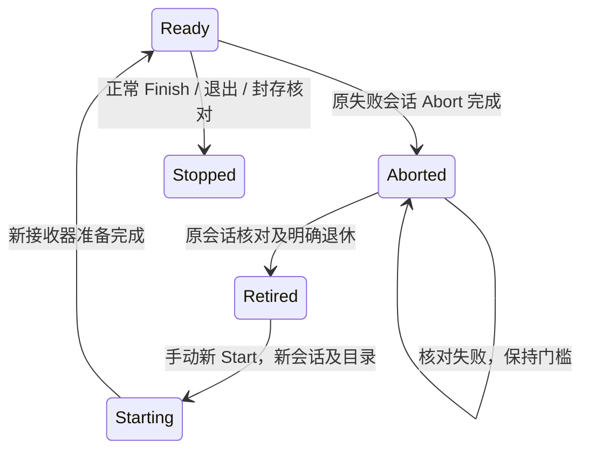

# 失败数据会话的退休：保留旧数据，准备新的接收周期

## 1. 这一步解决什么问题

一轮采集中的接收器可能因输入损坏、进程异常或磁盘问题退出。`abort-failed-session` 负责结束仍属于原数据服务的其他接收进程并回收子进程；它保留原文件，并把会话留在 `aborted`、需要核对的状态。因此，单纯结束进程还不能重新启动接收器。

`retire-failed-session` 是单独、明确的数据管理操作。它核对同一服务对象已经完成原失败会话的 Abort、全部原子进程已经回收、原目录锁已经释放、原计划和审计仍有效，然后把该会话标为 `retired`。随后该数据服务可以接受手动提交的新 `start`，生成新的会话 ID 和输出目录。

**退休不会把失败采集变成完整采集。** 旧会话仍保留原 PID、会话 ID、输出目录、退出码和原封存标记；没有获得封存证明的来源仍为 `seal_verified=false`。它也不删除、复制、扫描或修复 raw 数据，不启动接收器，不向任何 PID 发信号，不控制硬件。

当前实现范围是数据服务、原生核心以及 ECC 的本地/远程数据适配器。父 ECC 的 `retire-failed-receivers` 与操作台确认入口已接续，步骤见 [父 ECC 数据退休](ECC_FAILED_SESSION_RETIREMENT.md)；硬件后续收尾、完整 Run 正向恢复仍需独立接续，不能仅凭数据服务 `retired` 就宣告 Run 完成或启动下一轮硬件采集。

## 2. 三个容易混淆的状态

| 状态 | 已证明的事 | 可以做什么 | 不能据此声称什么 |
| --- | --- | --- | --- |
| `stopped` | 正常 Finish，原子进程退出且封存核对通过 | 正常归档，按正常生命周期开始新会话 | 现场硬件或整个 Run 一定通过验收 |
| `aborted` | 原失败会话的明确进程收尾；是否全部确认仍须查操作终态 | 保留文件，核对原收尾证据 | 数据完整、新接收会话可以直接开始 |
| `retired` | 原 Abort 完成，全部原进程回收，锁释放且证据有效 | 原数据服务手动开始新会话 | 原失败数据完整、父 ECC UNKNOWN 已解除、Run 已完成 |

正常 EOF、进程退出、封存、退休、硬件核对及 Run 完成是不同的证据。尤其不要把 `state=aborted` 当作成功 Abort 的充分条件：失败的 Abort 也可能保留该状态；必须具有同一对象实际完成的收尾记录。



## 3. 执行前必须满足的条件

数据服务必须仍是启动原接收器的同一个进程、同一个 `instance_id`。它需要保留全部原子进程对象、原目录身份、原 Abort 审计、固定计划和控制者绑定，不能通过服务重启后读取旧 PID 来接管。

请求必须绑定原 `expected_session_id`，以及原控制者的 `controller_snapshot_sha256`、`controller_epoch`、配置摘要和产物摘要。如果原 Abort 使用了 `parent_failure_operation_id`，退休必须传入相同值；如果原 Abort 没有声明该字段，退休也不能添加另一个父失败 ID。这是身份绑定，不是硬件已经停止的证明。

原 Abort 必须已经真正完成，所有子进程都被原父进程回收。只是在系统进程列表里看不到旧 PID 不够，因为 PID 可复用；核心使用原保留对象的回收记录，不对旧 PID 再发信号。

全部原输出目录和 `.getdaq-receiver.lock` 必须保持原身份，锁当前可取得。其他程序占用了原锁时不能退休。原 Abort 审计、退休证明或服务审计被改动时不能靠恢复文件内容清除已经锁定的故障。

控制层只解除对应已完成 Abort 的数据门槛。如果存在其他失败的修改意图、内部存储故障或冷启动门槛，会拒绝退休。不会把某个成功结果当作清除整个服务所有故障的开关。

## 4. 如何核对与提交请求

这是供集成和维护使用的数据服务接口。操作台用户优先使用父 ECC 的退休确认入口，不应绕过尚未完成的父 ECC/Run 完整恢复门槛手动开始硬件采集。

1. 用既有 `getdaq-supervisor-query identity` 和 `status` 查询目标数据服务，记录实际实例、计划摘要、控制者快照和 epoch。凭据从本地凭据文件读取，不写进请求 JSON。
2. 查询原 `abort-failed-session` 操作 ID。只有 `phase=complete`、原会话相符、全部 receiver 为 `reaped=true` 才继续；`accepted` 或 `running` 都不代表完成。
3. 用新的操作 ID 准备 `retire-failed-session` 请求，所有绑定字段取自原已确认上下文，不能填写新生成的 epoch 来“重新取得”控制权。
4. 保存请求文件后，通过 `getdaq-supervisor-query submit --request-file ...` 提交一次。响应丢失时只查询同一操作 ID，不生成另一个 ID 重发动作。
5. 查询同一操作到终态。成功要求 `phase=complete`、结果 `state=retired`、`needs_reconciliation=false`，且旧会话 ID、PID、目录及封存标记保持原值。再读取新的状态，不能仅依赖提交响应。
6. 保留原失败文件和两次操作的审计。退休成功只开放该数据服务的新接收周期；父 ECC 和 Run 的其他核对仍必须完成。

请求字段如下，示例中的摘要必须替换为原实际值。`parent_failure_operation_id` 只在原 Abort 使用了它时保留：

```json
{
  "schema": 1,
  "operation_id": "retire-original-failed-session-001",
  "command": "retire-failed-session",
  "plan_sha256": "<原计划SHA256>",
  "instance_id": "<原数据服务实例SHA256>",
  "controller_id": "<原控制者ID>",
  "controller_snapshot_sha256": "<原控制者快照SHA256>",
  "controller_epoch": "<原控制者epoch>",
  "configuration_sha256": "<原配置SHA256>",
  "artifact_sha256": "<原产物SHA256>",
  "parent_audit_reference": "<此次父操作的审计引用>",
  "expected_session_id": "<原失败会话ID>",
  "parent_failure_operation_id": "<原Abort声明的父失败操作ID>"
}
```

所有摘要和会话 ID 都要求规范的 64 位十六进制字符串，尖括号内容不能直接提交。操作 ID 使用 ASCII 字母、数字、下划线或连字符。准确命令行选项以工具 `--help` 为准。

## 5. 证据、故障和重启

原数据服务根下 `supervisor.jsonl` 记录退休意图与完成。控制层保存规范请求及原操作终态；该操作目录下的 `receiver/data-supervisor.jsonl` 保存本次退休证明。原 Abort 的审计也继续保留并核对。退休后，在 Validate、VerifyStopped 和新 Start 前再次核对退休证明与原已回收目录锁。

退休意图之后发生错误时保持 `aborted` 和核对门槛，不自动重试。同一个已接受操作 ID 的重复查询/提交返回原结果；新操作 ID 不能把已经尝试且未确认的退休重新执行。原审计不可信时应保留现场供人工调查，不要删根目录、改日志或按旧 PID 杀进程来模拟恢复。

数据服务重启后仍保持核对门槛，即便历史日志最后写着 `retired`。本版本没有冷启动接管；历史记录不能重新构造原父子进程关系，也不能代替新的完整恢复证明。

远程适配器额外核对原父审计、节点实例、控制者 epoch、原 receiver 会话/PID/目录，以及原整体 Abort 的完成记录。原父审计损坏、独立故障或前次退休已经尝试时拒绝；不会重发。若其他节点已经正常 `stopped` 且封存核对有效，明确记录跳过该节点，既不对它提交 Abort，也不提交退休；保留其正常封存状态。只有所有相关节点结果确认后才解除适配器对应的数据门槛。部分成功会保留逐节点结果和整体待核对，不自动回滚或开启新周期。

## 6. 性能与验证边界

退休只处理小型控制状态、审计和目录锁，不读取 raw 内容，不把 DAQ 载荷送入 Qt。Qt 数据服务前端负责认证和低频请求，原生核心管理接收进程，高流量接收/存储仍由独立接收器完成；本功能没有增加第三方依赖。

测试使用独立原生 receiver 和本机合成帧，检查退休前后旧 raw 的实际字节不变，新会话获得新目录/会话 ID，并按正常 EOF/封存完成。测试故障注入可能结束测试自己启动的 receiver；产品退休不发送信号。原生、认证 HTTP、插桩范围及最终证据见 [验证记录](VALIDATION.md)。这些测试不代表现场硬件、跨主机持续吞吐或 Ubuntu24/macOS 的验收。
