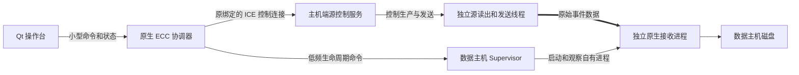

# ICE 数据源故障：保留旧数据，明确收尾，再开始新的采集

本章对应已通过本机联调的主机端源故障恢复流程。板端 `getHwServer` / `IceEirfu` 继续使用现场版本。这里的扩展只适用于提供可选 `DataSourceRecovery` 接口的受控主机端 ICE 数据源；旧数据源仍可使用原有正常采集接口，但不能因此获得失败连接退休能力。整套软件尚未完成现场验收。

## 先理解几种不同的“结束”

正常采集停止时，生产线程停止、缓冲区排空、发送端发送 End、接收端确认并封存文件。这条链路完整通过，才能认为该数据会话正常完成。

如果数据源已经进入 UNKNOWN，不能假设缓冲区排空，也不能再发送 End 来制造“正常完成”。源退休只在原生产线程已明确停止、数据源确认空闲以后，关闭原来的数据连接。旧会话继续保留 UNKNOWN 和错误；接收文件可能只有部分事件，不能作为完整 Run。

接收会话退休是另外一步：回收原有接收进程并释放其占用，仍保留旧数据目录及失败记录。最后的采集恢复只读核对原来的停止、源退休、连接收尾、接收端 Abort/退休及断电证明；它不修复设备，也不续接旧 Run。

## 控制链路和数据链路



源控制连接与数据连接是两条连接。源退休关闭后者，执行退休的控制连接仍用来取得原会话回执。操作者重开一个新控制连接不能代替原连接执行退休；只读查询回执也不会授予控制权。操作台和 ECC 不接收或中转原始事件数据。

## 操作前准备

1. 确认连接的是发生故障时的同一 ECC 服务实例，并能查看原操作、源会话和数据主机状态。
2. 保存原故障信息。不要删除原接收目录、审计文件或操作台 Run 记录。
3. 处理设备或生产线程故障的实际原因。本流程不会重新启动卡死的板端服务，也不会把失联视为空闲。
4. 如果 ECC 或源控制服务已经重启，原对象和原连接可能不再存在。本流程不提供跨重启接管，不能靠重复命令绕过。

## 同一服务实例内的操作顺序

每一步都等待操作结果确认，再执行下一步。操作台具有相应独立入口，不会自动串联执行整套恢复。

| 顺序 | 主机端命令 | 完成后意味着什么 |
| --- | --- | --- |
| 1 | `stop-production-after-failure` | 明确停止原生产线程；原采集仍 UNKNOWN |
| 2 | `retire-failed-sources` | 核对原源空闲，关闭原数据连接，不发送 End |
| 3 | `breakup-after-failure` | 依据源退休证明收尾原采集连接与配置就绪状态 |
| 4 | `abort-failed-receivers` | 收尾原接收进程，保留未封存数据 |
| 5 | `retire-failed-receivers` | 退休原失败数据会话，释放其占用 |
| 6 | `unprepare-acquisition-after-failure` | 核对并收尾原准备对象的供电和自有订阅 |
| 7 | `reconcile-acquisition-with-sources` | 绑定原失败操作，只读核对完整证明后回到 Described |
| 8 | 人工 Prepare | 创建新的准备周期；后续 Configure/Start 才开始新采集 |

步骤 2 和步骤 7 的操作台确认框默认取消。取消不提交命令；确认只提交当前这一项。步骤 7 使用原失败操作的 `failed_operation_id`，不能改为其他 Run 或其他服务实例的 ID。

原来的一般 `reconcile-acquisition` 不会解除独立源故障。若同时存在独立硬件告警、外部输入或存储故障，本路径也不能顺便解除这些门槛；需要按对应故障的流程处理。

## 怎样判断结果

源退休成功不等于采集恢复成功。退休后应看到原源仍 UNKNOWN，原错误和计数保留，没有 End 确认。接收端退休后应保留原会话、PID 和目录身份，显示已回收、未封存。

明确恢复成功后，ECC 回到 Described。旧 Run 仍是 Interrupted，时长不完整，不生成正常完成 CSV，不推进运行编号；操作者必须手动 Prepare。新采集使用新会话，原失败会话的记录不会被新会话成功状态覆盖。

如果命令应答丢失，界面不能确认动作是否完成，应保留 UNKNOWN，通过原操作记录观察，不自动再次发出动作。源端在调用动作前记录“已经尝试”，包括空闲检查失败或关闭连接应答丢失的情况；重复提交新 ID 也不能重做原连接的退休动作。

## 代码和依赖边界

`SourceControl.ice` 保留原 `SourceInfo` 和 `DataSourceControl` 的字段及方法，新增继承接口 `DataSourceRecovery`。源控制服务保存有界的失败会话退休记录，核对同一控制 TCP 连接和原会话，禁止其他控制者退休。

原生 ECC 把源退休的子审计链放入有界清单，并在父证明中绑定清单摘要。恢复在数据主机只读调用前后核对原文件及原源退休回执，防止等待过程中证明或身份改变。只有完整证据通过，才解除对应源故障；不能只信界面缓存或一个 `retired=true` 字段。

Qt 只承担按钮、状态和小型 JSON/审计引用。原始数据从源直接进入独立接收进程，源退休不会把旧数据转发到操作台。测试所有流合计上限为 20 GiB，结束后删除测试自产载荷，生产数据始终保留。

## 验证范围

本阶段使用本机模拟板端、真实受控 ICE 源、实际接收进程和本地 HTTP 服务验证。当前原生及 HTTP 两种编码均已通过，核对了旧数据未封存、完整收尾、只读恢复零硬件写入和新周期准确数据/正常封存。原生结果为 `build-source-retirement/final-native-evidence/source-recovery-ecc-zvlos6gu/result.json`，HTTP 结果为 `build-source-retirement/network-evidence/description-recovery-5nwlt2iu/result.json`。后续新增完整窗口测试后，HTTP 夹具已重编译；旧结果属于当时程序，不冒充当前夹具重跑证明。完整操作台两编码结果为 `build-source-retirement/corrected-window-evidence/description-recovery-qqp6l7l9/result.json`；独立检查器 `tests/check_source_recovery_window_evidence.py` 核对每场景 12 份真实 GUI 请求、本地持久意图/终态及 12 个后端操作，同时检查原源退休文件清单和只读恢复证明。旧 Run 保持中断，人工新 Prepare；GUI 这组没有继续执行新 Configure/Start。早期 `window-evidence/description-recovery-qf4uqa5q` 使用错误的场景编码选择，外层检查失败，不计入通过。新核心与受控源的 ASan/UBSan HTTP 两编码及七个源退休场景通过，候选包内 ECC 服务的两编码通过。插桩根为 `build-source-retirement/sanitized-network-evidence/description-recovery-n61y9k73` 和 `sanitized-control-evidence/source-control-wyr2qzjc`；包内根为 `build-source-retirement/package-network-evidence/description-recovery-y5z27g1i`。85 条严格 C++11 插桩编译配方、172 项来源/头文件记录，无对象复用；旧 GET/Ice、系统 Qt、普通接收器及数据服务未整体插桩。客户端52/完整界面89/流程模型24项通过。

相关说明：[失败采集恢复](ACQUISITION_RECONCILIATION.md)、[失败连接收尾](FAILED_ACQUISITION_BREAKUP.md)、[接收会话退休](ECC_FAILED_SESSION_RETIREMENT.md)、[重构状态](REFACTOR_STATUS.md)。

当前候选交付目录为 `build-packages/getdaq-host-20261015-source-retirement-candidate`（23程序）和 `build-packages/getdaq-windows-qt5142-20261015-source-retirement-candidate`（六程序）。Windows 使用用户实际 Qt 5.14.2 MinGW 套件构建，匹配 DLL、无 SDK PATH 和初始窗口检查通过；并非独立 Windows 或新菜单的人工验收。本机为 Ubuntu 20.04.6/WSL、GCC 9.4、Qt 5.12.8，不代表 Ubuntu 24/macOS 或真实板卡验收。检查点为 `build-source-retirement/checkpoint.json`，整套任务仍未完成。

## 怎样复核本阶段记录

在源码根目录执行以下命令。第一条检查记录的源码、程序、证据和候选包摘要，以及测试载荷是否清理；后面的命令独立检查源退休证明和完整窗口请求记录。

```bash
python3 tests/check_source_recovery_checkpoint.py build-source-retirement/checkpoint.json
python3 tests/check_source_retirement_proofs.py build-source-retirement/package-network-evidence/description-recovery-y5z27g1i
python3 tests/check_source_retirement_proofs.py build-source-retirement/sanitized-network-evidence/description-recovery-n61y9k73
python3 tests/check_source_recovery_window_evidence.py build-source-retirement/corrected-window-evidence/description-recovery-qqp6l7l9
```

这些命令检查已经保存的结果，不会重新采集或操作硬件。如果后续重构改变源码、程序或文档，旧检查点应报告不匹配；这时先查看新阶段记录，不要修改摘要来伪装旧验证仍适用于新代码。正式运行的软件构建步骤见[全套构建](HOST_SUITE_BUILD.md)，Windows套件及部署步骤见[Windows说明](WINDOWS_QT5142.md)。
