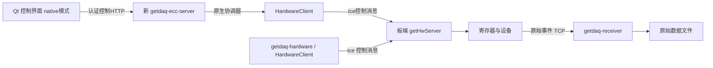

# 硬件访问后端：设备、寄存器和维护序列

更新：2026-10-16。本页介绍已接入新原生ECC的硬件访问层与独立维护CLI。native模式的Qt操作台经getdaq-ecc-server调用该层；旧SOAP模式仍可选择。库和CLI本身不提供整个ECC的状态机，系统入口见[原生ECC](NATIVE_ECC_COORDINATOR.md)。

## 1. 它在系统中的位置



`getdaq-hardware` 是独立命令行工具，`HardwareClient` 是可供新 ECC 后端复用的 C++11 库。二者都不链接 Qt，不接收原始事件。操作界面的慢刷新不会占用原始数据通路。

这一步替换的是旧主机端 `RemoteRegisterProcessor` 一类职责：发现板端已经注册的设备、读取描述、访问寄存器和按顺序执行命令。它没有重写板端内存映射驱动。现在支持根据离线编译工件显式创建空节点描述；不会自动清除已有设备。

## 2. 当前支持和未支持的功能

| 功能 | 当前行为 |
| --- | --- |
| 设备枚举 | 从 `mdaq::hw::Node` 读取设备名，不扫描网络 |
| 硬件描述 | 从 `Device::getDeviceConfig` 读取寄存器、位域、地址与访问方式；不读取寄存器值 |
| 读取寄存器/位域 | 显式读取一个目标，保留 64 位整数精度 |
| 写入 | 校验目标、位宽和只读字段，先持久化日志，再调用远端 |
| 顺序执行 | C++ API 支持写入、显式读取记录、掩码期望值检查、延时；失败立即停止 |
| CoBo 流水线初始化 | 已迁移 `pipeInit` 和 `pipeInterruptEnable(false)` 的命令顺序 |
| AsAd 慢控制校准 | 已迁移校准触发、monitorID、AIM 标签和顺序读取；实机待验 |
| LED/板端检查器 | 已迁移管理器RPC、间接权限及同一次观察的故障指示；GPIO实物待验 |
| 主机告警观察 | 自有订阅、有界事件日志/队列及独立CLI；保持停机请求，不直接执行硬件Stop |
| MuTaNT配置子流程 | 原生库Prepare/Configure、计数初始化和时钟/同步位；整体描述检查和读改写；系统对齐/运行协调已接原生ECC，实际硬件待验，详见 [MuTaNT](MUTANT_CONFIGURATION.md) |
| 系统对齐主机协调 | `getdaq-align`/SystemAlignmentClient完成槽位定位、机箱内测量及机箱间三步；全节点预检查、结果一致性和未知不恢复；已组合系统Prepare，板端算法及实际硬件待验，见 [系统对齐](SYSTEM_ALIGNMENT.md) |
| 硬件描述创建 | 已支持空节点 CREATE、元数据读回、部分失败记录和主机权限绑定 |
| 单板Prepare组合 | CoBoPrepareClient完成旧单板次序、自有订阅和逐步联锁；最终ADC通道重应用，后段/服务事前检查；由系统准备/ECC提交全局状态，特定原对象失败收尾已接；真实硬件待验；见 [组合手册](COBO_PREPARE_CLIENT.md) |
| 全系统Prepare/Configure | SystemPreparationClient先全局检查后组合MuTaNT/对齐/CoBo，按旧边界同步并跨板检查保持告警；该库负责准备/配置，NativeEccCoordinator负责生产状态，SystemAcquisitionClient负责后续连接；见[系统手册](SYSTEM_PREPARATION.md) |
| 生产ECC Describe/Prepare/Configure | 原生系统命令协调和工件已组合；生产状态/网络、Reset/Breakup与同原对象特定恢复已接；全局控制权/实际加载及冷恢复仍待 |
| 单板重新对齐 | 尚未迁移；不能拿流水线初始化代替 |
| GUI 接入新后端 | 已接native ECC整系统流程及只读硬件查看；任意寄存器GUI写入和单板重新对齐窗口未提供 |
| 服务端互斥 | 原生ECC有同机协作占用锁；库内互斥只保护同一对象，尚无跨主机/板端全局锁 |

## 3. 构建方法

从项目根目录执行：

```sh
bash tools/build-linux.sh ice
```

或者：

```sh
cmake -S third_party/ice-compat -B build-ice-compat -DCMAKE_BUILD_TYPE=Release
cmake --build build-ice-compat --parallel 4
```

输出 `build-ice-compat/getdaq-hardware`。Ice、bzip2、mcpp 都从项目内源码构建，不需要系统安装对应开发库；工件/描述读取使用标准C++11 StrictJson，原生层不链接yaml-cpp，没有新增外部 JSON、日志、Boost 或数据库安装依赖。程序实际动态链接的只有系统 C/C++、线程、数学与加载器库，不能将其理解为完全静态二进制。

同一构建还输出不链接Qt的 `getdaq-align`。`HardwareClient::Validate`复用Execute的完整软件/元数据预检查，不读寄存器值或写硬件，供跨节点协调先核对全部目标；实际Execute仍重新检查，不能代替独占控制。

当前实际测试环境是 Ubuntu 20.04.6 / GCC 9.4。目标 Ubuntu 24.04、macOS 仍待验证；此后端暂不支持 Windows 构建。Windows 的 Qt GUI 可以继续独立构建，不受影响。

## 4. 先看设备与描述

板端对象的完整代理地址需从现场启动配置获取。对象名不是 IP，也不等同于 ECC SOAP 的 URL。下面是命令模板，把尖括号内容替换为实际值：

```sh
build-ice-compat/getdaq-hardware devices '<对象名>:tcp -h <主机> -p <端口>'
build-ice-compat/getdaq-hardware describe '<对象名>:tcp -h <主机> -p <端口>' ctrl
```

这里的服务必须实现 `mdaq::hw::Node`，例如旧 CoBo `CtrlNode` 派生自该接口。GET StateMachine/ECC 状态对象与 Hardware Node 是不同接口，不能随意互换地址。

`describe` 输出中：

- `register_bytes` 是整个寄存器的**字节数**。
- `width_bits` 和 `offset_bits` 是位域的**位数/位偏移**。
- `base_address`、寄存器 `offset` 用十进制字符串输出，避免 JSON 消费者把大整数转成浮点后失真。
- `read_only` 在未绑定时来自板端元数据；绑定描述后还包含本地主机策略。旧板端可能不能可靠保存该标志。

例如 `register_bytes=4` 表示 32 位寄存器，不是 4 位。该区别由旧 `DeviceFactory` 中的 `sizeof(type)` 和接口实现确认。

`devices` / `describe` 不遍历读取所有寄存器。部分状态寄存器可能“读后清零”，因此看设备列表不应顺带读它们。

## 5. 显式读取和写入

读取模板：

```sh
build-ice-compat/getdaq-hardware read-register '<代理地址>' ctrl firmwareRelease
build-ice-compat/getdaq-hardware read-field '<代理地址>' ctrl pipeCtrl firmwareEnable
```

读取是明确的硬件操作；所读寄存器的副作用仍由固件定义。工具不会替操作者判断所有寄存器都适合轮询。

写入模板：

```sh
build-ice-compat/getdaq-hardware write-field '<代理地址>' '<设备>' '<寄存器>' '<位域>' '<值>' '<新日志路径>'
build-ice-compat/getdaq-hardware write-register '<代理地址>' '<设备>' '<寄存器>' '<值>' '<新日志路径>'
```

数值支持无符号十进制和 `0x` 十六进制，范围最高为 `18446744073709551615`。负数、超范围值、多余字符和空白被拒绝。64 位最高位按原始位模式映射到 Ice `long`，不通过 double 中转。对于较窄寄存器，读取结果按实际位宽提取。

对声明为只读的位域拒绝写入。整寄存器写入若覆盖任何只读位域，也拒绝；应明确选择可写位域。未知目标、非法描述、超位宽值在真正写入之前报错。

日志路径必须全新，父目录必须存在。已有路径不会覆盖或继续追加另一项操作。库不会自动预读旧值、自动读回或自动“恢复原值”；这些动作对于写一清零、脉冲触发或读后清零寄存器可能不是正确操作。

成功输出中的 `acknowledged` 只表示远端方法成功返回，`readback_verified=false` 明确表示没有自动读回验证。

## 6. 编码和超时

默认使用 Ice 1.0 编码。已确认对端支持时，可以在命令前指定：

```sh
build-ice-compat/getdaq-hardware --encoding 1.1 devices '<代理地址>'
```

从板端 `findDevice` 返回的新代理同样会固定编码与超时，不能只设置入口 Node 而遗漏 Device。默认单次通信超时 3 秒，C++ API 可设为 100～60000 毫秒。Ice 自动重试关闭。

每条命令显式指定一个对象，不自动尝试别的设备或协议。服务对象没有配置设备时，空列表是实际状态，工具不会为了“修好它”而创建或复位硬件。

## 7. 顺序执行器的原理

`HardwareClient::Execute` 接收 `HardwareStep` 列表：

| 步骤 | 内容 |
| --- | --- |
| `WriteValue` | 指定设备、寄存器、可选位域及写入值 |
| `ExpectValue` | 显式读取并比较 `(actual & mask) == (expected & mask)`；只检查一次，不自动轮询 |
| `Delay` | 等待给定毫秒数 |

执行前先取得涉及设备的描述，检查整张操作表。后面的步骤包含未知/只读字段时，不会先执行前面的写入。允许每次 1～4096 步，显式延时累计至多 300 秒；这是延时容量限制，不是包含网络超时的整个计划总时限。

执行时严格按列表顺序，逐步同步日志；不使用旧 `execBatch` 来假装整个列表是事务。前面已经成功的写入不会因后面失败自动回滚，失败点之后的步骤也不会继续执行。

该 API 按对象串行化，但不同进程/不同客户端仍可能同时访问板端。正式维护应确保只有一个控制者，并处于该维护步骤允许的设备状态。将来完整控制服务需要统一管理这些前置状态和所有权。

## 8. 写入日志与中断判断

日志是逐行 JSON，整数值仍使用字符串。开始时保存节点代理、实际 Device 代理、编码、Unix 毫秒时间戳与完整步骤。文件独占创建，权限为 0600；父目录和每条记录执行 fsync。

典型记录顺序：

```text
intent
begin step=0
acknowledged step=0
begin step=1
matched step=1
complete
```

| 末尾状态 | 可以判断什么 |
| --- | --- |
| 无 `intent` | 无完整意图记录；本工具尚未进入步骤执行 |
| 有 `intent`、无步骤 `begin` | 计划未进入执行步骤 |
| 有 `begin`，没有完成应答 | 该步骤可能已生效，不能直接重发 |
| `acknowledged` | 远端返回成功；未证明读回一致 |
| `unknown` | 写入出现远端异常或连接问题；可能已部分生效 |
| `mismatch` | 显式读取与期望不符，后续步骤未执行 |
| `read_failed` | 显式读操作报错，后续步骤未执行 |
| `observed` | 显式读取实际值并记录；没有期望值比较 |
| `skipped` | 条件引用的已观察值不满足要求，本步骤没有发送硬件动作 |
| `poll_begin` | 有界轮询的一次读取意图已落盘；含 attempt/sample |
| `outside_range` | 该次轮询值不在允许范围，按次数/等待上限继续或停止 |
| `complete` | 所有步骤按定义完成，不等于整个 ECC Prepare 完成 |

即使远端返回 `CmdException`，也不能推断完全未写入；测试特意模拟了“先改变值、再报错”。若写入应答已收到但完成日志写失败，错误信息会明确说明不要重做写入。

中断后保留原日志，核对实际设备状态和必要的可安全读取值，再制定后续动作。工具没有自动重放/续跑功能，也不会把日志内的一串写命令重新执行。

上述持久化针对本地文件系统；不是跨板事务、断电绝对保证或网络文件系统认证。配置镜像、硬件操作日志和 `.graw` 封存凭据各有职责，不能相互替代。

## 9. 已迁移的流水线初始化

`CoBoPipelineInit()` 对照旧 `CoBoNode.cpp::pipeInit` 及 `pipeInterruptEnable(false)`：15 次位域写入，随后延时 500 毫秒。其中包含 `pipeCtrl.reset=1` 再 `reset=0`，最后禁用流水线中断。

显式执行入口：

```sh
build-ice-compat/getdaq-hardware pipeline-init '<板端代理地址>' '<新日志路径>'
```

这是有复位动作的初始化子步骤，适用于确认需要该初始化的维护/准备流程。**不要在采集中调用，也不要用来执行保留其他板卡校准结果的单板重新对齐。** 工具目前没有 ECC 状态联锁，因此不会自动由 GUI 或设备发现流程触发。

字段与当前板端描述不匹配时，预检查整体拒绝，不能默默跳过字段然后宣称初始化完成。ClockInit、AsAd上电/监控、AGET/延迟、LED/主机告警及MuTaNT/系统对齐已有原生子模块，并已组合原生系统Prepare/Configure。真实PLL锁定/相位/电气延迟、现场实际控制权/版本以及硬件故障Stop/排空效果仍待实机验证。Native ECC生产状态及数据生命周期协调已经接入。

## 10. 实际测试与下一步

```sh
cd build-ice-compat
ctest --output-on-failure
cd ..
python3 tests/hardware_cli_integration.py \
  build-ice-compat/getdaq-hardware \
  build-ice-compat/hardware-client-tests
```

本机测试对象使用原始 GET 接口、真实 loopback TCP 和 1.0/1.1 两种编码。覆盖设备元数据、中文、32/64 位数值、位域写入、只读/越界拒绝、完整预检查、响应丢失后不重发、部分执行后停止、期望值不符停止及流水线顺序。CLI 测试另外检查真实子进程、JSON、日志内容和已有日志拒绝。

测试没有连接真实 GET 板卡，不证明板端固件语义或校准效果。硬件描述编译/部署已经落地；下一层仍需完成实验配置编译、完整 ECC 服务和各准备/校准流程，并用现场版本、配置及真机逐项验收。

## 硬件描述编译、创建与本地权限

新增 `validate-description`、`create-description` 和 `--description`。其中校验不连接硬件，创建只允许空节点，绑定描述可以在旧板端不能保持权限标志时执行本地主机策略。`describe` 结果中的 register/field `read_only` 在绑定模式下包含本地策略；未绑定时不要假定旧板端有完整权限信息。详细流程见 [硬件描述手册](HARDWARE_DESCRIPTIONS.md)。

## AsAd 校准与 ECC 状态核心

新增 `asad-calibrate PROXY MASK NEW_AUDIT_FILE`，必须同时提供 `--description FILE`。操作前提、mask 位图、完整顺序、AIM 低八位语义和故障处理见 [AsAd 校准手册](ASAD_CALIBRATION.md)。这项子流程的 TCP/CLI 测试已通过，实机待验，尚未自动接入 GUI。

新增不依赖 Qt/Ice 的 `apps/ecc` 状态约束核心，包含完整转换矩阵、执行前检查、并发拒绝和执行结果不确定时的阻断。持久化操作 ID 与启动核对约束已由原生ECC协调器及网络服务使用；默认恢复核对接口仍 fail-closed，必须由实际硬件证据支持。真实板卡、跨主机全局控制权及完整故障恢复仍待现场验收。具体见 [ECC 状态机说明](ECC_STATE_MACHINE.md) 和 [ECC 日志手册](ECC_JOURNAL.md)。

## 整板 AGET 子序列与显式读回策略

硬件库新增 `CoBoAgetConfigure`，复用无 Qt 的 `getdaq-experiment-core`，在全部活动芯片型号核对通过后才写 AGET 配置寄存器，逐项核对寄存器和读出掩码，并写入共用读出参数。它是类型化 C++11 库接口，尚无 JSON 部署 CLI/GUI，也不包含完整 Configure。前提、顺序和失败后的状态见 [AGET 原生执行说明](AGET_CONFIGURATION.md#123-原生库实际执行什么)。

`HardwareStep::allowedDifference` 默认为 0，仅 Expect 可显式设置；非零差异只有全部落在此掩码内才允许继续，并记录 `matched_with_warning`、实际值和差异，而非完全一致。当前 AGET 兼容选项只允许 reg2 bit21，默认仍严格；其他位不符立即停止，写入后断线不重发。策略不合法在任何寄存器操作前拒绝。详见 [reg2 差异](AGET_CONFIGURATION.md#124-reg2-的历史读回差异)。

库接口 `CoBoReadoutConfigure` 进一步组合 AGET、零抑制、CoBo Module/触发及循环缓冲区，整个计划先校验全部元数据/权限，再执行逐项写入和显式读回。只有调用者明确选择时才使用旧 shared 内存布局，不在部分写失败后自动回退。它仍无 JSON 部署 CLI/GUI；指针重置前提、数值和错误语义见 [CoBo 读出配置](COBO_READOUT_CONFIGURATION.md)。

`CoBoConfigure` 在此基础上组合 AsAd TCM/ISPM、脉冲管理器及 20ms 2p 初始化。新增 `HardwareStep::PulserCommand` 是类型化库操作，涵盖默认电压、外触发、周期/双脉冲/Poisson 配置以及明确启动/停止；现有通用 YAML CLI 没有添加这些动作入口。调用必须绑定描述，间接访问寄存器也检查本地只读策略。每个 RPC 的 begin 在发送前落盘，异常/断线为 unknown；应答不代表全部板端内部动作均已读回。Configure 只停止旧计时器并保存新策略，不调用 StartPeriodic。具体字段与执行前提见 [AsAd 配置](ASAD_CONFIGURATION.md)。

checkedCast 能验证 AsAdPulserMgr 接口身份，不能提前证明所有较新的具体方法存在。OperationNotExist 或调用异常也停止并保留日志，不沿用旧代码的警告后继续；完整生产 ECC 恢复/联锁仍待接入。

## Prepare 确定性子流程

原生库新增 `CoBoPrepareFoundation`、`CoBoAsAdInputProtections`、`CoBoAsAdInputsInit`、`CoBoAsAdAdcInit`、`CoBoAsAdDacInit`、`CoBoManualReadDataDelay`，保持无 Qt，不添加 CLI 动作。版本/可选寄存器和缓冲区布局须显式选择，禁止写失败后尝试另一套初始化。ADC 是只写寄存器，软件复位会自清零并清除之前的 ADC 设置；命令应答不能当电气校准结果。完整的顺序、前提及恢复限制见 [CoBo Prepare](COBO_PREPARE.md)。


## 整板 ClockInit 子流程

CoBoClockInit(settings) 迁移原 ClockInit 的 PLL FIFO/两组 LCM 和 R-CoBo 分频器；控制头文件不暴露 Qt/Ice 类型。全板参数先计算，缺绑定时不访问远端元数据，晚期 LCM2 缺失、只读或 32 位宽度不足时不会提前写 FIFO。默认拒绝已知范围错误；名义偏差/未知模型需类型化调用者明确确认并落入审计。

FIFO 和 LCM 不做普通寄存器回显；Full 只读观察不代表锁定。任意写入后丢失应答为 UNKNOWN，禁止自动重发、回滚或补写恢复掩码。正常结束恢复全部活动 AsAd；失败后保留实际状态交给生产恢复核对。该库子流程没有 JSON CLI/GUI 部署入口，不是完整 Prepare 或生产启动许可。详细参数、模型例子和顺序见 [时钟说明](COBO_CLOCK_CONFIGURATION.md)。

## AsAd 上电、监控与保护子流程

CoBoAsAdPowerCycle、MonitoringInit、ProtectionInit、MonitoringRead 和组合 CoBoAsAdPrepare 复用同一执行器，不增加 CLI 硬件动作。连接诊断通过条件步骤只引用此前无条件 ReadValue，跳过分支仍检查全部目标元数据；PollValue 有界、只在原始零码时重读，异常立即停止。片段组合使用 AppendHardwareSteps 平移条件索引，不能直接 vector::insert。

供电检查区分上电前后AL含义；旧监控实参顺序通过declared/legacy明确选择。上电动作生效后丢失应答仍为UNKNOWN，禁止自动重发、恢复选择或回滚。后段物理状态失败可能发生在前面板已上电之后。没有完整独占控制、Prepared或JSON部署入口；持续主机告警另由CoBoAlarmClient处理。详细字段、时序、原始码和故障日志见 [AsAd 上电监控](ASAD_MONITORING.md)。

## AGET/自动读取延迟子流程

CoBoAgetInit/Calibrate、CoBoAgetGlobalThreshold、CoBoAutomaticReadDelayCalibrate 和 CoBoSelectReadDataDelay 复用现有执行器与本地接口。全部描述/权限预检查，缺后段字段时不先复位ADC或覆盖reg1/reg2。校准后的reg5低16位严格比较预期型号；DACthreshold写入保留极性。global/per-asad布局须明确，不能写异常后换字段重试。

自动延迟两次200ms和临时firmwareEnable沿用旧校准时序，计算与最终选择分开。使能后应答丢失可能留下固件开启，仍停止并记UNKNOWN，不自动发“清理”写入。没有CLI/GUI JSON部署或Prepared提交；细节、字段位宽与示例见 [AGET 校准手册](AGET_CALIBRATION.md)。

## LED和持续主机告警

CoBoLedSetAll/Modify、CoBoAsAdAlarmMonitorInit进入统一预检查/审计执行器；上电故障指示与期望检查使用同一次缓存观察。CoBoAlarmClient公有接口无Qt/Ice类型，独立订阅ID及有界日志/队列，故障保持、UNKNOWN不重发。新增CLI：`watch-asad-alarms PROXY COBO_ID LISTEN_ENDPOINTS SECONDS NEW_EVENT_FILE NEW_SUBSCRIBE_FILE NEW_UNSUBSCRIBE_FILE`；它只观察已有板端检查器，不发送硬件Stop。端点、退出码、权限、部分写失败和恢复限制见 [详细手册](COBO_SERVICES.md)。生产ECC仍须协调停止、EOF/排空和封存。


## 单板Prepare与原生停止联锁

`CoBoPrepareClient`以不可变参数和本次绑定描述组合完整单板命令，保留自有告警对象给后续运行协调器；不增加手动CLI动作。`CoBoAlarmClient::ValidateService`显式核对远端`ice_isA`，不能以类型化代理的本地checkedCast替代。`HardwareClient::Execute(plan,audit,checkpoint)`在步骤、轮询、普通读改写及等待中检查本地停止信号，失败写interlock_stopped、不继续命令；不会打断在途RPC或发送硬件Stop。完整调用、审计文件、旧顺序修正和未实现系统职责见 [CoBoPrepareClient](COBO_PREPARE_CLIENT.md)。

`SystemPreparationClient`把单板Preflight与实际Prepare分开，先检查所有节点及后续Configure再写入；同一对象保留监听器和对齐掩码。Configure开始前再次核对全部名称/元数据/停止观察，然后配置所有CoBo、设置Level2/mutantMode、暂关WSCA CLK2、恢复保存掩码并发送同步、最后设置initDone和配置MuTaNT。每个活动板的保持故障都能阻止其他板后续步骤。该原生库阶段没有提交ECC状态或实现数据连接/Stop/恢复；见[全系统协调](SYSTEM_PREPARATION.md)。

整系统实验参数现已有`compile-system`离线工件、纯C++11严格读取/摘要和原生ID/角色绑定，接续同一SystemPreparationClient；详细profile、命令、数据精度、配置输入审计与运行前提见[完整实验配置手册](SYSTEM_EXPERIMENT_CONFIGURATION.md)。这不新增接收器依赖，仍未接生产ECC发布/加载版本和网络状态。

## 数据连接控制与数据证据

DataSenderClient只控制DaqCtrlNode连接/缓冲区/刷新/启停/断开；DataLinkSetClient先检查全部服务再连接第一块板，未知结果不重发或补偿。普通TCP Stop刷新后保留socket，Disconnect才关闭；原始MFM直接进入独立receiver，控制应答与文件封存分别验证。参数、状态、日志、接口和测试见[发送器详细手册](DATA_SENDER_CONTROL.md)。

SystemAcquisitionClient接续同一已Configured准备对象，组合运行前全集合检查、CoBo流水线/读指针/快控制、MuTaNT主从及sender控制；NativeEccCoordinator将其与生产状态机、固定HTTP入口和receiver生命周期相接。显式Stop先停全部生产再刷新；失败后的停止不重发已尝试目标或清理未知sender。实际控制权、板端效果与完整冷恢复仍待实机验收，见[全系统采集与故障停止](SYSTEM_ACQUISITION.md)。
全系统描述由SystemDescriptionClient及无Qt命令getdaq-system-describe实现，支持只读检查、现有核对、空节点创建和明确旧描述替换；NativeEccCoordinator已将其接入生产ECC状态与网络入口。全部目标先检查，销毁/创建/状态位应答不明不重发；真实控制权和恢复门禁仍待现场验收，见[描述操作与原理](SYSTEM_DESCRIPTION.md)。
