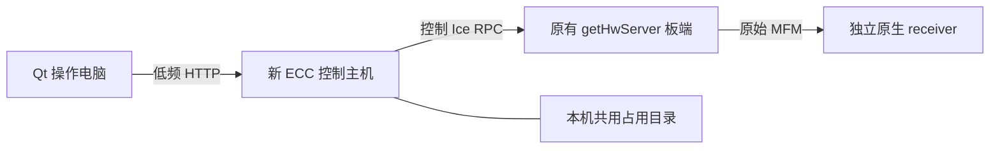

# ECC 主机端板卡占用保护

## 1. 目的与适用范围

两个新 ECC 服务即使使用不同审计目录，也可能指向同一批板卡。以前每个服务只锁自己的日志，无法发现重复部署；两个“我独占板卡”的配置声明不能产生互斥。

现在可让它们共用一个主机占用目录。启动时对板卡地址取得操作系统文件锁；相同地址的第二个实例立即失败，不等待、不抢占、不创建自己的 ECC 审计根，也不调用硬件。不同地址可以分别占用；中途冲突会释放本次已取得的占用。

**只保护同一主机、同一目录、遵守该机制的新 ECC 实例。它不是板端全局锁，也不阻止另一台电脑、旧 ECC 或维护工具直接访问板卡。** 板端 getHwServer/IceEirfu 保持现有部署。多控制主机或新旧 ECC 共存仍需统一控制入口或另外实现可靠的协调，不能用这里的文件锁代替。

推荐操作电脑通过 HTTP 访问一台 ECC 控制主机，ECC 通过现有 Ice 接口访问板卡。原始 MFM 数据直接进入独立原生 receiver，占用检查不接触原始数据，也不增加 Qt 数据链路。



## 2. 准备共用目录

在 ECC 运行账户下执行，按实际账户修改路径：

```sh
mkdir -p /home/daq/getdaq-control-ownership
chmod 700 /home/daq/getdaq-control-ownership
```

目录必须已存在、属于运行账户、权限 0700，且使用绝对规范路径；不允许符号链接或 `..` 等别名。所有需要互斥的实例使用同一目录、账户和板卡地址表。它只存小型占用记录，不存采集数据，也不应随每个实验审计根另建一个。

放在本机 POSIX 文件系统；不要把它当作已验收的 NFS/SMB 分布式锁服务。使用不同目录、不同用户或板卡地址别名可能绕过保护，这些情况不在验证范围内。

## 3. 配置固定 ECC 服务

在自己的 `getdaq.ecc-service` JSON 顶层增加以下字段，注意前后逗号。这是完整配置中的一个片段，不能单独启动：

```json
"host_control_ownership": {
  "directory": "/home/daq/getdaq-control-ownership"
}
```

省略时不启用，保持现有部署兼容。空目录、未知子字段或非规范路径被拒绝。原 `exclusive_owner_confirmed` / `data_processes_stopped` 声明仍需提供；文件锁不能证明旧控制程序已退出或硬件已停止。

启用后硬件与 sender 控制代理必须使用明确的单播 IPv4 字面地址、TCP 端点；拒绝 DNS 名、`localhost`、router/locator 或缺端点的代理。IPv6 和多地址别名尚未验收。

占用按 IPv4 地址去重，不按实验板卡 ID、Ice 对象名或端口区分：重命名部署或改变同地址端口也不能避开冲突。同一主机地址承载多个独立硬件服务时，会采用较粗的整地址保护；它不能自动辨认物理板卡。地址输入最多 256 个，排序、去重后依次取得锁。

完整配置、工件和接收计划见 [ECC 服务手册](ECC_NETWORK_SERVICE.md)。

## 4. 检查并启动

```sh
bin/getdaq-ecc-server --config /home/daq/getdaq-input/service.json --check-config
bin/getdaq-ecc-server --config /home/daq/getdaq-input/service.json
```

第一条只检查固定输入，不取得占用、不创建占用目录或 ECC 审计根，也不连接硬件。第二条在建立 ECC 对象前取得占用；启动不等于执行 Describe/Prepare，更不等于实际板卡已加载配置。

冲突错误包含 `Board is already reserved by another host ECC`。先核对已有进程和配置，不要删除锁文件、随便换目录或按超时抢占。已有进程可能仍在控制板卡。

## 5. 查看结果

经认证的只读接口为 `GET /v1/ownership`。原生客户端提供 `NativeControlHttpClient::Ownership()`；Qt 操作台提供以下专用查看页面，通常不必手工查询。

下面用 Python 标准库读私有认证文件并查询元数据，替换认证路径和 URL。认证值不作为 shell 参数；Python 不是 C++ 服务或 receiver 的运行依赖。

```sh
python3 - /home/daq/getdaq-input/ecc.credential http://127.0.0.1:24003/v1/ownership <<'PY'
import json, pathlib, sys, urllib.request
token = pathlib.Path(sys.argv[1]).read_text().strip()
request = urllib.request.Request(sys.argv[2], headers={"Authorization": "Bearer " + token})
with urllib.request.urlopen(request, timeout=3) as response:
    print(json.dumps(json.load(response), ensure_ascii=False, indent=2))
PY
```

| 字段 | 含义 |
| --- | --- |
| `instance_id` / `snapshot_sha256` | 当前服务实例与接受的父配置，仍需与预期核对 |
| `enabled` | 是否启用主机占用保护 |
| `scope` | 固定 `single-host-cooperating-ecc`，明确保护范围 |
| `directory` / `resources` | 共用目录与去重后的 IPv4 地址 |
| `held_at_last_check` | 最后一次检查时持有占用，不能理解为板端全局控制权 |
| `fault_latched` | 已发现身份、权限或内容变化，故障保持 |
| `cached` | 返回缓存，不在 Qt 请求线程等待文件系统/硬件 |
| `board_global_lock_verified` | 始终 false，没有板端全局锁证明 |
| `cross_host_lock_verified` | 始终 false，没有跨主机排他证明 |

GET 不执行硬件 RPC、不读原始文件、不续租或接管，也不清 UNKNOWN。不要把凭据写入日志或发送给别人。

## 6. Qt 操作台怎样查看

1. 使用自己的 native ECC 配置连接服务，等待身份与状态查询完成。
2. 点击窗口顶部的 **ECC host board reservations...**。这个入口只在 native ECC 模式显示，断开时不可操作；旧 SOAP/模拟模式不发该请求。
3. 查看第一行 Observation，以及 Shared directory / Reserved target addresses。表格只读；页面明确区分同机协作保护、板端/跨主机控制权和实际硬件加载，后三者不会被标成已验证。
4. 页面打开时每两秒查询一次，也可以点击 **Refresh observation**。关闭页面停止定时查询；请求只读取元数据，不调用控制命令、不读取原始数据。

| Observation 显示 | 如何处理 |
| --- | --- |
| Host reservation held at the last ECC check | 最后一次 ECC 检查时占用存在；查询返回缓存，不证明刚刚重读了锁文件或已取得板端全局控制权 |
| Host reservation protection is disabled | 服务没有启用本机占用配置；不能解释为其他控制软件不存在 |
| Reservation changed; reconciliation required | 服务已检测完整性变化；客户端也保持控制故障，后续正常缓存不自动解锁 |
| Observation expired; reservation is unconfirmed | 距 GUI 收到结果超过六秒，下次显示更新时标为未确认；需要重新查询 |
| 查询错误、未连接或无效回复 | 清除当前占用地址展示，不保留绿色的旧确认 |

界面标记的是收到缓存的时间，不是硬件检查时间。查询失败、HTTP404或老服务缺少该接口只影响观察可用性；已知占用故障、身份不符或同一实例的资源清单变化会阻止客户端继续提交控制。没有自动重连、换实例接管、Stop、解锁或 UNKNOWN 恢复。

客户端核对回复的实例与固定父快照，严格拒绝虚假的实时/全局锁声明。主窗口另核对所选父快照，并用连接代次丢弃断开、重连或配置切换前的延迟结果，避免旧服务结果回到新页面。

## 7. 生命周期和异常

占用保持到 ECC 对象销毁，且晚于其持有的硬件客户端销毁。普通 Stop/Pause/Breakup/Reset 不释放占用。进程结束时，内核关闭文件描述符后释放锁；锁文件保留，不需要删除。

锁记录只含部署/父快照摘要、PID 和地址。**文件存在、PID 文本和文件时间不能证明锁被持有。** 互斥由内核 flock 决定；文件权限 0600，拒绝符号链接/硬链接，描述符在 exec 后关闭。

ECC 命令前核对占用目录与锁文件的身份、权限和内容。变化会保持故障、拒绝操作，并让父状态保持 UNKNOWN/需要核对；恢复原文件不清故障。它不是逐 RPC 的原子屏障，也不是对具有同账户修改权限的程序的防篡改系统。

**占用释放不表示硬件停止。** 服务崩溃或被终止时，板卡、sender、receiver 和未完成 Run 仍须按原流程核对。取得新锁不能当作硬件恢复、加载版本验证或 Run 完成。当前完整硬件恢复入口仍未实现；保留证据，不以新建审计根绕过未知结果。

## 8. 验证范围与剩余工作

独立核心已按严格 C++11 构建，并通过普通及 ASan/UBSan/LeakSanitizer 检查：冲突、不相交资源、部分取得回退、独立进程拒绝、析构和子进程被终止后重新取得、地址拒绝、符号链接及故障保持。被 SIGKILL 的子进程只证明内核释放锁，不具有自身退出时的泄漏检查证明。

实际 native ECC 验证了启动冲突和占用变更前拒绝硬件调用，以及启用保护后的完整正常模拟控制流程。实际 localhost ECC 服务验证了认证缓存查询、第二实例拒绝和前实例终止后的新实例启动；这些启动/只读场景没有发送硬件命令。

测试使用替身和自有临时文件，不连接现场板卡、不启动 raw receiver、不传输 DAQ 数据。结果入口见 [验证记录](VALIDATION.md)。真实独占部署、跨主机/旧软件控制权、实际加载、目标平台和完整恢复仍待完成；板端重构不在本次范围内。
