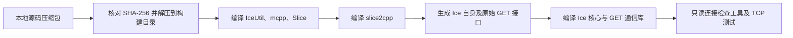

# Ice 兼容组件：本地构建、连接检查与边界

更新：2026-10-04。该组件用于保留旧 GET 控制协议。它是可选的独立工程，不是高速数据接收器的依赖，也不是新的完整 getECCServer。

## 1. 已经做到了什么

项目保存了 Ice 3.5.1、bzip2 1.0.8 和 ZeroC 修订的 mcpp 2.7.2-4ice 源码归档、原始许可证、来源与校验值。只构建 C++ 通信所需的 IceUtil、Slice、slice2cpp、Ice 核心和 GET 接口。

日常构建没有下载步骤，不用安装系统 Ice、bzip2 开发包、mcpp、Boost、ROOT、数据库或 gSOAP。编译器、CMake 和系统 C/C++ 开发环境仍需预先安装。没有制作从空白电脑恢复的完整系统离线包。

构建过程是：



Ice 提供消息编码和调用机制；GET 接口提供操作名称和参数类型。两者编译成功，并不表示寄存器配置、Prepare、校准和采集状态机已经全部迁移。

## 2. 三类程序必须分开

| 程序 | 链接 Ice | 链接 Qt | 作用 |
| --- | --- | --- | --- |
| GetDAQ 控制界面 | 否 | 是 | 配置、命令、状态显示；目前控制旧 ECC 使用 SOAP |
| getdaq-receiver | 否 | 否 | 原始 plain TCP MFM 接收、分文件写盘、可选导出 |
| getdaq-hardware | 是，本地静态库 | 否 | 设备/寄存器访问、顺序执行及操作日志 |
| getdaq-ice-check | 是，本地静态库 | 否 | 显式指定服务的只读 ping / 状态检查 |

以后新的硬件控制服务可以复用这个兼容模块。不会因为需要兼容旧板端，就让原始事件流进入 Qt 界面。

## 3. 在 Linux 构建

在项目根目录执行：

```sh
cmake -S third_party/ice-compat -B build-ice-compat -DCMAKE_BUILD_TYPE=Release
cmake --build build-ice-compat --parallel 4
```

也可运行 `bash tools/build-linux.sh ice`。普通 `all` 只构建 Qt 与原生数据组件，不隐式启用 Ice。

第一次需解压并编译历史源码，耗时比普通增量构建长。该构建现在还生成 [getdaq-hardware](HARDWARE_BACKEND.md)，用于底层硬件访问；原来的 getdaq-ice-check 仍保持只读。输出包括：

- `build-ice-compat/slice2cpp`：本地生成工具。
- `build-ice-compat/getdaq-ice-check`：只读检查程序。
- `build-ice-compat/ice-compat-tests`：本机网络验证程序。
- `build-ice-compat/generated/`：根据原始 `.ice` 重新生成的头文件和 C++ 文件。
- `build-ice-compat/vendor/`：工作源码。删除整个构建目录后可以从本地归档重新生成。

不用手工修改 vendor。原始压缩包、`source/` 的 GET 接口都保持不变。当前构建适配主要是选取必要模块、恢复接口生成顺序、排除 Windows 专用 DLL 入口，并未修改归档内的 Ice 代码。没有编译整个 Ice 产品家族，因此不包含 IceSSL、IceGrid、Freeze 或 Java/Python 组件。

目前实际通过的是 Ubuntu 20.04.6 / GCC 9.4 / C++11。Ubuntu 24.04 和 macOS 还需实际验证。此可选工程当前拒绝 Windows 构建；这不妨碍 Windows Qt 5.14.2 MinGW 单独构建 GUI。

## 4. 先做完全不接触硬件的验证

```sh
cd build-ice-compat
ctest --output-on-failure
```

测试会在 `127.0.0.1` 的临时端口启动一个 GET StateMachine 测试对象，强制关闭 Ice 的同进程调用优化，确保请求真正经过 TCP 编码和解码。它验证：

1. 接口类型检查与 ping。
2. GET Status 中 Paused=6 与 NoErr 的返回。
3. UTF-8 中文字符串。
4. GET 原生 `mdaq::utl::CmdException` 异常及其 reason。
5. 上述行为分别使用 1.0 和 1.1 编码。

测试对象拒绝所有控制操作，不连接真实板卡。**这验证的是本机 Ice 3.5.1 与同版本测试对象，不是旧 IceE 板端互通认证。**

## 5. 明确服务地址后再做只读检查

Ice 地址包含对象 identity、传输类型、主机和端口。对象 identity 是服务端注册的名字，不能仅凭端口猜出来。应从现场服务配置或启动日志获取。

命令模板如下；先把尖括号部分替换为真实信息，整体地址保留引号：

```sh
build-ice-compat/getdaq-ice-check ping '<对象名>:tcp -h <主机> -p <端口>'
build-ice-compat/getdaq-ice-check status '<GET状态机对象名>:tcp -h <主机> -p <端口>' 1.0
```

`ping` 只检查该 Ice 对象能否应答。`status` 要求对象实现 GET StateMachine；只有板端 Hardware Node 接口的服务不能按此方法读取 ECC 状态。程序不会自动尝试写寄存器、切换状态或探测网络中的其他地址。

默认编码为 1.0；若已确认对端支持，可显式传 `1.1`。不通过静默降级、反复重试来猜测现场版本。单次连接/调用超时设为 3 秒，Ice 自动重试关闭。

状态输出示例：

```text
state=6 error=0 encoding=1.0
```

状态编号为 0 Off、1 Idle、2 Described、3 Prepared、4 Ready、5 Running、6 Paused。这里 Ice Status 的 `error` 来自 GET `Error` 枚举，**不是 SOAP GetState 的 Transition 字段**。不得把两者混为同一个状态机忙碌标志。

退出码：0 成功；1 通信、类型或远端错误；2 命令参数不正确。连不上时保留具体异常，先核对地址、对象名和版本。

## 6. 保存与恢复

来源见 `third_party/dependencies.json`，校验：

```sh
cd third_party/archives
sha256sum -c SHA256SUMS
```

校验值用于发现文件损坏或副本不一致，不等于上游数字签名。来源分别为 [ZeroC Ice](https://github.com/zeroc-ice/ice)、[ZeroC mcpp](https://github.com/zeroc-ice/mcpp) 和 [bzip2 官方源码](https://sourceware.org/pub/bzip2/bzip2-1.0.8.tar.gz)。许可原文保存在 `third_party/licenses/`，生成 GET 通信代码继续保留原始 CEA 声明。

尚缺 CEA IceEirfu、板端工具链和实际匹配版本信息。主机 Ice 可以编译，不代表能重建板卡上的全部软件。因此依赖清单中的 `complete_offline_hardware_build` 仍为 false。
