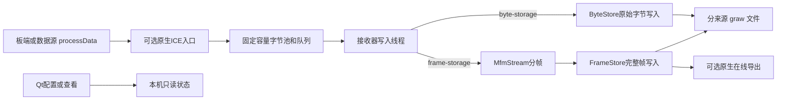

# 可选ICE数据入口：旧接口接收、显式结束和原生写盘

本页对应`apps/iceingress/`。它用于收到的GET/MDaq旧ICE数据流，独立于原来的`getdaq-receiver` TCP/ZBUF/FDT程序。新入口没有Qt，复用已有原生MFM分帧、文件存储和可选在线导出；仅选择ICE时使用已嵌入本地的Ice/GET兼容库。

默认`--storage-mode frame-storage`按MFM帧解析。若旧DataRouter配置使用`ByteStorage`，可明确选择`--storage-mode byte-storage`，此时每个ICE `processData`载荷按原顺序保存，不解析MFM，也不提供解析帧导出。状态和`.getdaq-ice-receiver-seal.json`会记录存储模式；来源仍须在同一ICE连接上调用`finishStream(session, expectedBytes)`，并以准确字节总数完成封存。DataSupervisor计划来源可设置`"storage_mode":"byte-storage"`，它会把选项传给接收进程，并在状态、封存收据和归档边界逐层核对。FDT不支持字节模式。

独立入口已接数据主机固定ICE/混合计划、自有进程核对和专属源结束归档，详见[管理ICE手册](MANAGED_ICE.md)。完整ECC发送器接法和旧板端升级仍须接续。真实旧固件/物理主机和持续大流量仍待验，最终测试范围见[验证记录](VALIDATION.md)。

## 1. 旧数据怎样到达主机

原接口位于`source/mordicus/MDaq-release-20210208/src/mdaq/daq/DataProcessor.ice`：`mdaq::daq::DataProcessor.processData(ByteSeq)`。旧发送器先对固定身份`DataProcessor`执行checkedCast，再改用ice_oneway，发送一块块原始字节。ByteSeq在C++端用借用的指针区间，不是每次调用都对应一帧。

旧IceDataSender会按消息大小拆分缓冲区；一个调用可能只有MFM头的一部分，也可能包含多帧或半帧尾。旧sender在消息上限中扣除512字节封装余量，不能把message-mib上限直接当可发送的纯载荷大小。因此新接收器将这些字节按顺序送入同一MfmStream，不能把一次RPC当作一帧或在每次RPC后强制结束分帧。

原始数据路径是：



Ice只在这个可选输入边界。Qt、ECC的HTTP接口和配置软件都不传波形；普通TCP程序也不会因此多链接Ice库。

接收器协调器负责有界队列、源结束/失败生命周期、状态和最终凭据。两个持久化策略分开实现：`byte-storage`将载荷原样交给`ByteStore`；`frame-storage`由`MfmStream`解析后交给`FrameStore`，并在完整帧到达时可选导出。Linux `getdaq-ice-receiver` 目标在拆分后构建通过；本轮未运行独立严格构建、归档或15个合成场景。

## 2. 为什么旧接口不能直接生成完成凭据

原DataProcessor没有结束方法。旧IceDataSender的析构为空，DataProcessor代理使用板端长期Ice communicator；销毁sender不一定关闭该数据连接。收到Stop应答、当前无调用或接收端关闭连接都不足以证明单向数据已经完整到达。

新入口允许旧接口继续写盘，但旧源没有发出明确结束时不发布成功凭据。SIGTERM/Ctrl+C会排空已经接受的完整帧、同步可保存的文件，退出失败并说明完整性未确认；这是停止本地程序，不是制造发送器EOF。即使旧源真的关闭TCP，接收器也不将它自动升级成成功完成。

因此“退出1但有graw”不代表文件必须删除：生产数据仍应保留调查。只在本文测试脚本创建的私有目录里，脚本才按测试清理规则删除合成载荷。

## 3. 新的显式结束接口

新增Slice文件`apps/iceingress/IceIngress.ice`定义`GetDAQ::DataIngress`，继承原DataProcessor，增加：

```text
finishStream(sessionId, expectedBytes)
```

旧身份仍是DataProcessor，原checkedCast和processData保持。升级后的数据源最后一次processData之后，使用**同一个数据TCP连接**调用finishStream，并给出本次会话ID和累计发出字节数。方法是普通双向调用，接收器关闭自动重试；源应观察原结果，不在未知应答后猜测成功或自动重发。

会话ID要与主机启动参数完全一致；expectedBytes非负、与实际接受字节完全相等。单独控制连接的请求不构成旧数据调用的顺序屏障，明确拒绝。字节数还防止首个单向大消息被丢弃、客户端重连后将空目录误判为成功。累计字节数使用非负Ice long，最大为2^63−1；不静默截断成32位计数。

接收端固定一个同步dispatch线程并开启连接序列化：每个前序processData已复制到有界队列，才处理同连接结束。结束标记之后拒绝追加数据，队列仍由写盘线程排空。只有完整帧、同步字节/文件集合一致，才发布ICE专属凭据。

这是一条**应用层源结束声明**，不是TCP EOF，也不证明板端事件计数、控制权或物理零丢失。它不能由GUI/DataSupervisor从另一连接代发。原板端接口不会自己产生此新方法；源侧IceSourceClient/getdaq-ice-send已提供同连接结束实现，详见[发送库与工具](ICE_DATA_SOURCE.md)。真实板端升级前仍按未确认模式处理。

## 4. 构建：只在需要ICE时启用

本地归档、校验和、许可与旧依赖构建说明见[依赖入口](../third_party/README.md)。新增入口默认关闭，不影响普通原生接收器的独立CMake构建。

```bash
cmake -S third_party/ice-compat -B build-ice-compat \
  -DGETDAQ_BUILD_ICE_RECEIVER=ON -DBUILD_TESTING=ON
cmake --build build-ice-compat --parallel 2 \
  --target getdaq-ice-receiver
```

输出`build-ice-compat/getdaq-ice-receiver`。测试需要同构建的`ice-ingress-fixture`目标。Ice、GET生成接口和bzip在本地静态构建，不从网络临时找旧包。平台仍是Linux/macOS的可选构建入口；本机已用Ubuntu20.04/GCC9，Ubuntu24和macOS实际验收另列。Windows Qt GUI没有新增Ice链接依赖。

## 5. 启动和参数

输出目录必须预先存在，不能已有graw、普通或ICE完成凭据；同一目录有进程持锁时拒绝。会话ID是新建本次流的64字符小写十六进制标识，不能恢复旧目录或换ID清除未知状态。

```bash
mkdir -p /srv/getdaq/ice-session-output
ice_session_id=$(python3 -c 'import secrets; print(secrets.token_hex(32))')
build-ice-compat/getdaq-ice-receiver \
  --output /srv/getdaq/ice-session-output \
  --session-id "$ice_session_id" \
  --bind 192.0.2.10 --port 46105 \
  --status-port 46115 --queue-mib 64 --max-frame-mib 32 \
  --message-mib 1 --min-free-mib 2048
```

192.0.2.10是说明用途的占位地址，须换真实数据网卡IP；不要将测试数据发到真板。板端旧ICE目标代理形状为`DataProcessor:tcp -h 接收IP -p 46105`。

`--min-free-mib 2048`示例要求输出卷至少保留2GiB可用空间；省略或设为0时关闭。启用后启动时检查，并在每约1MiB数据及大帧前检查一次；接近保护线时接收器失败并保留未封存目录，绝不发布成功回执。托管ICE来源从固定计划的`min_free_mib`读取，不接受客户端临时覆盖。保护线的适用边界、文件系统竞争限制和恢复方法见[数据服务磁盘章节](DATA_SERVICE.md#6-内存背压和磁盘)。

| 参数 | 默认 | 作用 |
| --- | --- | --- |
| output | 必填 | 现有空数据目录，独占锁与O_EXCL原始文件保护 |
| session-id | 必填 | 64字符小写HEX，源结束必须精确匹配 |
| bind / port | 127.0.0.1 / 46105 | 明确IPv4数据接口；不支持UDP混用 |
| status-port | 46115 | 只在127.0.0.1提供GET /status；0关闭 |
| queue-mib | 64 | 固定256KiB块池，总量1至4096MiB |
| max-frame-mib | 32 | MFM帧上限，跨调用有界重组，不按RPC分帧 |
| message-mib | 1 | Ice消息/单块上限，独立于MFM帧上限；一帧可跨多次RPC |
| rotate-mib | 1024 | 按完整帧轮转，不切开帧 |
| file-naming | native | native/get；GET样式时间/编号语义与原生接收器一致 |
| export-port | 0 | 可选在线分析支路；与数据/状态端口不可重叠 |
| export-queue-mib | 16 | 每分析客户端预算；上限规则复用原导出器 |

只绑定一个实际数据连接，第二连接的processData会拒绝并使当前完整性保持失败，避免把两个源混入同一流。客户端checkedCast或状态读取本身不算数据连接；数据端口不能用于就绪探测。

## 6. 查看状态

```bash
curl --fail http://127.0.0.1:46115/status
```

这是低频、只读、本机状态。主要字段解释：

- received_bytes：实际复制入有界池的MFM字节，不含Ice封装。
- accepted_file_bytes / synced_bytes：已接受写入和已同步字节；运行时不是事务快照。
- sender_end_confirmed：实际源finishStream声明被接受；仍须writer_done和完成凭据。
- sender_eof_confirmed：此程序保持false，绝不把应用结束标记伪装成TCP EOF。
- completion_receipt_published：排空/同步/枚举核对后已发布专属凭据。
- bound_connections：实际数据/合法结束绑定，至多1；rpc_data_calls计接受的调用。
- rejected_requests：不合法会话/计数/连接等请求次数；不能只靠此字段判断事件完整。
- export_clients / export_bytes / export_disconnections / export_failed：可丢弃分析支路统计。
- error：录盘、帧或本地停止错误；非空时不发布成功完成凭据。

状态查询不读graw，也不开始/停止源。它不会自行重开旧PID、重新连接或恢复未知采集。

## 7. 完成凭据与文件使用

成功后生成`.getdaq-ice-receiver-seal.json`，kind为getdaq.ice-receiver-seal，包含本次PID/session、文件集合/字节、durable、sender_end_confirmed=true、sender_eof_confirmed=false，以及ordered-same-connection-finishStream结束依据。

它的名称和结束依据与普通TCP/FDT seal分开。DataSupervisor仅在固定ICE计划中按专属源结束类型核对它；普通TCP/FDT入口和旧sentry流程不能借此凭据完成。不能改名、删EOF字段或手动填complete=true绕过，详见[身份与归档核对](MANAGED_ICE.md)。

graw只包含原始MFM，普通getdaq-inspect仍可读取。帧内全0或全FF保留，不按FDT控制字删除；ICE输入本身也不接受FDT包装。多文件整流比较按原生数字序号处理，不能依赖目录枚举次序。

## 8. 在线导出及大数据性能

可选export仍输出小端uint64长度加完整原始MFM帧，最多8个客户端。有界队列超限或客户端断开会回收/断开该支路，文件写盘继续；不是可靠双写、历史重放或完整事件交付证明。

ICE单向接口需要协议解析和字节复制到拥有生命周期的缓冲池，源可能在Ice/KERNEL层先收到发送成功，不等于本机落盘。本地排空和结束计数核对可识别当前声明不完整，但不替代端到端事件计数或实际多CoBo压力验证。

默认高吞吐部署仍可继续使用独立TCP/ZBUF/FDT程序；本页为需要旧ICE链路的可选入口。无需为了配置或查看，把大块事件放入Qt信号槽。

## 9. 小载荷联调与清理

`tests/run_ice_ingress_tests.py`启动真实本机Ice服务/客户端，并固定传入`--min-free-mib 1`后核对状态回报确为1048576字节。它还覆盖两种编码、混合MFM字节序/跨RPC帧、帧内控制字样字节、专属结束/零数据、错误session/计数/连接、丢大消息后重连不冒充空完成、旧无结束/真实peer关闭仍未确认、半帧/超大帧/第二来源、消息限额及原导出格式。

```bash
cmake --build build-ice-compat --parallel 2 \
  --target getdaq-ice-receiver ice-ingress-fixture
python3 tests/run_ice_ingress_tests.py \
  build-ice-compat/getdaq-ice-receiver \
  build-ice-compat/ice-ingress-fixture \
  build-ice-ingress/reproduced
```

全组线上总上界32MiB，包含输入/协议和可选输出的保守余量，低于用户20GiB所有流总限制。只在新私有目录生成合成数据；成功、失败和可捕获中断都会结束自有测试进程并删除本轮graw，保留小型计数、SHA和日志。SIGKILL/断电不保证finally，真实Run不能按测试规则删除。

`tests/build_ice_ingress_validation.py`另记录严格C++11普通/新代码ASan/UBSan构建输入、生成接口、本地旧静态库和实际程序SHA；旧库不会因链接插桩程序就被宣称整体插桩。最终验证与剩余范围见[验证记录](VALIDATION.md)。
