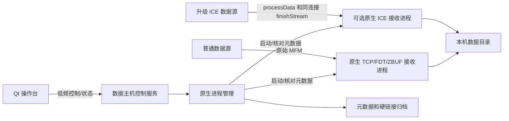

# 数据主机管理 ICE 接收：程序身份、源结束与 Run 归档

本页说明 `DataSupervisor` 如何管理独立 `getdaq-ice-receiver`。操作台和数据服务传递配置、状态及操作请求，MFM 原始字节直接从数据源进入接收进程。ICE 接收程序仍是可选组件；默认 TCP/ZBUF/FDT 接收程序没有增加 Ice 或 Qt 依赖。

本机实现不等于旧板端已升级。原来的 `IceDataSender` 只有单向 `processData`，没有明确结束方法。它可以发送载荷，但不能自动满足本页的正常结束条件。真实板端源升级、真实板端发送器接法、目标平台和持续大流量验收仍须继续。

## 1. 各程序的职责

| 程序/模块 | 输入和职责 | 是否接触原始波形 |
| --- | --- | --- |
| Qt 操作台 | 展示状态，提交配置/控制请求 | 否 |
| `getdaq-supervisor` | 认证低频 HTTP、持久化意图，调用原生进程管理核心 | 否 |
| `DataSupervisor` | 核对固定计划/程序，启动自有子进程，等待结束和验证目录凭据 | 否；只查看元数据 |
| `getdaq-receiver` | 接收 TCP/ZBUF/FDT，分帧、写盘、可选在线导出 | 是；无 Qt/Ice |
| `getdaq-ice-receiver` | 本地 Ice 兼容接口，固定容量队列、原生分帧/写盘/导出 | 是；无 Qt |
| `IceSourceClient` / `getdaq-ice-send` | 源端发送载荷，并在同一连接明确结束 | 是；属于数据源 |
| `ReceiverCatalog` / `getdaq-catalog` | 同文件系统硬链接归档、核对文件身份和凭据 | 不读取帧 |



数据量大时，重点是接收队列、磁盘、网络和 Ice 兼容封装的实测开销。选择 Qt 作为控制界面，不会让原始帧经过 Qt 的事件循环。ICE 是兼容路径；新设备或新传输设计仍可使用直接的原生 TCP 数据路径。

## 2. 为什么需要两个程序摘要

原计划的 `executable` 和 `executable_sha256` 继续指向普通接收程序。包含 ICE 来源的计划另加：

```json
{
  "ice_executable": "/srv/getdaq/bin/getdaq-ice-receiver",
  "ice_executable_sha256": "这里填实际程序文件的64位小写SHA256"
}
```

这两项加在 `receiver_plan` 对象中，与 `sources` 同级。每个 ICE 来源明确设置 `"input_protocol": "ICE"`。普通来源可省略该字段，保持默认 TCP；同一计划可以混合 ICE、TCP、ZBUF、FDT。

这些字段和每个来源的协议一起进入规范计划摘要。计划读取拒绝缺一项、无 ICE 来源却声明 ICE 程序、错误类型或无效摘要。数据主机启动前读取实际程序核对；随后每次操作继续核对文件设备/inode、权限、所有者和内容摘要。运行中替换同路径程序不会被静默采用，恢复原文件也不会自动清除故障门槛。

两个程序都必须是本机普通可执行文件，不能是符号链接或可被组/其他用户写入的文件。不要将现有部署根的 `plan.json` 手动改成新计划；它和日志是不可变身份记录。部署更换与旧会话恢复需要显式核对。

## 3. 配置步骤

先按 [数据主机控制服务手册](REMOTE_RECEIVER_CONTROL.md) 准备原生程序、输出根、审计根、端口及认证文件。下面是在既有完整服务配置上增加 ICE 的方法，不是仅靠片段创建完整配置。

1. 显式构建可选接收程序，命令见 [ICE 接收入口](ICE_DATA_INGRESS.md)。将普通和 ICE 程序放到固定安装路径。
2. 用 `sha256sum` 分别取得实际安装程序的摘要。路径或程序内容变更后，重新生成和审阅部署计划。
3. 将普通程序路径/摘要填入原 `executable` 两项，将 ICE 程序路径/摘要填入新增两项。
4. 将对应来源的 `input_protocol` 改为 `ICE`，保留 ID、接收地址、输出根、数据/状态/导出端口和资源预算。来源 ID 必须与数据源映射一致。这里的来源 ID 是固定计划标签；本页的程序/连接/会话核对不等于真实板端认证或独占硬件控制权。
5. 在数据主机运行只读配置检查：

```bash
/path/to/getdaq-supervisor --config /path/to/service.json --check-config
```

检查通过会给出计划摘要，不创建控制根、不启动 receiver、不发送硬件命令。把该规范计划摘要用于控制端的固定绑定。认证文件应通过既有工具创建，不把实际内容写进说明书或测试归档。

6. 启动服务：

```bash
/path/to/getdaq-supervisor --config /path/to/service.json
```

服务启动仅建立控制入口。通过同一身份/部署的控制请求执行 Start，才启动接收子进程。不要手工在同一输出会话中再启动第二个 receiver。

资源项 `queue_mib`、`max_frame_mib`、导出预算仍参与全部来源的合计限制。ICE 使用固定 256 KiB 块池；每个来源一个写盘线程，默认消息上限 1 MiB。发送源应留出协议封装空间，详见 [ICE 源库](ICE_DATA_SOURCE.md)。此阶段固定计划不提供独立的 Ice 消息大小配置项。

状态端口只绑定 `127.0.0.1`，由同一主机的管理器核对。外部控制端查询认证数据服务，不把原始 ICE 数据端口当状态端口，也不要用普通 TCP 连入数据端口进行 readiness 探测。

## 4. 从 Start 到 Ready

管理器创建带随机会话 ID 的专属目录和日志，先持久化启动意图，再执行对应的接收程序。ICE 来源使用 `ice_executable`，其他来源使用原 `executable`。

传给 ICE 程序的身份包括会话、来源 ID、配置摘要、实验工件摘要和实际输出目录。Ready 需要同时证明：

- 自有子进程仍在运行，PID 与实际状态一致。
- HTTP 状态的 service 是 `getdaq-ice-receiver`、协议是 ICE，端口、bind、命名和单来源运行模式符合固定计划。
- 会话、来源、两项摘要、输出目录都一致。
- 接收器持有被绑定的目录锁。
- 没有错误、没有已接受结束标记，没有伪造 TCP EOF。

仅有启动命令返回、端口可以连接或目录存在，不能提交 Ready。状态查询不绑定数据源，也不接收事件。

## 5. 三种结束必须分清

| 情况 | 凭据含义 | 管理结果 |
| --- | --- | --- |
| TCP/ZBUF 来源真实 EOF，完整帧写盘并同步 | 原生接收凭据中的 `sender_eof_confirmed=true` | 满足其原来的封存条件 |
| FDT 明确未用于采集，且从未接入连接/数据 | `source_unused_confirmed=true`，EOF 为 false，计数全零 | 保留“未使用”语义 |
| ICE 源同连接 `finishStream(session, expectedBytes)` | ICE 专属凭据 `sender_end_confirmed=true`，EOF 始终 false | 核对成功后 `source_end_confirmed=true` |

ICE 的 `Finish` 管理操作只等待自有接收进程自然退出。它不向另一控制连接发送 finishStream，不关闭源连接、不发送 SIGTERM/SIGKILL，也不把等待时间或空目录当结束。

数据源必须先在同一个固定连接发送全部载荷，再声明会话及实际已发总字节。接收端核对单来源、顺序和总数，排空队列，要求完整 MFM 帧，关闭/同步原始文件，核对文件集，发布专属凭据，最后正常退出。Finish 再核对退出和凭据，而不是只相信源标记应答。

零数据 ICE 流也必须由实际源连接发送合法结束标记。不能通过 FDT 的 `unused_source_ids` 结束一个 ICE 来源。旧源断开、无数据静默、操作台 Stop 或源端仅返回本地发送成功，都不会制造 ICE 成功结束。

## 6. 凭据和状态怎样核对

ICE 目录中使用 `.getdaq-ice-receiver-seal.json`，类型为 `getdaq.ice-receiver-seal`。不要改名为 `.getdaq-receiver-seal.json`。专属凭据记录来源/会话/PID、两项摘要、目录、实际绑定连接数、字节及文件列表，结束依据为 `ordered-same-connection-finishStream`。

管理器要求实际退出码为 0、目录锁已释放、最终状态身份一致、输入已停止、队列为空、无错误、源结束为真、TCP EOF 为假。总接受字节、完整文件字节、同步字节、文件数量及每个真实文件的类型/大小必须一致。缺少、重复、多出或被替换的原始文件都不能完成。

管理状态新增 `source_end_confirmed`，仅在 ICE 专属核对通过后输出 true；默认不添加字段，旧计划及默认状态的规范字节保持。原生查询和 Qt 控制协议保留该值。GUI 显示 `ICE source end / seal verified`，明确区别于 `not used for acquisition`。

这些状态是已完成核对的记录，不证明全部探测器事件都生成并发送，也不证明正在连续健康运行。GUI 不因看到结束、失联或故障字段自动发硬件命令。

## 7. Run 归档

同一数据主机可以归档混合来源。归档请求保留完整固定计划，因此普通和 ICE 程序摘要、各来源协议及核对后的生命周期一起绑定请求身份。

归档器按来源协议选择对应凭据，严格检查字段和结束类型。ICE 必须有 `source_end_confirmed`，原生 EOF 不能替代 ICE 标记；普通来源也不能借 ICE 标记完成。归档中的统一文件名 `receiver-seal.json` 是原凭据字节的拷贝，里面仍保留真实 kind/协议/false EOF/源结束依据。

原始 `.graw` 在同文件系统通过硬链接进入 Run 目录，不经过 Qt、HTTP 或归档器的波形缓冲区。链接后核对实际设备/inode/大小/链接数；Inspect 再核对请求、清单、凭据摘要和实际文件身份。跨文件系统/跨主机复制仍需独立原生传输任务，此处不偷偷退化为复制。

可只读检查一个已完成归档：

```bash
/path/to/getdaq-catalog --inspect-catalog /path/to/catalog/Experiment/run_0001/node
```

原始目录和归档硬链接都指向同一数据 inode。删除测试载荷时必须按本轮私有清单清掉两处链接；生产会话清理不使用测试脚本。

## 8. 异常怎么处理

| 观察 | 系统行为 | 操作者应核对 |
| --- | --- | --- |
| Finish 超时，源未发结束 | 保留进程和数据、记录失败，不能自动重启/重放 | 原会话源是否仍运行，是否发送合法结束，目录和日志 |
| 原始尾部不完整或写盘错误 | 保留已确认完整帧，退出失败，不发布成功凭据 | 原始源计数、网络/磁盘错误、完整文件 |
| 错会话、错总字节、另一个结束连接 | 拒绝该标记，不能凭控制应答提交完成 | 固定连接和源身份 |
| 专属凭据被改写，或目录多出文件 | 封存/归档核对拒绝 | 原目录、程序日志和已有持久意图 |
| 启动中第二进程失败 | 同一失败对象可显式 AbortStartup，先核对所有来源零连接/零数据 | 被占端口、程序构造日志、原启动记录 |
| 服务重开或程序被替换 | 保持需要核对，不自动接管旧 PID 或清门槛 | 原部署、程序摘要、会话及原始目录 |

AbortStartup 的信号仅用于已核对未接入数据的失败启动，不代表采集结束。ICE 此时退出失败并保持无源结束/无完整凭据；如果最终计数证明连接或数据发生了竞态，操作不能宣称安全空启动终止。不要通过新审计目录、新服务或手工补 JSON 清除 UNKNOWN。

## 9. 验证范围及剩余工作

普通本机实际管理测试包括两种 Ice 编码、混合 TCP/ICE、实际空源、缺结束、尾帧截断、凭据/归档篡改、失败空启动和错误程序摘要。测试对照原始 MFM 字节，成功和失败都清理本轮输入/输出及归档链接，只保留小型证据。GUI 模型另核对源结束字段及没有自动控制动作。

最终构建/内存检查/认证 HTTP/旧协议回归的实际结果见 [验证记录](VALIDATION.md)。测试每组远小于用户的全部流合计 20 GiB 上限；此限制不能绕过为“每个文件各 20 GiB”。SIGKILL、断电或文件系统故障无法保证脚本 finally，因此不能将捕获中断清理承诺扩展到这些场景。

当前仍需真实板端源库和 VxWorks 工具链接入、真实板端的 ICE 发送启停/恢复核对、真实固件/下游互通，以及 Ubuntu 24、Windows Qt 5.14.2 MinGW、macOS、长期吞吐和断电验收。独立数据主机管理通过不等于整套旧系统完全替换。

源端线程停止/排空和最终结束已提供独立模块，接法见[源端生命周期](CONTROLLED_ICE_SOURCE.md)。它不能替代尚未接入的源端远程控制和真实板端驱动。

源端低频扩展和ECC固定会话已接续，实际源控制和恢复边界见[ICE源控制](ICE_SOURCE_CONTROL.md)。本机完整流程不证明真实硬件加载/控制权或完整恢复。
