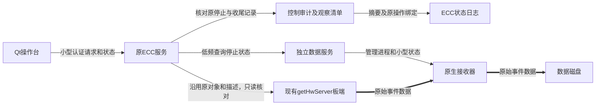

# 原 Prepare 故障收尾后的核对恢复

## 1. 当前实施状态

原生及实际HTTP核对恢复已实现并通过本机夹具验证；生产Qt客户端、持久意图以及完整MainWindow/RunControl的两编码流程已验证。普通后端、插桩后端和包内Release后端各通过一组完整窗口流程；GUI和旧依赖没有整体插桩，仍不属于现场验收。最终证据及限制以 VALIDATION.md 为准。已有的断电收尾使用 `unprepare-after-failure`；它完成后仍保留 UNKNOWN。新的核对恢复检查原失败记录、明确停生产记录、断电/注销订阅证明以及新鲜只读观察，再决定是否回到 Described。

本功能不修改板端 getHwServer/IceEirfu，也不让 Qt 接收采集数据。原生后端执行核对，Qt 只发送命令和显示小型状态。完整 Run 故障及冷服务恢复需要单独的证明，不能用本入口代替。

## 2. 为什么需要保留原对象

Prepare 中断可能留下已上电 AsAd 和已建立的订阅。新对象不知道旧步骤是否已执行，不能据此重发断电或注销。原对象记录了每一步首次尝试及应答，故障收尾成功后还要保存这些实际写入审计的字节链，并保留原失败历史。

恢复应当确认三件不同的事：

1. 原 Prepare 的生产停止已经得到确认。
2. 原故障准备的断电和自有订阅注销已经确认。
3. 恢复时描述、停止/未就绪位、供电状态和数据侧仍满足重新 Prepare 的前提。

只看到某个寄存器为0，不能代替前两项操作记录；某次 HTTP202 也不能代替终态结果。修改、删除或替换审计文件会使证明失效。

## 3. 命令及限制

通过认证操作接口提供 `reconcile-preparation`，绑定新的操作ID和原失败 Prepare 的 `failed_operation_id`。只有同一仍运行的服务保留原 Unprepared 对象、完成收尾证明且没有采集对象时才能核对；不执行寄存器写入、CREATE、订阅或注销。

全部核对通过后将保存新的恢复证明并提交 Described，再释放已经确认收尾的旧准备对象。重新 Prepare 是用户随后明确提交的新操作；不会自动重试原 Prepare 或开始 Run。原失败历史继续为 unknown，以说明当时操作不能确认完成。

若供电再次变化、生产重新启用、布局不符或订阅未知，应拒绝恢复且保持门槛。审计损坏保持存储故障；修复字节不能自动解除已保持的故障。现场全局控制权、实际配置加载、固件兼容和持续性能不能由本机模拟核对证明。

## 4. 实际操作顺序

在连接原服务的Windows或Linux操作台执行下列步骤；真正的读写和审计保存在原ECC主机。

1. 确认当前错误来自 Prepare，最近确认状态是 Described，无活动 Run、无未核对客户端意图。
2. 保留原失败 Prepare 的操作ID。不要删日志、换审计根或重启服务以绕过 UNKNOWN。
3. 明确停生产，等待该原对象的操作结果 complete。
4. 按[故障收尾手册](FAILED_PREPARATION_UNPREPARE.md)执行断电与自有订阅收尾，等待 complete。UNKNOWN 在此时仍保持，这是正常行为。
5. 点击菜单 **Verify original failed Prepare after cleanup...**。默认 Cancel 不提交；明确选择 Yes 才持久保存新的核对意图并发出请求。
6. 等待新请求的结果。后端不会重发先前失败的 Prepare、断电、停止或注销步骤，也不会启动接收器。
7. complete 必须同时返回 Described、outcome_unknown=false、needs_reconciliation=false、transition=0以及匹配的新核对ID。
8. 操作台重新查询状态后，才能再次使用 Progress all 执行一个新的 Prepare。准备过程会创建新的准备对象和订阅身份，不复用已经关闭的旧订阅。

若核对失败，继续保留原服务、原记录和UNKNOWN；只查看该请求的原ID结果。不要把“请求接受202”当“恢复完成”。修复供电/元数据等现场条件后，应按故障原因重新评估；原收尾不重复，审计损坏已保持的存储故障不能靠修改文件自动解除。

## 5. 保存的证明与失败判断

原失败Prepare父审计在失败时绑定文件身份和实际写入链。成功停生产具有独立原操作凭据。收尾成功后保留每份监测/断电/注销步骤以及系统准备/收尾审计的原写入链，恢复前检查全部文件仍匹配；所有文件都是控制元数据，不包含采集raw。

新恢复目录保存recovery-intent.json、描述与准备状态只读观察、observation-manifest.json及recovery-proof.json。完整观察文件名/字节SHA/实际写入链列在独立清单，父证明绑定清单SHA及数量，控制在日志的4096字节上限内；清单预算1MiB。证明绑定原失败ID、原停止ID、原收尾ID、父快照/配置/工件，以及每份新观察的文件SHA和写入链。提交前再次检查来源、目录、审计、停止和数据侧；数据停止RPC前后都重新检查已绑定证明和观察清单，避免等待期间文件变化被遗漏；只有内部持有的已验证对象可以提交，不能用用户输入的任意JSON直接清UNKNOWN。

| 情况 | 处理 |
| --- | --- |
| 没有已确认原停生产或收尾 | 拒绝恢复，无硬件写入 |
| AsAd再次上电、生产/就绪位非0 | 只读核对失败，保持UNKNOWN |
| 布局/名称/权限不符 | 拒绝，不CREATE或修补 |
| 原订阅仍Active或Unknown | 拒绝，不重复注销 |
| 原/收尾/新观察审计被改动 | 拒绝并保持存储故障 |
| 有采集对象或其他故障来源 | 此入口拒绝，不能恢复Run |
| 旧服务重启 | 没有原对象，拒绝接管 |
| 新恢复ID回复丢失 | 观察原ID，不换ID重发正向动作 |

## 6. 当前验证范围

普通原生验证两种编码恢复并重新Prepare，以及供电变化/审计损坏拒绝，另回归两编码Describe恢复。实际ECC与两个数据服务验证四项恢复成功/拒绝和三项明确断电收尾；每项记录实际encoding_minor，不能只根据场景名判断编码。生产Qt客户端/存储探针还观察了原失败、停止与收尾意图，核对成功后闭合相关门槛，要求新状态才恢复Prepare资格。

这些准备阶段场景未启动receiver、未传raw，不是完整采集、现场硬件或跨主机证明。70.38进一步通过完整MainWindow/RunControl网络按钮链路：GUI自己提交原失败Prepare，再完成原停止、取消/确认收尾、取消/确认核对以及新Prepare；后端请求数和本地持久记录逐项匹配。最终测试、插桩/包范围和证据路径见[验证记录](VALIDATION.md)。


## 7. 控制、核对和数据通路的关系



粗线是原始数据通路，它经过原生接收器与磁盘；Qt、控制审计和恢复证明只保存命令、状态和摘要。准备恢复场景不启动粗线上的接收器。状态提交完成后也只恢复控制前提，不能把审计文件或状态位当成某次采集的数据封存证明。


## 8. 怎样核对一次完整操作台恢复

下面是已验证的本机模拟过程，用于理解界面显示和不同操作ID，不能据此省略现场故障判断。

| 操作 | 后端接受的命令 | 父ECC结果 | 接收侧 |
| --- | --- | --- | --- |
| 第一次Progress all | describe一次 | Described，已知 | 两数据服务Fresh |
| 再次Progress all，Prepare中收到告警 | prepare一次，终态failed | Described/UNKNOWN，保留此Prepare ID | 无receiver |
| 明确停生产 | stop-production-after-failure一次 | 此请求complete，父UNKNOWN及原Prepare ID保持 | 无receiver |
| 收尾先Cancel、再Yes | unprepare-after-failure一次 | 此请求complete，父UNKNOWN保持 | 无receiver |
| 核对先Cancel、再Yes | reconcile-preparation一次 | 此请求complete，父回到已知Described，新核对ID | 无receiver |
| 刷新状态后手动Progress all | 新prepare一次 | Prepared，已知 | 无receiver，尚未Configure |

因此后端总计六份被接受请求：describe一份、prepare两份，其余三个命令各一份。两次Cancel各零请求。停生产或收尾的“请求ID”是新的，但它们结果内的“父ECC操作ID”仍指向原失败Prepare；只有核对提交成功才改为新的恢复ID。两个ID不能混为一谈。

本地控制记录位于部署设置中的native_ecc.record_dir，含requests及observations.jsonl。验证工具逐项检查六份实际请求文件、请求摘要、本地持久意图及六份终态观察与后端接受/结果记录完全匹配；不靠窗口自报passed，也不重发原请求。正常操作不要手工修改这些文件。此准备恢复过程没有Start、接收器、采集封存或Run完成记录。

## 9. Prepare 告警策略已保持时的明确确认

本节适用于：同一 ECC 服务还在运行，Prepare 已失败并保持 UNKNOWN，启用的告警停止策略已经针对这次 Prepare 完成 `stop-production-after-failure`。准备对象仍由该服务持有，原断电和自有订阅注销已完成。普通 `reconcile-preparation` 会拒绝独立告警；这时使用单独的 `reconcile-preparation-with-alarm` 确认入口。

这里的“确认”表示操作者检查并确认正在处理哪一次告警。它不证明温度、电源、接线等物理原因已经修复。后端仍必须读取当前停止、断电、描述和订阅状态，并核对原审计证明；满足这些条件才允许回到 Described。

1. 在操作台启用 `native_alarm_status`，同时确认服务端已启用 `alarm_stop_policy`。前者只查看状态，后者才负责自动停止。
2. 查看原 Prepare 的失败结果，记下原 Prepare ID；再查看告警缓存，记下原告警停止 ID。两者是不同 ID。告警停止必须是 complete，并且其观察绑定原 Prepare 的 UNKNOWN。
3. 等待自动停生产完成。不要把告警通知、HTTP 202、停止命令已接受或一个旧的 stopped 显示当成完成证明。
4. 使用 **Power off original failed Prepare...** 完成原准备断电与自有订阅收尾。此时父 UNKNOWN 和告警保持仍然存在。
5. 选择 **Acknowledge original alarm and verify Prepare cleanup...**，核对日志中的原告警停止 ID。对话框默认 Cancel；选择 Yes 才写入新的本地意图并提交请求。
6. 服务端同时核对原失败 ID、原告警停止 ID、原告警观察摘要、原停止/收尾审计、当前只读状态和数据侧停止状态。它不重新 Prepare、不重复断电或注销、不启动接收器。
7. 只有完整成功结果才能解除这次告警。网络完成记录在同一行保存 `alarm_policy_reset=true`、`alarm_stop_operation_id` 和 `alarm_observation_sha256`；不包含接收故障策略复位，因为本入口不处理接收故障。
8. 操作台重新查询状态后，由操作者再按 **Progress all** 执行新的 Prepare。新准备重新执行监测并建立新的订阅；原失败记录仍保留。

请求使用现有认证操作接口，额外两个字段都必填：

```json
{
  "failed_operation_id": "原Prepare操作ID",
  "alarm_operation_id": "原自动告警停止ID"
}
```

上面的片段不是完整请求。完整请求还包含 schema、全新的 operation_id、command、instance_id、snapshot_sha256、client_id 和 client_epoch。三个操作 ID 必须不同，摘要和请求规范字节由客户端生成；不要手工改写持久请求文件。

错误告警 ID、接收故障也已保持、停止未确认、原收尾不完整、独立输入或存储故障、源 UNKNOWN、冷重启丢失原对象均拒绝。普通 Running 告警成功 Stop 后的恢复也不属于此入口。重启后即使历史确认成功记录能解码，服务仍保持启动核对门槛，不能沿用旧 ID 接管对象。

本节功能的实际验证与尚未验收范围统一见[验证记录](VALIDATION.md)；旧第8节是未启用独立自动告警策略时的路径，不能用它绕过本节的明确确认。
