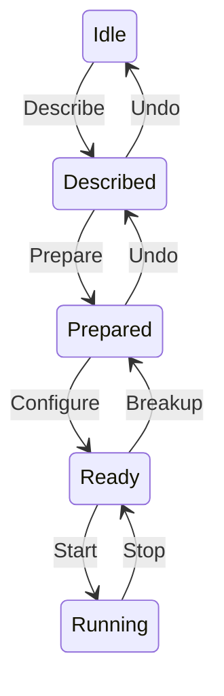

# 工作原理

## 1. 控制面和数据面

DAQ 同时存在两类通信：控制面传递配置、启停和状态；数据面传递采集事件。控制台、ECC 的 SOAP 接口以及 sentry 属于控制面。CoBo 输出、dataRouter/DataExporter 和存储属于数据面。

因此，选择 Qt Widgets 不会使原始数据自动流过窗口。当前控制台刷新慢时，主要影响操作反馈；原始数据仍由节点上的现有程序处理。但 CPU、磁盘等资源仍可能共享，所以不能宣称完全没有间接影响。

## 2. ECC 状态

| 数值 | 名称 | 含义 |
| --- | --- | --- |
| 0 | Off | ECC 状态；网络离线应另行表示 |
| 1 | Idle | 尚未完成描述 |
| 2 | Described | 已加载设备描述 |
| 3 | Prepared | 已完成准备 |
| 4 | Ready | 配置完成，可以启动 |
| 5 | Running | 正在运行 |
| 6 | Paused | 已暂停 |

上表根据 GET `src/get/rc/SM.h` 修正。忙碌通过独立 `Transition` 字段表示，不是 State=6。客户端和独立模拟器已分别表达状态与转换，阶段推进同时要求目标 State 和 Transition=0；Paused 设备可以 Stop，并阻止直接断开控制。相关测试已通过，实际 ECC 版本仍需核对。



Disconnected、Error、Settling、Cataloging 是控制台自身阶段，不是发送到 ECC 的数值状态。

## 3. 为什么启停有顺序

原 envoy 明确要求：Prepare 先 MuTaNT 再 CoBo；Configure 先 CoBo 再 MuTaNT；Start 先 CoBo 再 MuTaNT；Stop 先 MuTaNT 再 CoBo。新实现保留这个硬件协调顺序。

开始新 Run 时，还需要让 MuTaNT 从 Ready 回到 Prepared 再 Configure，用于沿用原版的事件编号/时间戳重置流程。新的 GUI 按钮只是触发 RunControl，后续步骤不会在点击槽中忙等。

“发出了 Stop 请求”“收到 Stop 成功应答”“GetState 返回 Ready”“最后一个数据帧已写入磁盘”是四件不同的事。控制台能确认前面三个；最后一个依赖数据服务提供的保证。

## 4. 状态查询与超时

每个 ECC 客户端最多一个正在处理的请求，避免同一设备上操作和状态查询互相乱序。空闲时定时 GetState。执行操作时等待应答，然后发送一次新的 GetState，后续仍通过轮询等待目标状态。

网络断开或响应不合法时将节点标记为不可用；旧数值不会被当作新状态继续推进。状态时间使用单调时钟，避免修改系统时间后时间差异常。

普通查询可以继续轮询恢复；有副作用的命令不自动重试。尤其 Catalog 可能已经完成文件移动，但 HTTP 响应丢失，再次发送就可能误处理新一批文件或撞上已存在目录。

## 5. 速率如何计算

sentry 返回当前 incoming 目录 `.graw` 文件总大小，单位 GB（十进制，1 GB = 10^9 字节）。控制台计算：

```text
rate_MB_per_second = (new_GB - previous_GB) × 1000 / elapsed_seconds
disk_used_percent = (1 - available_GB / total_GB) × 100
```

使用实际查询间隔，不假设每次正好两秒。目录变化或计数减小时重置速率基线，归档应答不生成负速率。统计的是文件大小增长速率，不是网卡线速、事件率，也不证明没有丢帧。

图表只保留有限数量的统计点，显示最近 300 秒。文件数量再多、原始数据再大，也不把文件内容送进 GUI 绘图。

## 6. 归档与数据完整性

原 sentry 的 `/catalog` 在处理前等待 30 秒，然后把 incoming 根目录的 `.graw` 移到实验和 Run 对应子目录。新 sentry 将等待时间配置化，默认仍为 30 秒，并保持相同的响应字段。

改进包括：拒绝覆盖已有 Run；同目录归档加锁；在目标目录记录计划文件和已移动文件；失败后保留部分结果；不把整个大文件装入内存。

等待 30 秒不等于已经排空。传统后端仍需实测 settling 时间。新原生接收器在发送端 EOF 后排空并同步文件，正常退出写封存凭据；新 sentry 取得相同内核锁并核对文件清单后才归档。该路径还未自动接入 GUI 的接收器进程管理，也不能证明硬件漏事件为零。见 [数据服务](DATA_SERVICE.md)。

## 7. 运行日志与配置备份

原始 `.graw` 在节点端归档；实验说明、参数、时长和 GET `.xcfg` 备份在控制台端保存。两者用实验名和 Run 编号关联。

`run.yml` 是固定快照；`journal.json` 是执行进展。只有归档、备份和本地记录都完成后，控制台才推进 Run 编号。配置自动保存失败会单独提示，不能把这一点混同于采集数据失败。

QSaveFile 用于单文件替换，能避免常见的半写配置；它不构成跨目录或多节点事务，也不能替代断电保护、存储冗余和实验数据备份。

## 8. 性能优化的优先级

控制台：异步请求、有界历史、有限日志显示、耗时文件工作后台执行。无需为每个 CoBo 开线程，也无需在界面引入原始事件的大缓冲。

sentry：只统计元数据，归档使用同文件系统重命名；等待用定时器；限制同时连接和后台工作数量。目录扫描时间仍随文件数增长，应通过文件轮转策略控制 incoming 中的文件数。

数据面：已实现固定容量块池、可复用分帧缓冲、分来源批量写盘和容量受限的可选导出。慢导出客户端断开，不持有主接收池的块；写盘慢则经 TCP 背压传回发送端。仍需实机测量接收率、内存/队列峰值、持续写盘率和端到端完整性，没有硬件压测前不承诺 Gb/s 指标。

## 9. 平台差异

Qt 提供窗口、文件、路径、网络、计时和线程抽象。进程探测使用 Linux/macOS 的 ps 或 Windows 的 tasklist；Windows 的进程名称通常包括 `.exe`。Windows 文件共享和文件句柄语义与 Linux 不同，仍在写入的文件可能无法移动，应在归档前正确停止写入。

跨平台兼容需要各平台实际构建和运行；当前 Linux 测试通过不能当作 Windows、macOS 和真实硬件已验收。
