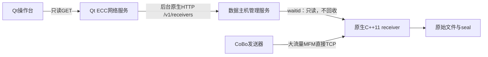

# 操作台查看接收进程：配置、含义与故障处理

## 1. 解决什么问题

原生ECC操作台已有整系统状态和接收会话信息，但这些来自完成操作时留下的缓存。接收器之后因磁盘写入错误或截断帧退出，缓存可能仍显示ready。现在操作台可以额外向ECC查询数据主机上自有接收进程的实际运行/退出情况，便于及时看到异常。

这是只读显示功能：不替代硬件状态、实际EOF、排空和seal核对，不自动Stop、断开发送器、重启接收器或解除UNKNOWN。原始事件始终走独立原生receiver，Qt只传小份控制与观察信息。



操作台和ECC都不接收原始帧。图中的进程观察箭头只读取退出记录，也不扫描.graw文件。

## 2. 使用前提

需要本轮版本的三个部分：数据服务getdaq-supervisor支持第58阶段的/v1/receivers，ECC服务getdaq-ecc-server支持聚合观察，以及具有新选项的GetDAQ操作台。原生接收器沿用此前版本，没有为此修改数据接收或写盘热路径。

数据节点、控制器标识、计划摘要、ECC实例/固定快照和认证文件继续沿用已有部署；不需要新端口、额外第三方库、硬件SDK或第二套凭据。每个数据服务仍只观察自己启动并持有的子进程，重开服务不接管历史PID。

先按[原生GUI手册](ECC_GUI_CLIENT.md)、[ECC网络服务](ECC_NETWORK_SERVICE.md)和[数据主机管理](REMOTE_RECEIVER_CONTROL.md)完成固定配置。不要把source/里的旧服务和新服务名称相同理解为协议已经相同。

## 3. 如何开启

操作台的连接设置窗口中，选中原生整系统模式，再勾选`Observe receiver processes`。保存后对应YAML为：

```yaml
getdaq:
  native_receiver_status: true
  poll_ms: 1000
  native_ecc:
    timeout_ms: 5000
    status_max_age_ms: 10000
```

这只是已有配置的相关字段片段，不是独立完整配置。其余地址、身份、快照、会话、认证路径、记录目录和节点映射必须保留。完整模板为config/envoy.native.example.yml，新模板开启此选项；旧配置没有字段时默认关闭，保持旧服务用法。

poll_ms决定操作台读取状态和尝试观察的周期。建议从1000ms开始；一次观察还未结束时，同一GUI不会发第二轮。客户端timeout_ms建议至少2000ms，示例5000ms，给ECC最多1.5秒的远端查询及回包留出余量。status_max_age_ms约束操作台本地收到观察后的有效时间，不使用不同主机的墙钟差判断新鲜度。

新设置只在native_ecc模式有效；在旧SOAP/模拟模式启用会被配置校验拒绝。它不是启用AsAd自动告警的开关，与native_alarm_status及服务端alarm策略分别设置。

## 4. 状态表怎样理解

| 接收进程显示 | 含义 | 建议 |
| --- | --- | --- |
| Running (process observed) | 本轮查询时自有子进程尚未退出 | 可以确认尚未产生退出记录；仍不证明线程没有卡住、网络/磁盘健康 |
| Receiver failed: exit 1等 | 已观察到异常退出码 | 查看保留的接收器stderr、Run和数据主机状态，按原操作ID核对 |
| Exited normally; Finish/seal pending | 正常退出，管理器尚未回收或完成封存核对 | 等待既有停止/Breakup/Finish流程，不直接当作异常或已完成 |
| Reaped; check seal | 管理器已回收进程 | 查看seal verified和整体Run结果；回收本身不证明归档成功 |
| Receiver manager busy; not observed | 数据节点正在生命周期操作，本次没有进程观察 | 等待后续查询；不显示以前的running作为当前事实 |
| Receiver observation unavailable | 整体查询失败或身份/协议不符 | 查看同一行说明和日志，保留当前控制与Run证据 |
| No owned receiver in this observation | 此实例没有对应自有子进程 | 新部署可能尚未Configure；重开部署的空列表不证明历史接收器已停止 |
| Receiver ownership/status unavailable | 操作系统不能确认该子进程所有权 | 保留未知，不能凭相同PID猜测、接管或自动重启 |

显示异常退出时，进程格使用红色，说明栏提示检查stderr和保留Run。忙碌、缺失、失联或过期时为不可确认提示；有观察的状态也必须结合文字解释，颜色不表示整套DAQ已经正常。

文件数、接收字节、帧数、PID、会话和归档路径仍属于生命周期缓存。新查询只给进程观察，不能把旧计数0解释为没有数据，更不能据此计算实时吞吐或丢帧率。

## 5. 为什么正常退出不是故障

正常停止时，板端停止生产并断开发送器，接收器看到实际EOF后排空、写文件、同步并封存。进程退出和ECC执行Finish之间有一个短窗口：进程已exited/0，但生命周期缓存仍ready。操作台会显示等待Finish/seal，而不发送额外Stop或重启。

相反，退出非0或因信号结束通常需要检查错误。退出码137常对应SIGKILL，但不能单凭它断言OOM或认定某个用户发了信号。退出0也可能来自未连接过发送器的受控信号退出，因此仍不能跳过实际EOF和seal核对。底层细节见[进程观察原理](RECEIVER_PROCESS_OBSERVATION.md)。

## 6. 查询失联时会怎样

ECC按固定数据节点顺序查询。每个节点先核对identity、controller和规范计划摘要，再读取/v1/receivers并核对同一实例；若该节点已经由生命周期绑定实例，返回其他实例会被拒绝，不自动接管。

一个节点连不上、协议过旧、认证或身份不符时，该节点available=false，observation=null；已经成功核对的其他节点可以保留观察。不能用别的节点正常推断失联节点正常。

整个远端查询使用1.5秒预算。若第一节点耗尽时间，后面的节点明确标为尚未确认，不偷偷延长GUI等待时间。一轮内没有POST、命令重试、自动恢复或原始文件读取。ECC最多允许一轮观察任务，另一轮GET返回409，避免多个操作台反复堆积远端等待任务。

远端请求在Qt Concurrent后台进行，ECC事件线程仍能回答/v1/status。1500ms是网络等待政策，不是硬实时上限；CPU调度、认证文件系统等待、JSON解析和回包仍可能增加耗时。生产环境应检查实际延迟，不能将回环测试数值当实时保证。

## 7. 过期和会话切换

操作台在成功收到并核对观察时启动本地单调计时器。新查询正在等待，若前一份观察超过status_max_age_ms，下一次轮询就显示缺失或过期，不继续显示旧的正常状态。网络/解析错误会立即撤下旧观察。

观察和生命周期不是同一事务原子快照。启动新周期、Finish或服务重开时，两份数据可能短暂不同；操作台只把相同节点身份、PID和session的进程结果叠加到该行。不同PID/会话显示等待生命周期同步，避免把上一周期的退出码贴到新Run上。

服务端observed_at_unix_ms只作为观察开始附近的墙钟信息，使用十进制字符串避免64位精度丢失。它不证明跨主机时间同步、真实事件时刻或查询返回后状态没有变化。

## 8. 如何处理异常

1. 记录受影响的节点、会话、PID、原操作ID和显示的退出码。
2. 查看数据主机该次Start审计目录的source-N.stderr及最后接收状态，不打印认证文件内容。
3. 保留真实Run和.graw；生产软件不会按测试清理规则删除异常数据。
4. 按既有控制流程核对生产是否停止、发送器是否断开、实际EOF/排空与seal是否成立。硬件UNKNOWN和数据不完整是不同问题，不能以进程退出清除任一门槛。
5. 需要明确停止生产时使用已有受控停止入口；本观察只提示，不自行发命令。失联后查询原操作结果，避免换ID重发Start/Breakup。

写盘原因的说明见[接收器写盘失败](RECEIVER_WRITE_FAILURES.md)和[ENOSPC/I/O可靠性](RECEIVER_IO_RELIABILITY.md)。测试tmpfs中的ENOSPC经验不能代替现场磁盘、权限、设备或断电检查。

## 9. 兼容旧服务

默认关闭的新选项让旧部署保持原缓存显示。若对旧ECC启用，新查询可能返回404；操作台显示观察不可用，不伪装实时健康，也不修改已有控制状态或补发命令。应升级完整服务链或关闭此显示选项。

只读观察失败不新增控制命令联锁，不自动改变原有命令权限或清除已有故障门槛。真正Start/Resume等命令仍按原生协调器的实际接收就绪、固定范围和持久状态校验执行；明确信息提示不能替代服务端前置校验。

GUI、纯协议与Qt客户端没有增加POSIX/Ice依赖；Windows Qt5.14.2 MinGW仍可按原qmake结构编译这些组件。当前本机版本是Qt5.12.8，真实Windows/macOS/Ubuntu24 Kit验收仍需进行。

## 10. 开发复现与数据清理

Qt控制流程和客户端分别由tests/native_gui.pro、tests/ecc_system_client.pro构建。纯协议和真实ECC网络夹具由现有本地兼容CMake构建提供。实际普通联调通过包装器运行：

```bash
python3 tests/run_receiver_gui_observation_tests.py \
  build-ice-compat \
  build-receiver/getdaq-receiver \
  build-ice-compat/getdaq-supervisor \
  build-receiver-gui/ordinary-final-evidence
```

包装器顺序运行normal-0、normal-1和truncated。本机合成数据直接进入原生receiver；普通TCP/封存回归及新观察使用实际服务进程，硬件端是本地模拟Ice服务，不能视为实机。

固定测试每组三个场景总线上上界3145728字节，远低于所有流合计20GiB。成功、失败或可捕获中断均先结束自有测试进程，再删除其私有测试根的.graw，保留小型SHA、JSON、日志和清理记录。真实Run不受此规则影响；SIGKILL/断电仍不能保证finally执行。

详细构建/运行结果、普通与插桩范围、历史证据和剩余验收以[验证记录](VALIDATION.md)为准。当前功能不提供进程卡死检测、连续磁盘/网卡健康、事件完整性、真实硬件恢复或持续大流量验收。
