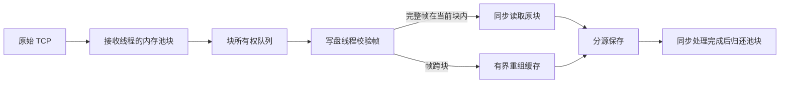

# 原生接收器：复制优化、性能测量与磁盘限制

2026-10-21补充：当前Ubuntu24全源码候选中的确切`getdaq-receiver`交付二进制通过四路16GiB合成负载回归，证据见[VALIDATION 71.83](VALIDATION.md#7183-ubuntu24当前交付接收器四路16gib负载回归2026-10-21)。它在WSL2宿主内核和Ubuntu24用户空间中运行，数据经localhost进入接收器并写入虚拟化文件系统；16GiB低于系统约49GiB物理内存，因此只用于验证交付二进制的并发接收、完整读回、封存和清理，不作为DAQ速率或持续物理磁盘性能指标。

本说明对应2026-10-08的原生C++11接收器验证。原始数据由板端发送器直接进入`getdaq-receiver`，Qt操作台、ECC控制服务及数据节点HTTP服务只处理配置、控制与小型状态信息。没有为这次优化引入Qt、Ice、Boost、ROOT、yaml-cpp或curl依赖。

2026-10-19补充：[在线导出锁隔离](EXPORTER_LOCK_ISOLATION.md)移除了导出socket操作对发布锁的占用，已分别在宿主和Ubuntu24用户空间进行普通/插桩回归。下面原分帧基准数字保留原日期和范围，不将新锁调整解释为相同倍数的吞吐提升。

2026-10-20补充：当前Ubuntu24交付候选的原生接收器另完成四路并发、总量1GiB的localhost写盘/封存回归，现已由标准Ubuntu24平台runner自动执行。它增加并发流数覆盖，但负载仍小于主机内存且由Python合成发送，不构成磁盘持续吞吐或实际DAQ速率验收；证据见[VALIDATION 71.11](VALIDATION.md#7111-ubuntu24候选接收器四路并发回归2026-10-20)和[71.12平台runner回归](VALIDATION.md#7112-ubuntu24标准平台runner接入只读源码安全与四路接收回归2026-10-20)(VALIDATION.md#7111-ubuntu24候选接收器四路并发回归2026-10-20)。

2026-10-22补充：Linux host 71.189 full候选内SHA256为`90144a4ca0ad64121ac7a66fbd58fc49e73120abd174401183b903032170c8ba`的`getdaq-receiver`通过四路16GiB合成负载，覆盖1GiB轮转、全部数据读回SHA、EOF、退出、封存和自动删除；清理后raw为0。墙钟28.20秒含发送/哈希和全文件读回。此负载仍位于单机物理内存规模内，不代表生产吞吐。完整回执和适用边界见[VALIDATION 71.190](VALIDATION.md#71190-linux-host-候选四路16gib合成接收回归2026-10-22)。

优化已通过本机合成帧检查，**尚未证明真实多CoBo、目标网卡与磁盘上的持续吞吐或零丢失**。当前开发验证环境为Ubuntu20.04.6、GCC9.4；Ubuntu24.04、macOS和Windows GUI的实际验收仍须单独进行。

## 1. 这次省去了哪一次复制

TCP是一串字节，一次`recv`可能收到半帧、一帧或多帧。接收线程先把字节读入固定大小的内存池块，再把块的所有权交给写盘线程。原来的`MfmStream`把每一帧都复制进自己的重组缓存；即使当前块已经包含完整帧，也要多复制一次。

现在，当重组缓存为空且当前块包含完整帧时，`MfmStream`先校验长度、标准头、item边界和来源字段，再让同步回调直接读取当前块中的这段字节。没有完整帧时仍使用原有有界缓存；下一块补齐后再校验、交给回调。当一个块先补齐上一帧、随后包含另一完整帧时，两条路径可连续工作，保持原顺序。



这不是整个链路的零复制。内核接收缓存到用户块仍有复制；跨块帧仍要重组；`FrameStore`仍将小帧汇集到256KiB批量写缓存，大帧直接调用写入；启用在线导出时`Exporter`仍建立独立的有界帧副本，使慢分析客户端不占住接收池块。磁盘写入也会受到文件系统、页缓存和`fsync`的影响。

## 2. 回调的指针为什么不能长期保存

`MfmStream::Sink`在写盘线程同步执行，数据指针只在回调执行期间有效。完整帧的指针可能属于接收内存池；跨块帧的指针属于重组缓存。回调返回后，缓存可能被复用，池块也可能归还接收线程。

因此，回调只能立即读取、同步写入或复制到明确拥有的内存；不能把这个指针放到另一个线程的任务队列，不能保存用于后续显示，也不能在回调中修改数据或再次调用同一对象的`Feed`。当前`FrameStore::Write`与`Exporter::Publish`都在回调返回前完成读取或建立自己的副本。Qt不获取这些指针。

优化保留最大帧预算，畸形长度在进入大块重组前拒绝。零长度、超限长度、非法头长、item越界和AsAd编号错误在完整/跨块路径均不能到达保存回调；前一帧合法而后一帧错误时，前一帧仍可保留，整个连接继续报告失败。

## 3. 内存分帧基准应该怎样解读

`tests/mfm_stream_benchmark.cpp`反复读取8MiB合成输入缓冲，检查头、帧数和一个载荷字节。**它没有经过网卡、写盘、文件SHA或真实采样分析，也没有读取每个载荷字节。** 程序里的`gib_per_second`是用逻辑帧字节数除以分帧耗时，不能当作可达到的DAQ传输速率。

`tests/receiver_framer_comparison.py`从既有不可变验证包取出优化前的两份`mfmstream`源码，先核对原SHA，再编译基准。优化前后使用同一基准、严格C++11和Release优化；每种输入逻辑处理1GiB，交替运行三次，报告耗时中位数。此测试不生成原始数据文件。运行记录为`build-receiver/framer-comparison-current/result.json`。

| 帧大小 | 每次Feed字节数 | 原实现中位耗时 | 当前实现中位耗时 | 原耗时/当前耗时 | 对应路径 |
| --- | --- | --- | --- | --- | --- |
| 4KiB | 256KiB | 17.997ms | 2.338ms | 7.70 | 完整帧直接同步读取 |
| 64KiB | 256KiB | 20.939ms | 0.233ms | 89.87 | 完整帧直接同步读取 |
| 1MiB | 256KiB | 26.381ms | 26.244ms | 1.01 | 跨块帧仍重组 |
| 4KiB | 127字节 | 48.279ms | 48.823ms | 0.99 | 细碎分段仍重组 |

这些数字只说明省掉重组复制对这个基准的影响。64KiB完整帧只检查少量字段，耗时极短，容易受缓存与调度影响；不能把89.87倍宣传成全系统提速。两种跨块输入约为原速度，也符合本次只优化完整帧路径的边界。

## 4. 实际TCP与文件检查

四路场景现由`tests/ubuntu24_platform_validation.py --stage all`自动运行；并发锁位于该轮可写的系统`TMPDIR`，因而与只读源码挂载兼容。标准平台runner会把此负载计入同轮20GiB wire总预算，并在完成后检查`.graw`清理结果。

本机另外启动两个真正的接收器，每个接收512MiB、4KiB合成CoBo帧，配置8MiB池预算、1MiB最大帧、64MiB文件轮转。每个接收器生成8个文件；合计1GiB。发送端对全部发送字节计算SHA，测试程序按文件编号顺序读取全部保存字节，核对单文件/整流SHA、字节数、帧数、自然EOF、正常退出与持久封存。

| 项目 | 流0 | 流1 |
| --- | --- | --- |
| 原始字节 | 536870912 | 536870912 |
| 帧数 | 131072 | 131072 |
| 文件数 | 8 | 8 |
| 接收器峰值RSS | 20724KiB | 20724KiB |
| 发送阶段耗时 | 约0.997秒 | 约1.187秒 |

峰值RSS来自Linux`wait4`对各接收进程的统计，约20.24MiB；不包含Python发送器内存，也不是所有硬件条件下的上界。发送耗时包括生成帧、计算SHA、TCP背压；尾部耗时是父进程按等待顺序观察到的时间，不能解释为精确`fsync`耗时。这里不报告生产吞吐指标。

另用单流12MiB、1MiB轮转生成十二个文件，验证第10、11号文件仍按数字编号参与整流SHA，而不是按字符串顺序排到第2号之前。上述全部合成`.graw`已经删除；小型SHA、计数、日志和封存记录保留。

普通与ASan/UBSan/LeakSanitizer两套接收器均通过核心和实际TCP集成：两种字节序、每个分割点、多帧合并、完整/跨块畸形头拒绝、文件内容、事件重置轮转、有界队列、慢导出客户端断开、异常尾帧和目录锁/封存归档。插桩组的接收器与检查程序由八次严格C++11编译产生；归档联调使用普通`getdaq-sentry`，没有把系统库或该Qt程序称为整体插桩。

## 5. 测试容量和自动清理

并发锁路径在系统`TMPDIR`下按UID和checkout摘要固定。为了避免共享临时目录中的预置文件劫持锁，测试程序拒绝符号链接、非普通文件、非当前用户文件及多硬链接文件；有效锁权限设置为`0600`。锁文件保持为稳定inode，不在每轮结束时unlink，否则两个竞争进程可能在不同inode上成功加锁。对应回归为[VALIDATION 71.13](VALIDATION.md#7113-ubuntu24接收压力锁文件符号链接与硬链接防护2026-10-20)。


用户要求本工作区的传输测试**每轮所有流合计最多20GiB**，测试结束删除生成数据。不能把它解释为每个接收器或每个文件各20GiB；轮转只改变文件划分，不改变总预算。

`receiver_sustained_load.py`默认两流各512MiB，合计1GiB。启动前校验总预算、另留1GiB磁盘空间，并在系统`TMPDIR`中用工作区专属文件锁拒绝并发第二轮；锁不会写进只读源码树，也没有关闭清理的选项。成功时先完成SHA与封存检查，再删除本轮合成数据，最后写成功结果。失败或Ctrl+C/SIGTERM也通过`finally`停止子进程、删除部分文件。清理只处理该次新建的私有测试目录，不处理真实Run。`payload-cleanup.json`保存删除字节和文件名。

2026-10-20另以当前源码构建的接收器完成四流各4GiB、合计16GiB的localhost写盘与全文件SHA读回验证；每流1GiB轮转，payload已自动删除，构建/测试回执保存在`build-receiver/host-four-stream-16gib-20261020/`。聚合墙钟25.20秒、每流峰值RSS约20,804 KiB。此数据在约49GiB内存主机的WSL2内核上运行，且发送端由Python生成并哈希，不能解读为实际DAQ线速或超过页缓存规模的持续磁盘速率。总合成raw小于20GiB限制。

2026-10-21进一步使用Ubuntu24候选中SHA为`8d0f35b61fe33448760ca6e5834b0f1f14de6094282eddb85ddfcd31b65f7b3d`的接收器完成四路18GiB loopback轮转、全文件SHA、EOF及seal验证；20个测试`.graw`均删除，回执留在`build-receiver/host-18gib-candidate-20261021/`。墙钟32.70秒含Python生成/哈希。当前WSL主机MemTotal为52.6GB，故18GiB仍未超过内存；它加强高容量并发和轮转证据，但不能当作超过页缓存的持续磁盘吞吐或实际DAQ速率。

SIGKILL、断电或文件系统错误可能阻止清理；这种情况下先确认测试进程停止，再按该次私有目录和清单清理遗留合成数据。不要为清理测试使用覆盖整个项目的`.graw`删除命令，也不要在本工作区直接做填满磁盘的破坏性测试。

当前主机物理内存约49GiB，20GiB预算无法证明超过内存缓存规模的持续磁盘写入。真实持续验收应另行安排空间足够、明确获准的测试环境；本轮保留这个缺口，没有通过降低证据标准宣称完成。

## 6. 如何复查或在自己的机器复现

下面所有命令从项目根目录执行。构建接收器不需要Qt开发环境：

下面的归档联调命令还需已构建的普通`getdaq-sentry`。纯接收机器没有该程序时，可省略最后的sentry参数运行TCP检查；这样不会执行归档项目，不能将结果称为全部五组检查通过。

```bash
python3 tests/build_receiver_validation.py build-receiver
(cd build-receiver && ctest --output-on-failure)
python3 tests/receiver_load_safety_test.py
python3 tests/receiver_integration.py build-receiver/getdaq-receiver build-suite/bin/getdaq-sentry
python3 tests/receiver_sustained_load.py build-receiver/getdaq-receiver \
  --evidence build-receiver/load-small-new --streams 2 --mib-per-stream 8 --rotate-mib 1
```

最后一条只生成合计16MiB，结束自动删除。`--evidence`里保留小型记录，成功`result.json`列出接收器/脚本SHA、每流计数、文件SHA、CPU/RSS和清理声明。复现内存基准时使用新的证据目录，保留以前的结果：

```bash
python3 tests/receiver_framer_comparison.py \
  --baseline build-ice-compat/validation-remote-ecc/verified-sources \
  --evidence build-receiver/framer-comparison-new
```

若没有该旧验证包，仍可运行当前`mfm-stream-benchmark`，但不能据此补写“优化前后已比较”。`tests/build_receiver_validation.py --sanitized`可构建新的内存检查版本；`/proc/meminfo`与RSS单位按Linux解释，测试脚本不是macOS已验证的性能工具。

本阶段不可变证据位于`build-receiver/validation-performance/`，包含普通/插桩程序、编译输入与命令、基准原源码、检查日志及已删除载荷的元数据；不保存`.graw`或认证值。

```bash
python3 tests/archive_receiver_performance_validation.py
python3 tests/archive_receiver_performance_validation.py --historical-only
```

第一条同时检查当前源码SHA；第二条只检查归档字节和记录之间的关系，不能证明后来修改的源码仍是被测版本。数据已删除后复查SHA记录不能代替重新读取原始文件；本轮全文件读取校验是在删除之前实际执行的。

操作、内存预算、封存与异常恢复见[数据服务手册](DATA_SERVICE.md)；整套仍待验项目见[验证记录](VALIDATION.md)和[重构进度](REFACTOR_STATUS.md)。

### 4.1 Ubuntu 24交付候选双流复核（2026-10-20）

保留的Ubuntu 24候选`build-packages/getdaq-ubuntu24-20261020-ssh-exporter-failure-candidate`再次以两条并行TCP流各接收512MiB合成帧，总量1GiB。每流131072帧、四个128MiB轮转文件；测试程序在删除前逐字节回读并核对发送流SHA、每个文件SHA、总字节/帧数、自然EOF、持久封存和正常退出。接收器峰值RSS约20.2MiB。所有1GiB `.graw`由本轮私有目录清理收据确认删除，工作区不存在剩余 `.graw`。

本轮执行的是候选包接收器SHA256=`040d7ecdcfc8d5e259a6313d977e18643541677cfd98ad32145eb3471104b095`，经Ubuntu 24 rootfs动态加载器和库在WSL2 Linux 5.15内核上运行，数据只走localhost。测试脚本、启动器、候选清单、结果与清理回执的哈希绑定记录在`build-exporter-worker-failure/load/package-candidate-load-binding.json`。这验证该交付二进制的双流本机接收/落盘/封存路径；主机内存约49GiB，1GiB低于内存规模，发送端也包含Python帧生成与SHA，故不据此报告磁盘持续吞吐或证明真实多板DAQ速率，更不是独立Ubuntu 24主机或硬件验收。

### 4.2 当前Ubuntu24源码候选双流回归（2026-10-20）

当前候选`build-packages/getdaq-ubuntu24-20261020-classinfo-candidate/bin/getdaq-receiver`与前述旧候选不是同一二进制。当前宿主glibc 2.31低于Ubuntu24候选运行要求，因此运行器新增`--loader`/`--library-path`参数，调用已验签Ubuntu24 rootfs中的真实ELF loader，同时将实际候选接收器路径和SHA写入结果。没有复制或重新编译候选程序。

```bash
python3 tests/receiver_sustained_load.py \
  build-packages/getdaq-ubuntu24-20261020-classinfo-candidate/bin/getdaq-receiver \
  --loader build-ubuntu24-validation/rootfs/usr/lib/x86_64-linux-gnu/ld-linux-x86-64.so.2 \
  --library-path "$PWD/build-ubuntu24-validation/rootfs/lib/x86_64-linux-gnu:$PWD/build-ubuntu24-validation/rootfs/usr/lib/x86_64-linux-gnu" \
  --evidence build-receiver/ubuntu24-current-source-load-20261020 \
  --streams 2 --mib-per-stream 512 --rotate-mib 128
```

两流合计1GiB、每流131,072个4KiB帧和4个128MiB文件。发送字节SHA与按文件顺序回读出的全部落盘字节SHA匹配，确认EOF、完整seal和receiver正常退出；峰值RSS各21,072KiB。删除前生成的全部8个`.graw`合计1,073,741,824字节，清理收据确认剩余0个。结果见`build-receiver/ubuntu24-current-source-load-20261020/receiver-load-m6mvgdd7/result.json`。

这仍是localhost、Ubuntu24用户空间运行在WSL2 Linux内核上的合成压力回归。主机有49GiB内存，1GiB负载未超过内存；Python帧生成、SHA、页缓存、虚拟化存储和调度都会影响计时。发送段约0.52秒和全程约1.63秒不表示真实磁盘/DAQ持续吞吐，也不是生产网卡、多CoBo、真板、零丢失或长期内存峰值证明。测试默认总量不超过20GiB，结束自动删除本轮载荷。

### 4.3 当前候选四路并发回归（2026-10-20）

对71.09全量候选中的实际`getdaq-receiver`开启四个独立localhost接收进程，每路发送256MiB、4KiB帧，128MiB轮转，合计1,073,741,824字节。每路65,536帧、两个归档文件；四路分别校验发送端整流SHA、所有落盘字节和每文件SHA、帧数、EOF、进程退出与持久seal。Ubuntu24 glibc2.39 loader/库在WSL2 Linux内核中运行，候选接收器SHA为`34511044c27ef96fe04f96b9ca5bb523e17d140b64ed15218bda3ae8cdc658fc`；完整SHA绑定回执、发送摘要、seal、接收日志和清理回执打包于`validation/ubuntu24-receiver-four-stream-load/`。测试程序与运行器的具体摘要见`result.json`。

测试总计时（包括接收后全文件SHA复读）约1.54秒；各进程峰值RSS约21,036KiB，接收器CPU时间约0.36–0.39秒/路。主机物理内存约49GiB，payload未超过物理内存；不能将这些数字换算为生产DAQ速率或持续磁盘写入性能。测试产生的1GiB `.graw`已在完整内容核验与seal之后删除；`payload-cleanup.json`记录删除1,073,741,824字节、剩余0。该数据量低于用户单轮20GiB总限制。此证据仅增加四路本机合成并发覆盖，不是两台主机、生产网卡、真实CoBo/板端、长期零丢失或内存上限验收。
