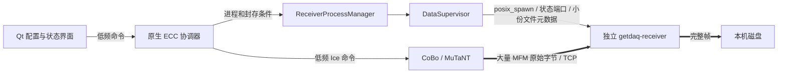

# 原生接收进程管理：操作、原理和开发接口

## 1. 这个模块解决什么问题

以前需要操作人员先启动 receiver，再凭端口或终端输出判断是否能采集。结束时还要分别判断发送器是否真正断开、接收进程是否退出、文件是否已经同步到磁盘。任何一步没有确认，都不能把整次采集记成完成。

现在增加两个相互分离的原生 C++11 模块。

| 模块 | 位置 | 职责 | 依赖 |
| --- | --- | --- | --- |
| `DataSupervisor` | `apps/datasupervisor` | 启动本机独立 receiver；保存进程身份；检查就绪；等待自然退出；核对 EOF、文件和封存凭据 | POSIX、标准 C++、已有纯参数/JSON/SHA 核心；无 Qt/Ice/yaml |
| `ReceiverProcessManager` | `apps/ecc/native` | 将上述核心接到 `NativeEccCoordinator` 的必需数据生命周期接口；检查发送目标及两种配置摘要 | 复用已有 ECC/硬件兼容库；不接收原始帧 |

**这里介绍本地主机进程实现，以及它如何被原生 ECC 协调器组合调用。** `NativeEccCoordinator` 在 native ECC 模式中把该生命周期接到认证 ECC 网络入口和 `RemoteReceiverManager`；GetDAQ 窗口通过 ECC 客户端调用组合命令，数据主机服务再启动并管理自己的 receiver。Qt 不直接产生或转发数据帧。旧 SOAP 控制模式仍保留，不能据此认为它也使用了新 receiver 生命周期。独立 `getdaq-supervisor` 和无 Qt 客户端见[远程管理](REMOTE_RECEIVER_CONTROL.md)，多节点适配见[远程生命周期](REMOTE_ECC_DATA_LIFECYCLE.md)。生产流程的本机验证不等于现场板卡、物理双机或持续吞吐验收。

这里的“本机”指管理核心与 receiver 在同一个接收主机。控制主机和数据主机分开时，数据主机运行这个核心与低频控制服务，控制主机使用已加入的`RemoteReceiverManager`。不能把远端地址假装成本机地址，也不能让 Qt/ECC 转发原始帧。

## 2. 数据和控制为什么必须分开



管理器没有接收或返回原始帧的接口。它不打开数据端口进行探测，不遍历原始帧内容，也不在每帧之后写控制日志。原始接收进程仍使用原生 socket、固定块池、队列和独立写盘线程。

控制日志会执行 `fsync`，因为发出有副作用的进程动作前必须留下持久意图。这些同步属于低频控制步骤，不加入每帧热路径。文件封存时的原始文件同步则属于数据可靠性要求，与 GUI 是否使用 Qt 无关。

这套划分避免了 Qt 重绘、信号槽、配置解析或控制 RPC 进入原始数据接收路径；它仍不能代替现场网络、磁盘和大于页缓存规模的持续吞吐测试。

## 3. 构建与检查

所有命令在 GetDAQ 项目根目录执行。接收进程管理依赖 POSIX；Windows Qt/MinGW GUI 独立构建，不链接这些进程接口。

```bash
# 先构建真实 receiver，再构建独立管理核心。
bash tools/build-linux.sh data

# 只构建管理核心；不下载第三方依赖、不要求 Qt。
bash tools/build-linux.sh supervisor

# 构建可选 Ice 兼容硬件层、原生 ECC 及真实进程适配器。
bash tools/build-linux.sh ice
```

独立管理核心也可以直接构建。

```bash
cmake -S apps/datasupervisor -B build-data-supervisor -DCMAKE_BUILD_TYPE=Release
cmake --build build-data-supervisor -j 3
cd build-data-supervisor
ctest --output-on-failure -R '^data-supervisor-process-lifecycle$'
```

测试脚本使用 Python 标准库，只是开发验证工具，不是生产库运行依赖。没有 Python 或指定 receiver 尚未构建时，CMake 不登记跨进程测试；不能把“未登记”当成“测试通过”。可显式设置 `-DGETDAQ_RECEIVER_EXECUTABLE=/绝对规范路径/getdaq-receiver`。

原生 ECC 与真实 receiver 联调：

```bash
cd build-ice-compat
ctest -j 3 --output-on-failure -R '^native-ecc-receiver-'
```

这些测试使用回环地址、合成 MFM 和模拟板端。它们不连接实验现场、不证明真实固件互通，也不是吞吐基准。结果范围和实际运行记录见 [VALIDATION.md](VALIDATION.md)。

## 4. 一份接收计划包含哪些内容

`DataSupervisorOptions` 构造时复制，之后不能修改已绑定计划。接收参数变化需要新计划和明确核对，不能偷偷改变当前进程的目标。

| 字段 | 含义 | 约束及建议 |
| --- | --- | --- |
| `auditRoot` | 本次管理部署的持久目录 | 绝对规范路径；管理器独占创建或核对；不要用临时目录作正式部署 |
| `deploymentId` | 便于操作人员识别部署 | 1～128 字节有界 UTF-8，禁止控制字符 |
| `receiverExecutable` | 将启动的原生 receiver | 绝对规范路径；普通可执行文件；禁止最终符号链接、组/其他用户写权限；记录完整文件 SHA-256 |
| `configurationSha256` | 实际实验参数版本 | 从严格解码的完整实验工件取得，不能手填一个看似有效的摘要代替参数 |
| `artifactSha256` | 收到的完整工件字节摘要 | 与参数摘要不同；两者同时绑定、同时核对 |
| `sources` | 每个 sender 对应的接收计划 | ID 唯一；全部活动 sender 必须匹配，不能漏掉 MuTaNT 读出源或多加无关源 |
| `startupTimeoutMs` | 启动等待上限 | 默认 30000；100～600000；超时保存已启动进程，不自动重试 |
| `finishTimeoutMs` | EOF/退出等待上限 | 默认 30000；100～600000；不因超时自动发 TERM/KILL |
| `statusTimeoutMs` | 单次小份状态请求超时 | 默认 1000；100～10000；不是每帧通信 |
| `maxTotalQueueMiB` | 队列总预算 | 默认 8192；包括原始块池及已启用导出的队列预算 |
| `maxTotalFrameMiB` | 帧组装预算之和 | 默认 8192；限制各源 `maxFrameMiB` 总量 |

预算是显式配置约束，不是精确的进程 RSS 上限；线程栈、运行库、容器管理和瞬时导出对象还有额外内存。正式设置前需要测量多源情况下的峰值。

每个 `ReceiverSourcePlan` 的字段如下。

| 字段 | 说明 |
| --- | --- |
| `id` | 与 ECC 私有 sender 集合中的 `senderId` 完全一致；ID 仅进入元数据，文件目录使用序号 |
| `receiverAddress` | sender 实际连接的明确 `IPv4:port`；本机接口必须具有该 IPv4 |
| `bindAddress` | receiver 的数据监听地址；可为目标 IPv4 或 `0.0.0.0`；通常建议具体地址 |
| `outputRoot` | 已存在、当前用户拥有、权限 0700 的数据根目录；不同源可放在不同磁盘 |
| `dataPort` | 原始 MFM 数据端口；只给 sender 使用 |
| `statusPort` | 小份身份/状态端口；管理器固定通过 127.0.0.1 访问 |
| `exportPort` | 可选在线导出端口；0 表示关闭；导出仍在 receiver 内完成 |
| `queueMiB` | 固定原始块池，默认 64；1～4096 |
| `maxFrameMiB` | 单帧上限，默认 32；1～1024；按真实固件帧样本设置 |
| `rotateMiB` | 单个文件名义分卷大小，默认 1024；1～1048576；不切断一帧 |
| `exportQueueMiB` | 在线导出队列预算，默认 16；1～1024；不是原始数据可靠存储队列 |

数据、状态和已启用导出的所有端口必须互不重复。配置支持 1～195 个源，但实际容量仍取决于主机、网卡、磁盘和明确总预算。绑定地址核对不证明远端 sender 正确配置；ECC 适配器还会逐项核对发送目标。

`/a/b/../c`、`/a//c` 等路径会被拒绝。库不会替操作人员悄悄规范化一个可能指向别处的正式部署路径。CMake 测试入口会规范化它自己的二进制路径。

## 5. 接到原生 ECC 的方式

下面展示组合关系。实际应用须先获得完整 `NativeEccOptions`：收到的工件字节、所有硬件端点/描述、编码/超时和私有 sender 集合。具体端点绑定见 [原生 ECC 手册](NATIVE_ECC_COORDINATOR.md) 和 [整系统工件手册](SYSTEM_EXPERIMENT_CONFIGURATION.md)。

```cpp
#include "nativeecccoordinator.h"
#include "receiverprocessmanager.h"
#include "systemexperimentconfiguration.h"

// eccOptions 已由应用准备；必须保留收到的原始工件字节。
const auto artifact = GetDAQ::DecodeSystemExperimentArtifact(
    eccOptions.experimentArtifactBytes);
GetDAQ::DataSupervisorOptions receiving;
receiving.auditRoot = "/var/lib/getdaq/receiver-control";
receiving.deploymentId = "experiment-A";
receiving.receiverExecutable = "/opt/getdaq/bin/getdaq-receiver";
receiving.configurationSha256 = artifact.configurationSha256;
receiving.artifactSha256 = artifact.artifactSha256;
// receiving.sources 须逐项对应 eccOptions.senders，并设置数据目录及状态端口。

GetDAQ::ReceiverProcessManager data(receiving);
GetDAQ::NativeEccCoordinator ecc(eccOptions, data);
// data 的寿命必须长于 ecc。操作ID每次唯一，已有ID不能复用。
ecc.Execute(GetDAQ::EccCommand::Describe, "describe-001");
ecc.Execute(GetDAQ::EccCommand::Prepare, "prepare-001");
ecc.Execute(GetDAQ::EccCommand::Configure, "configure-001");
```

以上是开发集成示意，不是一个现成的生产启动命令；示例路径和源列表必须替换为现场已核对的值。GetDAQ操作台可配置选择native_ecc或保留的旧SOAP/模拟模式；只有native_ecc模式会由NativeEccCoordinator驱动该receiver生命周期。操作步骤见[操作台手册](ECC_GUI_CLIENT.md)。

`EccDataLifecycle` 现在要求 `BindingSha256()`，并在 `Validate` 中接收父 ECC 的参数摘要和工件摘要。这不是可选提示：实际计划不匹配就必须抛出异常，接口没有默认成功实现。

管理计划包含控制根目录、部署 ID、可执行文件及其 SHA、所有源/路径/端口/预算和两个实验摘要。计划 SHA 加入父 `snapshot.json` 的 `data_lifecycle_binding_sha256`。不同的实际接收计划因此会改变父 ECC 请求作用域。旧阶段的快照没有这个字段时，不会静默升级旧目录；需保留证据并做明确迁移/恢复。

## 6. 正常操作顺序及为何 Stop 不封存

| ECC 操作 | 接收进程的实际行为 |
| --- | --- |
| Describe / Prepare | 必须确认本管理对象没有未完成接收周期；不启动 receiver |
| Configure | 硬件 Configure 后启动全部 receiver；核对全部身份/状态/目录锁；之后才连接全部 sender；再次检查就绪，才能提交 Ready |
| Start | 核对 receiver 仍属于本周期；开始硬件生产与读出 |
| Pause | 先停止全部生产，再停止/刷新发送器；同一个原始 socket 与 receiver 保留 |
| Resume | 使用原连接和原 receiver 周期；不重新启动或换目录 |
| Stop | 停生产并刷新；继续保留原始连接，接收周期仍为 Ready |
| Stop 后 Start | 同一接收周期继续接收；硬件重新 RunInit，receiver 不重启 |
| Breakup | 原生硬件流程显式断开自有 sender；管理器等待自然 EOF、排空、退出、解锁及 seal；全部满足才提交 Prepared |
| 再次 Configure | 创建新的随机会话和各源新目录；旧进程已回收、旧周期已经封存 |
| Reset | 数据周期必须已确认停止；按父 ECC 阶段执行撤销准备/忘记本地描述 |

旧普通 TCP sender 的 `daqStop` 会刷新数据但保留连接。**Stop ACK 不是 EOF。** 接收器必须实际读到 `recv()==0`，才能记录 sender EOF。只有 `disconnect` 才关闭这个连接；发送器停止本身也不能代替磁盘 `fsync`。

如果运行中的 receiver 故障，Pause/Stop/Breakup 不能先因“接收端不健康”而阻止所有生产停止。父协调器仍先尝试停止生产；之后接收条件不满足时保持 UNKNOWN。这种负向流程不是自动恢复，也不会制造 Ready 成功结果。

## 7. 启动和就绪检查的具体原理

启动会生成 32 字节系统随机数，编码为 64 位十六进制会话标识。它用于区分接收周期，不是远程认证凭据。每个源都在其数据根目录下创建独占的新目录：

```text
outputRoot/
  getdaq-<session-id>-source-0/
    .getdaq-managed-session.json
    .getdaq-receiver.lock
    .getdaq-native-receiver
    *.graw
    .getdaq-receiver-seal.json       # 正常完成后才出现
```

管理器先持久记录 spawn 意图，再调用明确路径的 `posix_spawn`。没有 shell、没有 PATH 搜索、没有失败后换参数重试。子进程的标准输入接 `/dev/null`，标准输出/错误写各自日志；管理器读取最终状态时有大小限制。控制核心不把 raw socket 接到这些日志。

目前 receiver 只输出初始监听行、最终状态和错误；管理器读取最终 stdout 最大 64 KiB。目录 seal 最大 16 MiB，HTTP 状态回复最大 64 KiB。管理器不提供日志自动轮换或无限进程输出采集服务。

就绪需要同时满足：

1. PID 仍是本对象启动且未被回收的子进程，尚未退出。
2. 状态端口返回严格 JSON，协议版本为 1，service 为 `getdaq-receiver`。
3. PID、会话、sender ID、两个实验摘要、输出目录全部与计划一致。
4. `--once`、durable、监听地址、数据和状态端口与实际启动参数一致。
5. receiver 持有同一个输出目录锁；管理器自身不能取得它。
6. 没有错误、没有已经完成的 sender EOF、连接数不超过 1。

管理器**不会连接数据端口来“试一下”**。一次性接收器若被这种探测先连接再关闭，会将探测当作本次 EOF；真正 sender 随后就无法完成这次采集。测试直接检查了 Configure 后、sender 接入前 `connections==0`。

## 8. 结束时检查哪些证据

`Finish` 不发 TERM/KILL，不关闭 sender socket，只等待本对象的子进程自然退出。对子进程先用 `waitid(...WNOWAIT)` 确认退出，再对准确 PID 执行一次 `waitpid`。子进程所有权丢失时拒绝动作，不能向一个可能重用的 PID 发送信号。宿主应用不得另设通用 SIGCHLD 回收器去抢走这些子进程。

每一路都必须具有以下证据。

| 证据 | 检查 |
| --- | --- |
| 正常退出 | 实际 exit code 为 0；信号退出或错误返回都不能提交完整周期 |
| 同一周期身份 | 最终 stdout 和 seal 的 PID/会话/源/两个摘要/输出目录都匹配 |
| 实际 sender EOF | `sender_eof_confirmed==true` 且 `connections==1`；从未连接后被 TERM 退出不满足 |
| 排空 | `connected==false`、`queued_blocks==0`、无错误、`stream_sealed==true` |
| 文件同步 | durable 为 true；received、accepted、sealed 和 seal 文件大小之和一致 |
| 完整清单 | seal 文件名唯一、普通文件、大小一致；目录中没有未列出的 `.graw` 或替代符号链接 |
| 独占锁释放 | 原来的锁文件 inode 未变；进程退出后管理器能获得目录锁进行核对 |

seal 的字节数使用十进制字符串保存，避免 JSON 浮点实现丢失超过 2^53 的整数精度。管理器严格解析 64 位无符号整数，拒绝溢出、非整数或非规范前导零。

这里核对原始文件的名称、类型和长度，**不会重新读取 TB 级文件计算校验和**。这证明本接收进程的完整帧写入与同步计数、周期身份和文件集合一致，不证明磁盘介质没有潜在位翻转，也不证明板端没有丢事件。合成测试另逐字节比较小份已知原始数据；正式可靠性还需要硬件事件计数与存储验收。

空数据流也可以合法结束，但必须确实建立过一次 sender 连接并收到 EOF。未接入 sender 的空接收进程即使退出 0、生成零字节本地 seal，也不能被管理器解释为一次完成采集。

某一路失败时，仍检查其他已经退出的独立源，保留其真实 seal 结果；整组不提交 Stopped/Prepared。某一路一直不 EOF 时，总等待期限到达后不自动杀死它。

## 9. 管理日志、目录权限和故障保持

```text
auditRoot/
  .supervisor.lock              # 同一个管理部署的本机独占锁
  plan.json                     # 不可变接收计划
  supervisor.jsonl              # 逐条同步的部署日志

ECC-operation/receivers-start/
  data-supervisor.jsonl
  source-0.stdout / source-0.stderr
  source-1.stdout / source-1.stderr

ECC-operation/receivers-finish/
  data-supervisor.jsonl
```

目录要求当前用户拥有且权限 0700；新控制文件使用 0600。准备数据根目录时，用运行 receiver 的同一个用户创建，不要靠给所有用户写权限解决问题。

部署根、数据根、计划、日志和部署锁都绑定 inode/设备及权限。计划与日志核对完整小份字节，可执行文件核对完整 SHA。文件被替换、同长度修改或目录被重建后，故障门槛保持；把内容改回不会清除核对要求。每个新进程动作必须在审计检查/持久意图成功后进行。

`Status()` 只返回最近的短快照，不等待状态 HTTP、硬件 RPC 或子进程。它记录管理阶段，不能代替实时健康探测。调用 `VerifyReady()` 才会实际检查 owned PID、状态回复和锁；生产网络入口未来应分别显示阶段快照、最近观察时间及观察错误。

部署日志最多 64 MiB；单操作日志最多 1 MiB。达到预算时拒绝下一动作，不能无日志继续。受控历史归档与长期部署轮换仍待接，不应手工截断日志。

## 10. 部分启动失败和显式取消

启动第二路失败时，第一路可能仍活着。管理器保存已创建目录、PID 和两路 stdout/stderr，保持 Failed；不会自动再启动第二次，也不会顺手杀掉第一路。

只对**同一个对象、失败的启动阶段、此前没有取消尝试**提供显式 `AbortStartup(newAuditDirectory)`。它先检查全部还活着的 receiver 从未接入任何连接且 received 为 0，再逐个复查、记录意图、给准确的自有子进程发送一次 SIGTERM。

该入口不能取消已接入数据的 receiver，不能处理 Finish 超时，不能作用于重开对象，不能作为普通 Stop 或 Breakup。取消后即使全部子进程退出，也只记录 Aborted 和“需要核对”，不记录 acquisition seal 成功，不解除父 ECC UNKNOWN。

如果取消期间有 sender 接入竞态、信号失败、日志失败或退出超时，保留未确认结果，不重发信号、不补发 SIGKILL。第二次取消尝试会被拒绝。开发测试中的最后兜底回收仅用于测试自己的子进程，不是生产管理策略。

实际使用中的故障排查顺序：

1. 停止新的正向请求，保存父 ECC、管理器、sender 和 receiver 日志。
2. 查父 ECC 最近操作是 Configure、Start、Stop 还是 Breakup，区分控制未知与数据错误。
3. 查 `source-N.stderr`，定位 bind 失败、磁盘写入、截断尾帧或被中断接收。
4. 比较对应 `source-N.stdout`、新目录和 seal 的 PID/会话/源/摘要；不要只看端口开放。
5. 若生产可能继续，使用已经实现的父 ECC 显式停生产入口；其适用条件见 [协调器手册](NATIVE_ECC_COORDINATOR.md)。这不自动断开未知 sender。
6. 对纯空启动失败才考虑上述显式取消；其他情况保存未完成数据，做真实现场核对。

## 11. 重开、退出及当前限制

重新打开既有管理根目录，即使上一条是完整 Stopped，也进入 `needsReconciliation`。管理器不根据历史 PID 自动接管进程，不向历史 PID 发信号，不自动创建新接收周期。当前尚无完整进程/发送器/数据联合恢复实现。

析构函数不隐式 Stop、Disconnect、TERM 或删除目录。它只回收仍属于自己且已经终止的子进程；仍活着的 receiver 保留。宿主服务意外退出后不能把新建对象或新目录当作恢复手段，应保留历史根目录与实际进程进行核对。

本机部署锁只约束同一个控制根目录，不是所有接收主机的分布式锁，也不是硬件控制权。状态 HTTP 和随机会话标识不构成远程认证。独立远程服务已有认证与固定协议，原生ECC已接多节点适配，详见[远程管理](REMOTE_RECEIVER_CONTROL.md)及[远程生命周期](REMOTE_ECC_DATA_LIFECYCLE.md)；真实硬件控制租约、启动恢复、告警调度、准备故障停止、生产网络/GUI 和完整下游 Run 归档仍待组合。

原始数据当前仍是已明确的 plain TCP MFM；FDT/ICE/ZBUF 及现场固件样本不能用本模块覆盖。Ubuntu24、macOS 及 Windows Qt5.14.2 MinGW 的实际验收、持续高吞吐和断电/磁盘满测试也尚未完成。当前本机环境是 Ubuntu20.04.6/GCC9.4。

## 12. 代码阅读顺序

1. [管理核心公开接口](../apps/datasupervisor/datasupervisor.h)：理解状态和可调用动作。
2. [计划与持久 I/O](../apps/datasupervisor/supervisorio.cpp)：路径、严格 JSON、SHA 作用域、预算和状态 HTTP。
3. [进程核心](../apps/datasupervisor/datasupervisor.cpp)：spawn、身份/目录锁、EOF/退出/seal 和显式空启动取消。
4. [ECC 适配器](../apps/ecc/native/receiverprocessmanager.cpp)：两种摘要、活动 sender 集合及准确目标地址。
5. [父 ECC 协调器](../apps/ecc/native/nativeecccoordinator.cpp)：持久意图、硬件与数据门槛的提交顺序。
6. [receiver](../apps/datareceiver/receiver.cpp)：原始热路径以及低频身份/EOF/seal 元数据。
7. [独立进程联调](../tests/data_supervisor_test.cpp) 与 [ECC 真实接收联调](../tests/native_ecc_receiver_test.cpp)：正常/故障边界，明确区分测试回收与生产行为。
