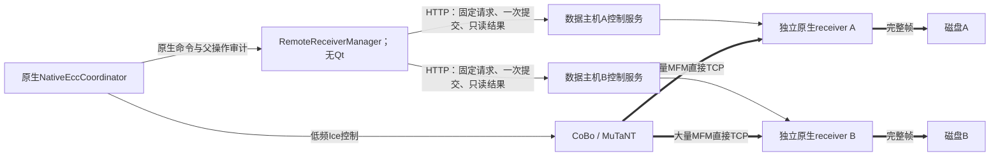

# 原生 ECC 与多数据主机：接法、操作和故障语义

## 1. 这一步与独立控制服务有什么区别

[远程接收控制服务](REMOTE_RECEIVER_CONTROL.md)负责一台数据主机：接受固定计划的操作、启动自己的receiver、保存操作ID并核对封存。现在增加`RemoteReceiverManager`，把一个或多个这样的服务接到原生`NativeEccCoordinator`的必需数据生命周期接口。

这样，硬件配置、发送器连接与接收就绪之间的顺序由同一ECC协调器控制。它会先确认所有接收节点满足条件，再允许板端连接和生产数据；正常结束时，先确认硬件停止和发送器断开，再等待各数据主机的自然EOF与封存。

本手册介绍原生库适配器；整系统固定HTTP入口另由[getdaq-ecc-server](ECC_NETWORK_SERVICE.md)提供。Qt操作台已实现`native_ecc`模式并可连接该HTTP入口，旧SOAP/模拟模式仍保留，具体配置见[GUI操作手册](ECC_GUI_CLIENT.md)。原生模式的联调使用实际服务/receiver进程和本机回环网络，板端由收到的完整描述及Ice测试夹具模拟；这不证明真实板卡、两台物理主机或持续吞吐已经验收。最新平台和功能证据以[验证记录](VALIDATION.md)为准。



控制适配器不传输原始帧，不打开receiver的数据端口进行探测，也不读取TB规模的文件内容。服务的Qt入口仍只承担低频控制。父ECC及远程适配器无Qt/curl依赖；硬件控制复用已有本地Ice/GET兼容库，原始receiver保持无Qt/Ice/yaml依赖。

## 2. 构建和运行前需要准备哪些东西

先构建并配置独立receiver与数据主机控制服务，具体步骤见[服务部署手册](REMOTE_RECEIVER_CONTROL.md)。每个节点要有已经核对的服务配置、接收程序摘要、实验参数摘要、完整工件摘要和固定计划摘要。

构建原生ECC与适配器：

```bash
bash tools/build-linux.sh ice
```

`getdaq-ecc-native`仍为原生库，新增源文件位于`apps/ecc/native/remotereceivermanager.h/.cpp`。这个库没有自动启动各主机服务的功能；服务须在对应数据主机运行。构建不会从网络临时下载Ice或GET依赖。

Ubuntu24、Windows Qt5.14.2/MinGW GUI和macOS是用户目标；实际本机开发验证为Ubuntu20.04.6/GCC9.4/Qt5.12.8。新的进程/网络夹具使用Linux的`/proc`核对测试进程，CMake只在Linux且存在服务目标时登记它们；不把这个夹具当成跨平台验收。

控制主机需要保存每个服务的认证文件副本，权限0600，属于实际运行ECC的用户。认证值不写入`RemoteReceiverOptions`、操作文件或日志。客户端从受保护的本地文件读取它；数据主机和控制主机的文件路径可以不同。

## 3. 多主机配置字段

原生库调用者构造`RemoteReceiverOptions`；固定HTTP服务通过其配置中的`remote_receivers`读取对应选项，启动方法见[ECC网络服务](ECC_NETWORK_SERVICE.md)。这两种入口复用同一个原生适配器。

| 字段 | 作用和约束 |
| --- | --- |
| `controllerId` | 与所有数据主机允许的固定控制器ID相同；公开标识，不是密码 |
| `endpoints` | 1～195个数据主机服务；ID和控制地址/端口组合不能重复 |
| `endpoints[i].agentId` | 预期数据节点ID，必须与服务身份相同 |
| `endpoints[i].planSha256` | 预先核对的规范接收计划摘要；不会直接信任第一次网络返回的摘要 |
| `endpoints[i].control.address` | 规范IPv4控制地址，不能是`0.0.0.0`；不是原始数据目标 |
| `endpoints[i].control.port` | 控制服务端口，1～65535 |
| `endpoints[i].control.credentialFile` | 控制主机的0600认证文件路径 |
| `endpoints[i].control.timeoutMs` | 单次HTTP整体截止时间，100～60000ms，不能大于整体命令预算 |
| `commandTimeoutMs` | 一次远程协调的整体预算，100～600000ms；默认600000ms |
| `pollIntervalMs` | 已提交操作的GET查询间隔，10～1000ms；默认100ms，不重新POST |

数据主机的接收进程启动/结束截止时间仍由各自固定计划决定。控制器整体预算应覆盖节点启动/退出和跨节点控制开销。RPC之间和回复后检查整体截止时间；若某个请求超过预算而结果仍不确定，不能推断它未发生或自动重发。

同一控制器可以连接两台实际数据主机，也可以在本机联调时连接两个独立服务。控制地址和数据地址分别绑定：例如ECC通过管理网`10.0.0.21:23100`访问服务，而板端sender通过DAQ网`192.168.10.21:23001`向receiver发送MFM。原始数据不会绕行管理网或控制主机。

HTTP没有内建TLS。使用受控实验网络或已有SSH/TLS通道，具体约束沿用[服务认证说明](REMOTE_RECEIVER_CONTROL.md)。这个适配器没有引入新的加密/HTTP运行库。

## 4. 原生库接法

下面是调用方已经构造好`NativeEccOptions`之后的完整单轮函数。硬件描述、实验工件、拓扑、停止声明和发送器选项的构造方式见[原生ECC手册](NATIVE_ECC_COORDINATOR.md)。示例不替代这些前提检查。

```cpp
#include "remotereceivermanager.h"

void RunOneCycle(const GetDAQ::NativeEccOptions &options,
                 const GetDAQ::RemoteReceiverOptions &remoteOptions)
{
    // 对象顺序重要：data必须比ecc活得更久。
    GetDAQ::RemoteReceiverManager data(remoteOptions);
    GetDAQ::NativeEccCoordinator ecc(options, data);

    ecc.Execute(GetDAQ::EccCommand::Describe,  "describe-001");
    ecc.Execute(GetDAQ::EccCommand::Prepare,   "prepare-001");
    ecc.Execute(GetDAQ::EccCommand::Configure, "configure-001");
    ecc.Execute(GetDAQ::EccCommand::Start,     "start-001");

    // 调用方按实验需要等待；这里不放任意固定采集时长。
    ecc.Execute(GetDAQ::EccCommand::Stop,      "stop-001");
    ecc.Execute(GetDAQ::EccCommand::Breakup,   "breakup-001");
    ecc.Execute(GetDAQ::EccCommand::Reset,     "unprepare-001");
    ecc.Execute(GetDAQ::EccCommand::Reset,     "forget-001");
}
```

每个操作ID都须在这个父审计根中唯一。例子为了说明顺序立即Stop，实际应用应根据操作人员选择结束；不要把示例当成无人值守生产采集程序。异常必须交给上层保存并显示，不要捕获之后循环重发同一硬件命令或重新创建对象清除故障。

构造器只检查本地选项和认证文件。ECC创建并核对不可变快照、父目录及持久日志后，调用数据接口的`BindController(snapshotSha256,auditRoot)`。绑定操作不访问网络，也不启动或停止进程。远程身份读取与真实就绪/停止检查发生在ECC命令的预检查或执行中。

`EccDataLifecycle`现要求实现`BindingSha256`、`BindController`和缓存`NeedsReconciliation`，以及原有Validate/Verify/Start/Finish接口；没有默认成功实现。已有本机`ReceiverProcessManager`保留，新增父范围绑定；测试替身明确标识，不产生真实接收证明。

## 5. 为什么要有两种摘要和一个持有期

| 名称 | 怎样产生 | 有什么作用 |
| --- | --- | --- |
| 数据适配器`BindingSha256` | 控制器ID、按节点ID排序的端点/预期计划摘要以及截止/查询策略的规范编码 | 进入父ECC不可变快照，防止运行中换接收目标或计划；不包含认证值或短寿命实例/持有期 |
| `controller_snapshot_sha256` | `SHA256("getdaq.data-controller:1\n" + 父快照摘要 + "\n" + 父审计根路径)` | 绑定完整父部署和实际审计根；不能用新目录自动接管同一旧部署 |
| `controller_epoch` | 一个远程适配器对象生成一次的64位公开随机标识 | 表示本次持有期；重建对象会生成新值，不自动冒充旧对象 |

第一个进程动作会让服务持久绑定后两项。此后所有操作必须匹配。输入端点顺序改变不会改变数据适配器摘要，但服务节点、控制地址、计划或时间策略改变会改变它。

同一个适配器不能绑定不同父快照或审计根。父根目录、operations目录和snapshot文件的身份、权限、内容被绑定；每次网络动作前后核对。服务实例改变、既有持有期不匹配或受信任存储变化，均不能靠恢复文件、换父目录或重新构造对象自动解除。

这些约束是软件侧部署/持有期约束，仍不等于真实硬件全局锁，也不证明板端实际加载了该配置版本。新协调器仍明确记录`actual_loaded_configuration_verified=false`；真实发布/加载版本和完整恢复要另行接续。

## 6. 在硬件动作之前怎样核对所有节点

Validate先读取每个服务的身份及完整计划，检查预期节点、控制器、计划摘要和规范计划字节。数据地址按远端计划的可移植规则检查；客户端不会用控制主机网卡来否定数据主机IP。

再把全部服务的source集合与父ECC的活动sender集合逐一匹配：

1. 每个sender ID必须恰好对应一个接收源，目标IPv4/数据端口完全相同。
2. 两个节点不能宣称接收同一个source ID或同一个原始数据目标。
3. 所有节点的参数摘要及完整工件摘要必须与父ECC一致。
4. 不能遗漏父sender，也不能偷偷增加未属于当前系统的接收源。
5. 节点状态/控制门槛、实例和持有期必须满足当前操作前提。

全集合匹配后才提交只读Validate/Verify操作，核对数据主机实际管理器的存储、程序和进程条件。父配置参数或计划不匹配，在首次硬件执行前拒绝；原始数据目标不会由控制请求临时指定。

`Status()`和`NeedsReconciliation()`只复制短缓存，不等网络、hardware RPC或Finish截止时间。节点计数仍是生命周期缓存，接收期间可能为初值，不能作为实时速率/健康证明。

## 7. 正常采集与结束顺序

| 父ECC命令 | 远程数据配合 |
| --- | --- |
| Describe / Prepare | 全集计划和实际停止条件核对；不会启动receiver |
| Configure | 硬件配置后，为全部节点保存意图，逐节点Start并确认实际Ready；全部成功后才连接板端sender，再核对Ready |
| Start | 确认既有receiver/会话/PID就绪，再运行硬件与发送器 |
| Pause / Resume | 保留相同receiver、数据TCP连接和会话；Resume前检查就绪 |
| Stop | 停全部生产再刷新sender；普通TCP连接保持，receiver仍是同一周期 |
| Stop后再次Start | 保留接收周期，硬件重新RunInit；不启动第二组receiver |
| Breakup | 全部生产停止及sender明确断开后，逐节点Finish：自然EOF、排空、退出、解锁和seal；全部确认才提交Prepared |
| 下一次Configure | 每台数据主机生成新的会话/输出目录；不能复用旧周期身份 |

每台主机的`session_id`独立。适配器分别保留各节点Start确认的source、PID、会话和输出目录；Ready和Finish必须匹配这个已有周期。没有一个人为拼接的全系统session冒充各节点seal里的实际会话。

正常Finish结果需要Stopped、没有数据核对门槛、相同PID/会话/目录、实际reaped、exit0和sealVerified。具体EOF/文件/锁核对仍由对应数据主机的原生核心执行，控制主机不扫描原始事件或重新计算TB文件的摘要。

## 8. 父操作审计与一次POST

Start/Finish的目录必须是绑定父根中的`operations/父操作ID/动作目录`，由当前动作独占创建。父根还须为后续ID/动作留下路径长度预算；远程绑定目前要求根路径不超过3300字节。

```text
controller/
├── snapshot.json
├── experiment.json
├── ecc.jsonl
└── operations/
    └── configure-001/
        ├── operation.jsonl                 父硬件动作与状态绑定
        └── receivers-start/
            ├── intent.json                 全部节点的完整固定请求
            └── remote.jsonl                before_post / accepted_reply / node结果 / 整组结果
```

`intent.json`在第一个进程POST之前完整写入并同步。每个节点的请求ID由父范围、持有期、动作路径、命令和节点ID确定；请求键进一步覆盖实例、计划、配置和工件等全部字段。远端服务不会把父路径作为远端文件路径使用。

每个节点只POST一次。接受后只通过GET查询同一操作ID，不用新ID重新启动，也不在超时后重发。动作日志、意图文件和目录的身份/权限/内容被保留核对，整个对象生命周期内继续保护已经完成的操作证据；恢复损坏文件不解除故障。

## 9. 部分失败、失联和生产停止

| 情况 | 行为 |
| --- | --- |
| 节点A已Ready，节点B启动失败 | 保留A及B结果；停止后续Start，不自动kill A、不回滚、不重启；父ECC保持最后确认值和UNKNOWN |
| 第一个Start的HTTP应答丢失 | 已经可能启动receiver；保留父意图，不向同节点或后续节点再Start；只读核对已完成结果不能清父UNKNOWN |
| 节点A数据截断，节点B收到完整EOF | 独立核对B的Finish和seal，保留A失败；整体保持UNKNOWN，不能提交Prepared |
| 节点A的Finish应答丢失 | 不重发A；仍可对已经停止生产/明确EOF的其他独立节点提交一次Finish，保存各自结果；全部不能被拼成整组成功 |
| 父审计文件发生变化 | 保持故障，停止后续请求；不能在不可信意图基础上继续其他节点操作 |
| 已有接收周期的服务实例改变或无法观察 | 保留核对门槛，不自动接管/重建周期；先前PID/会话确认继续供诊断 |
| SDK/服务正常退出 | 不自动停生产、断开sender或kill receiver；生命周期仍须明确处理 |

在Running或Paused状态请求Stop/Breakup时，数据主机不可达不应挡住已保留硬件对象的生产停止。协调器绕过这一负向动作之前的数据/全局预检查，让原生采集对象先执行已绑定的生产停止阶段；后续就绪/结束核对失败再保存UNKNOWN。它仍不会盲目重发以前未知的硬件阶段或假装发送器已经EOF。

正向Start/Resume不能使用这个例外。数据侧核对门槛会反映到父`Status().needsReconciliation`，不通过慢网络查询伪造健康。普通`Execute`的持久状态仍由父ECC日志提交；实际执行后异常产生UNKNOWN，预检查失败不冒充已经执行了硬件动作。

完整Reconcile、旧进程接管、数据集迁移/Run归档、真实硬件控制权和实际加载版本尚未完成。不要删除旧根、换目录或把命令line结果手工标成完成来绕过这些门槛。

## 10. 开发验证与实际范围

构建后运行完整联调夹具：

```bash
python3 tests/run_native_ecc_remote_receiver_tests.py \
  build-ice-compat/native-ecc-remote-receiver-tests \
  build-receiver/getdaq-receiver \
  build-ice-compat/getdaq-supervisor \
  --output-parent build-ice-compat/remote-ecc-evidence
```

可以用`--scenarios data-only plan-mismatch audit-fault ownership`单独检查较短的数据/范围路径。`data-only`明确不执行父ECC状态转换，不能代替完整Configure/Start/Breakup联调。

完整场景包括两种Ice编码的正常两轮、截断、Start/Finish真实服务接受后丢客户端应答、第二节点端口占用导致部分启动，以及Running/Paused状态服务重启后的生产停止。服务和receiver是实际独立进程；MFM来自有记录的真实TCP测试sender。故障代理只在测试中工作，不进入产品依赖，也不保存认证头。

证据每次保存在新目录中，包含原始父/节点操作审计、配置与原始文件。凭据必须排除在交付归档之外。测试夹具在故障结束时只回收自己明确记录的PID、可执行文件和启动时刻；产品适配器没有自动kill策略。内存检查范围、最终结果及仍待验项目以[验证记录](VALIDATION.md)的实际记录为准。
