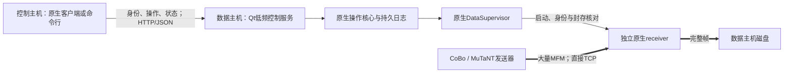

# 数据主机远程接收管理：操作、协议与实现原理

## 1. 目前可以做什么

`getdaq-supervisor` 在数据主机上管理独立的 `getdaq-receiver`。控制主机可以通过小份 HTTP/JSON 消息查询身份、状态和操作记录，也可以提交启动、结束或显式中止失败启动的操作。服务负责保存请求、启动自己的子进程并核对接收结果。

本模块已接真实 receiver 进行本机跨进程联调，并由 [RemoteReceiverManager](REMOTE_ECC_DATA_LIFECYCLE.md) 接到 `NativeEccCoordinator` 和原生 ECC 网络服务。GetDAQ 的 native ECC 模式通过低频 ECC HTTP 控制入口间接驱动远端接收服务；Qt 不直接管理远端子进程或处理原始载荷。旧 SOAP 模式仍保留，但不具备这套新 receiver 生命周期闭环。两种模式的行为不能混为一谈；独立服务、命令行或库联调也不能替代真实双机、板卡和持续吞吐验收。

| 组件 | 程序或文件 | 使用 Qt | 作用 |
| --- | --- | --- | --- |
| 配置与运行界面 | `apps/envoy` | 是 | native ECC 模式通过 ECC 服务间接驱动生命周期；Qt 只传递低频控制/状态，不承载原始载荷 |
| 数据主机的控制入口 | `getdaq-supervisor`、`apps/datasupervisor/service` | Qt Core/Network/Concurrent | 接受低频请求、认证、返回操作 ID 和状态 |
| 进程与持久操作核心 | `DataSupervisor`、`SupervisorControl` | 否 | 启动 receiver、核对身份和封存、保存操作日志 |
| 控制主机原生客户端 | `SupervisorHttpClient`、`getdaq-supervisor-query` | 否 | 有界 socket 请求、身份检查、一次提交、只读查询 |
| 原始数据接收程序 | `getdaq-receiver` | 否 | 大量 MFM 接收、队列、写盘和独立封存 |

`getdaq-supervisor-query`的协议/计划验证位于纯C++11共享target。Linux/macOS控制端使用POSIX socket实现；Windows操作端使用独立WinSock实现和Win32受保护ACL凭据读取，构建在用户Qt5.14.2/MinGW7.3下，但helper自身不链接Qt。Windows端helper只处理身份、生命周期和单次控制请求元数据；高流量DAQ仍由Linux接收服务处理。Windows完整认证HTTP回环用例由`tests/windows_supervisor_query_integration.py`执行；若Windows CI未运行，该项只能记作构建/包smoke，不是网络验收。



Qt 不读取或转发 MFM，服务接口也没有原始帧字段。控制请求不能指定任意程序、shell、输出目录或监听端口。实际接收计划由数据主机在启动时从本地固定配置读取。

## 2. 构建：数据程序与控制服务分开

以下命令从项目根目录执行。数据接收与进程控制目前要求 POSIX。Windows Qt 5.14.2/MinGW 的 GUI 独立构建；这里没有 Windows 进程管理实现。Linux 本机验证环境为 Ubuntu 20.04.6/GCC 9.4/Qt 5.12.8，Ubuntu 24 和 macOS 尚待实际验收。

只构建数据程序及原生管理核心、客户端：

```bash
bash tools/build-linux.sh data
```

这个命令显式关闭 Qt 控制服务，不查找 Qt。它生成 `build-receiver/getdaq-receiver`、原生管理静态库以及 `build-data-supervisor/getdaq-supervisor-query`。已有编译器、CMake、标准库/POSIX 即可；不使用 Ice、yaml-cpp 或 curl。

构建数据主机控制服务：

```bash
bash tools/build-linux.sh supervisor
```

该命令启用可选 Qt Core/Network/Concurrent 服务。已有 Qt 开发环境时生成 `build-data-supervisor/getdaq-supervisor`；没有 Qt 时仍能生成原生部分，并在 CMake 输出中说明没有服务目标。服务没有窗口，不需要 Qt Widgets。

也可以明确使用独立构建目录，避免复用 `data` 命令的服务开关：

```bash
cmake -S apps/datasupervisor -B build-supervisor-service \
  -DCMAKE_BUILD_TYPE=Release -DGETDAQ_BUILD_SUPERVISOR_SERVICE=ON
cmake --build build-supervisor-service --target getdaq-supervisor getdaq-supervisor-query -j4
```

Qt 缺失时，明确构建 `getdaq-supervisor` 目标会失败；安装匹配的 Qt 开发环境后重新配置。服务不增加原始 receiver 的链接依赖。

## 3. 数据主机部署前准备

可以从 [完整示例配置](../config/receiver/supervisor-service.example.json) 开始修改。示例 IP、目录和三个全零摘要是占位值，必须换成实际值。不要直接把它当成生产配置运行。

建议将接收程序、固定配置、认证文件、控制状态与原始数据分别放置。下面是目录含义，而不是自动执行的安装脚本：

```text
/opt/getdaq/bin/getdaq-receiver        接收程序，不能有组/其他用户写权限
/srv/getdaq/config/node-A.json         服务固定配置
/srv/getdaq/credentials/node-A.token   当前运行用户的0600普通文件
/srv/getdaq/state/                    控制状态父目录
/srv/getdaq/state/node-A/              服务第一次启动独占创建的审计根
/srv/getdaq/data/                      已存在、当前运行用户的0700输出根
```

先创建凭据目录、状态父目录和数据输出根，让它们属于实际运行服务的用户。**不要预先创建 `audit_root` 自身。** 已存在的审计根会被视为重新打开旧部署，需要核对；服务不会把一个旧目录自动当成全新且安全的部署。

`output_root` 必须已经存在并满足 0700 目录检查。所有路径必须为绝对规范路径，不能包含 `..`、`.`、重复斜线或末尾斜线。文件系统要支持普通文件、目录同步和 POSIX 锁。

生成认证文件：

```bash
build-data-supervisor/getdaq-supervisor \
  --generate-token /srv/getdaq/credentials/node-A.token
```

命令独占创建 0600 文件；不会覆盖已有文件，也不会显示认证值。父目录必须已经存在。认证文件放在审计根之外，避免为了创建认证文件而提前创建审计根。控制主机需要通过受控方式保存同一个认证值的本地 0600 文件；两个主机的文件路径可以不同。

配置中的 `executable_sha256` 是实际接收程序文件摘要，可在数据主机计算：

```bash
sha256sum /opt/getdaq/bin/getdaq-receiver
```

`configuration_sha256` 是完整实验参数的规范摘要；`artifact_sha256` 是实际完整实验工件字节摘要。二者由已有工件流程提供，含义见 [实验配置手册](SYSTEM_EXPERIMENT_CONFIGURATION.md)。二者不能互换，也不能由接收服务自行编造为“实际硬件已加载”。

## 4. 配置字段逐项解释

服务配置顶层必须恰好包含以下字段。未知字段、缺字段或重复 JSON 键都会被拒绝。

| 字段 | 作用 |
| --- | --- |
| `schema`、`kind` | 固定为 `1`、`getdaq.supervisor-service` |
| `agent_id` | 数据主机服务的固定标识，客户端应核对 |
| `controller_id` | 此部署允许的控制器标识；它是公开身份字段，不能代替认证凭据 |
| `bind` | 服务控制接口的规范 IPv4；示例为 `127.0.0.1` |
| `port` | 1～65535；不能与任何 receiver 数据、状态或导出端口冲突 |
| `credential_file` | 本机认证文件路径；当前用户所有、普通文件、权限 0600 |
| `receiver_plan` | 完整且固定的原生接收计划对象 |

接收计划保持 [本机管理手册](RECEIVER_PROCESS_MANAGEMENT.md) 的全部字段和约束。补充几个容易混淆的地方：

| 字段 | 解释 |
| --- | --- |
| `receiver_address` | 板端 sender 实际连接的数据主机 IPv4 和数据端口；不是控制服务端口 |
| 可选`input_protocol` | 默认TCP，数据主机接受TCP/ZBUF/FDT字符串；非默认进入规范计划/摘要及实际模式核对。须匹配ECC sender.protocol；受管理FDT启停/重连及明确未使用来源见[管理手册](MANAGED_FDT.md) |
| 接收源的 `bind` | receiver 数据监听地址；可为实际目标 IP 或 `0.0.0.0` |
| `data_port` | 原始数据直接进入 receiver 的端口；管理器不连接它进行探测 |
| `status_port` | receiver 的小份状态接口；管理器通过它检查身份和就绪 |
| `export_port` | 可选原始数据导出端口；0 表示关闭；不能复用控制接口 |
| `queue_mib` | 接收数据块池预算；不是板端循环缓冲区大小 |
| `max_frame_mib` | 单源帧大小上限及帧缓冲预算 |
| `rotate_mib` | 原始数据文件轮转大小；不决定控制日志大小 |
| `min_free_mib` | 可选；接收器输出卷最低可用空间保护线，0/省略关闭。非零值进入计划摘要；Start先预检空间，运行中接收器复查，触发后Run失败且不封存 |
| `max_total_queue_mib` | 全部源的接收池及已启用导出队列的总预算 |
| `max_total_frame_mib` | 全部源的帧缓冲总预算 |
| `startup_timeout_ms` | 等待实际子进程就绪的总截止时间；100～600000ms |
| `finish_timeout_ms` | 等待自然 EOF、退出和封存的总截止时间；100～600000ms |
| `status_timeout_ms` | 单次 receiver 状态读取截止时间；100～10000ms |

数据主机验证目标 IP 确实属于自己的网卡。控制主机解析远端计划时只检查可移植语义，不拿控制主机的网卡否定远端地址。源 ID 和所有非零端口必须互不冲突。

## 5. 检查、启动和只读查询

先进行本地检查：

```bash
build-data-supervisor/getdaq-supervisor \
  --config /srv/getdaq/config/node-A.json --check-config
```

检查接收程序摘要、计划、IP/端口和认证文件；不会创建控制根或启动 receiver。成功时输出公开的 `plan_sha256`。这个摘要来自规范计划字节，包括程序摘要、配置摘要、目录、端口、源和资源预算；不是配置 JSON 原文的 `sha256sum`。

记录这个摘要，再启动服务：

```bash
build-data-supervisor/getdaq-supervisor \
  --config /srv/getdaq/config/node-A.json
```

服务启动只建立控制状态和监听接口。只有收到明确的 `start` 操作才启动 receiver。每次服务启动都会产生新的公开 `instance_id`；这与每轮接收使用的 `session_id` 是两个不同概念。

控制主机使用原生 CLI 查询，下面的 `PLAN_SHA256` 必须替换为从已核对配置得到的真实摘要：

```bash
build-data-supervisor/getdaq-supervisor-query identity \
  --host 127.0.0.1 --port 23100 \
  --credential-file /srv/getdaq/credentials/node-A.token \
  --expected-agent data-node-A --controller experiment-controller \
  --expected-plan PLAN_SHA256
```

将 `identity` 换成 `status` 即查询当前缓存状态。每次 CLI 先读取并核对身份、实例和完整计划的规范摘要，再查询目标。错误节点、错误计划或错误控制器会被拒绝。

将模式换成`receivers`可查询自有子进程实际运行/退出状态，对应经认证的`GET /v1/receivers`。它不回收进程或改变生命周期，操作忙时返回busy及空观察列表；正常EOF退出仍须Finish核对seal，详见[即时观察手册](RECEIVER_PROCESS_OBSERVATION.md)。ECC/GUI可选聚合观察见[GUI手册](RECEIVER_GUI_OBSERVATION.md)，原status计数仍是缓存。

查询历史操作：

```bash
build-data-supervisor/getdaq-supervisor-query operation \
  --host 127.0.0.1 --port 23100 \
  --credential-file /srv/getdaq/credentials/node-A.token \
  --expected-agent data-node-A --controller experiment-controller \
  --expected-plan PLAN_SHA256 --operation-id configure-data-start-001
```

历史记录可以来自旧的服务实例，输出会保留原 `instance_id`。旧操作 `complete` 不等于新实例已经恢复控制权。

Native Run替换在数据服务重启后，可用原始Publish operation ID只读检查本机事务阶段：

```bash
build-data-supervisor/getdaq-supervisor-query catalog-replacement-observation \
  --host 127.0.0.1 --port 23100 \
  --credential-file /srv/getdaq/credentials/node-A.token \
  --expected-agent data-node-A --controller experiment-controller \
  --expected-plan PLAN_SHA256 --operation-id ORIGINAL_PUBLISH_OPERATION_ID
```

CLI先读取原operation，再要求当前服务身份、原operation/request key、控制器scope/epoch及replacement ID与认证观察响应一致。输出包含当前服务实例和原请求实例，`observation.phase`可区分published、finalize_incomplete、finalized等filesystem阶段。它只读catalog/journal元数据，`raw_payload_bytes_read`固定为`0`、`recovery_authorized`固定为`false`；不代表ECC父级协调器已重建跨节点证据，也不能授权Publish/Finalize恢复。

HTTP 本身没有 TLS。示例只监听回环地址；不同主机部署应使用已受控的实验网络或现有 SSH/TLS 通道，再设置明确的控制监听 IP。认证凭据不能写入普通配置字段、命令行参数、截图或控制日志。凭据文件内容/身份/权限在运行中改变会保持认证故障；恢复旧文件不能自动解除，服务重启也须面对旧部署核对门槛。

## 6. 操作请求、一次提交和结果查询

只有 `POST /v1/operations` 接受操作请求，内容类型固定为 `application/json`，编码后最多 8KiB。请求固定为以下结构：

```json
{
  "schema": 1,
  "operation_id": "configure-data-start-001",
  "command": "start",
  "plan_sha256": "数据主机固定计划的64位小写摘要",
  "instance_id": "当前服务实例的64位小写标识",
  "controller_id": "experiment-controller",
  "controller_snapshot_sha256": "父控制器快照范围的64位小写摘要",
  "controller_epoch": "本次控制器持有期的64位小写标识",
  "configuration_sha256": "实验参数的64位小写摘要",
  "artifact_sha256": "完整工件字节的64位小写摘要",
  "parent_audit_reference": "父控制器操作记录的公开引用"
}
```

这是字段说明模板，中文摘要占位必须替换；不是可直接提交的 JSON。`parent_audit_reference` 只作为元数据保存，服务不会把它作为数据主机文件路径打开。真正的操作目录由服务自行创建在 `audit_root/control/operations/operation_id/` 中。

`operation_id` 为 1～128 个 ASCII 字母、数字、下划线或连字符。计划、实例和两个配置摘要必须与服务当前固定范围一致。`controller_snapshot_sha256` 和 `controller_epoch` 用于绑定同一个控制器持有期，不是密码，也不证明硬件全局独占。原生 ECC 适配器生成的范围及意图见 [远程生命周期](REMOTE_ECC_DATA_LIFECYCLE.md)，不能把手工填写字段当成真实系统加载或控制权验收。

低层联调时，已核对完整请求后可提交一次：

```bash
build-data-supervisor/getdaq-supervisor-query submit \
  --host 127.0.0.1 --port 23100 \
  --credential-file /srv/getdaq/credentials/node-A.token \
  --expected-agent data-node-A --controller experiment-controller \
  --expected-plan PLAN_SHA256 --request-file /srv/getdaq/config/request.json
```

CLI 在发送前检查请求实例和计划。已知过期的请求不会发送 POST。传输中断或超时后，CLI 返回错误且不自动重发；请保留原请求文件和操作 ID，通过 `operation` 查询。CLI 退出码 0 表示收到并核对了目标 HTTP 响应；对于 submit，HTTP 202 只表示请求已持久接受，必须继续查询终态。

| `command` | 作用 |
| --- | --- |
| `validate` | 检查本机管理器存储、程序及计划；不启动/停止 receiver |
| `verify-stopped` | 核对允许开始新接收周期的停止状态；不停止发送器 |
| `start` | 生成新接收会话/目录，启动实际 receiver 并核对全部就绪 |
| `verify-ready` | 读取实际 receiver 身份/状态并核对就绪；不探测数据端口 |
| `finish` | 等待所有 sender 自然 EOF，再核对排空、退出、解锁和封存 |
| `abort-startup` | 仅当前服务内失败启动、尚无数据连接的明确中止；不是任意进程 kill |

请求落盘后，由原生后台线程执行。客户端提前断线不会撤销已接受操作。此时可以通过只读查询找到原操作；不要换操作 ID 再次启动。

## 7. 状态、失败和重启要怎样理解

| 操作阶段 | 含义 |
| --- | --- |
| `accepted` | 已保存请求与接受日志；尚不能宣称完成 |
| `running` | 正在执行已绑定动作 |
| `complete` | 动作及完成日志已确认；仍需结合具体命令和数据状态理解 |
| `failed` | 动作或后续核对失败，已有持久失败记录 |
| `unknown` | 服务重启遇到未完成意图或不能可靠保存结果；不推断动作未发生 |

同一个实例内重复提交同一操作 ID、同一完整请求，返回已有记录，不启动第二次。相同 ID 搭配不同请求键会被拒绝。慢操作期间新操作立即返回冲突，不加入队列。服务重启后，旧实例请求被拒绝；历史查询仍能查看旧操作。

`status` 是短快照，不等待慢硬件或接收完成。receiver 的 `received_bytes`、`frames`、`files` 用十进制字符串保存，避免 JSON/JavaScript 在超过 2^53 后丢失整数精度。**这些是生命周期缓存，接收期间可能仍为初始值；目前不是实时速率或完整健康报告。** 封存核对后才有最终计数。需要实时信息时，不能把缓存中的 0 当成“没有收到数据”。

第一次改变进程的操作会持久绑定控制器快照和持有期；以后所有操作须匹配这个范围。接收周期结束并不自动释放控制权。服务重启后保持核对门槛，没有自动接管、自动恢复或自动补发机制。

`finish` 不发送板端 Stop/Disconnect，也不向 receiver 发送 TERM/KILL。正常结束必须由硬件控制层先停止生产、确认 sender 刷新，再明确断开发送器；服务最终看到自然 EOF。Stop 应答、一个空目录或 receiver 收到退出信号都不能代替这个条件。

若 finish 超时，实际 receiver 可以继续存活；失败记录保持，后续到达的 EOF 不会自动清除故障。若部分启动失败，只有同一对象能核对全部子进程从未连接/收到数据后执行显式 `abort-startup`。已接入数据、Finish 失败或重开旧部署不能走这一捷径。

| HTTP 状态 | 常见原因与处理 |
| --- | --- |
| 200 | 只读响应成功；核对身份及范围后解释内容 |
| 202 | 操作已接受或返回已有同键记录；继续按 ID 查询 |
| 400 / 413 | JSON、字段、方法内容或大小不符合协议；修正本地请求 |
| 401 | 未提供正确认证头；检查受控凭据，不在终端打印值 |
| 404 | 路由或操作 ID 不存在；不能仅凭 404 推断此前网络中断的命令未执行 |
| 409 | 忙、持有期不同、核对门槛、存储故障或接受失败；查看保留证据，禁止盲目改 ID 重试 |
| 412 | 实例/计划/控制器/配置前提不匹配或同 ID 的请求键不同 |
| 503 | 认证文件检查等服务前置步骤失败；修复环境并进行明确核对 |

## 8. 存储、线程和资源边界

原始进程管理证据保持 [本机管理手册](RECEIVER_PROCESS_MANAGEMENT.md) 的格式；远程控制再增加：

```text
audit_root/
├── plan.json                         规范接收计划
├── supervisor.jsonl                  进程生命周期日志
├── .supervisor.lock                  本部署独占租约
└── control/
    ├── policy.json                   节点、允许控制器、计划摘要
    ├── operations.jsonl              顺序号、实例、持有期、接受/运行/结果
    └── operations/
        └── OPERATION_ID/
            ├── request.json          完整固定请求；无认证值
            └── receiver/             改变进程的动作审计目录
```

目录为 0700、普通状态文件为 0600。核心检查目录、策略文件、日志及请求的内容/权限/文件身份。日志大小上限 64MiB、缓存历史最多 8192 个操作；达到上限需要明确的部署维护/恢复流程，服务没有后台删记录或自动切换根目录。

Qt 事件线程处理认证和小份解析/缓存查询。持久接受在 Qt Concurrent 执行；实际数据生命周期在专用原生线程串行执行。接收和写盘位于各自独立 receiver 进程，控制服务不会逐帧写审计或把事件搬进 Qt 队列。

状态查询不等待 Finish 截止时间；操作 ID 查询只读取缓存。HTTP 最多 64 个连接，头部上限 16KiB、请求 body 上限 64KiB，操作解析再限制为 8KiB；同时持久接受任务最多 8 个，进程动作同时最多一个。原生客户端回复上限 1MiB，有单次整体请求截止时间，拒绝重复 Content-Length、分块回复、非法长度和多余字节，不跟随重定向。

退出服务会关闭控制监听，等待已接受的后台动作离开，但不会自动停止 receiver。控制 socket 设置关闭时不继承到 exec 后的 receiver；已完成的服务不能因为子进程继承了控制端口而继续占用它。

## 9. 验证和仍需接续的工作

复现本机控制/receiver联调（包装器顺序运行并清理生成载荷）：

```bash
python3 tests/run_receiver_observation_tests.py \
  build-receiver-observation \
  build-receiver/getdaq-receiver \
  build-receiver-observation/ordinary-evidence
```

测试使用 Python 标准库作为开发夹具；服务、原生 CLI 和 receiver 的运行不需要 Python。每次测试产生新目录，保留小型配置、控制日志、操作结果、计数/SHA和结果清单；finally先结束自有测试进程，再删除全部生成的.graw。每组线上总上界8257536字节，低于20GiB全部流总预算。下层run_supervisor_control_tests.py是开发夹具，单独调用仍保留原始数据，因此应通过上述清理包装器运行。测试故障清理只针对自有测试进程组和夹具记录的特定PID/可执行文件/启动时刻；生产服务不采用这一自动kill策略。

覆盖正常两轮、调用者提前断线、Finish 超时/即时状态查询、持有期冲突、控制日志损坏/恢复后保持故障、完成前请求损坏、重启旧部署、执行中服务崩溃后 UNKNOWN 不重放、认证故障、部分启动/显式中止，以及错误实例/计划/配置/额外原始数据字段。实际检查 receiver 不继承控制监听和未完成的控制连接。原生 HTTP 夹具另外覆盖分片回复、重复长度、chunked、截断、超大回复、重定向、POST 应答丢失和截止时间。

这些是同一 Linux 主机上实际进程和回环 TCP 的证据；不是两台物理主机、实机、目标平台、磁盘故障或持续高速验收。实际版本、结果及内存检查范围见 [验证记录](VALIDATION.md)。

原生 ECC 适配器已加入多节点发送目标/计划核对、父操作审计和网络失联 UNKNOWN 传播，并接入生产 ECC 网络服务及 Qt native ECC 模式，详见 [远程生命周期](REMOTE_ECC_DATA_LIFECYCLE.md)。后台告警/故障停止的自动化范围、真实加载版本/全局控制权、完整冷恢复和现场 Run 归档仍有边界。已有 receiver 继续保持独立；旧协议兼容、板端工具链、真实多机及持续吞吐验收按[重构进度](REFACTOR_STATUS.md)推进。


## 原正常会话结束后交接控制者

新增 `handoff-control`，只允许原健康控制者把已正常Finish的接收计划交给明确的新范围/持有期。交接不改计划、不搬数据，重核对原接收器正常退出、封存和输出锁后，在同一持久完成行提交新权属。新适配器还必须绑定并向原服务核对交接回执，才能认领原封存周期和启动新会话。原适配器保持门槛；部分/应答不确定不回滚、不重发，冷服务仍拒绝自动接管。完整步骤、CLI及原理见[交接手册](DATA_CONTROL_HANDOFF.md)。
