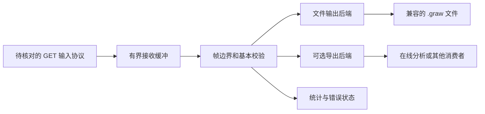

# dataRouter 与 DataExporter / DataExporRouter 的比较计划

> 2026-10-03 更新：本地 GET dataRouter 与 ATTPC/DataExporter 源码均已收到。DataExporter 是 DataRouter 的扩展，增加写盘同时 TCP 导出；当前建议共用接收与存储核心、可选导出，作为独立数据服务。源码证据、已发现问题及验收要求见 [最新审阅方案第 8 节](SOURCE_REVIEW_AND_PLAN.md#8-datarouter-与-dataexporter-的初步选择)。下文的比较维度仍适用。

2026-10-04 实施：已有 `apps/datareceiver/` 无 Qt 原生 C++11 版本，将 plain TCP 接收、MFM 分帧、分源存储和有界导出放在一个独立进程。文件主输出必选，在线导出可选；并未实现所有输出模式任意组合。已通过合成帧及慢客户端测试，尚无真实固件/旧版对照与持续性能验收。参见 [数据服务手册](DATA_SERVICE.md)。

2026-10-23 对照更新：用户确认现场用的是 ATTPC/DataExporter 改进版。重新核对 GitHub `main` 当前提交 `70d9d069531886f3053cccb52689717d0d85fe96`（2026-10-08）：它仍是 DataRouter 的扩展，`Exporter::processFrame()`先调用`FrameStorage::processFrame()`写盘，再转发完整帧；DataRouter 的`runConfig()`仍为空，不把 GUI Run number 传给接收/文件层。该版本已修复异步长度头临时变量生命周期，并将客户端/socket操作收敛到 io_context 线程；但每客户端发送`deque`仍无容量限制，长度头仍直接发送本机`uint64_t`表示。当前重构已把两者合入无 Qt 的`apps/datareceiver/`：默认先写盘，帧存储成功后再发布可选导出；导出使用显式小端64位长度、有界字节预算和队列项上限，慢客户端断开不阻塞写盘。旧Run覆盖仍属于后续归档/catalog流程；接收器不会因Run number回退自行覆盖旧文件。

当前GetDAQ工作树不再保留一个独立的旧`DataExporter`源码目录；兼容实现是`apps/datareceiver/`中的原生C++11代码，不在采集热路径链接Qt、Boost或Ice。上游核对链接：[README](https://github.com/ATTPC/DataExporter/blob/70d9d069531886f3053cccb52689717d0d85fe96/README.md)、[DataRouter.cpp](https://github.com/ATTPC/DataExporter/blob/70d9d069531886f3053cccb52689717d0d85fe96/src/DataRouter.cpp)、[Exporter.cpp](https://github.com/ATTPC/DataExporter/blob/70d9d069531886f3053cccb52689717d0d85fe96/src/Exporter.cpp)、[TCPServer.cpp](https://github.com/ATTPC/DataExporter/blob/70d9d069531886f3053cccb52689717d0d85fe96/src/server/TCPServer.cpp)。实现与兼容边界仍需真实固件/旧消费者差分和持续吞吐验收；代码审阅或小型socket回归不构成性能排名。

## 已知事实

原 envoy 在 ECC 的 DataLinkSet 中同时配置两条目标：`data<ID>` 默认 46005，`exporter<ID>` 默认 46007。上游注释将两者描述为 file dump 和 export。实际运行节点可以使用 dataRouter 或 DataExporter，并由 sentry 监控指定进程。

依据：[已检查的 ECC 配置源码](https://github.com/ATTPC/attpc_envoy/blob/d877924caa68cb14b448cd5cfd26b555beafb5fd/src/envoy/ecc_envoy.rs)。这只能证明它们在原部署中有独立配置入口，不能证明两者实现和输出完全相同。

用户随后提供了 ATTPC/DataExporter 仓库，此处按该实现与本地 GET dataRouter 比较。已检查主要接收/存储/导出关系，但尚未负载测试，不给出谁更快或谁更稳定的结论。

## 收到源码后逐项比较

| 维度 | 要核对的证据 | 对合并的影响 |
| --- | --- | --- |
| 输入协议 | 连接方向、握手、帧头、长度、字节序、断线语义 | 决定是否能共用接收器 |
| 帧类型 | GET/MFM 类型、元数据、是否跨包/跨事件拼接 | 决定解析和路由模块 |
| 输出 | .graw 是否原样保存、是否转换、是否转发 | 决定多个输出后端是否必要 |
| 顺序 | 多 CoBo 排序、事件拼接、时间戳处理 | 合并不能悄悄改变事件语义 |
| 缓存 | 每连接缓存、队列上限、内存增长、分配频率 | 确定有界队列和批量大小 |
| 写盘 | 文件轮转、目录、尾包、flush/fsync 语义 | 决定 Stop/Drain/Close 流程 |
| 阻塞 | 磁盘慢、消费者慢、TCP 背压、硬件缓存 | 决定哪些错误必须停止采集 |
| 完整性 | 字节计数、事件计数、序号缺口、校验 | 决定如何证明没有静默丢数 |
| 恢复 | 链路中断、进程重启、残留文件、部分帧 | 决定恢复策略而非盲目重连 |
| 依赖 | ROOT、Boost、gSOAP、平台库、外部进程 | 判断可内嵌或替换的部分 |
| 部署 | Linux/macOS/Windows 实际使用方式 | 确定哪些平台是数据面真实目标 |

## 当前倾向：共用核心、按需输出

如果两者输入一致，我倾向于一个统一的数据服务，内部共用接收、帧识别、计数和缓冲；输出选择文件保存、网络导出或二者同时启用。不要先把两个旧程序机械串联，也不要先假设某一个一定更好。

该分层已在第一版原生服务中实现；协议支持目前限于已实现的 plain TCP MFM 子集。合成帧测试不等于真实硬件协议已验收。

## 必须先定下来的行为

- 文件保存通常应视为采集主路径。磁盘满或持续写入落后时必须明确报错，不能静默丢数据。
- 在线监控是否允许抽样/丢弃，必须作为独立配置；不能把在线绘图抽样误用于原始文件保存。
- 如果两个输出都要求完整数据，则慢消费者会影响整体推进；需要明确背压和停止策略，不能无限增加内存。
- Stop 应停止新输入，再排空缓冲并关闭文件，随后返回可验证的完成状态。这样才能逐步替代目前 sentry 的固定等待时间。
- 根据用户要求，数据服务使用独立 C++11/POSIX socket，不链接 Qt；控制和低频监测保留 Qt。是否继续采用平台专属 I/O 优化由压测决定，不能仅凭框架名称推断速度。
- 原有两个端口是否合并，由 ECC 支持的 DataLink 配置和现有消费者决定，保留兼容入口可能比直接删除端口更稳妥。

## 验收依据

同一输入记录重放给旧版和新版，比较输出文件内容、帧/事件计数、排序、末尾残帧、内存峰值、CPU、持续写盘和停止排空。再用真实硬件测试网络中断、磁盘满和慢消费者。

已收到源码，但真实样例和现场验收仍不足；不把“TCP 测试能接收字节”当作完整重构验收通过。
