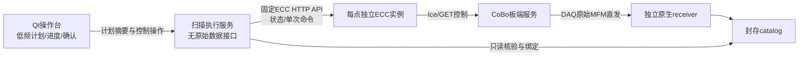

# 扫描执行器架构与安全迁移边界

本文记录离线扫描计划从“生成配置”走到“逐点采集并形成可追溯归档”所需的架构约束。它是实现与验收规范，不表示完整扫描执行器已经存在或已经在硬件上验收。当前Envoy可对一个已绑定点分别提交整系统Describe、Prepare、Configure，每一步都要求新鲜身份重验、操作员确认、意图先落盘、操作结果与新状态回读一致；随后可核验receiver事件基线并由操作员确认整系统Run，达到事件目标后提交整系统Stop。Describe/Prepare/Configure只推进当前ECC实例，不从点JSON装载或切换配置。离线核心现可用冻结快照及完整receiver plan模板生成逐点固定部署包，但不会把文件复制到数据主机、启动/退休ECC服务或推进多点journal。单点Run沿既有Native收尾完成Breakup、receiver退出/seal及catalog核验，将扫描journal推进至CatalogVerified，再由显式归档绑定推进至Bound。

扫描运行身份有两种只读核验模式：首次接纳`adopt`要求ECC处于Idle且receiver进程未启动；恢复重验`revalidate`要求ECC状态精确对应journal中的EccStarted、Described、Prepared或Configured。摘要只绑定静态部署身份和receiver计划，不纳入状态、观测时间、session或PID，因而跨正常生命周期仍可比较；Configured时另按CoBo ID核对Ready session与运行进程PID。该核验仅证明服务报告匹配冻结期望，不证明板端真实寄存器状态。

## 1. 为什么不能在当前Run里换扫描点

一次ECC运行对象会在建立时读取完整实验工件，计算并固定配置摘要、工件摘要、系统快照和数据控制绑定。数据生命周期管理器随后要求接收计划的两个摘要与该父ECC完全相同。Configure会使用这份不可变工件；Changing工件路径或在Running时修改寄存器会使父审计、接收计划和真实硬件配置失去共同身份。

因此，简单地在Qt窗口里循环“改参数—按Configure—Start”不满足现有安全契约。逐点扫描必须让每个点拥有独立的完整配置身份、Run、receiver周期、停止/封存回执和扫描绑定凭据。执行协调逻辑只能调度这些控制操作，不能搬运DAQ原始字节；CoBo sender仍直接向独立receiver发送数据。

代码依据：`NativeEccOptions::experimentArtifactBytes`为一次ECC实例提供固定完整工件；`PlanNativeEccConfiguration`将工件摘要计入ECC快照；`ReceiverProcessManager::Validate`拒绝与父配置/工件摘要不符的接收计划；`NativeEccCoordinator::Execute(Configure)`按该固定对象准备并配置硬件。这些约束来自`apps/ecc/native/nativeecccoordinator.h`、`nativeecccoordinator.cpp`、`receiverprocessmanager.cpp`及其现有测试。

## 2. 推荐的点执行身份

当前`CreateScanPointDeployments`已实现离线部署包生成，并由POSIX native工具`getdaq-scan-deploy`开放入口：它重新核对冻结快照中的每个artifact，要求每个固定数据agent提供与模板ECC endpoint摘要一致的规范receiver plan，并确认receiver source ID集合与ECC sender集合完全相同。输出包为每点生成只读artifact、完整ECC service配置和逐agent receiver plan；ECC/receiver plan均使用独立deployment ID、configuration/artifact摘要、审计root和更新后的receiver plan摘要。manifest记录本地输入路径、目标数据主机plan路径，以及ECC/receiver审计root需要的父目录。输入带`configuration_publication`或`configuration_selection`时当前拒绝生成，因为published artifact连同publication/effective snapshot也必须为每点重新生成和验证，不能只替换experiment artifact引用。

```text
getdaq-scan-deploy create PLAN_DIRECTORY POLICY.json SNAPSHOT.json ECC_TEMPLATE.json \
  NEW_BUNDLE_DIRECTORY RECEIVER_PLAN.json TARGET_DIRECTORY \
  [RECEIVER_PLAN.json TARGET_DIRECTORY ...]
```

接收计划及目标目录必须按ECC模板endpoint顺序各提供一组。工具只生成本机sealed文件和manifest；不会上传接收计划、创建远端目录、退休当前ECC实例、启动服务或发送硬件命令。重复使用已存在的bundle目录会失败。

这是计划材料生成，不是部署或控制权切换：调用者仍需在各目标主机安全安装plan并准备其审计root父目录，再按原`retire-data-plans`/successor receipt路径完成receiver plan交接；ECC服务现支持在成功handoff后显式、有界地关闭并释放主机占用，但扫描执行器尚未自动调用，也没有据此开放journal `Bound → Retired`、启动新ECC进程或发送下一点命令。参见验证71.448及71.452。

生成后的bundle可用`getdaq-scan-deploy verify PLAN_DIRECTORY POLICY.json SNAPSHOT.json BUNDLE_DIRECTORY`只读重验。命令重新解码源计划/策略/冻结快照，要求manifest严格字段集、execution/snapshot摘要和点序与快照一致，再逐点检查0400属主文件、artifact摘要、ECC固定配置、receiver plan规范编码/摘要/部署绑定及每点独立目标文件名。它只验证本地bundle完整性与内部绑定，不认证bundle来源，不安装远端plan、不启动ECC或receiver，也不发送硬件命令。

目标数据主机既可用当前receiver service配置本地暂存，也可通过同一数据主机的bearer认证supervisor接口暂存计划。远端调用以`getdaq-supervisor-query submit --host RECEIVER_IPV4 --port CONTROL_PORT --credential-file CREDENTIAL_FILE --expected-agent AGENT_ID --controller CONTROLLER_ID --expected-plan PLAN_SHA256 --request-file REQUEST.json`提交`stage-successor-plan`，请求携带目标文件路径、计划SHA和规范plan对象；该专用命令的HTTP/请求上限为2 MiB、plan本身最多1 MiB，其他控制命令仍限8 KiB。服务在接受操作前先检查规范编码/摘要、原receiver executable和资源上限、scan execution/deployment/point绑定、目标不存在及目标目录/原审计父目录权限；预检失败不创建操作或目录。接受后按固定operation ID记录请求，再创建执行专属0700审计父目录并独占封存0400 plan；重复目标拒绝覆盖。该操作不退休旧plan、不启动receiver、不改变控制权；之后仍须走原有退休和successor回执流程。

该调用复用现有bearer认证HTTP控制面，传输层没有新增TLS；跨不可信网络部署前需要既有网络保护或其他受控传输，bearer凭据不可写入请求文件或日志。此操作验证的是目标supervisor在自己的主机上完成了计划暂存，不证明原始DAQ数据已经传输，也不推进扫描journal或自动启动下一点。

ECC predecessor的进程退休使用认证`POST /v1/shutdown`。请求绑定当前`instance_id`、冻结`snapshot_sha256`及原始handoff operation ID；服务接受原handoff直接complete，或原handoff仍保留failed但准确的`complete-data-handoff`补齐operation已complete两种情况，并重验本实例保留的精确handoff receipt。服务拒绝活动提交/观察、handoff未完成、错误实例/摘要/operation，以及硬件控制状态未知或仍处于transition/error的情形。handoff仅能在全部原receiver已正常停止并验证封存后完成；完成时原数据管理器会永久fence并把aggregate status标为需要协调，因此关闭检查读取独立的硬件`ControlStatus()`，不把这个预期的数据handoff fence误判为控制器故障。服务先返回accepted，短暂等待HTTP响应刷新后正常退出；析构释放host board lock。这个端点不允许无handoff的普通关闭，也不强制杀进程。schema-7 journal现记录先行持久化的shutdown intent及与同一受管PID正常退出、服务配置、handoff、当前执行快照/点和runtime identity绑定的退休证据；`RetireManagedEccServiceForScanPoint`协调器在失败/结果不明时隔离当前点，未完成intent重开后进入`NeedsReconciliation`。这只接通POSIX底层服务与journal，Envoy尚未调用该协调器或依据它自动部署/推进下一点。

后续执行器应把“扫描计划”转成一份新的、不可变的`getdaq.scan-execution`清单。它引用原扫描manifest摘要，并为每个点固定：点序、配置/工件摘要、独立部署ID、ECC实例/服务端点、独立父审计目录、数据节点与接收计划摘要、Run身份、停止策略、创建者和明确的人工确认状态。清单和每个点目录均独占创建；不修改原计划、原工件、已完成Run或已封存catalog。

第一版建议一次只执行一个点：完成当前点的停止、Breakup、receiver自然EOF/正常退出/封存、catalog核验与点绑定后，才能建立下一点的ECC实例。每点由完整固定ECC配置启动；清洁结束以后显式退休该实例，再释放板卡的主机侧协作占用。进程异常退出、停止结果未知或receiver未封存时，不得启动下一点来抢占板卡。

初版保持“单点单独提交”。验证整份计划只能说明计划结构有效，不构成对全部硬件命令的预先批准。每一点的Configure、Run Start和异常处理都应显示其CoBo、配置摘要、目标接收目录及预期停止条件，由操作员明确提交。常规的已提交操作只查询原操作ID；POST应答未知时不得换ID或自动重发。

## 3. 操作台、执行器与数据面



Qt适合呈现少量计划字段、人工确认和生命周期状态，但不参与高速数据接收、`.graw`解析、文件复制或进度字节转发。扫描执行服务负责持久化执行意图及跨点状态，可用无Qt C++11实现；它调用固定ECC控制接口并读取receiver/catalog的小份状态与回执。原始网络流始终为板端到数据主机receiver，不能经Qt或控制服务中转。跨主机归档仍是独立的普通TCP/IP工具，不并入扫描控制请求。

## 4. 点状态机与不可逆边界

Envoy尚未把ECC进程启动接入逐点执行器。POSIX Native层现提供受管启动桥：先把schema-8 `managed-service-start-intent`持久化，绑定当前点、operation ID、冻结deployment中的ECC executable与service configuration摘要；再由`EccServiceProcessSupervisor`启动固定输入。只有exec成功且仍存活的确切子进程，才生成仅supervisor可构造的证据并推进到`EccStarted`。这只证明程序已执行且进程仍活着，不证明HTTP服务Ready；随后仍须独立查询并绑定运行身份，才允许`describe`。任何含混的启动失败都会隔离到`NeedsReconciliation`，重开时悬空intent也进入隔离，不能自动重试或推断“未启动”。操作员在控制台外启动的实例仍可沿旧schema-5 `adopt-ecc`路径显式接纳。journal schema 1–7继续可读；schema 6新增重启隔离的Describe/Prepare/Configure原ID观察完成事件，schema 7增加受管ECC关闭intent和进程退出退休证据，schema 8增加受管启动intent及子进程证据。

预期每点状态依次为：`Planned → Reviewed → ECCStarted → Described → Prepared → Configured → RunStarted → RunStopped → ReceiverFinished → CatalogVerified → Bound → Retired`。schema v3在`ECCStarted`后增加一条独立的运行期身份绑定事件：执行器先验证ECC身份与当前点配置/工件摘要、服务状态和数据节点身份，再将规范化观察记录的SHA-256写入journal；成功绑定后才允许`describe`及后续intent。Qt-free协议层`ObserveScanRuntimeIdentity`现复用严格的ECC identity/status解码器，交叉检查调用方冻结的service/instance/snapshot/input/config/artifact/data绑定、ECC双响应的instance/snapshot一致性、控制器仍为无未知操作的Idle、数据控制scope/epoch，以及完整receiver agent/instance/plan集合仍为fresh且无session/receiver进程，最后对稳定排序的字段生成规范摘要。规范摘要版本2还纳入扫描执行快照SHA和点索引，持久化桥会确保它们与当前journal一致，避免相同配置点之间或不同执行之间复用摘要。`BindScanRuntimeIdentityExpectation`现在从不可变执行快照计算快照SHA，并从所选点直接取得配置/工件SHA；部署适配器只需提供服务实例、ECC输入绑定和数据节点等运行期身份字段。POSIX存储桥`PersistScanRuntimeIdentityBinding`接收实际`ScanExecutionSnapshot`对象，并在解析响应前验证其执行ID、规范字节SHA、计划SHA、点数，以及期望配置/工件SHA与journal当前点快照内容一致；验证失败不会写入journal。该存储桥已由Envoy的NativeRunControl接入真实ECC身份查询；新接纳入口见71.301。Unix原生ECC侧新增`BuildFixedScanRuntimeIdentityExpectation`：它从重新检查过的`FixedEccConfiguration`推导静态service/client、ECC快照与输入绑定、receiver生命周期绑定、data scope及receiver agent/plan，并要求与冻结扫描点工件和只读身份/状态观察吻合；运行期instance/epoch字段仍来自同一轮Idle/fresh观察。该构造器已经有固定部署离线集成回归，但还没有被Envoy调用，也不支持Windows原生端。进入下一点时身份绑定清空，每个新ECC实例都须重新观察。该函数验证的是ECC服务报告与调用方期望是否一致；它不认证HTTP服务、不证明板端寄存器或物理硬件状态，也不替代未来执行器对期望身份来源的安全绑定。每个硬件命令或远程POST仍须先写入并同步单次意图，且只提交一次。成功回复后保存原操作ID和观察结果。状态不明、持久记录被改写或进程身份变化时，进入`Unknown/NeedsReconciliation`并保留证据；执行器不得自动清目录、杀进程、重复提交或跳过该点。

若Configure/Start失败，不得把下一点配置加载到同一未知控制实例。只有当前原ECC提供明确、已有实现的故障停止/核对路径且核对结果满足下一阶段前置条件，才允许继续该点收尾。失败目录、原请求、receiver partial和已有归档均保留供人工核查。

`Bound → Retired`不是通用journal操作：普通`retire` intent、成功回执和人工对账仍不能推进它。Linux POSIX受管进程监督器可启动固定配置的ECC子进程；关闭前必须先把`managed-service-shutdown-intent`同步到journal，绑定当前点、runtime identity、PID、服务配置摘要及原handoff operation ID。监督器只在认证shutdown响应逐字匹配该请求，且同一PID经`waitpid`以状态码0退出后，才能生成不可由调用方构造的进程证据。journal只接受与最后一条intent、执行ID、冻结快照、点序号及runtime identity完全匹配的证据，并记录服务进程退出事件后推进至`Retired`；原子store关闭重开后仍可重放，随后才允许`WithNextPoint()`。重启时若shutdown intent没有完成事件，journal自动进入`NeedsReconciliation`，不得重发shutdown或推进点位。schema 8 journal也沿用该关闭协议，不降级schema版本。旧schema 1–7继续读取，旧退休记录只保留历史可读性。

这是已测试的底层启动/关闭journal原语，尚未接入Envoy逐点执行器、reviewed deployment选择或自动多点推进。当前GUI仍使用外部启动/接纳的ECC实例；不能宣称扫描已经能自动启动/关闭服务。测试只覆盖Linux GCC/C++11、本机假HTTP服务和受管假子进程；没有硬件、真实receiver/DAQ raw、Windows/macOS或现场验证。后续接线前还需让executor从已审阅deployment获取可执行文件、固定配置、服务endpoint和私有凭据，并在异步控制流程中保持UI响应。

同一约束也适用于Qt-free内存状态机：普通`Transition(Bound, Retired)`被拒绝。新状态只由schema-7受管服务退出证据事件推进；旧schema 1–6解码器仍可读取旧`retire`完成或“确认已执行”对账，但会保留历史退休标记，`WithNextPoint()`拒绝把旧状态当成新的退休证据。读旧日志保留审计可读性，但不能据此继续自动控制。

Run Stop与receiver Finish不是同一动作：先让硬件生产停止，再核验sender断开/EOF，最后Finish receiver、确认正常进程退出并封存。点绑定只在catalog检查通过且接收计划的配置/工件摘要等于该点时生成。它仍不证明硬件读回；执行器须将`hardware_loaded_verified=false`保留为事实。

## 5. 停止策略与执行策略工件

现有通用系统工件没有一个由新原生实验模型统一消费的“每个扫描点运行N个事件”策略。不能默认扫描器会自动在某个事件数停止。

schema-4 journal可在点状态为`Configured`且该点已绑定运行期ECC身份后保存事件计数基线。`ScanEventCountBaselineCoordinator`在发起查询前从冻结快照取得CoBo来源；响应返回时逐项核对ECC instance/deployment snapshot/data binding、来源和固定receiver agent/instance/plan，并要求事件数可用，随后将session、PID、累计计数与观察时间一并追加到journal。单测证明错误来源不会改变journal且大于2^53的计数可精确保留。NativeRunControl已把只读事件查询接入单点Run监控：开始查询前要求整系统处于新鲜、匹配的Running状态；返回后要求ECC实例/快照、数据绑定、来源、receiver agent/instance/plan、ready session及CoBo PID与新鲜生命周期观察一致。事件仍低于目标时会刷新ECC和receiver观察后再采样；达到目标才提交一次整系统Stop。当前仍要求点工件事先完整Configure并与服务身份匹配；执行器没有加载点配置、推进多点或完成receiver收尾。

旧`TestController.cpp`的证据显示PeakingTime、Gain/AutoGain分支读取`CoBo/Module/nbEvent`作为事件目标；旧Threshold分支却把同一个`statNb`用于阈值采集窗口次数，并通过周期Pulser和`startTps`/外部timer结束单个窗口。它们不是可互换的停止策略。旧循环还直接切换slow/fast control并写寄存器，不能作为新ECC的控制序列照搬。证据见`source/get/GetController-release-20210208/src/get/TestController.cpp`约4020–4350行，以及`docs/SOURCE_REVIEW_AND_PLAN.md`的旧控制器扫描行为核验。

旧`GetTest::onDataFrameReceived`会跳过MFM frame type大于2的拓扑帧，再增加`nbEvent`。新receiver当前保留总`frames`统计，并在frame-storage模式的只读status中额外报告`acquisition_event_count_available`和`acquisition_events`，按`FrameInfo.type <= 2`计数，以便后续对接逐点事件停止。ByteStorage不解析帧，明确报告该计数不可用。此计数目前只用于观察和语义回归；扫描执行器尚未把它接到ECC Stop，也未证明它等同于独立物理事件或所有部署的停止条件。原始数据仍直接写入receiver。

因此，有限停止策略是单独的、可审核的`getdaq.scan-execution-policy` JSON sidecar，不修改离线扫描计划或点配置。PeakingTime、Pulser、AutoGain每点必须明确填写事件数和最大运行时长；事件数上限为1,000,000,000，超时上限为24小时。超时是中止/故障条件，不代表事件目标达成或Run成功。**Threshold当前只允许离线生成计划并人工逐点操作；不允许创建自动执行策略，也不允许自动Run。**旧代码的定时窗口数不能替代事件目标，且其Pulser、触发时序与结果语义尚未核实，因此核心策略解码器也拒绝旧的`timed_windows`策略，避免它被后续执行组件误当作获准规则。策略绑定manifest原始字节SHA-256、扫描类型、CoBo和点数；加载时必须先完整通过`ValidateSystemScanPlan`，再校验策略，任何计划字节变化都要求重新生成策略。

事件目标策略示例（摘要必须是原`scan-manifest.json`文件字节的SHA-256）：

```json
{"schema_version":1,"kind":"getdaq.scan-execution-policy","source_plan_sha256":"<64位小写SHA-256>","scan_kind":"getdaq.peaking-time-scan","target_cobo":"C0","point_count":16,"stopping_strategy":"event_count_per_point","events_per_point":100000,"maximum_duration_ms_per_point":3600000}
```

Threshold没有策略JSON示例：该扫描类型目前不能创建自动停止策略。配置CLI只接受事件数策略；对Threshold使用`create-scan-policy`会明确失败。创建其他可支持扫描策略时，必须给定尚不存在的新输出路径：

```bash
getdaq-config create-scan-policy PLAN_DIRECTORY event-count 100000 3600000 PLAN_DIRECTORY/scan-execution-policy.json
```

以上只是命令格式示例，事件数和时长必须由实验方案负责人明确选择，不能照抄为现场参数。命令会先完整检查计划，再以独占新建方式保存sidecar；已有目标文件绝不覆盖。之后运行`getdaq-config-check scan-execution-policy PLAN_DIRECTORY PLAN_DIRECTORY/scan-execution-policy.json`做只读核验。Envoy对PeakingTime、Pulser和AutoGain提供有限策略编辑与创建入口：必须填写事件数和最大运行时长，显示二次确认，独占创建固定名称sidecar，再调用检查器复核。Threshold界面明确显示manual-only并禁用策略按钮。GUI与CLI都只处理元数据，不执行自动扫描或任何硬件操作。

要把计划和这份策略固定为一次执行尝试的输入身份，可使用下列Qt-free核心命令创建C++11执行快照：

```bash
getdaq-config create-scan-snapshot PLAN_DIRECTORY PLAN_DIRECTORY/scan-execution-policy.json execution-2026-01 PLAN_DIRECTORY/scan-execution-snapshot.json
getdaq-config-check scan-execution-snapshot PLAN_DIRECTORY PLAN_DIRECTORY/scan-execution-policy.json PLAN_DIRECTORY/scan-execution-snapshot.json
```

快照独占保存计划摘要、策略文件摘要及逐点配置/工件摘要；后续只读检查会重新验证原计划全部点工件，并要求快照仍与传入的计划和策略字节匹配。执行ID由调用方提供，需为安全的字母/数字/`-`/`_`标识；生成新快照时应另选全新ID和输出文件。此快照只冻结离线输入身份，不包含已启动ECC进程ID、服务端点、receiver周期、Run身份或单点操作批准，因此不是完整运行清单，也不能启动Configure或Run。执行适配器接入前，不应把它解释为采集已经开始。

这份策略只定义“以何种有限条件停止”，不表示接线、触发源、周期Pulser控制和结果解释已确认。旧Threshold代码确实使用固定时长窗口与周期Pulser，但这只是历史行为证据，不是获准的自动执行规则。只有停止条件、触发与Pulser操作以及结果判据经过核实并映射到新ECC固定工件后，才能重新评估是否开放自动Run。

## 6. 失败恢复与人工处理

| 情况 | 执行器行为 |
| --- | --- |
| ECC尚未收到命令 | 只允许在意图明确标记`not-sent`且能证明未提交时重新审阅；不得改写原意图 |
| 操作已受理或回复未知 | 仅GET/只读观察同一operation ID；不创建新ID重放 |
| Stop已确认、receiver尚未Finish | 保留本点身份，按现有ECC/receiver的明确收尾步骤继续；不启动下点 |
| catalog/绑定核验失败 | 保留Run和receiver证据；修正原因后以新输出凭据重做只读核验，不能伪造SHA或覆盖旧凭据 |
| ECC或执行服务非正常退出 | 保留UNKNOWN和原进程/文件身份；不得自动重建实例接管或清理数据 |
| 计划后续点文件改变 | 拒绝继续，检查原manifest和点工件；已完成点历史不变 |

现有描述/准备/采集/接收器恢复入口各有严格前提。扫描执行器不能添加一个通用的“Retry/Resume”按钮，不能把不同故障路径合并为无条件清故障。journal核心现提供显式`WithOperationReconciled`对账事件：调用方须引用原operation ID、填写非空的声明操作者ID、提供人工观察证据摘要，并选择“确认已执行”或“确认未发送”。前者只能推进到原操作映射的目标状态；后者回到原状态但保留旧operation ID，后续如重新提交必须使用新ID。操作者ID只是可追溯声明，不提供身份认证；证据摘要只关联外部观察材料，不验证其真实性，也不能单独证明硬件状态。

`ScanOperationRunner`现提供单操作协调：将请求字节摘要和operation ID写入journal并持久化后，才调用注入的外部操作回调；成功时从intent中的操作名推导唯一目标状态并持久化响应摘要。回调抛出异常代表“是否已提交/受理未知”，runner记录unknown并返回隔离状态，不自动重试。若unknown记录本身无法持久化，runner向上抛出错误，原intent仍会在重开时触发隔离。此组件没有ECC HTTP、receiver、catalog或硬件适配器，测试只用小型fake callback；它是调用顺序护栏，不是完整扫描执行服务。

为适配已有异步Qt ECC HTTP客户端，runner另提供`PersistIntent`、`Complete`和`MarkUnknown`阶段接口。异步调用方先调用`PersistIntent`，再提交一次请求；收到明确成功响应后调用`Complete`，超时/连接中断等结果不明确时调用`MarkUnknown`。这些接口仍只管journal，不替调用方判断请求是否已离开主机，也不自动重发。同步`Execute`是相同阶段的便捷封装。三阶段仍同步执行本地journal写入/`fsync`；若不能接受GUI线程等待磁盘，应让专用worker拥有journal store，并通过Qt线程队列投递网络请求及返回结果。

## 7. 分阶段实施及验收

### 7.1 原operation ID的安全恢复

重启后只有未完成intent时，journal重开会将其隔离为`NeedsReconciliation`。恢复入口仅对Describe/Prepare/Configure读取ECC客户端本机保存的原请求，并逐字节重算请求SHA，与扫描journal保存值比较；随后使用原operation ID调用只读`GET /v1/operations/<id>`。只有服务响应请求与原始请求完全相同、终态为`complete`、结果报告正确whole-system目标状态及同一operation ID，并且下一次新鲜`/status`再次确认相同目标和operation ID时，才写schema-6 `operation-observed-complete`并恢复journal。任何失败/未知/404/身份或状态不符都不重放命令，journal继续保持隔离。普通Run/Stop不能用该路径，因为它们还需要恢复事件监视器、运行计时及receiver会话；目前仍要求人工对账。

服务有效响应`phase=unknown`会触发Native客户端针对该扫描观察的可恢复联锁；普通HTTP网络错误不会直接设置此客户端标志，未决操作仍由pending/reconciliation记录约束。相同operation ID的显式恢复只有在原Describe/Prepare/Configure请求得到完全匹配的complete结果、结果状态和新鲜status均报告预期目标及相同ID、告警观察健康、故障代次未变化时，才可清除该扫描观察自身的保持。并发状态UNKNOWN、告警、配置读回、所有权、receiver策略或计划退役等独立故障仍阻止清除。ECC客户端记录库也只删除这一精确ID的held operation；解除客户端保持后仍重新验证identity/status。这些逻辑只管理控制面元数据，不接触数据面。测试通过`HttpClient::Transport`进程内注入，不需要打开监听端口；该Transport默认关闭，生产仍用Qt网络管理器。

1. **停止策略与已配置点Run控制（单点Run与收尾成功链已通过fake服务测试）：**Qt-free `ScanExecutionPolicy`仅接受PeakingTime、Pulser、AutoGain的显式事件数和运行时上限；Threshold只可离线建计划，不可创建自动Run策略，旧定时窗口策略也会被拒绝。CLI和Envoy先完整校验计划并独占创建绑定其摘要/类型/CoBo/点数的策略文件，checker提供只读核验。Envoy现可在已Configured且身份和事件基线绑定后，由操作员确认一次整系统Run；NativeRunControl以低频receiver事件查询监测当前CoBo的累计事件数，达标后提交一次整系统Stop，操作回执和新鲜控制器状态读回成功才进入普通Run收尾：Breakup、receiver EOF/排空/退出及seal核验、`native_catalog=true`时的catalog核验和Run记录完成。若归档配置未启用，扫描Run入口会拒绝启动。异常和未知结果保留未决点，不报告成功。Threshold自动Run入口关闭。当前操作不加载点工件、不自动推进多点；该控制阶段只用控制元数据，不接DAQ payload。fake服务验证不代表真实ECC或现场验收。
2. **纯C++执行清单核心：**计划与停止策略快照已经实现；journal schema v2绑定离线快照，schema v3新增每点运行身份摘要门槛；schema v4记录事件基线，schema v5增加从Reviewed显式接纳外部已启动ECC实例的`adopt-ecc`意图。`ObserveScanRuntimeIdentity`解析ECC身份/系统状态并与调用方冻结期望交叉校验；`BindScanRuntimeIdentityExpectation`从不可变快照派生当前点配置/工件摘要，POSIX存储桥再次核对冻结快照及当前点工件。Unix原生`BuildFixedScanRuntimeIdentityExpectation`已接到受保护固定ECC部署和接收计划并经模拟服务测试，但Envoy尚未调用这个固定部署构造器。Envoy/NativeRunControl可在Reviewed状态显式接纳外部已启动ECC，支持应用重启后重验身份并在Configured后绑定事件基线；Run入口要求当前点已Configured并绑定运行身份和基线；Describe/Prepare/Configure可在窗口中逐项明确提交，不由Run按钮代为执行，也不启动ECC进程。fake HTTP成功链已覆盖Run→事件目标Stop→Breakup→receiver seal→catalog→Run完成，并验证单操作后释放journal独占锁，允许下一步重验身份。事件目标Stop后先持久化绑定已确认Stop operation ID的`receiver-finish` intent；只有新鲜ECC状态确认所有receiver正常退出并seal后，journal才推进到`ReceiverFinished`。随后先持久化与即将提交的catalog请求字节和operation ID完全一致的`catalog-verify` intent，再发送唯一catalog操作；新鲜ECC状态中的catalog receipt及文件计数核验成功后推进到`CatalogVerified`。Breakup/catalog失败或超时、receipt缺失或不一致时保留未知intent并停止，不换ID重发。Run记录完成后释放journal独占锁；GUI绑定仅允许当前`CatalogVerified`点，先持久化`bind` intent，在异步catalog CLI运行期间持有独占锁，核验输出文件/响应及计划摘要后推进至`Bound`。schema v7现增加POSIX受管ECC supervisor、先行持久化shutdown intent及精确PID正常退出证据事件；未完成intent重开后隔离。底层单点退休可重放并推进下一点，但尚未接入Envoy执行器、deployment选择和自动多点推进。仍缺逐点ECC配置部署、完整跨进程Run/Stop恢复闭环与真实执行。测试只使用小型控制元数据。
3. **单点ECC适配器：**在原ECC HTTP API上一次提交一个点操作，复用已有持久意图、状态新鲜度、告警和数据节点绑定门槛；先在fake服务测试，禁止真实硬件测试作为默认CI步骤。
4. **端到端小样本联调：**由操作员显式确认一个受控点，验证完整Configure/Run/Stop/Breakup/EOF/seal/catalog-bind顺序；DAQ流量必须直达独立receiver。每轮生成测试raw不得超过20 GiB，完成后由测试自身清理并以回执证明无残留。
5. **多点和平台验收：**逐点验证所有错误边界，再分别验证Ubuntu24、Windows Qt5.14.2操作端和macOS；真实两机网络、目标卷/吞吐和板卡另有现场验收，不能由loopback或CI推断。

当前已有离线四类计划、Qt-free逐点工件校验、归档Run/catalog只读绑定和分析能力；它们只覆盖计划子集及归档后的功能。`ScanExecutionState`提供逐点状态护栏；`ScanExecutionJournal`记录执行ID、计划/离线快照摘要、每点运行身份摘要和操作intent/result。schema v3要求运行身份绑定后才能执行描述等命令；schema v4增加配置后Run所需的事件基线；schema v5允许经操作员确认接纳外部ECC实例；schema v7增加受管ECC进程退出事件。Qt-free `ObserveScanRuntimeIdentity`交叉校验ECC `/identity`、`/status`与冻结期望，并把执行快照SHA和点索引纳入摘要；存储桥再次校验当前点和实际快照。`ScanRuntimeIdentityCoordinator`通过Envoy/NativeRunControl线程桥读取本地manifest、事件策略和点工件，验证部署目标及新鲜identity/status/receiver观察。Reviewed状态接纳流程先写`adopt-ecc` intent，成功核验后才推进到`EccStarted`并绑定摘要；失败留下原intent等待人工对账。已绑定实例支持应用重启后重验，Configured状态支持只读绑定事件基线。Configured后可由操作员启动Native整系统Run；接收目标事件数后，RunControl验证整系统Stop，再执行Breakup、receiver EOF/排空/退出与seal核验、可选catalog核验并完成本地Run记录。单点fake HTTP回归覆盖Run收尾至`CatalogVerified`；GUI绑定入口再以持锁`bind` intent核验catalog CLI输出并把journal推进到`Bound`。schema-7底层supervisor可在固定ECC子进程完成认证handoff关闭且waitpid状态码为0后，把退出证据绑定journal的scan/runtime identity；这一能力尚未接入Envoy。仍未完成多点自动推进、逐点配置部署与实际硬件加载证明。它不会自动启动ECC进程或装载新的点配置；Describe/Prepare/Configure已支持针对当前已加载点的逐项明确提交，但不证明真实硬件读回或现场数据链路。摘要不是服务认证或硬件证明。每个状态命令仍须先持久化单次intent再提交；重开时未完成intent会被隔离，禁止自动重试。未知操作人工对账只处理精确operation ID；operator ID为声明，观察说明只保存摘要，均不能证明硬件读回。POSIX存储使用0700目录、0600文件/锁、独占`flock`、同目录临时文件、fsync和原子替换。Windows有独立Win32存储实现，但本轮没有Windows原生编译。仍缺逐点ECC配置部署、多点推进/Run/Stop未知结果的完整恢复与实机执行；Threshold保持手动。完整execution manifest、Windows/macOS及现场验收仍未完成。
