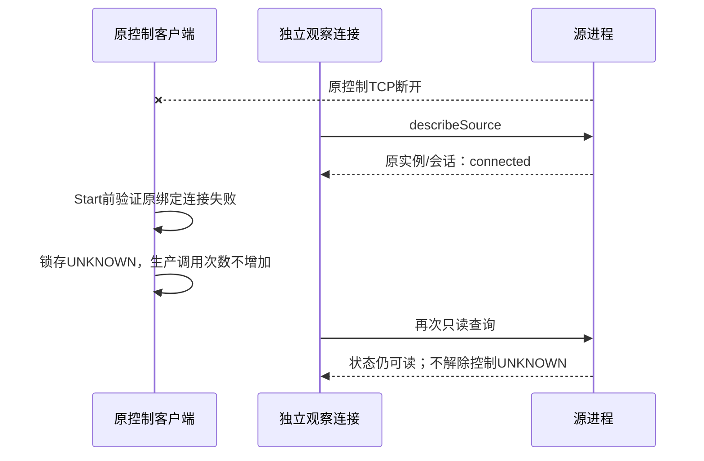

# 源状态查询与控制连接丢失

源进程可同时拥有两类连接：原控制连接负责 Start、Stop 和结束操作；只读观察连接只调用 `describeSource`。两者的成功或失败必须分别解释。源状态可以读取，并不表示原控制连接仍能执行命令。

## 1. 原控制连接断开时发生什么

本轮复现了一个客户端问题：源已 Connected 时断开原控制TCP，只读查询仍能获得有效回答；直接调用客户端Start的预检查失败，但客户端本地状态没有进入UNKNOWN。

现在所有绑定后的ICE控制验证都走同一错误入口，包括普通控制命令内部的预检查、显式Validate及故障停止预检查。失败会锁存本地UNKNOWN，保留最后确认状态，不增加生产调用次数，不用另一个只读连接接管原控制身份。Fresh且没有建立采集流的预检查失败仍可在零生产动作状态下拒绝。

这里的 `connected` 是远端源状态，UNKNOWN是原控制对象结果；界面可以同时显示 `connected / control UNKNOWN`，并不矛盾。

## 2. 操作者应该怎样处理

查看原操作、服务实例、receiver session及错误原因。保留原接收器和未完成Run记录。不能因为源的只读状态重新出现，就重发Start或重新创建发送器。

显式故障停止仍要求原已绑定控制连接。如果它已经丢失，调用会失败并保留UNKNOWN，不会使用观察连接发送Stop、伪造停止确认或生成End。应根据现场设备和控制权流程确认生产状态；完整硬件接管/恢复尚未实现。

本轮用例分别在尚未Start的Connected状态及已发送8192合成字节的Running状态关闭原控制连接。Connected时Start被拒绝且生产Start次数为0；Running时Stop被拒绝，不增加生产调用次数、不伪造停止确认或End，接收器仍没有正常结束凭据。最后由测试夹具停止自己的有限生产线程并清理接收器，这不是产品自动停止或真实板端停止证明。

## 3. 为什么慢查询不能堵塞命令和状态

ECC的源观察先短暂捕获控制状态和源对象共享句柄，然后释放命令锁，才向远端发查询。HTTP前端在后台线程执行它。并发请求到来时，同一种源观察只允许一次待处理读取：第二次返回409，表示本次没有排队。

普通`/v1/status`读取已发布状态，不等待慢源。只读查询、状态读取和重叠拒绝都不发送硬件生产动作。查询超时显示不可观察，而不是自动停止数据源或接收器。

## 4. Reset期间的对象生命周期

Reset会释放采集对象及它拥有的源集合。观察在开始时取得独立共享句柄，因此不能只保存集合中的裸指针。已开始的观察保留开始时的操作ID和源集合；Reset后的新观察使用当前集合。

旧回答不得被解释成新状态。操作台按控制操作ID及接收session核对，等待匹配结果。共享句柄保证的是本地对象生命周期，不保证原控制权、不允许旧对象重放动作。

## 5. 用例如何建立实际并发

测试夹具使用一次性同步屏障：只有源进程真正进入只读RPC后，测试才继续。它不会用固定睡眠猜测是否正在查询。

HTTP用例在第一份观察等待时，检查状态读取、第二份源查询的409和生产动作数，再释放屏障并核对原查询正常返回；随后执行原正常采集及结束流程。

Reset用例先正常Breakup/封存。源RPC进入屏障后，测试用SIGUSR1只暂停观察调用线程，模拟调试器断点；信号处理只使用POSIX的read/write握手，不接触生产锁或改变查询预算。随后释放源RPC屏障并完成Prepared到Described的真实Reset，确认旧观察线程仍暂停、原采集集合已经释放且新查询集合为空。恢复调用线程后，旧回答必须保留Breakup时的源实例/session/操作ID；暂停期间可能达到原超时上限，允许明确unavailable，不能采用新对象或把旧信息当当前事实。

这项暂停只存在于测试夹具，原始数据线程此时已经按正常流程停止/封存。它证明持有句柄跨对象释放的生命周期安全，不证明自然调度下每次Reset都能与短查询重叠、实时响应或硬件恢复。最初只用远端RPC等待时，查询在500 ms预算结束早于Reset，未满足生命周期断言；该组只作诊断且raw已清理。

最终普通/新代码插桩结果、程序摘要与清理凭据将记录在[检查点](SOURCE_OBSERVATION_CHECKPOINT.md)和[验证记录](VALIDATION.md)。未记录通过的场景不能据测试代码或本页描述推断已验收。真实板端、物理多主机、目标平台和持续数据量仍有独立边界。
