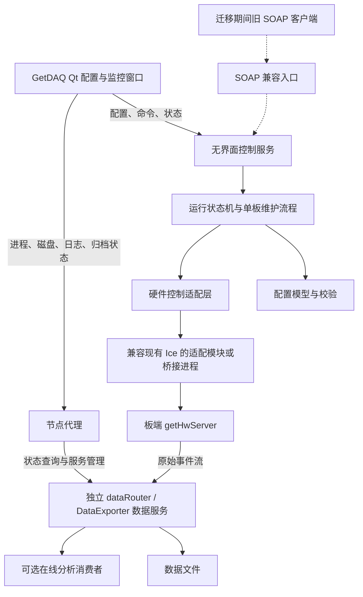

# GET 源码与三份资料审阅：统一配置软件方案

审阅日期：2026-10-03。本文保留收到 `source/` 和三份 PDF 后的方案与审阅结论，优先于早期仅替换 envoy 的范围说明。当时仅审阅；2026-10-04 已按新授权开始实施，没有执行真实硬件操作。

当前接续：新原生ECC、固定控制HTTP、完整采集/正常收尾、接收进程管理与Qt入口已落地；配置模型/工作区、发布仓库与正常收尾后的计划切换已有本机验证。下面保留原材料审阅和分阶段方案，其旧“待接”不能覆盖[当前逐项状态](REFACTOR_STATUS.md)。单板维护及原实例部分退休的GUI接线已完成本机验证；70.64已接独立冷数据交接补齐CLI及新实例周期，70.65新增独立恢复任务服务及Qt冷数据窗口；任意硬件冷恢复、目标平台和现场验收仍有缺口。

## 1. 结论与范围

建议做成一个 Qt 桌面配置与监控入口，统一实验配置、硬件参数、运行控制、单板维护、节点服务状态和运行记录。硬件控制由无界面的控制服务执行；数据接收、写盘、导出继续使用独立进程。用户在一个窗口操作，但原始事件流不经过这个窗口或它的控制服务。

“必要的软件全部重构”按功能覆盖理解：整理并替换实际使用的功能，不必把整个历史 GET 框架、所有数据库后端、ROOT 转换器和板端系统重新实现。dataRouter / DataExporter 的统一重构仍属于配套工作，但独立交付、独立验收，不能并入配置界面的原始数据通路。

源码足以开始上位机和主机端控制后端的设计，尚不足以证明可以立刻移除 Ice、重写板端 getHwServer 或兼容所有固件。板端版本、实际配置和实机回包需要在硬件接入阶段核对。

## 2. 实际审阅范围

### 2.1 本地源码

盘点 `source/` 的 12 个目录，排除 `.svn` 和生成的 `build` 后，共有 939 个 `.cpp/.h/.hpp/.ice/.c/.ui` 文件。已沿程序入口、构建依赖和关键调用路径阅读，重点为：

- GetBench：Ice / SOAP 两个 ECC 入口、SOAP 接口定义、BackEnd / SystemManager / CoBoNode 的控制流程、MuTaNT 接口、配置文件管理、状态定义、DataRouter / FrameStorage。
- GetController：Ice EccClient、硬件描述加载、配置和校准相关代码、数据路由配置入口。
- MDaq：硬件 Node / Device 的 Ice 接口、寄存器批处理接口、端口定义及构建依赖。
- CompoundConfig：配置对象模型、默认对象继承、XML include、范围和单位等语义。
- ConfigWidgets、MultiFrame、CoBoFrameViewer、StateMachine、Utilities、SOCI：目录、构建依赖和职责边界；未逐函数审计所有实现。
- `mordicus/trunk` 是另一个独立 ControlCore 快照。其本地 `.svn/wc.db` 记录远程路径 `ECC/trunk`、工作副本基线revision 2010，根目录最后改动为revision 1439（2013-11-22）；生成的`src/ECC.cpp`标注Ice 3.3.1，README/NEWS仍为Sample模板且ChangeLog为空。`configure.ac`依赖MDaq和Ice。本项目统一构建计划没有编译该快照，只编译`MDaq-release-20210208`与`GetBench-software-release-20210208`所需接口；因此此目录保留作历史对照，不当作较新的正式发行或隐含现场依赖。SVN元数据是随源码收到的本地记录，不等于服务器端最新修订证明。

这不是逐行看完全部源码，也不是已完成实机兼容验证。下面的判断区分了源码事实与拟议设计。

### 2.2 三份 PDF

页码均指 PDF 阅读器显示的物理页码，不是页脚印刷页码。

| 文档 | 页数 | 重点核对部分 | 用途 |
| --- | ---: | --- | --- |
| `2018-01-30_get_cobo_realignment _daisuke.pdf` | 22 | 全部流程页及截图，尤其 4–5、8–15、19–22 页 | 单板时钟重对齐、维护边界和结果检查 |
| `attpc-daq-readthedocs-io-en-latest.pdf` | 52 | 7–9 页架构；16–23 页配置与运行；25–26 页对象关系；44–45 页节点监控与文件归档 | 配置软件的操作模型与运行记录 |
| `get_software_doc_201312(1).pdf` | 37 | 9–10 页依赖；23–31 页组件/协议；33 页起板端部署说明 | ECC、板端服务、数据路由与配置格式的关系 |

三份 PDF 均提取了文本；对齐教程逐页查看了截图，也查看了其他文档的重要架构/状态图。2013 年 GET 文档 PDF 第 32 页在本文件中渲染为空白，没有据此臆补状态图。

资料中的 IP、用户名、端口和安装命令是特定部署的历史示例。没有执行其中的命令，也不会把截图中的“忽略 timeout”推广为新软件的错误处理规则。

## 3. 原软件的真实职责

| 组件 | 源码/文档确认的职责 | 重构取舍 |
| --- | --- | --- |
| envoy / 旧 AT-TPC Web GUI | 组织 ECC 操作、监控、Run 信息 | 合入新主窗口 |
| GetController | 单板测试、细粒度硬件配置，也可内置数据接收和显示 | 迁移配置/维护功能；不迁移其内部数据接收器到主窗口 |
| cconfiged / ConfigWidgets | CompoundConfig 配置编辑 | 整合成带继承来源、单位和范围的配置编辑页面 |
| getEccServer | 主机侧 ECC 入口，通过 Ice 暴露状态机、配置管理和 CoBo/AsAd 控制操作；服务端调用硬件控制后端 | 高层控制职责已迁入 NativeEccCoordinator/`getdaq-ecc-server`及原生硬件服务；北向改为新的固定 HTTP API，不实现旧 `GetEcc.ice` RPC servant，也不兼容旧 Ice GUI 的对象代理。南向继续通过本地 Ice 3.5.1 兼容层访问现有板端服务 |
| getEccSoapServer | 主机侧 SOAP ECC 入口，与 Ice ECC 是并列服务入口而非必经串联 | 高层控制职责已迁入新原生 ECC/HTTP 服务；新服务不是旧 gSOAP WSDL/URL 的线协议替身。envoy 中保留的 SOAP 客户端用于明确选择的旧服务部署，不表示新服务仍提供 SOAP server |
| getHwServer / getHwServer.out | 板端硬件服务、寄存器访问、数据发送等 | 第一阶段保持板端兼容，不当作普通 Qt 桌面程序改写 |
| sentry | 节点进程/磁盘/文件状态与归档 | 扩展为节点代理，可增加受约束的服务管理 |
| dataRouter | 数据接收、帧存储/字节存储/计数等 | 独立数据服务 |
| DataExporter | 基于 DataRouter 增加写盘同时 TCP 导出 | 与 dataRouter 共用接收核心、可选导出后端 |
| CoBoFrameViewer | 文件中的帧/波形查看及可选转换功能 | 按需做离线诊断工具，不成为采集程序的启动依赖；按事件合并由独立原生`getdaq-merge`完成，Qt Widgets `getdaq-waveform-viewer`可直接查看支持的`.graw`或`.gmat`单通道二维波形；显式启用ROOT时，`getdaq-root`保留旧对象树转换主路径，`getdaq-root-viewer`浏览事件、四个AGET波形或桶×通道热图。`getdaq-matrix`仍提供Viewer布局矩阵转换；可选`getdaq-fits`导出支持范围内的事件/通道FITS。旧Viewer五种ROOT统计字段已有Qt直方图实现，QwtPlot3D主要曲面语义已有不依赖Qwt的Qt软件绘制实现但不复制旧外观；旧ROOT拟合代码为注释，没有作为已启用功能迁移；真实ROOT消费者兼容仍待验证，细节见[矩阵转换手册](DATA_MATRIX.md)、[波形查看器说明](WAVEFORM_VIEWER.md)、[ROOT工具说明](DATA_ROOT.md)及[FITS导出说明](DATA_FITS.md) |
| ROOT / FITS 转换、事件合并 | 分析和后处理 | 事件合并已移植为无第三方依赖的离线程序；CoBo type-1 rev0–5与compact type-2 rev5的FITS导出已有独立可选`getdaq-fits`（显式依赖CFITSIO）；ROOT TTree转换与事件浏览已有独立可选`getdaq-root`和`getdaq-root-viewer`（显式依赖ROOT 6，查看器另依赖Qt5），统计字段直方图和主要三维曲面语义已有迁移，旧ROOT Canvas精确样式及真实文件兼容仍待验证；历史拟合实现为注释，不属于已启用功能；均不纳入接收或主配置软件必需依赖。功能差异见[ROOT说明](DATA_ROOT.md)和[FITS导出说明](DATA_FITS.md) |

### GetController 单板测试/校准循环的迁移缺口

继续核对 `GetController-release-20210208/src/get/WorkspaceManager.cpp` 与 `TestController.cpp` 后发现，GetController除了配置/维护，还包含独立的单板测试循环：工作区默认允许 `Default`、`StdAcquisition`、`Acq2pMode`、`PeakingTime` 四种类型；运行线程另外存在 `Gain`、`AutoGain`、`Threshold`、`InjectTest`、`hittedChannel` 等分支，但不能仅凭这些分支就认定它们仍是受支持的工作区入口。

这里不能把旧代码原样接入新 Run 控制。`PeakingTime` 分支在达到事件数后停止采集、切慢控制、直接改每片 AGET reg1 的四位 index、清空显示缓存，再切快控制并重启；循环16个值。注释写有“Compute FWHM”和“Write to log file”，对应位置没有计算或写入实现。`Threshold` 分支逐点改硬件阈值并累计 `hitPat_0`，旧源码还留下“TODO: To be confirmed”注释。同期 `CoBoEvent` 将该字段读成每片72位容器并说明实际通道为68个；Threshold只累计68位，结果表虽声明/打印72项，末4项保持初始值。因此数组宽度差异有源码级解释，但hit-pattern与阈值响应的物理解释以及下游如何消费仍待样本/现场确认。`Gain`/`AutoGain`会改变 pulser 电压和单通道寄存器选择。新ECC的配置/采集状态门槛不允许把这些直接写寄存器操作伪装成普通 Run 中的安全热修改。

当前已有四类有限的离线参数计划：PeakingTime、Pulser幅值、AGET Threshold码和 AutoGain 配置点。旧 `hittedChannel` 线程分支另有固定Pulser幅值下逐通道切换与事件等待代码，但默认工作区列表不含该类型，初始选择、现场用途和结果消费未确认；单幅值AutoGain配置计划只可表达类似参数点，不能视为执行替代。新增 `plan-autogain-scan`按明确CoBo/AsAd/AGET及活动通道闭区间，和整数mV幅值闭区间生成不超过256个完整系统工件；保留旧TestController通过Reg3/Reg4单热位遍历通道的顺序，并通过现有AGET编译器重建寄存器映像。四种计划都逐点重算摘要、只改明确目标配置、不访问硬件、不启动采集，并拒绝覆盖现存目录。阈值码按旧代码可确认的3位全局值与4位通道值展开；旧`hitPat_0`的物理阈值含义、事件统计和结果消费仍待确认。AutoGain新计划不执行旧事件测量循环、事件数策略、增益公式/判定、停止恢复或结果输出，因此两种计划都不声称替代旧的现场测量流程。归档完成后，`getdaq-catalog --bind-scan-point`可验证计划点与封存Run的配置/工件摘要相同，并生成独立Run关联凭据；这属于事后记录，不证明板端读回。现有ECC Run固定绑定一个系统配置摘要，不能在Running中切换参数。未来自动执行器必须形成每点独立配置绑定和Run/归档，并遵守原生ECC状态门槛、告警/未知结果及显式单次提交语义。哪些自动测试仍是现场工作流、分析端期望什么结果格式仍需现场确认。Qt只管理低频计划，不接收raw。详细使用和限制见[PeakingTime计划](GETCONTROLLER_SCAN_PLAN.md)、[Pulser幅值计划](PULSER_AMPLITUDE_SCAN_PLAN.md)、[AGET阈值计划](THRESHOLD_SCAN_PLAN.md)、[AutoGain计划](AUTOGAIN_SCAN_PLAN.md)及[扫描点/Run关联](SCAN_RUN_BINDING.md)。
当前Envoy已补上单扫描点Native执行路径：操作员先在ECC外装载对应完整工件，再经部署身份核对逐次执行整系统Describe/Prepare/Configure；每点显式事件数必填，Threshold仍手动。Run期间按匹配CoBo、agent、receiver session和PID轮询事件数，达标后只提交一次Stop，再完成Breakup、receiver finish/seal、catalog、Run记录及扫描点绑定。fake ECC集成测试已将单点journal推进到`Bound`；这不启动真实receiver或板卡，也不证明实际寄存器加载。跨点自动装载下一工件、ECC部署切换/重启、自动继续与跨点崩溃恢复仍未完成，不能把单点成功链当作旧扫参流程全部迁移。具体证据见[验证记录71.322](VALIDATION.md#71322-单扫描点run至归档绑定的fake-ecc集成回归2026-10-23)。

重要区别：`getEccServer` 和 `getEccSoapServer` 是旧系统中两种并列 ECC 服务入口，不应画成必然串联的两个服务器。旧 GetController 使用 Ice；旧 envoy 使用 SOAP。新系统由envoy调用固定 HTTP ECC 控制服务，服务端通过本地 Ice 客户端连接保留的板端 `getHwServer`/IceEirfu。新主机服务只兼容南向板端协议，不向旧 Ice/SOAP 客户端伪装为原 ECC server；迁移旧客户端时要切换到新版操作台/API，不能让新旧两套服务同时控制同一板卡。

### 旧主机 GetEcc RPC 的逐组迁移边界

下表对照 `GetEcc.ice` 声明、旧 `GetEccImpl.cpp` 实现和当前新入口。它用于区分功能迁移与协议兼容；“已替代”表示新架构中有对应功能入口，不表示已经在真实板卡上验收。

| 旧 RPC/职责 | 旧实现事实 | 新架构中的对应位置与边界 |
| --- | --- | --- |
| `describe/prepare/configure/start/stop/pause/resume/breakup/reset`、`getStatus` | 旧服务状态机调用 `BackEnd`；旧状态和转换错误另行返回 | `NativeEccCoordinator`、`getdaq-ecc-server` 固定 HTTP operation/status API，关联原生硬件流程与 DataSupervisor。API路径、身份/审计模型均不同，旧代理不能直连 |
| `describeNode/prepareNode/configureNode`、CoBo 时钟/慢控/单通道/阈值、AsAd pulser 与 ISPM | 旧服务把调用委托给 `BackEnd` 和 GET 控制类 | 通用硬件命令进入 `HardwareClient`，配置计算在 `common/experiment` 和 `common/config`，被原生 ECC 准备/配置流程或明确的硬件维护入口调用；具体板端序列仍受型号和固件约束，需现场核验 |
| `getDataLinks`、CoBo-MuTaNT link、MuTaNT alignment | 旧服务暴露链接信息或返回板端子服务 proxy | 新的 `SystemAcquisitionClient`/receiver plan 管理数据链接，`SystemAlignmentClient`/`SystemPreparationClient`协调跨板流程；不保留旧 proxy-returning RPC |
| `subscribeAlarms`、`alarmService`、AsAd alarm monitor | 旧服务转发或管理远端 alarm 子服务 | 新 `CoBoAlarmClient` 和 ECC alarm/status API提供订阅、审计与策略；客户端不能取旧 Ice alarm proxy。报警生命周期及板端回报仍需现场验收 |
| LED manager 与直接 PLL/寄存器命令 | 旧 Ice 返回管理器 proxy或把命令转给 CoBo | 新 `HardwareClient`包含受限 LED/寄存器步骤，当前由配置、监控或维护计划调用；不是旧 `LedManager`/`PLLManager` proxy 的通用替代 |
| `getConfigIds/getConfigSet/getSubConfigIds/getSubConfig/addSubConfig` | 旧服务按 URL 选择文件仓库或可选数据库管理器；旧 ConfigWidgets 数据库导入/导出槽为空 | 新配置工作区、编译器和固定版本文件仓库提供本地XCFG编辑、编译、登记及发布；未实现任意旧数据库URL/凭据/驱动兼容。旧构建默认关闭数据库支持；用户目前也不确定现场是否使用数据库，因此在取得配置实例或流程证据前不增加数据库依赖 |
| `systemReset`、写使能/读使能、乘数读取、AGET hit-register读写及慢/快控延迟校准 | 查阅该版本 `GetEccImpl.cpp` 可见这些实现为空，`coboReadMultiplicity`固定返回0 | 这些旧RPC当时没有可迁移的有效服务行为；新软件不把空操作或常数返回包装成已完成硬件功能。若现场另有固件扩展或私有版本，需先提供实际部署源码/用法与预期行为 |

该映射是源码级迁移盘点，不代替逐旧客户端的替换验收、兼容板端联调或实验现场确认。旧 GetController 的冰客户端和旧 envoy SOAP 客户端只可连接它们各自的旧 ECC 入口；新版 envoy 通过新 API 操作，不能在升级期间对同一板卡并行运行两套控制面。

依据：GET 文档 PDF 第 24–29 页；`GetBench.../src/main/getEccServer.cpp`、`src/get/soap/getEccSoapServer.cpp`、`src/get/soap/EccSoapServer.cpp`；`GetController.../src/get/EccClient.cpp`。

### CoBoFrameViewer 的旧离线转换器范围

已复核 `source/get/CoBoFrameViewer-release-20210208/src/` 的四类工具：`cobo-frame-graw2root`把CoBoEvent写入ROOT TTree，`cobo-frame-root2disp`读取该ROOT数据做图形查看；`cobo-frame-graw2fits`按事件/CoBo/AsAd创建FITS表及索引文件。新`getdaq-fits`已实现CoBo type-1 rev0–5和compact type-2 rev5事件/通道表与索引的独立可选转换，CFITSIO只在显式构建该工具时需要，合成样本读回通过；新`getdaq-root`保留旧对象树转换主路径，`getdaq-root-viewer`可浏览旧`GDataFrame`事件树并显示通道波形/桶通道热图。真实实验`.graw`与旧输出差分尚未完成，旧root2disp统计模式后来已迁入，主要QwtPlot3D曲面语义也已有独立Qt软件实现；旧ROOT Canvas外观与真实ROOT消费者兼容仍待验证，历史拟合代码处于注释状态且不属于已启用功能。所有工具均不是接收、保存原始MFM或配置板卡的前置条件。

旧 `cobo-frame-graw2gmat` 生成固定顺序的二进制样本矩阵，构建仍链接Qt和Boost。其代码调用 `fromFrame_hardcoded`，随后对每个通道无条件从 `Channel::data()` 写512个样本；旧数据模型允许通道缺失或样本数少于512，且输出无头部/事件元数据。当前没有找到它的消费者、格式规范或真实样例，因此暂不宣称已兼容，也不把这段潜在越界读取行为直接搬进新工具。若实验组仍用`.gmat`，需先取得具体下游软件、样例及期望字节序/缺失样本规则，再定义安全替代格式与差分验收。

## 4. 新材料要求修正的设计

### 4.1 状态与操作进度必须分开

本地 `GetBench.../src/get/rc/SM.h` 明确定义：

| State | 含义 |
| ---: | --- |
| 0 | Off |
| 1 | Idle |
| 2 | Described |
| 3 | Prepared |
| 4 | Ready |
| 5 | Running |
| 6 | Paused |

`Transition` 另行表示描述、准备、配置、启停等正在进行的操作，0 表示没有转换。此前客户端和模拟器将 6 简化为 Busy 的地方需修正，并补充“Paused”“状态不新鲜”“请求结果未知”的显示和测试。

`getEccServer` 的 Ice 接口与 SOAP 包装的状态结构也不能混用；须分别做适配。不能通过界面按钮文字推断硬件命令：旧 Web 界面的 Reset 按钮可能是退回一个状态，而底层 Reset、Undo、Breakup 的影响不同。

### 4.2 单板维护与正常采集分开

2018 对齐教程的关键是：系统退至 Prepared 后，针对故障 CoBo 执行维护；不要继续回退而破坏其他 CoBo 已完成的对齐。教程结束时也强调不要随手 Reset。教程中 GetController 的 Load Hw / Configure 流程包含比普通全局 Configure 更多的操作，不能把它直接映射成一个同名按钮。

建议维护页面具有：选定板卡、当前版本与状态、影响范围、操作步骤、执行记录、校准结果和恢复正式配置的入口。维护期间由后端禁止正常 RunStart，结束后重新核对全局状态。升级中的旧客户端不受新服务的锁控制，现场应明确同一块板只由一个控制入口操作。

成功判断不能仅靠命令返回成功。对齐需要状态/读回与样本数据检查；可打开已保存的诊断样本，或显示独立诊断工具产生的摘要。新配置 GUI 不为此直接订阅全量事件流。

### 4.3 配置不是普通 XML 键值表

CompoundConfig 包含 `id="*"` 默认对象继承、include、范围、单位、注释和具体对象覆盖。仅用 XML 解析器读取标签，还不能替代这个模型。

新编辑器应分别展示：本地设置值、继承后的有效值、来源文件/对象、单位、范围。保存时保留未知字段和未编辑的结构；写硬件前生成有效配置快照与变更预览。替换 CompoundConfig 前，需用实际配置文件对照旧解析器的结果。

硬件配置继续兼容 `.xcfg`；应用自己的节点和部署配置可用 JSON，保留现有 envoy YAML 导入。不要为了统一扩展名而一次迁移全部硬件配置。

### 4.4 拓扑不能写死

2017 文档允许一个 ECC 管理多个源，也允许每源一个 ECC。2018 教程又示范多个 CoBo 向同一接收主机的不同端口发送数据。因此模型应分离：

- 板卡：类型、名称/ID、硬件服务地址、固件信息。
- ECC 服务：协议、地址、所管理板卡集合。
- 数据服务：控制地址、数据接收地址、服务名称、输出模式。
- 数据链路：从哪个源到哪个接收器，采用什么协议。

主机 IP、CoBo IP、ECC 端口和数据端口不是同一件事。不能固定“一板一主机”，也不能固定两条数据目标或必须存在 MuTaNT。

2013 文档的 SOAP 默认端口示例是 8061，本地 2021 发布目录的 `getEccSoapServer.cpp` 运行默认值是 8083，而 `ecc.hh` 中还保留旧 service-port 注释。端口应显式配置，以实际进程为准。

### 4.5 SOAP 兼容需要真实样例

`ecc.hh` 把 `configID` 和 `table` 声明为字符串，后端再把其中内容解析为 XML。现已用固定 gSOAP 2.8.124 从旧接口生成服务绑定，并让当前 Qt `EccClient` 与独立 gSOAP 服务进程实际完成 `GetState` 和 `Describe` 请求；服务收到的两个字符串参数、GetBench命名空间、SOAPAction及`ResponseState`/`ResponseText`响应均通过。该探针纠正了此前只接受`*Response`节点、漏掉旧响应DTO类型名的解析问题。

此证据仅证明固定接口和gSOAP 2.8.124测试服务之间的进程级协议互通；未取得现场服务抓包，不能确定实际部署版本、完整业务状态语义、错误/并发行为或数据库配置。gSOAP 生成器及生成代码涉及GPL许可，因此探针只在独立测试进程构建，不进入产品。详见[旧SOAP依赖和许可边界](DEPENDENCIES_AND_OFFLINE_BUILD.md#旧-ecc-soap-服务的依赖状态)及[互操作测试步骤](../tests/legacy-gsoap/README.md)。

## 5. 建议架构

图示为目标架构。当前原生主机ECC核心、认证控制HTTP、独立数据服务及Qt操作台连接已经落地；完整配置代次切换、部分/冷恢复及现场验收仍未完成，最新逐项状态见[重构进度](REFACTOR_STATUS.md)。迁移期间可以选择旧SOAP或新原生ECC入口，不应让两者同时控制同一设备。

建议用户看到一个软件入口；需要本机服务时由启动器检查并启动，分布式场景连接节点服务。控制服务独立保存运行上下文，GUI 关闭、重连或崩溃不应擅自复位硬件。桌面窗口负责显示，后端负责操作排队、命令互斥和过程记录。

保留必要的小程序：主 GUI、控制服务、节点代理、独立数据服务、联调模拟器；CLI 调试入口可与控制服务共用核心。不建议为每个旧类生成一个新的可执行程序。

## 6. 主窗口功能

| 页面 | 主要功能 |
| --- | --- |
| 总览 | 板卡/服务在线情况、State 与 Transition、时间戳、告警、磁盘与采集摘要 |
| 硬件拓扑 | CoBo / AsAd / AGET / MuTaNT 层次、地址与数据链路、版本和启用状态 |
| 实验配置 | describe / prepare / configure / hardwareDescription 配置集；树形编辑、继承来源、比较和备份 |
| 运行控制 | 分步配置、Start / Stop、Run 编号、运行描述、归档进度与恢复 |
| 单板维护 | 对齐/校准、触发/时钟检查、限定范围的寄存器读回、现场诊断记录 |
| 节点服务 | ECC/路由进程、启动参数、日志尾部、端口与配置版本；必要的启动/停止操作 |
| 历史记录 | 配置快照、操作结果、告警、失败位置、Run 元数据和诊断样本关联 |

普通操作页面使用明确动作，例如“重新配置选中 CoBo”“退回 Prepared”；深层复位与寄存器写入放在维护页面，先展示影响，不隐藏在含糊的“初始化”按钮后。

## 7. 依赖减量策略

| 旧依赖/框架 | 方案 | 限制 |
| --- | --- | --- |
| Qt / Qwt / QwtPlot3D | 主 GUI 用 Qt Widgets 和现有 QPainter 曲线 | 不为低频监控引入全套分析绘图库 |
| Boost 线程、路径、参数处理 | 按模块改为 C++11 与 Qt 对应能力 | 迁移时核对行为，不直接全局替换名称 |
| Utilities / DHSM | 提取实际所需日志、调度和状态机职责 | 先验证旧状态转换，再替换内部实现 |
| gSOAP | 旧 `ecc.hh` 由本地2.8.124生成器构建隔离测试服务，与当前 Qt 客户端完成真实双进程 `GetState`/`Describe` 互通；生成器及生成文件只在测试中使用 | 需现场服务抓包/启动验证完整操作、错误和并发语义；精确现场gSOAP版本未知；GPL生成代码不进入产品 |
| TinyXml | Qt XML 读取/写入 | XML 语法替换不等于 CompoundConfig 语义替换 |
| CompoundConfig / ConfigWidgets | 重写所需配置模型和 Qt 编辑器 | 继承、include、范围、未知字段兼容先验收 |
| ConfigDatabase / SOCI数据库后端 | 新软件以本地`.xcfg`和固定版本的文件仓库为默认；只有现场确认仍需旧数据库时，才增加隔离的导入/读取适配器 | 源码核对：GetBench的`configure.ac`默认`enable-database-support=no`；只有显式启用且pkg-config找到外部`ConfigDatabase`时才编译数据库分支。`BackEnd::setConfigManager`对file URL走文件仓库，其他URL在数据库支持关闭时拒绝。`ConfigDatabaseManager`把Describe/Prepare/Configure/HardwareDescr映射为`description`/`prepare`/`configuration`/`hardwareDescription`，用`date`查询时间版本，且从URL取用户/密码；ConfigWidgets的Import/Export/Include Database槽函数为空。因此旧后端源码不证明现场使用，更不证明旧GUI数据库操作可用。当前未找到部署实例/数据库URL样例，用户目前不确定现场是否使用数据库；具体DBMS、驱动、凭据注入及实际工作流仍待现场证据，不应把URL凭据模式迁入新程序 |
| ZeroC Ice / IceE | 初期保留兼容边界，尽量隔离在服务端 | 板端现有协议仍依赖它，不能直接换成普通 QTcpSocket |
| MultiFrame | 数据服务和可选离线帧工具中使用或逐步精简 | 纯配置 GUI 不必链接；数据格式兼容单独验收 |
| ROOT | 独立可选分析工具 | `getdaq-root`及`getdaq-root-viewer`已覆盖主要对象树转换/事件浏览路径；不作为配置与监控的必需安装项，真实消费者、统计图与完整分析仍待验收 |
| CFITSIO | 仅供独立可选`getdaq-fits`使用 | 默认接收/控制/Qt构建不查找或链接；type-1 rev0–5转换已有合成测试，真实样本差分及Windows/macOS构建未验收 |
| yaml-cpp | 已固定版本放在 third_party，兼容旧 envoy 配置 | Qt 自带 JSON 用于新服务配置，避免扩大依赖 |

目标是主 GUI 只需要 Qt 基础模块和已内嵌的小型兼容依赖。硬件服务初期额外需要 Ice 兼容模块。按用户补充要求，必要的专用依赖应保存本地源码，不能只留下上游下载链接或依赖在线 submodule。固定版本、保留原始包、记录适配补丁，并在无旧库、无缓存的环境中验证离线构建。

已保存官方 Ice 3.5.1、bzip2 和 mcpp 源码及校验值，接入独立兼容构建，并通过原始 GET 接口的 TCP 回环测试。尚不是完整新 ECC；最终生产版本需实机兼容测试确定。板端 IceEirfu 与 Qt/编译器等离线环境仍待补齐。详细且面向初学者的解释、实际状态、检查命令和交付标准见 [依赖源码保存与离线构建说明](DEPENDENCIES_AND_OFFLINE_BUILD.md)。

## 8. DataRouter 与 DataExporter 的初步选择

已检查 ATTPC/DataExporter 提交 `a5333482b49e14be4a1381da765d719ff1123be5`。README 明确它是改造的 GET DataRouter；`Exporter::processFrame` 先调用 FrameStorage 保存帧，再将帧交给 TCP 导出服务。它不是另一个完全不同的采集体系。

建议以 GET 的协议与存储行为为兼容基线，吸收 DataExporter 的可选导出功能，形成一个独立数据服务；不把任何一个版本未经检查就直接作为最终实现。

静态审阅已发现导出代码需要改进：

- `TCPServerConnection::WriteHeader()` 把局部 `messageSize` 的地址传入异步写入；需要让缓冲区活到完成回调。
- 发送队列没有容量限制，慢客户端可能造成持续内存增长；需定义导出支路的背压/丢弃策略。
- 接收客户端列表的修改与广播访问需要明确线程归属；连接回调使用裸 `this`，需审计关闭过程的生命周期。
- 长度头是直接发送的 `uint64_t` 内存表示；新格式应明确字节序，但迁移时必须保留旧在线消费者的兼容模式。

这些是代码审阅结论，尚未做负载测试，不能据此给出两者吞吐量排名。

**后续实现状态（2026-10-20）：**以上问题针对旧版DataExporter源码快照，不能再当作新`apps/datareceiver`的未解决项。新导出器先把小端64位长度和帧字节放进拥有所有权的消息对象；socket由单一工作线程拥有，发布线程只在短互斥区内追加有界队列或请求断开，慢客户端不拖住主写盘；上限由每客户端字节预算、4096条队列项和最多8个客户端共同约束。线程退出异常时工作线程也会关闭其连接。普通与ASan/UBSan/LeakSanitizer故障/锁回归、Ubuntu24候选依赖检查及候选包内32MiB慢客户端回归已经通过，具体范围见[导出锁隔离手册](EXPORTER_LOCK_ISOLATION.md)和[验证记录70.74](VALIDATION.md#7074-在线导出工作线程故障清理2026-10-20)。这不是持续吞吐或真实网络验收。

**改进版核对更新（2026-10-23）：**用户确认现场使用ATTPC/DataExporter改进版。复核GitHub `main` 提交 `70d9d069531886f3053cccb52689717d0d85fe96`：该版本修复了异步发送头部存储期及服务器线程所有权，但每客户端待发送队列仍无界、长度头仍使用本机字节序；`DataRouter::runConfig()`仍为空，DataExporter写盘后在线转发帧，不参与Run编号或Run覆盖。当前`apps/datareceiver/`已经把这条功能路径纳入单一无Qt C++11接收进程，并给可选导出增加有界队列与显式小端协议；这不是独立的`apps/dataexporter`程序，也不经过Qt原始数据通路。详情见[DataRouter/DataExporter对照](ROUTER_COMPARISON.md)和[Run编号与覆盖](RUN_NUMBER_AND_OVERWRITE.md)。本次静态对照不替代旧客户端真实连接差分或持续负载验收。

旧 `DataRouter` 还支持 `ByteStorage` 原样写入TCP/ZBUF接收块。新接收器默认按帧校验的 `frame-storage`，并保留独立 `byte-storage` 兼容模式；该模式只接普通TCP/ZBUF，不解析MFM、不提供帧导出，也不承载管理式FDT周期。原样字节仍通过独立原生接收/写盘线程、按接收块有界轮转，并可生成完整字节封存记录。它不替代帧存储，也不能证明帧有效。见[传输操作手册](RECEIVER_TRANSPORTS.md#原样字节存储模式)及[验证记录71.33](VALIDATION.md#7133-datarouter-bytestorage字节存储模式补齐2026-10-20)。

新`FrameStore`按板卡/AsAd或来源分文件；沿用已审阅旧代码的`event <= previousEvent`即关闭当前来源文件规则，并保留字节上限轮转，不重排帧。该兼容规则有本机帧序列和文件轮转测试，但现场部署版本的实帧对照仍待完成。

存储的现场兼容仍须精确对照：2013文档描述事件ID变小时轮转文件，本地旧FrameStorage实现使用`eventIdx <= previousEventIdx`，当前新FrameStore也按该规则处理并有测试。只有真实部署版本与实际帧样例对照后，才能确认现场行为；不能只按文档概述宣称已经完成兼容。

## 9. 分阶段实施与验收

### 阶段一：先固定兼容基线

本阶段同时建立专用依赖的本地源码清单、原始包、校验值、补丁与生成工具版本记录；最终构建不得临时下载未知版本。已有源码归档不等于兼容验收通过。

1. 保存源码版本、部署拓扑、现用 `.xcfg` 及 include 文件、板端版本。
2. 修正当前客户端/模拟器的 Paused 与 Transition 模型。
3. 加入真实 SOAP 请求/回包样例；分别验证命令成功、忙碌、硬件失败、超时和状态查询。
4. 把当前写死的节点关系和数据目标改为显式配置；覆盖单 CoBo、无 MuTaNT、多板共享 ECC 等场景。

验收：旧服务可访问；显示和操作不混淆状态；离线模拟与旧服务协议分别有证据。

### 阶段二：统一配置与监控界面

实现拓扑、配置集、参数树、继承来源、版本差异、日志和运行记录。沿用 MUSIC 的 `.h/.cpp/.ui/.pro`、信号槽、`f...` 成员命名与清楚的中文注释。

验收：现有配置可以读取、编辑、保存；有效值与旧解析器一致；未修改字段和 include 关系不会丢失；Windows Qt 5.14.2 MinGW 能构建 GUI。

### 阶段三：迁移主机端 ECC 核心

建立可测试的状态机、硬件访问接口和命令序列，先迁移只读查询，再迁移配置流程。利用现有 Ice 接口访问板端；把通信依赖隔离在服务端以免强迫 Windows GUI 搭建旧 GET 编译环境。

验收：对照旧版配置顺序、寄存器写入序列、等待条件、读回和错误传播；真实硬件的小规模运行通过后扩大节点数。

### 阶段四：单板维护与节点管理

把时钟重对齐、校准、触发诊断和维护退出做成明确流程；节点代理补充日志和受约束的进程管理。仅依据教程就自动化全部步骤还不够，需要核对当前硬件版本和校准结果。

验收：选定板操作不意外改变其他板；不会与正常运行并发；重连后能识别维护中断和现场实际状态。

### 阶段五：独立数据服务整合

整合 dataRouter 与 DataExporter，保留需要的帧存储、文件轮转和在线导出；加入有界缓冲、计数和可查询的停止排空结果。停止硬件、板端停止发送、路由排空、文件关闭、归档完成必须分别确认。

验收：同一真实帧重放对比文件、事件顺序、尾帧和轮转；测试慢消费者、磁盘满和断线；再做硬件吞吐测试。GUI 自身没有参与原始事件接收、缓存、转发或写盘。

### 文档随阶段交付

操作手册覆盖 Ubuntu 部署、Windows 检查、节点配置、正常采集、维护和故障恢复；原理文档覆盖状态机、校准、配置继承和控制/数据关系；架构文档覆盖类职责、线程、接口、目录和依赖；每项验收记录平台、版本和限制。

用户明确要求文档非常详细、容易理解。每个操作写明目的、操作机器与目录、前提、完整命令或按钮路径、预期结果、常见错误及恢复方法；先解释术语，再讲实现。不只罗列命令，也不把尚未完成的功能写成可用操作。文档格式与例子见 [依赖说明第 11 节](DEPENDENCIES_AND_OFFLINE_BUILD.md#11-文档应该详细到什么程度)。

## 10. 当前边界

后续实际落地记录：已迁移单片及整板活动 AGET/ASTRE 的 13 个配置寄存器、读出掩码和共享读出约束，独立 C++11 核心无 Qt，外围离线编译器记录参数继承来源和源文件哈希。原生库增加型号先核对、寄存器/掩码写入读回的 AGET 子序列，但 JSON 部署入口、完整实验编译与 Prepare/Configure 仍未完成。依据、操作和测试见 [AGET 配置手册](AGET_CONFIGURATION.md) 与 [验证记录](VALIDATION.md)。

之后已增加 CoBo Module/触发/零抑制/循环缓冲区及跨芯片读出/位置屏蔽检查，离线命令 compile-cobo-readout 和原生库组合子序列均有本机验证。完整 AsAd/2p 初始化、ECC Configure/服务及实机验收仍待完成；细节见 [CoBo 读出配置](COBO_READOUT_CONFIGURATION.md)。

更新：AsAd TCM/ISPM/pulser 参数、板端管理器兼容调用和 2p 初始化现已在新的离线 compile-cobo-configure 与原生 CoBoConfigure 组合中迁移并做本机验证。仍需完整 Prepare、生产 ECC 状态/恢复/网络服务及实机验收，未将子流程完成视为完整软件替换。详见 [AsAd 配置](ASAD_CONFIGURATION.md)。

后续迁移：Prepare 的基础触发/LEMO/缓冲区及 AsAd 输入保护/槽位、ADC/DAC 命令已进入独立计算/原生计划；保留只写 ADC、自清零复位和等待，明确旧 Prepare 复位会清除先前 ADC 槽位设置。未改变成完整生产初始化；时钟已推进至独立子流程，上电监控及其他校准继续迁移。见 [Prepare 说明](COBO_PREPARE.md)。

时钟推进：PLL/LCM1/LCM2 整板计算、xcfg/CLI 和原生 ClockInit 已落地。显示整数分频、延迟量化与上下游名义偏差/未知输出；FIFO/LCM 命令整份预检查，结果仅表示应答，不证明锁定或完整 Prepared。见 [时钟说明](COBO_CLOCK_CONFIGURATION.md)。

上电监控推进：AsAd 上电、初始监控、VDD 等待和后段保护已有离线工件及原生子流程；明确保留旧平铺阈值下的 3.2V 等待默认值，并区分监控实参顺序修正/旧行为。条件诊断和有界轮询全部预检查、逐步审计、不重发写命令；LED、持续主机告警和完整生产协调仍待接。见 [上电监控](ASAD_MONITORING.md)。

校准推进：AGET串行初始化/实际校准、3位全局阈值和自动读取延迟已有纯核心、离线配置和原生子流程。保留64位hit、ADC测试及等待，明确0的自动选择含义、期望型号检查、计算/选择分离和共同字段冲突；逐板分支修正旧固定写0的问题，但实际固件支持仍待验证。DAC与DACthreshold位宽不同，调整阈值须保留极性。完整生产Prepare、LED/主机告警和MuTaNT仍待接；见 [AGET 校准](AGET_CALIBRATION.md)。

**2026-10-05阶段记录，已由后续实现扩展：** 当时LED/自有主机告警、MuTaNT、系统对齐和完整单板Prepare刚组合进SystemPreparationClient。后续NativeEccCoordinator、固定HTTP入口、SystemAcquisitionClient及RemoteReceiverManager已接入Describe/Prepare/Configure、生产ECC状态和数据生命周期。当前需关注实际控制权/加载版本、部署环境、现场板卡及真实恢复，不应把这段早期进度描述当作现状；现状见[系统手册](SYSTEM_PREPARATION.md)和[重构状态](REFACTOR_STATUS.md)。

- 已有 GUI、sentry 和模拟器代码是前一阶段实现；本轮没有把以上目标功能标成已完成。
- 现有测试模拟器不证明真实 GET 帧兼容，也没有验证板端固件。
- Ubuntu 24 是主部署目标；Windows Qt 5.14.2 MinGW 是 GUI 验收目标；macOS 的 Kit、体系架构与打包需独立验证。
- 需要后续现场信息：当前 CoBo/MuTaNT 固件和 getHwServer 版本、实际 `.xcfg` 配置集、启动命令与端口、是否仍使用 Narval、是否需要 attpc_conduit 在线导出。它们不妨碍先做配置界面和协议基线，但会影响硬件迁移与数据服务兼容范围。
- `source/` 原样保留作为参考和对照，不把它及其中 `.svn` 直接加入新工程编译路径，也不因其年代较旧而删掉硬件必需流程。

## 11. 主要证据入口

- [GET 状态定义](../source/get/GetBench-software-release-20210208/src/get/rc/SM.h)
- [SOAP 接口](../source/get/GetBench-software-release-20210208/src/get/soap/ecc.hh) 与 [忙碌/状态包装](../source/get/GetBench-software-release-20210208/src/get/soap/EccSoapServer.cpp)
- [CoBo 配置、校准和启停](../source/get/GetBench-software-release-20210208/src/get/rc/CoBoNode.cpp)
- [GetController 硬件客户端](../source/get/GetController-release-20210208/src/get/EccClient.cpp)
- [MDaq 板端接口](../source/mordicus/MDaq-release-20210208/src/mdaq/hw/Control.ice)
- [CompoundConfig 教程](../source/cconfig/CompoundConfig-release-20210208/doc/Tutorial.dox)
- [GET 构建依赖](../source/get/GetBench-software-release-20210208/configure.ac)
- [DataExporter 源码基线](https://github.com/ATTPC/DataExporter/tree/a5333482b49e14be4a1381da765d719ff1123be5)
- [CoBo 时钟重对齐教程](<../2018-01-30_get_cobo_realignment _daisuke.pdf>)
- [AT-TPC DAQ 文档](../attpc-daq-readthedocs-io-en-latest.pdf)
- [GET 软件文档](<../get_software_doc_201312(1).pdf>)

2026-10-05配置接续：已有子编译器的类型化输出现组合为完整系统参数工件，补齐LEMO/读取延迟/输入槽位，纯C++11严格读取/内容摘要及原生ID/活动/角色/节点顺序绑定已通过真实旧配置与两种编码的完整TCP执行。不是全CompoundConfig语义或生产不可变发布/加载提交；接收器依赖不变，后续继续ECC网络/状态、真实控制权、数据连接与启停排空恢复。详见[完整实验配置手册](SYSTEM_EXPERIMENT_CONFIGURATION.md)。

2026-10-05数据控制接续：DataSenderClient/DataLinkSetClient已实现低频板端连接、缓冲区/刷新策略、发送启停与断开，完整集合先检查实际接口、持久化意图并保持未知结果不重发。收到的普通TCP代码与真实跨进程替身测试确认Stop不产生EOF；独立receiver的尾帧/封存证据不能由控制ACK代替。下一步仍须组合硬件采集顺序、生产ECC/控制权/加载版本、告警停机和自动排空恢复；详见[发送器操作与原理](DATA_SENDER_CONTROL.md)。

2026-10-05采集接续：SystemAcquisitionClient现组合同一已Configured准备对象与按ID/活动/缓冲区绑定的私有sender集合；保留CoBo→MuTaNT从→主的启动/恢复顺序，恢复不重复RunInit，停止改为先停全部生产再刷新sender。Failed后可显式请求停止生产，不重发已尝试停止或清理未知sender；生产ECC、后台告警调度、真实控制权/加载版本、自动接收/排空和完整恢复仍未完成，见[全系统采集](SYSTEM_ACQUISITION.md)。
**2026-10-05阶段记录：** SystemDescriptionClient/getdaq-system-describe完成主机Describe协调。后续SystemDescriptionClient已接入NativeEccCoordinator生产Describe命令和固定HTTP入口；全局控制权、现场读回及冷启动恢复仍待验收。当前操作范围见[描述手册](SYSTEM_DESCRIPTION.md)。

**2026-10-05阶段记录：** 系统退出流程按收到的SystemManager::breakup/unprepare、CoBoNode::impl_unprepare及Node::daqDisconnect迁移，并将供电观察、独立断电和订阅释放分开。后续NativeEccCoordinator已接入生产ECC状态提交和本机/远端数据生命周期；硬件效果、断电现场策略和未知结果冷恢复仍需现场验证。接口见[结束与撤销准备](SYSTEM_RELEASE.md)。
