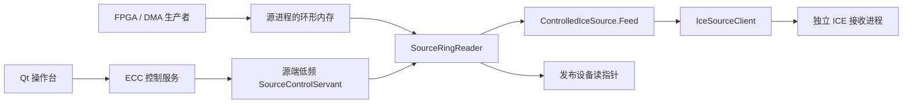

# 源端环形缓冲读出：读指针、线程和尾部排空

本页对应 `apps/sourcereader/sourceringreader.h/.cpp`。它替换旧 `CircularBuffer → DataSender → 更新 FPGA 读指针` 中可移植的读出逻辑。该库仅使用标准 C++11 和线程库，独立构建不需要 Qt、Ice、yaml、Boost 或 curl。选择 ICE 时，发送回调接到已有源端模块；选择其他同步发送器时，可复用相同缓冲核心。

目前已有实际实现、内存检查和双线程到真实接收进程的本机验证。板上 MMIO/DMA、中断、缓存同步和停止硬件的实现仍需要对应工具链及设备资料，不能把本机模拟内存当作真实 FPGA 驱动。`source/` 中旧代码保留不变。

## 1. 这层放在哪里



Qt/ECC 只选择缓冲区、设置刷新策略、启动/停止及查看状态。原始波形在源进程和独立接收进程之间传输。该读出库不解析帧，也不写数据文件，不把一个缓冲片段误认为完整 MFM 帧。

## 2. 三种累计位置分别是什么

每个 `SourceRing` 由应用提供 ID、借用内存地址、容量、初始读位置和两个设备适配回调。ID 范围 0～7，最多八个缓冲区；GET 的四个 AsAd 可以用 0～3。掩码中的位必须对应实际存在的缓冲区。

| 位置 | 含义 | 何时推进 |
| --- | --- | --- |
| `observedWriteTotal` | 已观察到、CPU 可以读取的生产字节总数 | `writeTotal()` 返回后；不能倒退或复位 |
| `handedTotal` | 发送调用明确返回的本地交付位置 | 同步 `send` 成功返回后 |
| `publishedTotal` | 发布读指针回调明确返回的位置 | `publishReadTotal` 成功返回后 |

总数从环形内存第 0 字节起累计，实际位置为 `total % capacity`。初始化的读、写位置必须属于同一计数周期；本库不自动复位设备。三个值是源侧进度，均不能当成接收端持久写盘证明。

例如容量 16，读总数 12、写总数 19，待发送七字节：先借用 `[12,16)` 四字节，再借用 `[0,3)` 三字节。它们直接交给发送回调，没有另建整帧或环形副本。网络库、内核和接收端可能仍有复制，不能据此声称整链零复制。

采用累计总数可以区分空与满：写总数减读总数为 0 表示空，为 capacity 表示恰好满，超过 capacity 表示越界覆盖风险并保持 UNKNOWN。

## 3. 设备回调必须提供的真实保证

`writeTotal()` 必须返回已经写完且对 CPU 可见的字节边界。多缓冲合入同一流时，还必须保证每次观察都停在完整消息/MFM帧边界，并显式设置 writeEndsAtMessageBoundary=true；构造拒绝缺保证的多缓冲。初始读位置同样必须处于完整消息边界。单缓冲可以提供任意字节前缀，因为它无需在来源之间切换。真实 DMA 要先执行平台所需的缓存失效/内存屏障，再报告该边界；本库的互斥锁不能替代设备缓存同步。返回的范围还必须保证在借用发送期间不被生产者覆盖。

`publishReadTotal(total)` 将累计位置转成设备读指针并执行必要屏障/写入/读回。返回表示适配器确认这一发布完成。不能只把值写入普通软件变量，再宣称设备已经释放缓冲。

借用内存必须从构造前一直有效到停止所有调用并销毁 reader 以后。DMA 映射的建立/释放属于驱动。发送回调必须在返回前消费这段内存，不能将指针留给异步队列后立即返回；异步发送器需要额外的所有权/完成确认适配。

应用必须先停止实际设备生产，再停止/join 读出线程，最后排空。只停止读出线程、仍让 FPGA 写入，会使“排空后结束”的判断无效。

## 4. 读出预算、掩码和刷新策略

`Flush(byteBudget, force)` 每次最多发送 byteBudget 字节。选中缓冲后记录其本次已确认写边界；片段受 chunkBytes、环形连续区间和预算限制，但必须一直保留该缓冲，直到完整送达本次边界才轮到下一缓冲。预算可以在半帧处结束，下次Flush仍接续原缓冲，不能把两来源的半帧交替拼接。公平性以完整消息批次为单位，不承诺按每个字节片段轮换；不进行跨缓冲事件号排序。它不分配与数据量成比例的额外内存。

alwaysFlush 为 true 时立即发送已有字节；为 false 时，在该缓冲待发送字节少于 batchBytes 时延后。`force=true` 忽略该门槛，供最终尾部排空使用。batchBytes 不能超过任一缓冲容量。门槛只决定何时开始读，不保证所有网络块都是 batchBytes。

`Configure(mask, alwaysFlush)` 需要调用方确认生产者静止。改变掩码前检查所有缓冲（包含原先禁用的缓冲）为空，防止关闭某个缓冲时丢弃尾部。不存在的位或零掩码在动作前拒绝，不修改位置。存在未读数据时改变掩码属于无法安全提交的策略，保持 UNKNOWN。

`Empty()` 检查当前启用缓冲的最新生产位置。它只有在设备已静止、且不存在其他生产者时才可以作为最终排空的一项前提。停止/连接状态和实际设备所有权还由源端生命周期模块及驱动核对。

## 5. C++11 接法

下面的 driver 是需要实现的板端适配对象，方法名用于说明职责，仓库没有声称已经提供该真实驱动。

```cpp
GetDAQ::SourceRing ring;
ring.id = 0;
ring.memory = driver.CpuMappedBuffer();
ring.capacity = driver.BufferCapacity();
ring.initialReadTotal = driver.ConfirmedReadTotal();
ring.writeTotal = [&] { return driver.CpuVisibleWriteTotal(); };
ring.publishReadTotal = [&](std::uint64_t total) {
    driver.PublishAndConfirmReadTotal(total);
};

GetDAQ::SourceRingReader reader(
    {ring},
    [&](const std::uint8_t *data, std::size_t count) {
        source->Feed(data, count);
    },
    [&](const std::string &error) {
        source->ReportFailure(error);
    },
    256 * 1024, 256 * 1024);
```

`source` 可以是同进程已连接的 ControlledIceSource，或低频控制适配器 SourceControlServant。后者的 ReportFailure 是本地设备线程 API，未加入远程 Slice；不能在尚无已连接源对象时调用。

读出线程循环使用有界 `reader.Flush(4 * 1024 * 1024)`，空闲等待由应用的中断/条件变量完成；不要忙循环占满 CPU。正常 drain 回调在设备和读出线程都静止后，反复 Flush(budget,true)，直到 Empty；驱动应为这段操作提供超时和静止证明。

reader 串行化 Flush/Configure/Empty/Status，不创建线程。回调执行时持有 reader 的操作锁，回调不得递归调用本 reader 的任何方法。fault 回调只记录/锁存源故障，不在里面 Stop/join：当前回调可能就在待 join 的读出线程中。显式失败停止由独立控制线程处理。

## 6. 发送和读指针失败如何处理

旧 MemRead 的刷新先同步写指针、发送，再同步读指针；异常被记录后仍可能继续后续动作。旧 daqStop 最多等待十次后没有再次确认停止，随后刷新。新可移植层不采用这两种不确定继续方式。

发送抛异常：该片段不发布读指针，记录 UNKNOWN；网络可能已收部分字节，禁止重发。发布读指针抛异常：发送已返回，handedTotal 保留新值，publishedTotal 保留上次确认值；设备写入可能已经发生，禁止再发送或再发布同一片段。

计数倒退、越界、普通及非标准回调异常也保持 UNKNOWN，并向 source.ReportFailure 传播。原 reader 对象没有 Reset 或重试入口。析构不刷新、不写指针、不发送结束。故障报告回调自身抛异常不会清除 reader 原故障；生产应用应确保故障报告可可靠锁存。

源端显式一次失败停止只停设备/join/checkIdle，不排空或补 End。要调查原指针、已发送位置、接收字节和设备状态，再进入独立受控恢复，不能新建 reader 假装历史问题消失。

## 7. 只有旧 FPGA 地址寄存器怎么办

LegacyRingWriteTracker 提供经过范围/整数溢出检查的地址到累计计数转换。它接受合法 end 地址并归一到起点，保持旧环形末尾约定。

然而单个地址不能区分“没写”和“完整绕了一圈又回到相同地址”。构造必须显式传入 noFullLapGuaranteed=true，表示驱动已经证明每次观察之间生产不足一整圈、不会出现满空歧义，并有硬件背压防止覆盖未读字节。传 false 直接拒绝。这个参数是应用前提，不是本库获得的硬件证明。

没有该保证时，应读可靠的累计字节/圈数寄存器，或增加固件计数/溢出标记；不能靠频繁轮询或假设网卡足够快来证明无丢失。旧 SyncedCircularBuffer 把超范围地址警告后忽略，新 tracker 会锁存 UNKNOWN，不采用旧值继续发送。

## 8. 独立构建和验证

只构建可移植缓冲层：

```bash
cmake -S apps/sourcereader -B build-ring -DCMAKE_BUILD_TYPE=Release
cmake --build build-ring -j4
(cd build-ring && ctest --output-on-failure)
```

启用 ICE 的纯数据构建会一并提供 getdaq-source-ring-reader 和 ring-ice-source-fixture。fixture 只用于合成测试，不是硬件守护进程。实际联调命令：

```bash
python3 tests/run_ring_ice_source_tests.py \
  build-ice-data/getdaq-ice-receiver \
  build-ice-data/ring-ice-source-fixture \
  build-ring-evidence
```

测试用两个真实线程分别写入和读取 6144 字节环形内存，帧跨连续边界，317 字节发送片段和有界读出预算；三次 Start/Stop 保留源连接，每次强制排尾。两种编码核对九帧原字节；合法空流结束；发布读指针应答丢失后两层 UNKNOWN、接收器没有结束/成功封存。

每轮联调输入/输出所有流合计保守上界 2 MiB，远小于 20 GiB。成功、失败或捕获中断均删除本轮合成 raw，保留小日志、SHA 和计数；SIGKILL/断电不保证 finally。单元用例不产生 payload 文件。详细普通/插桩范围见 [验证记录](VALIDATION.md)。这些验证不证明 DMA 一致性、板端中断、真机背压、目标平台、长期吞吐或断电。

设备生产/消费线程的可复用生命周期现由[SourceRingReadout手册](SOURCE_READOUT_LIFECYCLE.md)接续。多缓冲帧边界修正和完整ECC联调的最终范围以验证记录第69节为准；第68节是此前单缓冲专项，不能用其逐片段轮换用例证明多来源MFM流正确。

设备只能提供任意原始前缀时，可用SourceMfmRing.FramedView生成经过结构检查的完整帧边界，不能手工将任意位置标成完整；verifyDrained进一步防止半帧尾被Empty隐藏，见[源MFM手册](SOURCE_MFM_BOUNDARIES.md)。
