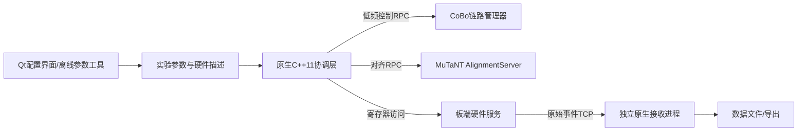

# CoBo/MuTaNT 系统对齐：操作、原理与原生架构

更新：2026-10-05。本文对应 `getdaq-align` 和 `SystemAlignmentClient`。它们迁移了旧主机的槽位定位、机箱内延迟测量和机箱间三步协调，不接收原始事件，也不替代完整生产 ECC。

## 1. 为什么需要这一层

CoBo 安装在机箱的 AMC 槽位上。MuTaNT 通过两条网络分发 GMC 和 WSCA；在对齐时，CoBo 先切换成相应反馈模式，板端 MuTaNT 服务再测量和设置延迟。主机必须知道“哪个 CoBo 在哪个 MuTaNT 的哪个槽位”，并以规定顺序调用各个模块。

只写一个时钟位不能完成这些工作。只收到 RPC 应答也不能证明真实电气相位已经达到要求。新版分别记录板端应答、返回结果的一致性和仍未验证的物理行为。

收到的源码含 `AmcSlotManager.cpp`、`SystemManager.cpp` 和 `MutantLinkManagerI.cpp`，但 MuTaNT 的 `AlignmentServer` 只有 `.ice` 接口；没有找到对应板端 TDC 算法实现。因此当前重写的是主机协调，仍调用现场既有板端服务。没有声称板端算法、XGPIO 驱动或 IceEirfu 已重建。

## 2. 控制和数据传输在哪里分开



`getdaq-align` 不链接Qt或yaml-cpp。它复用已有本地Ice/GET、标准C++11严格JSON和POSIX，没有增加外部运行库。Qt只用于配置、控制和显示低频状态。大流量数据继续由`getdaq-receiver`接收；它不链接Qt、Ice或yaml-cpp。

native_ecc模式下，Qt操作台调用固定ECC HTTP服务；生产ECC的Prepare会在同一SystemPreparationClient中执行MuTaNT子流程、SystemAlignmentClient系统对齐和CoBo准备。`getdaq-align`仍是独立的离线检查/诊断入口，GUI没有单独的“只对齐”按钮。旧SOAP/模拟模式保留为兼容路径，不具备这套原生系统准备与接收生命周期。硬件服务和多机箱TDC算法仍由现场板端提供；本机模拟测试不能代替真实板卡验收。

### 旧命令与单板维护的范围

旧 `mutant-align` 直接调用当前 MuTaNT 的 `alignDelayTDC`，返回该机箱内多个 AMC 槽位的结果；`mutant-align-multishelve`也是当前 MuTaNT 上的跨机箱对齐接口，由操作者按 GMC/WSCA 分别执行步骤 1–3。它们不是“只对选中 CoBo 写一次寄存器”的操作。旧系统的 `findSlotOfCoBo(coboId, clock)`会切换目标 CoBo 的反馈链路，但随后扫描拓扑里的所有 MuTaNT TDC 结果，要求唯一槽位后再恢复Normal链路；若中途抛异常，旧函数没有用作用域清理保证恢复。

新版 `SystemAlignmentClient` 保留系统级定位、GMC/WSCA测量、跨机箱步骤和写入顺序，在完整拓扑、停机/未初始化、接口身份及审计前提通过后运行。生产GUI将其作为 System Prepare 的一部分；独立 `getdaq-align`使用者也必须显式确认独占和数据已停止。针对某个故障CoBo的维护则用单板完整重准备，保留其他板和已完成的系统对齐，随后仍停留在Prepared并要求操作者显式Configure。该维护与重新运行TDC/跨机箱对齐目的不同。当前没有能够证明TDC影响范围只限所选CoBo的接口，所以UI不会把系统级操作包装成“单板重新对齐”。旧源码逐项对照见[命令迁移核对表](LEGACY_ECC_COMMAND_COVERAGE.md#对齐命令的范围源码复核-2026-10-22)。

## 3. 构建与输出

在项目根目录执行：

```bash
bash tools/build-linux.sh ice
```

输出包括 `build-ice-compat/getdaq-align`、原有 `getdaq-hardware` 和相关静态库。Qt 操作台仍用原有 `.pro` 构建；这两个原生工具属于独立的可选 CMake 构建。

实际本机验证环境是 Ubuntu 20.04.6、GCC 9.4。用户目标 Ubuntu 24、macOS 仍需实际验收；可选硬件后端目前不支持 Windows 构建。Windows Qt 5.14.2/MinGW 可独立检查 GUI。

## 4. 对齐前必须具备的条件

调用者必须已经停止采集、板端数据发送器和接收进程，并持有这些板的独占控制权。`--exclusive-stopped` 表示调用者明确声明已完成这些条件；它不会获得远端锁，也不会发送 Stop。

MuTaNT 必须先完成本项目 [MuTaNT Prepare 子流程](MUTANT_CONFIGURATION.md)：`run=0`，主从角色、GMC/WSCA 来源和 PromptWSCA 已正确设置。CoBo 的 `initDone` 和 `firmwareEnable` 必须为零，包括本次停用但仍声明在拓扑中的 CoBo。

新版先检查全部节点名称、管理器接口、绑定描述和相关寄存器权限/布局，再读取这些条件。任何后段节点的预检查失败都不会留下前段链路或对齐写入。条件值为零仍不证明数据发送器停止或控制权独占；这两项由上层负责。

不要让旧 ECC 和新协调器同时控制同一批板。库内互斥仅保护同一个协调器对象，不是全局硬件锁。

## 5. 准备硬件描述与拓扑

先导出接下来要绑定的描述。下面使用收到的原始文件作本地编译示例，不代表它们已经匹配现场固件：

```bash
mkdir -p runtime/descriptions runtime/alignments
build-suite/bin/getdaq-config compile-hardware \
  source/get/GetBench-software-release-20210208/data/config/hardwareDescription_Mutant.xcfg \
  runtime/descriptions/mutant.json
build-suite/bin/getdaq-config compile-hardware \
  source/get/GetBench-software-release-20210208/data/config/hardwareDescription_fullCoBoStandAlone.xcfg \
  runtime/descriptions/cobo.json
cp config/hardware/alignment-topology.example.json \
  config/hardware/alignment-topology.local.json
```

编译工具不覆盖既有输出文件。若已有描述，应明确另选新文件名并在拓扑中更新引用。

编辑 `alignment-topology.local.json`，把所有 `REPLACE_...`、IP 和端口改为现场实际值。示例的回环地址仅作占位，不会自动寻找硬件。

| 字段 | 含义与要求 |
| --- | --- |
| `schema_version` / `kind` | 固定为 `1` / `getdaq.alignment-topology` |
| `encoding` | 明确的 `1.0` 或 `1.1`；兼容旧现场时通常先核对1.0 |
| `timeout_ms` | 单次请求超时100–60000ms；不是整个对齐的总时间 |
| `mutants` | 本次受控模块；1–16个是主机资源限制，不是硬件物理上限 |
| `cobos` | 包含活动及需断开的停用板；最多192个，活动数不超过12×模块数 |
| `id` | 本次拓扑的唯一逻辑ID，最多128字节；不同于对象名或IP |
| `expected_node_name` | `mdaq::hw::Node::name()` 应返回的完整实际名称；不要从ID猜测 |
| `node_proxy` | 硬件节点对象的完整Ice代理；必须实现 `mdaq::hw::Node` |
| `alignment_proxy` | MuTaNT的 `AlignmentServer` 对象地址 |
| `link_proxy` | CoBo的 `MutantLinkManager` 对象地址 |
| `role` | MuTaNT明确为 `master` 或 `slave`；必须恰好一个master |
| `enabled` | CoBo是否参加本次定位/反馈；停用板仍须列入已受控拓扑 |
| `hardware_description_file` | 已编译的本地描述；相对路径以拓扑文件目录为基准 |

旧主机使用的服务对象名分别为 `MutantAlignmentServer` 和 `MutantLinkManager`，实际启动配置仍须核对。节点对象与管理器对象的身份不同；不能用 ECC SOAP URL 代替。

同一板的硬件和管理器必须使用相同的明确端点集合。新版拒绝空/间接代理、router/locator、重复逻辑ID及规范化后重复对象。相同端点不能进一步证明服务内部接线正确；不同DNS别名也不能据此排除物理重复板，现场映射仍需核对。

## 6. 先做离线校验

```bash
build-ice-compat/getdaq-align validate-topology \
  config/hardware/alignment-topology.local.json
```

该命令读取拓扑及描述，检查必填字段、重复/未知字段、明确角色、数量、范围和本地描述结构。现在只接受严格JSON：encoding/id/proxy/文件名为字符串，schema_version/timeout_ms为非负JSON整数，enabled为真正JSON布尔；拒绝YAML、多文档、注释和类型混淆，不根据字符串猜数字/布尔。

返回 `valid=true` 表示本地结构通过。输出同时明确 `hardware_connected=false`、`proxy_types_verified=false`；没有连接板端、没有核实运行状态，也没有做任何对齐。错误返回1，命令参数错误返回2。

整个拓扑文件最多1MiB，单个描述最多8MiB；这些上限用于控制主机内存和日志，不是 DAQ 数据包大小。

## 7. 执行对齐并查看日志

在第4节条件已实际满足后执行：

```bash
build-ice-compat/getdaq-align align-system \
  config/hardware/alignment-topology.local.json \
  runtime/alignments/alignment-0001 --exclusive-stopped
```

日志目录必须尚不存在，父目录须已存在。程序独占创建0700目录，所有日志以0600文件创建并逐条同步到磁盘，不覆盖旧记录。复用同一目录会在接触硬件前失败。

目录内容：

```text
alignment-0001/
  system.jsonl             # 拓扑、实际绑定权限/布局、前提、RPC顺序与结果
  hardware-0.jsonl         # 某次WSCA读改写及读回
  hardware-1.jsonl
  ...
```

`system.jsonl` 每行独立JSON。首行保存本次真正绑定的完整描述对象，而不是在失败后重新加载可能变化的配置文件。它是操作记录，不是可重放计划，也没有自动恢复或重新部署入口。

系统日志上限16MiB；每次新增记录先检查预算，预算或磁盘写入失败后不发送下一操作。日志不是原始采集数据，逐条 `fsync` 的延迟不会进入事件接收热路径。

成功输出包含 `located`、每个模块保存的 `gmc_mask/wsca_mask` 和机箱间步骤数，同时明确 `physical_alignment_verified=false`、`full_prepare=false`、`sync_pulse_sent=false`。

## 8. 实际执行顺序

1. 检查全部节点、接口、权限/布局、实际名称、主从/时钟来源与停止条件。
2. 所有声明的CoBo切为Normal。
3. 对每块活动CoBo，先切GMC反馈，让每个MuTaNT执行板端TDC过程；恰好一个槽位被报告占用后，切回Normal。再用WSCA独立定位并切回Normal；两次必须落在同一模块/槽位。
4. GMC机箱内测量：所有CoBo先Disconnected，活动板再GMC反馈；逐模块测量，再把全部CoBo设为Normal。WSCA按相同顺序执行。
5. 读取每个MuTaNT的两路12位输出掩码，保存为机箱内对齐快照，并核对返回结果。
6. 多机箱时，先全部Disconnected、活动板Normal；按拓扑中的每个slave，依次对GMC/WSCA执行step1、step2、step3，每步均先master、后该slave。
7. 多机箱正常完成后按旧流程设置全部MuTaNT的WSCA位、全部CoBo回Normal；随后保留旧Prepare中单/多机箱都会执行的最终WSCA设置。

单机箱不调用机箱间三步过程。停用CoBo不参与定位和反馈，但会收到全体切换命令。它们必须属于本次控制者负责的硬件；不能把其他实验正在使用的板列入本拓扑。

新版对齐子流程本身不发送SyncPulse：旧系统在CoBo PLL等准备阶段之后另行同步；[全系统协调器](SYSTEM_PREPARATION.md)已按该次序组合到native ECC的Prepare/Configure及数据生命周期。对齐命令返回成功仍不等于电气相位验收通过，也不会提前启动采集。

## 9. 槽位、延迟和掩码如何解释

板端字典键按收到的旧调用语义为0–11；人类使用的AMC编号为1–12。日志同时保存 `slot_index` 和 `amc_slot`，并拒绝负数或12以上的字典键。板端索引11就是AMC12。

两路结果必须返回相同的键集合、相同存在性；存在槽位的 `delta_delay_ps` 差值不得超过10000ps。正好10000ps允许通过；更大则停止。减法先提升到64位，避免两个32位极端值相减溢出。

还要求存在槽位与独立定位的活动CoBo一一对应、无两块板占同槽、保存的两路掩码与存在集合一致。这些检查比旧代码严格，目的是让后续SHELF_MASK不会使用明显矛盾的拓扑；它们仍只检查报告一致性，不证明电气精度。

板端 `programmedDelay` 是原始返回值，不据此推断真实时间。机箱间 `measuredDelay/programmedDelay` 的接口未声明单位，新版保留原始有符号整数和注释，不擅自标成ps。

机箱间过程可能改写实际输出掩码，保存的机箱内快照必须保持原值。后续MuTaNT Configure/SHELF_MASK使用该快照，ATO/BEAST另加的输出位不能混入快照；参见 [MuTaNT掩码说明](MUTANT_CONFIGURATION.md)。

## 10. 失败时怎么处理

| 失败位置 | 当前行为 |
| --- | --- |
| 本地文件、参数、独占/停止声明不满足 | 不改变硬件 |
| 任一节点类型、名称、权限/布局或运行前提不符 | 全局预检查停止，未发送链路/对齐写入 |
| 定位不唯一、两路矛盾、键非法、掩码不符 | 停止后段流程；此前板端过程可能已改变延迟/掩码 |
| 链路/对齐RPC异常，包括AlignmentAlarm | 结果记UNKNOWN；一次调用，不重发、不自动恢复Normal |
| RPC已应答但ACK日志写失败 | 已知收到应答，停止；不重复该操作 |
| WSCA寄存器写入后失联/读回失败 | 使用共享HardwareClient故障语义；不回滚或重发 |

旧代码部分异常分支会自动设WSCA和Normal。新版明确取消这种未知状态下的补偿；不能证明恢复动作可靠时，再发命令可能隐藏现场状态。失败后保留整个目录，核对系统/子日志和板端状态，再由完整控制器或现场人员决定恢复步骤。

不要“换一个日志目录再运行一次”当作恢复。新目录仅防止覆盖证据，不保证先前命令没生效。库对象是单次使用：Complete或Failed后都拒绝再次Align；析构不发送恢复命令。

## 11. 开发入口与后续组合

- `common/experiment/alignmentconfiguration.*`：纯C++11结果一致性检查，无Qt/Ice/YAML。
- `apps/hardware/systemalignment.*`：原生协调、固定编码/超时、禁止自动重试、全局预检查和持久化顺序。
- `alignmenttopology.cpp`：共享StrictJson读取拓扑、共享纯C++模型读取描述，不连接硬件。
- `alignmentmain.cpp`：独立命令行，无Qt。
- `HardwareClient::Validate`：共享Execute的完整软件/元数据检查，不读寄存器值、不写硬件、不创建日志；实际Execute仍重新检查。

上层将 `SystemAlignmentResult` 作为本次Prepare的内部结果；[SystemPreparationClient](SYSTEM_PREPARATION.md)依次持有对齐与CoBo准备对象、固定配置快照及告警监听器。NativeEccCoordinator进一步将该流程接到生产状态机、固定HTTP入口和数据生命周期。仍未证明现场加载版本/全局控制权、真实板卡对齐及冷启动恢复；这些边界见[重构进度](REFACTOR_STATUS.md)。

`ValidateInterfaces()`供全系统MuTaNT Prepare之前检查全部节点、管理器、描述和实际名称；只核对元数据，不读运行/角色寄存器、不发送链路/TDC操作。成功后仍为Fresh并保留连接，后续`Align()`继续读取实际已准备的角色/时钟源与停止位。校验失败进入Failed，不重用；不能用接口预检查替代主从实际配置或对齐结果。

验证覆盖、独立旧函数对照和内存检查记录见 [VALIDATION.md](VALIDATION.md)。真实GPIO、TDC相位、板端固件版本、目标平台及持续采集仍待现场验收。
