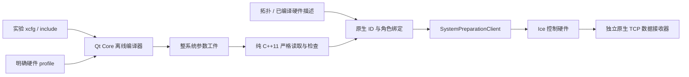

# 完整实验参数工件：编译、检查、绑定与原理

需要把此工件、profile、全部原始来源及有效快照作为一次版本保存，并让固定ECC持续核对时，使用[配置发布包](CONFIGURATION_PUBLICATION.md)。本地包生成/ECC绑定已有实现，远端自动上传/选择和实际板端加载读回仍待接。

## 1. 这一步解决什么问题

旧 GET 实验配置是 `.xcfg`。之前的新工具分别编译 AGET、CoBo 读出、AsAd、时钟、监控、校准和 MuTaNT，原生系统协调器则由调用者直接填写 C++ 参数。现在 `compile-system` 把这些参数组合为一个文件，补齐 Prepare 的 LEMO、手动读取延迟和输入槽位设置；原生后端可以严格读取并按实例 ID 绑定到系统 Prepare/Configure。

**这条链路已有本机模拟硬件验证，整套 ECC 替换仍未完成。** 工件检查、拓扑绑定和库对象 Configured 都不是现场 ECC Ready。新的生产 HTTP 入口、数据发送器连接、采集 Start/Stop、正常 Breakup 后 receiver EOF/封存核验已有代码；现场控制权与实际加载版本、后台告警停机、未知结果和冷实例的硬件恢复仍需验收或实现。[逐项状态](REFACTOR_STATUS.md)是当前能力入口。

当前支持收到的 GET Setup/CoBo/Mutant 参数布局及已有子编译器支持的继承/include；相同泛型路径的标量会解析共享 `unit`/`range`。硬件编译边界按旧 CompoundConfig XML 规则拒绝未知属性（标量只接受 `id/type/unit/range`，对象只接受 `id/include`）；编辑器仍保留未知原文以便安全审阅和编辑。数据库/网络来源等扩展不属于完整 CompoundConfig 替代范围，也不静默丢弃未知具体 Node。一个系统需要 1～192 个明确 CoBo 实例、至少一个活动 CoBo，以及 0～3 个 MuTaNT；有 MuTaNT 时必须恰好一个主模块、最多两个从模块。

## 2. 三种文件的分工

| 文件 | 内容 | 从哪里获得 |
| --- | --- | --- |
| 实验 `.xcfg` | 活动板/芯片、触发、读出、时钟、监控、校准、MuTaNT实验参数 | 原实验配置；保留原文和 include |
| 硬件兼容 profile JSON | 预期板型/芯片型号、寄存器布局、明确兼容策略 | 按现场硬件和既有文档核对后填写 |
| 拓扑 JSON | 实例 ID、网络代理、实际预期节点名称、硬件描述文件、主从角色 | 节点部署信息；不是实验参数 |

编译得到的 **工件 JSON** 包含完整类型化执行参数、源文件摘要、profile 字节摘要和参数版本摘要。工件不保存网络代理、控制权声明、数据进程状态或订阅回调地址。这样可在 Windows 的 Qt 工具中检查实验参数，再由 Linux 原生后端结合现场拓扑使用。



图中的控制命令不承载原始事件。接收器的固定缓冲池、队列、写盘和导出保持原实现，不解析本工件，也不链接 Qt、Ice、yaml-cpp 或新的 JSON/SHA 库。正常采集已由 `SystemAcquisitionClient` 与 `NativeEccCoordinator` 连接发送器、生产停止、Breakup/EOF、receiver Finish 和封存核验；该编译器本身仍不自动启动或连接数据进程。现场固件与真实数据完整性仍需硬件验收。

## 3. 构建程序

从项目根目录运行。以下构建目录相互独立，不能把 Qt 或旧 Ice 依赖放入接收器工程。

```bash
mkdir -p build-suite
cd build-suite
qmake ../GetDAQ.pro
make -j2
cd ..

cmake -S common/experiment -B build-experiment -DBUILD_TESTING=ON
cmake --build build-experiment -j2

cmake -S third_party/ice-compat -B build-ice-compat -DBUILD_TESTING=ON
cmake --build build-ice-compat --target getdaq-system-config -j2
```

本机工具位置：`build-suite/bin/getdaq-config` 是 Qt Core 编译器；`build-ice-compat/getdaq-system-config` 是原生检查/绑定工具。纯核心只依赖 C++11 标准库。原生拓扑工具复用已本地化的 Ice/GET 和 yaml-cpp，用于代理/硬件描述兼容；不需要新安装 JSON 或 OpenSSL 库。旧 Ice 主机构建仅支持当前 Linux/macOS 构建范围，macOS 尚未实际验收。

Windows 用 Qt 5.14.2 MinGW Kit 打开根 `GetDAQ.pro`，构建出的 `getdaq-config.exe` 可执行 `compile-system`。它不需要板端 Ice 环境。纯读取核心也是 C++11；本阶段没有在 Windows 实际编译/运行，原生拓扑工具不能据此视为 Windows 已支持。

## 4. 用收到的配置做一次离线练习

仓库提供 [profile 示例](../config/experiment/system-profile.external-trigger.example.json)，对应收到的 `configure-ExternalTrigger-2CoBo_1Mutant.xcfg`：第一块 CoBo 活动、第二块停用，一个主 MuTaNT。

**示例中的板型和芯片型号是测试预期，不是现场读取结果。** 复制后核对自己设备，再决定是否使用。名义时钟偏差许可为 true，是对该示例旧参数的明确选择；不能直接用于其他实验。

```bash
mkdir -p runtime/experiments
cp config/experiment/system-profile.external-trigger.example.json runtime/experiments/reviewed-profile.json

build-suite/bin/getdaq-config compile-system \
  source/get/GetBench-software-release-20210208/data/config/configure-ExternalTrigger-2CoBo_1Mutant.xcfg \
  runtime/experiments/reviewed-profile.json \
  runtime/experiments/external-trigger.v1.json

build-ice-compat/getdaq-system-config inspect runtime/experiments/external-trigger.v1.json
```

成功时编译器返回 0 并打印输出路径；检查器返回 JSON，包含 `valid:true`、两个 64 字符摘要、CoBo/MuTaNT 数量，以及 `hardware_connected:false`、`production_ecc_state_committed:false`。命令不会连接节点、订阅告警或修改寄存器。

输出路径必须不存在。再次运行同一编译命令会失败，已有文件保持不变；需要新版本时使用新文件名。这个本地 NewOnly 创建防止普通覆盖，**不提供远端原子发布、目录权限锁、断电持久性或实际加载提交协议**。编译完成并关闭文件后再交付给后端；不在生成期间加载文件。生产不可变发布和恢复语义需要在 ECC 接续阶段完成。

## 5. 怎样填写 profile

顶层必须恰好包含 `schema_version:1`、`kind:"getdaq.system-experiment-profile"`、`cobos`、`mutants`。数组必须覆盖 `.xcfg` 中全部明确实例，包括停用 CoBo；不能填写 `*`，也不能用一条 profile 凭空创建未声明节点。profile 不决定 isActive，`enabled` 必须与 `.xcfg` 一致。

停用 CoBo 条目只允许 `id` 和 `enabled:false`。额外参数会被拒绝，避免误以为停用板也应用了实验参数。它仍属于系统受控拓扑；系统协调器会检查停止前提并设置必要系统位，不初始化/上电或订阅它。

### 5.1 活动 CoBo 的全部必填字段

| 字段 | 允许值/含义 | 如何决定 |
| --- | --- | --- |
| `id` | 与 `.xcfg` Instance 完全相同 | 不使用代理名称或显示别名代替 |
| `enabled` | JSON 布尔 true | 必须与实验 isActive 相同 |
| `hardware_version` | 正的规范十进制**字符串**，1 为 R-CoBo、>=2 为 µTCA 型号编号 | 查现场硬件，不从访问失败猜测 |
| `chip_versions` | 对象，键为全局芯片 ID 的十进制文本，值为 `0x201/0x202/0x203` | ID = 4×AsAd + AGET；恰好覆盖活动逻辑芯片 |
| `buffer_layout` | `per-asad` 或 `shared` | 必须匹配描述和固件，Prepare/Configure共用 |
| `verify_hardware_version` | JSON 布尔 | 仅明确旧 R-CoBo 可关闭版本寄存器检查 |
| `firmware_info_registers` | JSON 布尔 | 描述是否支持固件日期/发布号观察 |
| `interrupt_rate_register` | JSON 布尔 | 旧缺该寄存器布局须明确关闭 |
| `monitoring_mapping` | `declared` 或 `legacy` | 前者按字段含义；后者保留旧实参错位行为，见[监控手册](ASAD_MONITORING.md) |
| `led_policy` | `required` 或 `none` | 是否要求板端 LED 管理器；required 的实际版本限制见[服务手册](COBO_SERVICES.md) |
| `delay_layout` | `global` 或 `per-asad` | SCR自动延迟寄存器的真实布局，不能写失败后换布局 |
| `calibration_aget_register` | JSON 布尔 | 旧无校准片选择寄存器时明确关闭且满足校准片限制 |
| `clock_allow_nominal_difference` | JSON 布尔 | 是否明确接受旧名义模型已知偏差；不代表测量频率正确 |
| `clock_allow_unverified_upstream` | JSON 布尔 | 是否明确允许 skipPLL/expert 导致的上游不可计算；不代表PLL已锁定 |
| `adc_mode` | `DDR` 或 `SDR` | ADC格式；旧标准Prepare默认DDR，SDR是明确选择 |

本系统协调版本要求 `mutantConfig` 系统状态寄存器，即使独立 CoBo 模式也如此；profile 不提供“失败后忽略”开关。不支持的旧板需要明确新实现和对应测试。

`chip_versions` 的“活动”是逻辑 isActive，不是 `enableAsAdPosition`：逻辑活动但物理槽位关闭的芯片仍须提供型号，后续校准/Configure仍依照逻辑集合。不要把保护开关当作活动掩码。

### 5.2 MuTaNT 的全部必填字段

| 字段 | 允许值/含义 |
| --- | --- |
| `id` | 与 `.xcfg` 的 Node[Mutant]/Instance 对应，大小写按原配置 |
| `register_layout` | `modern` 或 `legacy-names`；二者沿用v1.5语义，只选明确寄存器名称 |
| `clock_policy` | `strict` 或 `legacy-vhdci`，未知时钟名称的旧回退必须事前选择 |
| `two_proton_counter_command` | 是否支持该计数初始化命令，JSON布尔 |
| `allow_prototype_power_df` | 明确旧原型电源策略，JSON布尔 |
| `verify_board_id` | 是否检查板ID，JSON布尔 |
| `expected_board_id` | 规范十进制字符串，0～4294967295 |

模块数由本次明确 MuTaNT 列表确定，GMC/WSCA 输入掩码固定为零。运行时只能使用本次系统对齐保存的机箱内掩码，不能把前一次工件、ATO输出或机箱间过程现值当成新对齐结果。

主从角色、slaveId、端口、Level0/1/2 等实验参数仍来自 `.xcfg`。主模块必须唯一；从模块 A 对应 slaveId=0，B 对应1，端口和ID不能重复。没有 MuTaNT 时 `mutants:[]`，不是填写一个虚拟主模块。

## 6. Prepare 前段参数怎样读取

`Module/readDataDelay` 必须声明，范围0～255，无单位；不能因为C++模型有14的初值就忽略实验中的缺项。后续是否计算/选择自动延迟沿用校准参数，参见[校准手册](AGET_CALIBRATION.md)。

四个 LEMO 位置分别读取 `LEMO/L[0..3]/function`，缺项独立默认 `none`；无效功能明确拒绝。允许值与收到的旧映射一致：trigger_pulse_output、busy_output、pll_holdover_output、pll_ld_output、pll_clkin0_output、pll_clkin1_output、pll_sync_output、external_trigger_input、none、pll_clkin0_input、pll_clkin1_input、pll_sync_input、external_timestamp_reset_input。R-CoBo虽不写LEMO，也不能保留非法文本。

每个活动 AsAd 必须声明四个 AGET 物理位置。各位置读取 `Control/isActive`，以及三个独立可选字段：`enableAsAdPosition` 默认true，`connectGroundToZAP` 默认false，`antiSparklingEnabled` 默认true。关闭物理位置使ADC通道掉电并关采样/读出位；不改变逻辑 AGET 集合。

这是一个明确的旧行为修正：旧代码把三个查询放在同一个try块，早期字段缺失时会跳过后面已明确提供的字段。新编译器分别处理默认值，保留后续明确地线/防打火配置，并对其类型/范围检查；原文件全部字段齐全时含义相同。对应回归覆盖“缺enableAsAdPosition，但显式ground=true、antiSpark=false”的情况。

其余配置由现有类型化子编译器组合，保留单位、类型、来源继承与芯片覆盖检查；整体再核对 Prepare/Configure 的活动AsAd/AGET集合、逐片预期型号和缓冲布局。某片合法不表示整板共享offset/depth/2p合法。

## 7. 原生检查与拓扑绑定

先用现有[拓扑示例](../config/hardware/alignment-topology.example.json)填写真实节点信息和已编译描述路径，具体规则见[对齐手册](SYSTEM_ALIGNMENT.md)。**实例ID必须与工件相同**：练习配置用 Crate00_Slot00、Crate00_Slot01、master，示例中的 CoBo0/MuTaNT0 只是占位名称，需要修改。

```bash
build-ice-compat/getdaq-system-config validate-binding \
  runtime/experiments/external-trigger.v1.json \
  runtime/reviewed-topology.json
```

`validate-binding` 只读取文件、检查参数/描述及绑定关系，成功输出 `topology_bound:true`；不连接代理、检查远端实际名称、创建回调监听、订阅、写日志或设置寄存器。拓扑代理可暂时离线，但这不证明运行时网络可用。ID重复、数量不同、活动标志不同、主从角色不同或原生计划不能接受的策略会失败。

独立CoBo也可使用同一种拓扑格式，`mutants:[]`。原生配置检查入口明确允许此格式；`getdaq-align`仍要求有MuTaNT，不会为独立模式执行虚拟对齐。

绑定按ID查找端点，然后恢复**工件中的节点顺序**，保留调用者的实际代理/描述/回调与控制前提。因此把拓扑数组重新排序不会悄悄改变工件指定的主机操作顺序。

## 8. C++ 后端怎样接入

接口在 [systemexperimentbinding.h](../apps/hardware/systemexperimentbinding.h)，读取核心在 [systemexperimentconfiguration.h](../common/experiment/systemexperimentconfiguration.h)。生产后端应长寿命持有协调器，不能每个请求重新加载文件、重新订阅并丢弃已保存掩码。

```cpp
const auto artifact = GetDAQ::LoadSystemExperimentArtifact(artifactPath);
auto options = GetDAQ::BindSystemExperiment(artifact, reviewedEndpoints);

// reviewedEndpoints是生产控制器提供的SystemPreparationOptions：
// 实际端点/描述、每板回调地址、独占控制和数据进程停止确认。
std::unique_ptr<GetDAQ::SystemPreparationClient> client(
    new GetDAQ::SystemPreparationClient(options));
client->Prepare(newAuditDirectory);
client->Configure();
// 继续保留client以消费其自有告警和保存掩码；这不提交生产ECC Ready。
```

也可绑定 `SystemAlignmentOptions`。该重载不猜测回调地址，不建立控制权或停止数据进程；从文件加载的前提默认false，回调地址留空。**调用者必须在构造执行器之前提供实际条件和回调地址**，不能把CLI绑定成功当作这些条件成立。

执行时仍做全局远端元数据/服务/真实名称/版本和停止前提检查，Configure前再次核对，详见[系统协调手册](SYSTEM_PREPARATION.md)。工件读取先于硬件动作；非法工件不能借机创建硬件操作。Prepare失败或同步结果UNKNOWN仍遵循原协调器的故障保持、不重发、不自动清理规则。

## 9. 工件格式、精度和摘要

顶层恰好六个键：`schema_version`、`kind`、`configuration_sha256`、`profile_sha256`、`sources`、`settings`。schema版本数字为1，kind为getdaq.system-experiment-settings。settings包含所有模型字段，包括兼容策略和固定数组；缺字段、未知字段和重复键均拒绝，不用当前编译器默认值替代缺失旧工件字段。

settings中的**整数/浮点数均编码为字符串**；布尔仍为JSONtrue/false。整数为规范十进制，无前导零/十六进制/负零，解码检查目标C++类型范围；浮点数按经典locale和max_digits10写入，解码拒绝非有限值/溢出。原AGET全局参数中的字符串保留原有类型化编译语义，不强行改成JSON浮点数。

这避免一般JSON工具把大整数转为53位精度浮点数，保留48位计数、无符号范围和未来字段精度。不要把字符串手动改成数字；格式错会先于版本检查被拒绝。固定数组长度必须精确，映射的数值键也必须是规范十进制。

| 摘要 | 覆盖内容 | 用途/边界 |
| --- | --- | --- |
| `configuration_sha256` | UTF-8域前缀 `getdaq.system-experiment-settings:1\n` 加纯核心确定性settings JSON | 标识实际参数和策略；来源路径迁移不改变它，参数或节点顺序改变会改变 |
| `profile_sha256` | 编译时实际收到的完整profile字节 | 追踪所用兼容策略文件；不自动重新打开后来改变的文件 |
| `sources[].sha256` | XcfgDocument加载的实际原文件/include字节快照 | 原文件继承来源；不证明现场采用该文件 |
| 检查器返回 `artifact_sha256` | 实际读取的工件全部字节 | 区分来源/格式改变，保持本次收到的输入证据 |

参数摘要通过解码后重新规范编码计算；JSON键重排或缩进改变不影响参数摘要，但工件字节摘要会改变。数组顺序属于参数编码。后端不会用工件中的相对路径再次加载/覆盖参数，也不把源文件的后来内容替换进本次输入。

摘要仅用于内容一致性和追踪，不是签名、身份鉴别、控制权或“硬件已加载该配置”的证明。SHA-256实现按[NIST FIPS180-4](https://nvlpubs.nist.gov/nistpubs/FIPS/NIST.FIPS.180-4.pdf)的算法自行实现，仅用于配置字节，已有标准向量和Python hashlib交叉验证；没有声称获得FIPS认证。

## 10. 文件与解析边界

工件最大64MiB，现有拓扑读取器最大8MiB，profile最大1MiB；JSON字符串最大4096字节、每数组/对象最大4096项、嵌套深度最大64、总节点最大400万。原生读取支持严格JSON，不把YAML标记、注释、尾逗号、多文档、NaN或不合法UTF-8当JSON接受。转义后的重复键同样拒绝，例如`a`和`\u0061`。

来源记录必须有1～256项，路径唯一且有界、SHA为64字符小写十六进制。板/芯片范围、主从一致性及全部既有参数约束继续检查。解析DOM和参数计划只在控制侧加载时分配，不进入原始事件热路径；文件大小限制不是DAQ吞吐指标。

审计根`system.jsonl`记录实际绑定的两个输入摘要，同时保留`actual_loaded_configuration_verified:false`、`production_ecc_state_committed:false`。直接C++参数的既有调用可不绑定工件摘要，显示为空；一旦提供，两个摘要必须同时有效。生产ECC后续须实现独立的加载/运行版本核对与状态提交。

## 11. 常见错误的处理

| 错误/现象 | 含义 | 下一步 |
| --- | --- | --- |
| Missing profile / undeclared instances | profile和xcfg实体不一致 | 核对实际Instance，不填通配符、不删除停用板以绕过检查 |
| Profile enabled differs | 两处活动标志冲突 | 先决定真实实验活动集合，再一致填写 |
| Version map缺项/多项 | 没覆盖恰好全部活动逻辑芯片 | 按4×AsAd+AGET编号核对；不按物理槽位开关删型号 |
| Unsupported unit / scalar class | 单位错误或共享类尚未解析 | 修正明确错误；共享类须继续实现语义，不移除元数据假装等价 |
| Unknown/duplicate key | 格式或拼写错误 | 按本schema重建，避免JSON编辑器的最后键覆盖行为 |
| Configuration digest mismatch | 参数与保存版本不同 | 回到源文件/profile重新编译新文件，不只改摘要掩盖变更 |
| Topology ID/role differs | 端点与实验模型不能对应 | 核对实例ID和真正主从，不按数组位置强行配对 |
| Cannot create new artifact | 路径已存在/权限错误 | 使用新版本文件名并检查目录；不覆盖正在使用的工件 |
| 绑定成功但执行器拒绝回调/前提 | 缺生产回调地址/真实控制条件 | 补齐控制器的运行条件；离线检查不生成这些条件 |
| Prepare/Configure远端失败 | 硬件可能已有部分动作 | 保留工件和审计，按系统手册核对并恢复；不换目录自动重跑 |

## 12. 可复现验证与未完成范围

纯核心回归：

```bash
cd build-experiment
ctest --output-on-failure
cd ..
```

编译、原生检查/绑定、真实旧配置和本机TCP端到端回归：

```bash
cmake --build build-ice-compat --target hardware-system-preparation-tests -j2
python3 tests/system_experiment_integration.py \
  build-suite/bin/getdaq-config \
  build-ice-compat/getdaq-system-config \
  build-ice-compat/hardware-system-preparation-tests
```

省略最后一个参数则只做离线进程检查，不创建TCP服务。提供该参数时，测试使用真实收到的两份描述，模拟板端在随机本机端口运行；读取编译工件，执行两种Ice编码的完整Prepare/Configure，并检查输入摘要/活动/读出和订阅生命周期。它不连接现场设备，不证明真实PLL相位、TDC校准、波形正确或持续高速吞吐。

实际结果和插桩范围见[验证记录](VALIDATION.md)。工件已接入native ECC固定网络/状态流程，并由配置界面检查当前固定实验摘要；尚未证明现场硬件实际加载了对应版本，也未完成全历史数据模式、macOS原生、独立部署机、板卡和持续DAQ验收。
