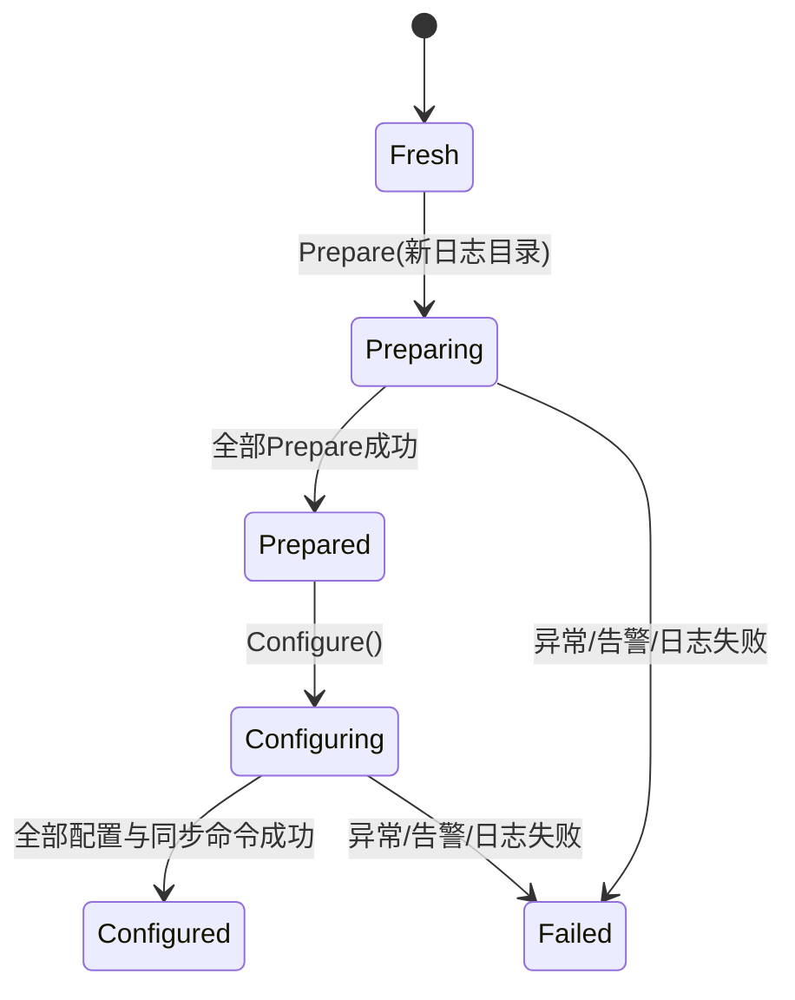

# 全系统 Prepare / Configure：顺序、同步与跨板告警

## 1. 这个模块负责什么

`apps/hardware/systempreparation.h/.cpp`提供无Qt的`SystemPreparationClient`，把已经迁移的MuTaNT初始化、系统对齐、单板CoBo Prepare、CoBo Configure和MuTaNT Configure连接成同一个长寿命主机流程。构造时复制配置，执行后保留本次对齐的掩码和告警订阅，后续阶段不能另拿一份参数重新拼接。配置复制后的拓扑检查、CoBo/MuTaNT交叉约束和硬件步骤计划编译位于私有 `systempreparationplan_p.cpp`；该阶段不连接硬件。`SystemPreparationClient` 消费编译结果并负责Prepare/Configure生命周期及顺序。

这是**原生硬件协调库接口**。接口单独使用时不接生产 ECC 状态、GUI 配置部署或远端独占锁；当前由 `NativeEccCoordinator` 组合到原生 ECC 网络服务，并衔接数据生命周期和 Qt native ECC 模式。对象中的`Prepared`/`Configured`仍只是子流程阶段，只有父协调器完整提交后才更新 ECC 状态。真实硬件全局独占、实际加载配置验证和现场运行仍需验收，不能把本机联调当作现场许可。

数据边界保持不变：Qt显示配置和低频状态；Ice兼容层只发送控制命令；大量原始DAQ字节进入独立的[C++11接收进程](DATA_SERVICE.md)。这个协调器不收取、复制或转发原始帧，也没有新增SDK依赖。

同一采集对象成功Breakup后，本对象回到Prepared，保存掩码和告警仍在，可以对同一不可变配置重新Configure。Unprepare仅接受Prepared及本次新的数据进程停止声明；观察实际供电/保护、确认断电后释放自己的订阅，成功进入不可重用的Unprepared。它不销毁描述、不处理receiver封存，也不是完整生产Reset；详见[撤销准备及失败处置](SYSTEM_RELEASE.md)。

## 2. 为什么要组合到同一个对象

只把几个旧子流程依次调用，会留下几个实际问题：

- 第二块板的字段、型号或告警服务有问题时，第一块板可能已经复位或上电。现在所有活动板的Prepare和Configure目标，以及全部系统同步位，都先检查，再开始任何写入。
- 机箱间对齐会改变当前时钟输出掩码。Configure需要机箱内对齐时保存的掩码；不能在后来重新读取现值冒充该快照。
- 第一块板完成Prepare后，其告警仍必须阻止第二块板继续初始化。只检查“正在配置的那块板”不足够。
- 同步脉冲与采集启动共用硬件路径；提前设置`initDone`会改变脉冲含义。必须保持旧主机代码的时序边界。

这里迁移的是收到的2021版GET `SystemManager`主机流程。板端TDC实现、实际PLL锁定、电气延迟和实机吞吐仍需验收。

## 3. 输入与检查

| 输入类型 | 需要提供的内容 | 注意 |
| --- | --- | --- |
| `SystemPreparationOptions` | 全部CoBo/MuTaNT、编码1.0或1.1、100..60000ms超时、独占/数据停止声明 | 声明本身不实现锁或Stop |
| `SystemCoBoSettings` | 唯一ID、板端链路代理、是否活动、单板Prepare选项、完整CoBo Configure参数 | 停用板仍属于受控拓扑，必须实际停止 |
| `SystemMutantSettings` | 节点/对齐服务/描述/实际名称/主从角色、MuTaNT参数 | 0模块为独立CoBo；有MuTaNT时为1主+最多2从 |

ID跨两类节点唯一。代理要求显式直接端点；规范化identity、facet和端点后检查重复，不把两个不同拼写当成不同板。对齐服务和对应硬件节点的端点绑定仍由`SystemAlignmentClient`检查。

活动CoBo的Prepare/Configure必须具有相同AsAd、逻辑AGET集合、逐片预期型号和循环缓冲区布局，并支持系统`mutantConfig`字段。物理槽位的`enabled=false`与逻辑`active=false`仍是不同概念，不静默改变活动集合。所有原有子编译器继续检查参数单位、范围和明确布局。

MuTaNT总数由协调器按实际拓扑设置，不用调用者可能遗留的`moduleCount`。本次Configure的GMC/WSCA掩码只来自本次对齐结果，调用者输入的旧掩码不用于本流程。有MuTaNT时必须恰好一个主模块；两个从模块必须具有不同ID和端口，A对应从ID0，B对应从ID1。旧一致性循环错误地重复检查第一个从模块，新实现逐个检查，并在首次写入前拒绝不一致拓扑。

## 4. 状态和使用方法



`Prepare`和`Configure`各只能一次。失败对象不可重用；创建新对象和新日志目录也不能代替恢复核对。`Configure`只能接续同一对象成功完成的Prepare，外部随后修改原始settings不会改变它已经复制和编译的计划。

生产后端接入形式如下，`verifiedOptions`需要由实际控制权、已发布配置及数据停止观察共同产生，不能把布尔值设为true就当验证完成：

```cpp
#include "systempreparation.h"

// 长期归运行控制后端所有；对象需要活到运行结束与订阅处置完成。
std::unique_ptr<GetDAQ::SystemPreparationClient> system(
    new GetDAQ::SystemPreparationClient(verifiedOptions));
system->Prepare(newAuditDirectory);
system->CheckInterlock();
system->Configure();
system->CheckInterlock();
// 下一阶段仍需连接发送器/接收器、绑定ECC状态和实现真实Start/Stop。
```

本模块没有新的GUI按钮、命令行部署入口或JSON加载器。现有`compile-*`用于离线检查；不能把JSON输出直接送到本类或当成已加载版本。这里的类型化选项是后端集成接口。

## 5. 首次写入之前

1. 检查独占和数据停止声明，创建全新0700目录及0600日志；目录存在即拒绝。
2. 检查规范化节点重复、全部链路/TDC接口、实际名称和绑定描述。`SystemAlignmentClient::ValidateInterfaces()`此时不要求MuTaNT已经设置主从/源，也不执行链路或对齐写入。
3. 检查每个MuTaNT Prepare、Configure、WSCA、掩码和同步位的元数据/权限/宽度。
4. 检查所有CoBo的`initDone`、`mutantMode`和`l2Trigger`目标；活动板完整检查Prepare、后续Configure及实际硬件版本、AlarmService远端类型。
5. 创建活动板本地回调监听器，但**不Subscribe，不reset其他客户端**；它们留给同一个单板对象稍后订阅。
6. 只读观察全部CoBo的`firmwareEnable=0`、`intEnable=0`、`initDone=0`和全部MuTaNT的`run=0`。停用板也检查，不能为了配置别的板改动仍采集的板。
7. 持久化`global_preflight_complete`，随后才进入硬件写入。

局部子流程仍在执行前重新检查元数据和实际停止/板型。预检查不是跨客户端原子保证，接口身份也不能预先证明每个较新方法的实际语义。正在采集或已经`initDone=1`的拓扑会被拒绝，不在这里偷偷清零或代替Breakup。

## 6. Prepare顺序

| 顺序 | 动作 | 最后保留什么 |
| --- | --- | --- |
| 1 | 所有MuTaNT Prepare | 总数、主从角色、时钟源和电源/板型观察 |
| 2 | 活动CoBo两路独立槽位定位、机箱内测量、机箱间主从对齐 | 保存机箱内GMC/WSCA掩码；最终WSCA CLK2开启 |
| 3 | 逐活动CoBo执行完整单板Prepare | PLL/AsAd/AGET/ADC/DAC/保护/阈值/延迟，以及各自订阅 |
| 4 | 检查所有活动板保持告警并记录完成 | `initDone`仍为0，不发同步、不启动采集 |

单板细节见[组合手册](COBO_PREPARE_CLIENT.md)，对齐见[系统对齐](SYSTEM_ALIGNMENT.md)。已经准备的板的监听器持续存活；后续板每项操作、等待和轮询都会同时检查前面板的保持告警。

## 7. Configure和同步的关键顺序

1. 再检查所有板的实际名称、全部后续Configure/同步元数据、停止位与保持告警；在任何本阶段写入前完成，避免Prepare后的环境变化只在后一块板才发现。
2. 逐活动CoBo配置AGET、零抑制、AsAd TCM/ISPM/pulser和Module。此时不提前打开`mutantMode`，避免旧AsAd配置问题。
3. 所有CoBo设置主模块的Level2策略，然后设置`mutantMode`；停用板明确保持0。
4. 再观察全部CoBo停止位、`initDone=0`及所需`mutantMode`。
5. 所有MuTaNT关闭WSCA的CLK2分发位。
6. 对每个MuTaNT，先恢复本次保存的机箱内两路掩码，再发送`start_pulse=1`。
7. 所有MuTaNT再发送`start_pulse=0`。这里保留“全部置高、再全部置低”，不改成每模块立即高低一对。
8. 所有MuTaNT恢复WSCA CLK2分发。
9. 所有活动CoBo设置`initDone=1`；停用板保持0。必须先于MuTaNT Configure，因为它影响B卡MRDY。
10. 逐MuTaNT按保存掩码Configure，检查MRDY并处理tag-only输出；最后再次检查告警。

收到的旧说明明确：同步在对齐和CoBo PLL初始化之后；`mutantMode=1`而`initDone=0`使CoBo区分同步与启动；CLK2分发位暂为0才能传递同步脉冲。普通字段通过有界读改写保留无关位；自清零同步命令不强加回显检查。

独立CoBo模式跳过全部MuTaNT/对齐/同步动作，保持`mutantMode=0`、`l2Trigger=0`，仍执行活动CoBo的Prepare/Configure。

本模块最后不执行旧`daqConnect`。同一准备对象由[SystemAcquisitionClient](SYSTEM_ACQUISITION.md)显式连接，并由NativeEccCoordinator组合硬件/发送器启停及自动receiver生命周期。`Configured`不证明发送器已连接、ECC Ready、真实相位同步或数据可以采集；这些须由后续步骤和实际观察确认。

## 8. 告警与部分失败怎么处理

每块活动板保留自己的`CoBoAlarmClient`，不reset其他客户端。`Alarms(coboId)`可在阶段终止后获得所有者；停用或尚未建立监听器的板返回nullptr。可以读取快照和有界Drain，Drain不清故障。生产后端需要持续调用`CheckInterlock()`并把故障接到真正的硬件Stop/排空/封存流程。

跨板检查器只读取本地保持状态，不从回调线程写硬件。它在操作边界、轮询、普通读改写写入前和最长25ms的等待分段检查；**不能打断在途RPC，也没有网络、磁盘或线程调度的硬实时上界**。告警导致停止后段，不等于硬件已经停止。

| 失败位置 | 已知边界 | 处理要求 |
| --- | --- | --- |
| 全局元数据/服务/停止观察失败 | 尚未发送本流程硬件写入或订阅 | 保留审计，修正前提；不声称系统已Prepare |
| 第二块板初始化期间第一块告警 | 第二块可能已部分复位/上电 | 停止后段，协调真实Stop；不自动清理前板 |
| 同步高脉冲应用后丢失应答 | 结果UNKNOWN，可能已影响PLL | 不重发、不自动置低/恢复CLK2、不设置initDone |
| MuTaNT Configure或MRDY失败 | CoBo initDone可能已为1 | 不提交ECC Ready；真实Stop/恢复须接续审计和实际观察 |
| 应答后日志写入失败 | 某命令可能已确认，但审计不完整 | 不把重复命令当成修复日志的方法 |

析构只释放本地资源，不自动Stop、Unsubscribe、复位或恢复Normal。成功注销也需要显式命令路径；Unknown订阅不可盲目重发。失败后现可在同一对象明确调用 `StopProductionAfterFailure`，关闭主/从MuTaNT及活动CoBo生产源，保持Failed和自有告警，不要求Configure成功。它不会停sender/排空数据或替代权限锁、状态恢复；操作步骤见[准备故障停止](PREPARATION_FAILURE_STOP.md)。

## 9. 日志和验证入口

全系统根`system.jsonl`记录绑定描述、硬件阶段和完成/失败边界，预算64MiB。每个硬件阶段有独立`hardware-N.jsonl`。`alignment/`保存拓扑/对齐过程；`cobo-N/`保存本板预检查、执行前提、两段Prepare、订阅和告警日志。名字使用数组编号而不是把用户ID插入文件路径。

独立文件的作用是指出**哪一个RPC可能生效、最后哪个应答已记录、哪个阶段尚未执行**；日志不是自动重放脚本。失败目录不删除或复用。

```bash
bash tools/build-linux.sh ice
(cd build-ice-compat && ctest --output-on-failure -R hardware-system-preparation-tcp)
(cd build-ice-compat && ctest --output-on-failure -R 'hardware-(prepare|alignment|mutant)-tcp')
python3 tests/system_preparation_original_reference.py
```

最后一个命令需先成功运行全系统TCP测试，读取它生成的`build-ice-compat/system-preparation-audits.jsonl`及对应新日志目录；它重新提取/编译真实旧SystemManager函数，只作阶段顺序对照，不连接实机。

测试使用真实描述转换的CoBo11设备/1310寄存器、MuTaNT5设备/87寄存器，TCP回环与两种编码；实际记录和验证范围见[验证文档](VALIDATION.md)。模拟中通过的同步位顺序不证明板端电气行为。当前实际开发环境与Ubuntu24、Windows Qt5.14.2 MinGW及macOS验收仍分开记录。

整系统实验参数现已有`compile-system`离线工件、纯C++11严格读取/摘要和原生ID/角色绑定，接续同一SystemPreparationClient；详细profile、命令、数据精度、配置输入审计与运行前提见[完整实验配置手册](SYSTEM_EXPERIMENT_CONFIGURATION.md)。这不新增接收器依赖；NativeEccCoordinator已负责生产ECC状态提交和网络状态，但目前不证明板端实际加载版本，也不提供完整冷启动恢复。
