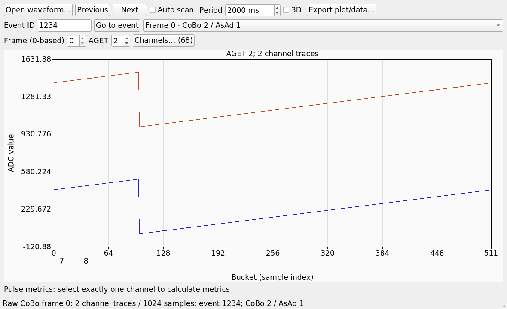

# 离线波形查看器

`getdaq-waveform-viewer` 是一个独立的 Qt Widgets 离线工具，可直接查看 `.graw` 原始文件或 `getdaq-matrix` 输出的 `.gmat` 文件。它按真实事件号或帧、AGET 和通道显示波形，只用 Qt 5 Core/Gui/Widgets 和 C++11，不依赖 ROOT、Qwt、网络库或数据接收器。

## 选择具体事件与显示通道

打开 `.graw` 并等待索引完成后，在 **Event ID** 输入MFM帧头中的真实事件号，点击 **Go to event** 或回车。事件号范围0～4294967295，不是从零开始的帧序号。同一事件包含多块CoBo/AsAd时，旁边下拉框列出匹配的帧索引和板卡来源，选择需要查看的一帧；不会把不同板卡的通道混在一起。未找到事件或事件号越界时保留当前帧并提示原因。

事件号可能在同文件中重复或回卷，下拉框保留所有匹配帧的具体索引以便区分。单次匹配超过4096帧时提示使用Frame索引，不截断后冒充完整事件。`.gmat`未保存原始事件号，因此禁用Event ID入口，使用 **Frame (0-based)** 选择矩阵帧；不能把矩阵帧序号当作原始事件号。

点击 **Channels…** 打开通道选择弹窗，勾选当前AGET的0～67通道，按OK应用或Cancel放弃。保留原来的弹窗交互，不占用常驻绘图空间。All / None可全选或清空；确认空集合时清空画布并禁用导出。选择会沿用于后续帧及AGET切换，2D、3D和CSV导出使用同一通道集合。

二维图横轴为真实采样桶号 **0～511**，显示数字刻度；纵轴为 **ADC value**，显示全组选中曲线共用的自动范围及多个数字刻度。纵轴标签宽度按实际数值计算，负值和四位以上数值不会因为固定边距而丢掉前面的数字。这里没有假定采样频率，不将bucket直接标成ns。绘图点按真实桶号排序，避免输入存储顺序跨过桶号回卷处时连出横跨图面的伪线；ADC数值不变。



上图使用本机合成波形文件演示界面，不是实板采集结果。

## 控制台 Tools 入口

控制台 **Tools → Waveform viewer…** 打开同一套离线窗口，只允许在没有本地活动Run、没有观察到Running/Paused、没有待续跑自动序列且控制端空闲时打开。重复点击会激活已有窗口，不创建多个副本。

集成窗口存在时，主窗口Run start变灰；普通Run与扫描点Run在GUI和控制线程都检查窗口互锁。必须关闭查看器、等索引线程取消/退出及窗口销毁后，才重新允许启动。采集开始后菜单入口不可用；若GUI观察到MCP/其他外部入口已经开始采集，会关闭集成窗口。该行为有观察延迟，不是ECC服务端跨客户端锁，也不管理从操作系统单独启动的查看器进程。

独立 `getdaq-waveform-viewer` 保留，命令行扫描分析、3D和导出功能不变。控制台与独立程序通过 `waveformwindow.pri` 编译同一个窗口/绘图实现，不启动第二套DAQ接收或控制连接。窗口只读离线文件，原始数据不进入Run控制网络路径。

控制台右上角Elapsed按 `0 h 00 min 00 s` 显示，分钟/秒按60进位，小时超过24不回卷；显示单位变化不修改现有计时来源和暂停规则。

## 其他离线数据工具

**Tools → Data file tools…** 将现有独立程序接入一个后台任务窗口：

| 功能 | 独立程序 | 窗口参数 |
| --- | --- | --- |
| 原始数据结构/来源检查 | `getdaq-inspect` | 一个或多个已结束采集的本地文件 |
| 波形矩阵转换 | `getdaq-matrix` | 单个输入、新 `.gmat` 路径、帧数上限（All 为不限） |
| 按事件号合并 | `getdaq-merge` | 多个输入、新 `.gmer` 路径、合并事件数上限；沿用1024 MiB分段 |
| FITS 导出（可选） | `getdaq-fits` | 单个输入、新目录、帧数上限 |
| ROOT 导出（可选） | `getdaq-root` | 单个输入、新 `.root` 路径、帧数上限；默认 GDataFrame 格式 |
| ROOT 事件查看（可选） | `getdaq-root-viewer` | 启动现有窗口，在其中打开 ROOT 文件 |

程序优先从 GetDAQ 所在目录查找，再查 PATH。没有安装对应程序时，该选项文字置灰并禁用；全部缺失时 Data file tools 菜单置灰。 未选择输入、单输入转换选了多个文件、输出未填写或已存在时，Run tool灰显并以tooltip说明原因；没有选中输入项时Remove selected灰显。实际启动前仍再次核对，避免文件在编辑后变化而误执行。打开 Tools 菜单会刷新安装状态；状态轮询不重复扫描 PATH。ROOT/CFITSIO 仍是独立可选组件，不增加主程序链接依赖。常规 control 构建没有原生离线程序时菜单置灰属于正常行为；full/data/analysis 构建规则沿用现有配置。

新窗口只读输入，明确拒绝已有输出路径；矩阵、FITS 和 ROOT 转换沿用20 GiB输出上限。合并器沿用已有分段逻辑，保留已存在的分段。通过 QProcess 的独立 argv 调用程序，不拼接 shell。后台输出只显示前256 KiB并最多保留2000行，失败保留工具的原始报错。工具采用普通独立窗口，不走 QDialog 的 accept/reject 退出回调。叉号、Close 按钮与 Esc 共用关闭路径；Stop tool 或关闭窗口会请求终止，2秒未退出则结束子进程；必须等进程结束及窗口销毁后才解除 Run 互锁。中断的转换可能留下临时/未完成输出，不能把这些文件当作完成归档。

波形窗口和数据工具窗口共用互锁，必须都关闭后才能启动普通或扫描点 Run。即使工具尚未执行任务，窗口打开时也锁定 Run start。ROOT 查看器作为受管子进程运行，关闭工具窗口会同时结束该进程；从系统独立启动的程序仍不受 GUI 管理。外部/MCP采集开始时，GUI观察后关闭窗口并停止子进程，同样有观察延迟，不能当作服务端跨客户端排他锁。

## `.graw` 与 `.gmat` 的读取方式

打开 `.graw` 时，工具在后台顺序检查 MFM 帧头并建立 CoBo 子帧偏移索引；对大帧只读取必要的头部，然后跳过其余字节，不会把整个文件载入内存。选择一个波形时，才读取并解码对应的 CoBo 帧。关闭窗口时会请求索引线程停止，并等待其退出。原始文件只读，不连接设备、不启动接收器，也不会改写或转换输入。

当前支持独立 CoBo type-1 revision 0–5、CoBo type-2 revision 5，以及旧合并器和本项目 `getdaq-merge` 使用的 MFM layered type `0xFF01` revision 1。type-1 样本显式含 AGET、通道、桶号和值；查看器保留文件中的样本顺序并用桶号作为横坐标，允许稀疏波形，但会拒绝所选通道的重复桶号。type-2 按旧 CoBo Viewer 规则由 AGET 的顺序恢复通道/桶号，并要求四个 AGET 都有完整的 `68 × 512` 读出。无法解析的帧结构、截断帧、无受支持 CoBo 帧的文件都会报错。

索引最多保存 2,000,000 个 CoBo 帧，单个 CoBo 帧最多 4 MiB，layered MFM 容器最多 1 GiB、嵌套深度最多 8 层。这些上限用于控制索引和单次解码内存；超限时明确拒绝文件。索引时间随文件长度增长，界面不会因此停止响应。

`.gmat` 仍使用固定 `4 AGET × 68 通道 × 512 桶 × 8 字节` 布局，即每帧 1,114,112 字节。查看器校验该文件大小是整帧的整数倍；选择通道只按文件偏移读取512个binary64样本（4KiB）。需要把完整 type-1 `.graw` 转成旧 Viewer 矩阵布局时，仍可使用独立原生 `getdaq-matrix`。它与 GUI 均不在 DAQ 接收链路中。

`.gmat` 波形的512个binary64值会完整显示和导出。若其中有非有限数，当前波形会被拒绝；若值不是整数或不在CoBo 12位ADC范围内，波形仍可查看/导出，但不会把浮点或越界数误作原始ADC值计算脉冲指标。

工具默认叠加显示所选 AGET 的全部 68 条通道曲线；通过Channels…弹窗选择显示集合（允许全部隐藏），并用颜色和图例区分。对 `.graw`，一帧只读取和解码一次，type-1 中所选但没有样本的稀疏通道会从图例和曲线中省略；type-2 仍要求完整四 AGET 读出。对 `.gmat`，只读取所选通道的 512 个 binary64 样本。所有显示通道共用同一 ADC 纵轴范围，CSV按通道逐条写出。脉冲指标只有选中单条通道时才计算，避免把多条曲线混合成没有明确意义的指标。勾选“3D”会把当前AGET绘制为桶号×通道×信号值曲面；鼠标左键拖动可旋转视角。未选择的通道以零值显示，匹配旧 CoBoSurf 的通道掩码行为。该曲面由现有 Qt Widgets/QPainter 栅格绘制，不使用QwtPlot3D、Qt OpenGL绘制API或ROOT库，也不新增这些库的直接链接依赖。Qt本身的Gui平台运行依赖仍由所选Qt发行包提供。该工具不缓存整个文件，也不连接在线DAQ。帧号可直接输入，也可用 Previous/Next 按钮逐帧浏览；到达首尾后会循环到另一端。Auto scan 按钮按可编辑间隔自动前进，默认每2秒一帧，允许设置50毫秒到5分钟；它只在离线文件已成功打开后启用。

脉冲分析先按桶号排序，峰值取最大ADC样本。基线默认为0；peaking time使用峰高的5%上升沿阈值，FWHM使用50%阈值，均按离散样本桶计算、不做插值，定义与旧版 `Channel::peakingTime(0.1, 0.05, 0)` 和 `Channel::fwhm(0.1, 0.5, 0)` 相同。旧实现把阈值比较绑定到16位整数，因此小数阈值会向下截断；新实现保留该细节。窗口同时显示桶数及按旧版0.1 GHz采样频率换算的ns值（每桶10 ns）。稀疏type-1帧按真实桶号计算距离；重复桶、未越过阈值、无正向峰值或不完整脉冲会标为不可计算。旧实现对阈值交叉缺失的迭代器处理不安全；新实现显式拒绝这些情况。

### 归档后的 Pulser 响应表

Gain/AutoGain 扫描归档后，可用命令行按操作者提供的通道、Pulser 幅值和 `.graw` 文件映射汇总波形：

```sh
getdaq-waveform-viewer --analyze-pulser-response COBO ASAD AGET CHANNEL PULSER_MV FILE [CHANNEL PULSER_MV FILE ...]
```

例：

```sh
getdaq-waveform-viewer --analyze-pulser-response 2 1 0 7 -1000 run-001.graw 7 -950 run-002.graw 8 -1000 run-003.graw
```

参数组须按通道递增、同一通道内按 Pulser mV 非递减排列；同一通道和幅值可传入多个分段文件，并聚合为一行。报告包含帧数、通道缺失/无效计数、平均峰值 ADC、peaking buckets 和 FWHM buckets。所有通道必须属于同一个指定 AGET。

这只是离线波形响应摘要，不计算物理增益，不选择合适增益，也不应用任何自动通过/失败判据。命令不读取扫描manifest、Run/catalog绑定凭据，因此文件映射及实际Pulser输出均未核实；结果不能证明某个Pulser设定确实加载或对应所报归档。旧 AutoGain 的增益公式、结果表和异常停止恢复仍未迁移。

选择通道后可使用“Export plot/data...”另存为PNG图像或CSV样本表。PNG以窗口图形的两倍宽高渲染当前2D曲线或3D曲面；CSV每个样本一行，包含源文件、帧、CoBo/AsAd（可用时）、AGET、通道、bucket和ADC值，多通道时按通道顺序连续输出各条曲线，文本字段使用标准双引号转义，浮点数使用17位有效数字以保证binary64往返，行尾为CRLF。两种格式都先写入同目录临时文件，成功后原子替换目标文件；失败时保留已有目标。导出只读取当前已显示波形，不改变输入文件或DAQ运行状态。

仍不提供 ROOT TTree、FITS、拟合、统计直方图、波形编辑或实时预览。独立 ROOT viewer 仍提供ROOT事件文件的四AGET曲面/热图/直方图浏览；本工具的3D曲面直接作用于 `.graw/.gmat` 当前帧。

## 使用

```sh
getdaq-waveform-viewer
getdaq-waveform-viewer --help
```

在窗口中直接打开 `run.graw` 或 `run.gmat`，然后用Event ID查找真实事件，或用帧号输入框/Previous/Next选择帧，再选择AGET及通道集合（首次启动默认全选）。切换“3D”后可拖动曲面改变视角；需要连续检查时勾选Auto scan并调整Period。较大的 `.graw` 首次打开会先扫描索引，完成后才可以浏览；扫描过程不会向输入文件写入内容。`.gmat` 使用旧 Viewer 约定的 little-endian IEEE-754 binary64 布局。本工具会拒绝大小不完整的矩阵文件；不要仅通过改扩展名绕过校验。

Qt Creator 用户可直接打开仓库根目录的 `GetDAQ.pro`；新工具项目位于 `apps/waveformviewer/waveformviewer.pro`。完整构建、依赖与验收状态见[源码回顾与重构计划](SOURCE_REVIEW_AND_PLAN.md)、[操作手册](OPERATIONS.md)和[验证记录](VALIDATION.md)。
